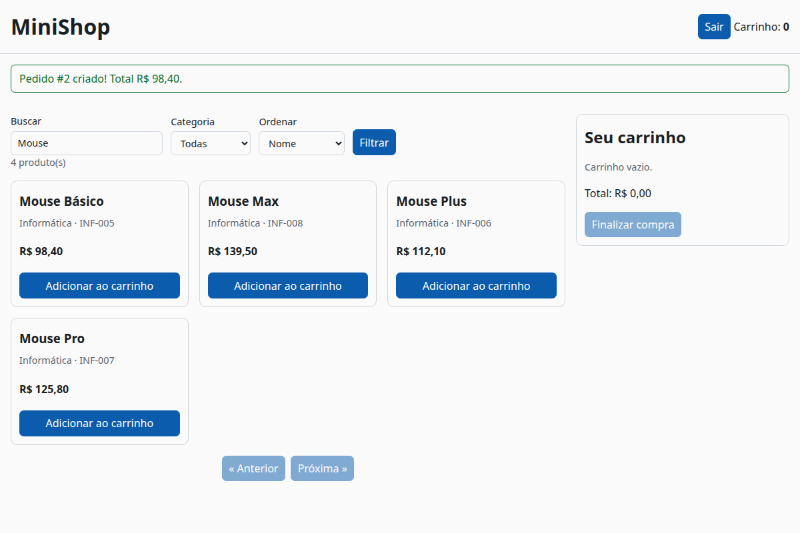

# 14. Front-end simples consumindo a API do MiniShop

> ⏱️ ~1h30 · Módulo 6 · Pré-requisitos: [4.05](../04-front-end-essencial/05-js-dom-eventos.md), [4.06](../04-front-end-essencial/06-js-promises-fetch.md), [4.07](../04-front-end-essencial/07-projeto-pagina-api-publica.md), [6.06](06-autenticacao-token-jwt.md), [6.09](09-paginacao-throttling.md), [6.11](11-cors.md), [6.13](13-graphql-grpc-api-completa.md)

> ✅ **Verificação.** Código executado em 2026-11-08: a API Django do laboratório (DRF 3.18.3) num `runserver`, o front servido por `python -m http.server` em **outra origem** e controlado por **Google Chrome 156 (headless) via Puppeteer**; os testes do módulo `api.js` rodaram no **Node 22** (`node --test`). As saídas e a captura de tela são reais. O laboratório da API fechou em **65 testes passando**.

## 🎯 Objetivos
Ao final desta aula você consegue:
- Construir um front-end **sem framework** (HTML + módulos ES) que lista produtos, busca, pagina, faz login e compra pela API
- Escrever um cliente HTTP (`api.js`) com **JWT**, **renovação automática (single-flight)**, **erros tipados**, *timeout* e **`Idempotency-Key`**
- Renderizar dados da API **sem `innerHTML`** (defesa contra XSS) e tratar os quatro estados (carregando, sucesso, vazio, erro)
- Testar o cliente com `node --test` e a página inteira com um **teste de ponta a ponta** em navegador real
- Diagnosticar os problemas típicos de integração (CORS com cabeçalho personalizado, `Retry-After`, `401`)

## 🤔 Por que isso importa
Uma API só vale quando alguém a consome. Esta aula amarra os módulos 4 e 6: o `fetch` e o DOM que você já viu agora conversam com uma API real, com autenticação, paginação, erros padronizados e CORS. Em vaga de júnior, “integro o front à API com tratamento de erro e token” é o dia a dia; e ver o que **só aparece no navegador** (um cabeçalho bloqueado, um token expirando) é o que ensina de verdade.

## 💡 Intuição (explicação simples)
O front é o **balcão de atendimento** e a API é a **cozinha**. O atendente (JavaScript) anota o pedido, leva à cozinha **com o crachá do cliente** (token) e traduz as respostas para o cliente: “pronto”, “acabou o ingrediente” (422), “seu crachá venceu, vou renovar sem incomodar você” (refresh), “a cozinha está lotada, volte em 1 minuto” (429). Um bom atendente **nunca** lê em voz alta o bilhete da cozinha como se fosse uma instrução (XSS): trata tudo como texto.

## 🔬 Como funciona por dentro
```mermaid
flowchart LR
    subgraph Navegador
      H[index.html] --> M[main.js<br/>eventos e DOM]
      M --> A[api.js<br/>fetch + JWT + erros]
      A --> S[session.js<br/>tokens em sessionStorage]
      M --> U[ui.js<br/>el(), moeda(), mensagens]
    end
    A -- "HTTPS + Authorization: Bearer<br/>Idempotency-Key" --> API[(API MiniShop<br/>outra origem: CORS)]
```
- **Estrutura:** `index.html` (semântico, acessível), `style.css` (variáveis, modo escuro, responsivo), `js/session.js` (tokens), `js/api.js` (todas as chamadas HTTP), `js/ui.js` (funções de apresentação), `js/main.js` (eventos e DOM). **Sem build**: módulos ES nativos (`<script type="module">`).
- **Camadas do front** (a mesma ideia de “serviço” da API): `main.js` não chama `fetch`; só chama `api.carrinho()`. Todo o conhecimento de HTTP (cabeçalhos, tokens, formato de erro) fica em **um** arquivo, que dá para testar sem navegador.
- **Cliente HTTP (`api.js`):**
  - adiciona `Authorization: Bearer` quando a chamada é autenticada;
  - **`AbortController` + *timeout*** (10 s): sem isso, uma API travada deixa a tela “carregando” para sempre;
  - converte **todo** erro em um `ApiError` com `status`, `code`, `detail` e `fields`, seguindo o formato da aula 6.05 (`{campo:[...]}` para validação; `{detail, code}` para o resto), mais `status 0` para rede/*timeout*;
  - **renovação automática:** em `401` com `code: "token_not_valid"` tenta **uma** vez o `refresh`, guarda o refresh **rotacionado**, e repete a chamada; se o refresh falha, limpa a sessão e lança `session_expired` (a tela reabre o login).
- **Single-flight.** Se três chamadas recebem `401` ao mesmo tempo, **uma só** renova o token e as outras esperam e reaproveitam (uma variável de módulo guarda a promessa em andamento). Sem isso, o 2º refresh usaria um refresh já invalidado pela **rotação** (aula 6.06) e o usuário seria deslogado sem motivo.
- **Onde guardar os tokens?** Opções e riscos:
  | Onde | Vantagem | Risco |
  |---|---|---|
  | memória (variável) | não persiste, o XSS tem janela menor | some ao recarregar a página |
  | `sessionStorage` (usado aqui) | some ao fechar a aba; simples | **legível por qualquer JavaScript da página**: um XSS rouba os tokens |
  | `localStorage` | persiste entre abas/sessões | idem, por mais tempo |
  | *cookie* `HttpOnly` + `SameSite` | JavaScript **não** lê | traz o CSRF de volta; exige mesmo domínio/CORS com credenciais |
  A escolha do curso é `sessionStorage` + **defesa forte contra XSS** (sem `innerHTML`, CSP no módulo de segurança) + access curto (15 min). Num produto real, avalie *cookies* `HttpOnly` com o front e a API no mesmo domínio.
- **XSS na renderização.** Tudo que vem da API entra por **`textContent`/`createElement`**; a função `el()` só aceita *strings* como nós de **texto**. A página de teste traz um produto malicioso cujo nome é HTML com `onerror`, e o resultado mostra o texto literal, sem executar nada.
- **`Idempotency-Key` no cliente.** O botão “Finalizar compra” gera um UUID (`crypto.randomUUID()`) **por intenção de compra** e o **mantém** enquanto a tentativa for incerta (erro de rede ou `429`): se o usuário clicar de novo ou o app repetir a chamada, o servidor devolve o **mesmo** pedido. Depois do sucesso, ou de um erro definitivo, a chave é descartada e a próxima compra usa outra.
- **Quatro estados** em cada região de dados: carregando (`aria-busy`), sucesso, vazio (“Nenhum produto encontrado”) e erro (com “Tentar de novo”).
- **Acessibilidade (aula 4.08):** HTML semântico, `label`s, `role="status"`/`aria-live` nos avisos, `<dialog>` para o login, foco visível, link “pular para o conteúdo”, `aria-label` nos controles de quantidade.

## 🛠️ Exemplo prático
**1. `session.js`: tokens**
```javascript
// Tokens em sessionStorage: somem ao fechar a aba. É um meio-termo (veja "Onde guardar os tokens?" na aula).
const CHAVE = "minishop.tokens";

function armazem() {
  try { return globalThis.sessionStorage ?? null; } catch { return null; }   // pode lançar em modo privado
}

export function lerTokens() {
  try { return JSON.parse(armazem()?.getItem(CHAVE) ?? "null"); } catch { return null; }
}

export function guardarTokens(tokens) {
  try { armazem()?.setItem(CHAVE, JSON.stringify(tokens)); } catch { /* sem armazenamento: vale só em memória */ }
}

export function limparTokens() {
  try { armazem()?.removeItem(CHAVE); } catch { /* ignora */ }
}

export const estaLogado = () => Boolean(lerTokens()?.access);
```
**2. `api.js`: o cliente da API**
```javascript
import { guardarTokens, lerTokens, limparTokens } from "./session.js";

export const BASE = globalThis.MINISHOP_API ?? "http://127.0.0.1:8131/api/v1";
const TIMEOUT_MS = 10_000;

export class ApiError extends Error {
  constructor({ status, code = "error", detail = "Erro inesperado.", fields = null, retryAfter = null }) {
    super(detail);
    Object.assign(this, { name: "ApiError", status, code, detail, fields, retryAfter });
  }
}

// Formato de erro da API (aula 6.05): {"campo": [...]} para validação; {"detail", "code"} para o resto.
async function lerErro(resposta) {
  let corpo = null;
  try { corpo = await resposta.json(); } catch { /* corpo vazio ou não-JSON */ }
  const retryAfter = resposta.headers.get("Retry-After");
  if (corpo && typeof corpo.detail === "string") {
    return new ApiError({ status: resposta.status, code: corpo.code, detail: corpo.detail, retryAfter });
  }
  if (corpo && typeof corpo === "object") {
    return new ApiError({ status: resposta.status, code: "validation_error", detail: "Corrija os campos destacados.", fields: corpo });
  }
  return new ApiError({ status: resposta.status, detail: `Falha (HTTP ${resposta.status}).` });
}

async function enviar(url, { metodo = "GET", corpo, token, cabecalhos = {} } = {}) {
  const ctl = new AbortController();
  const timer = setTimeout(() => ctl.abort(), TIMEOUT_MS);
  try {
    const resposta = await fetch(url, {
      method: metodo,
      signal: ctl.signal,
      headers: {
        Accept: "application/json",
        ...(corpo !== undefined && { "Content-Type": "application/json" }),
        ...(token && { Authorization: `Bearer ${token}` }),
        ...cabecalhos,
      },
      body: corpo === undefined ? undefined : JSON.stringify(corpo),
    });
    if (!resposta.ok) throw await lerErro(resposta);
    return resposta.status === 204 ? null : await resposta.json();
  } catch (e) {
    if (e instanceof ApiError) throw e;
    if (e.name === "AbortError") throw new ApiError({ status: 0, code: "timeout", detail: "A API demorou demais para responder." });
    throw new ApiError({ status: 0, code: "network_error", detail: "Sem conexão com a API (ou bloqueado por CORS)." });
  } finally {
    clearTimeout(timer);
  }
}

// "Single-flight": várias chamadas que recebem 401 ao mesmo tempo compartilham UM único refresh.
let refreshEmAndamento = null;

function renovar() {
  refreshEmAndamento ??= (async () => {
    const tokens = lerTokens();
    if (!tokens?.refresh) throw new ApiError({ status: 401, code: "not_authenticated", detail: "Faça login novamente." });
    try {
      const novo = await enviar(`${BASE}/auth/token/refresh/`, { metodo: "POST", corpo: { refresh: tokens.refresh } });
      guardarTokens({ access: novo.access, refresh: novo.refresh ?? tokens.refresh });   // a API rotaciona o refresh
    } catch (e) {
      limparTokens();
      throw new ApiError({ status: 401, code: "session_expired", detail: "Sua sessão expirou. Entre novamente." });
    }
  })().finally(() => { refreshEmAndamento = null; });
  return refreshEmAndamento;
}

export async function requisitar(caminhoOuUrl, opcoes = {}) {
  const url = caminhoOuUrl.startsWith("http") ? caminhoOuUrl : `${BASE}${caminhoOuUrl}`;
  const { autenticado = true, ...resto } = opcoes;
  const tentar = () => enviar(url, { ...resto, token: autenticado ? lerTokens()?.access : undefined });
  try {
    return await tentar();
  } catch (e) {
    const tokenInvalido = e instanceof ApiError && e.status === 401 && e.code === "token_not_valid";
    if (!autenticado || !tokenInvalido) throw e;
    await renovar();                 // se falhar, lança session_expired
    return tentar();                 // uma segunda e última tentativa
  }
}

export async function entrar(username, password) {
  const tokens = await requisitar("/auth/token/", { metodo: "POST", corpo: { username, password }, autenticado: false });
  guardarTokens(tokens);
}

export const sair = async () => {
  const tokens = lerTokens();
  limparTokens();
  if (tokens?.refresh) {                                   // invalida o refresh no servidor (melhor esforço)
    try { await enviar(`${BASE}/auth/logout/`, { metodo: "POST", corpo: { refresh: tokens.refresh } }); } catch { /* ok */ }
  }
};

export const api = {
  produtos: (params = {}) => requisitar(`/products/?${new URLSearchParams(params)}`, { autenticado: false }),
  categorias: () => requisitar("/categories/", { autenticado: false }),
  carrinho: () => requisitar("/cart/"),
  adicionar: (product, quantity = 1) => requisitar("/cart/items/", { metodo: "POST", corpo: { product, quantity } }),
  alterarQuantidade: (itemId, quantity) => requisitar(`/cart/items/${itemId}/`, { metodo: "PATCH", corpo: { quantity } }),
  remover: (itemId) => requisitar(`/cart/items/${itemId}/`, { metodo: "DELETE" }),
  finalizarPedido: (chave) => requisitar("/orders/", { metodo: "POST", cabecalhos: { "Idempotency-Key": chave } }),
  pedidos: () => requisitar("/orders/"),
};
```
**3. `ui.js`: apresentação segura**
```javascript
// Funções puras de apresentação. REGRA: dado vindo da API entra SEMPRE por textContent/createElement, nunca por innerHTML.
export const moeda = (decimalComoTexto) =>
  new Intl.NumberFormat("pt-BR", { style: "currency", currency: "BRL" }).format(Number(decimalComoTexto));   // só para EXIBIR

export function el(tag, atributos = {}, ...filhos) {
  const no = document.createElement(tag);
  for (const [k, v] of Object.entries(atributos)) {
    if (k === "class") no.className = v;
    else if (k.startsWith("on")) no.addEventListener(k.slice(2), v);
    else no.setAttribute(k, v);
  }
  no.append(...filhos);                      // strings viram nós de TEXTO (sem interpretar HTML)
  return no;
}

export function aviso(mensagem, tipo = "info") {
  const area = document.getElementById("avisos");
  const p = el("p", { class: `aviso ${tipo}` }, mensagem);
  area.replaceChildren(p);
  return p;
}

export function mensagemDeErro(e) {
  if (e.fields) return Object.entries(e.fields).map(([campo, msgs]) => `${campo}: ${[].concat(msgs).join(" ")}`).join(" | ");
  if (e.code === "throttled" && e.retryAfter) return `Muitas tentativas. Tente de novo em ${e.retryAfter} s.`;
  return e.detail ?? "Algo deu errado.";
}
```
**4. `main.js`: a página**
```javascript
import { api, ApiError, entrar, requisitar, sair } from "./api.js";
import { estaLogado } from "./session.js";
import { aviso, el, mensagemDeErro, moeda } from "./ui.js";

const $ = (id) => document.getElementById(id);
const estado = { urlAtual: null };

// ---------- catálogo ----------
async function carregarCatalogo(url = null) {
  const lista = $("produtos");
  lista.setAttribute("aria-busy", "true");
  lista.replaceChildren(el("li", { class: "estado" }, "Carregando…"));
  try {
    const params = { search: $("busca").value.trim(), category: $("categoria").value, ordering: $("ordem").value };
    for (const k of Object.keys(params)) if (!params[k]) delete params[k];
    const dados = url ? await requisitar(url, { autenticado: false }) : await api.produtos(params);
    estado.urlAtual = url;
    desenharProdutos(dados);
  } catch (e) {
    lista.replaceChildren(el("li", { class: "estado erro", role: "alert" }, mensagemDeErro(e), " ",
      el("button", { type: "button", onclick: () => carregarCatalogo(url) }, "Tentar de novo")));
  } finally {
    lista.removeAttribute("aria-busy");
  }
}

function desenharProdutos(dados) {
  const lista = $("produtos");
  if (dados.results.length === 0) {
    lista.replaceChildren(el("li", { class: "estado" }, "Nenhum produto encontrado."));
  } else {
    lista.replaceChildren(...dados.results.map((p) => el("li", { class: "card", "data-sku": p.sku },
      el("h3", {}, p.name),
      el("p", { class: "suave" }, `${p.category.name} · ${p.sku}`),
      el("p", { class: "preco" }, moeda(p.price)),
      p.in_stock
        ? el("button", { type: "button", onclick: () => adicionar(p) }, "Adicionar ao carrinho")
        : el("span", { class: "suave" }, "Sem estoque"))));
  }
  $("resumo").textContent = `${dados.count} produto(s)`;
  $("anterior").disabled = !dados.previous;
  $("proxima").disabled = !dados.next;
  $("anterior").onclick = () => carregarCatalogo(dados.previous);
  $("proxima").onclick = () => carregarCatalogo(dados.next);
}

async function carregarCategorias() {
  try {
    const dados = await api.categorias();
    $("categoria").append(...dados.results.map((c) => el("option", { value: c.slug }, c.name)));
  } catch { /* o filtro simplesmente fica só com "Todas" */ }
}

// ---------- carrinho ----------
async function adicionar(produto) {
  if (!estaLogado()) { $("dlg-login").showModal(); return; }
  try {
    await api.adicionar(produto.id, 1);
    aviso(`“${produto.name}” adicionado ao carrinho.`, "ok");
    await atualizarCarrinho();
  } catch (e) { tratarErro(e); }
}

async function atualizarCarrinho() {
  if (!estaLogado()) { $("itens").replaceChildren(el("li", { class: "suave" }, "Entre para ver seu carrinho.")); $("contador").textContent = "0"; $("total").textContent = ""; $("finalizar").disabled = true; return; }
  try {
    const c = await api.carrinho();
    $("contador").textContent = String(c.count);
    $("total").textContent = `Total: ${moeda(c.total)}`;
    $("finalizar").disabled = c.items.length === 0;
    $("itens").replaceChildren(...(c.items.length ? c.items.map((i) => el("li", { "data-item": i.id },
      el("span", {}, `${i.product.name} × `),
      el("input", { type: "number", min: "0", max: String(i.product.stock), value: String(i.quantity), "aria-label": `Quantidade de ${i.product.name}`,
        onchange: (ev) => alterar(i.id, Number(ev.target.value)) }),
      el("span", {}, ` ${moeda(i.subtotal)} `),
      el("button", { type: "button", "aria-label": `Remover ${i.product.name}`, onclick: () => alterar(i.id, 0) }, "Remover")))
      : [el("li", { class: "suave" }, "Carrinho vazio.")]));
  } catch (e) { tratarErro(e); }
}

async function alterar(itemId, quantidade) {
  try { await api.alterarQuantidade(itemId, quantidade); } catch (e) { tratarErro(e); }
  await atualizarCarrinho();
}

// ---------- pedido ----------
let chaveDaCompra = null;     // UMA chave por intenção de compra: se o usuário clicar duas vezes ou a rede falhar, reaproveita

async function finalizar() {
  $("finalizar").disabled = true;
  chaveDaCompra ??= crypto.randomUUID();
  try {
    const pedido = await api.finalizarPedido(chaveDaCompra);
    chaveDaCompra = null;               // compra concluída: a próxima intenção usa outra chave
    aviso(`Pedido #${pedido.id} criado! Total ${moeda(pedido.total)}.`, "ok");
    await Promise.all([atualizarCarrinho(), carregarCatalogo(estado.urlAtual)]);
  } catch (e) {
    if (e.status !== 0 && e.status !== 429) chaveDaCompra = null;     // falha "definitiva": nova tentativa = nova intenção
    tratarErro(e);
    $("finalizar").disabled = false;
  }
}

// ---------- login ----------
async function enviarLogin(ev) {
  ev.preventDefault();
  const form = ev.target;
  $("erro-login").textContent = "";
  try {
    await entrar(form.username.value, form.password.value);
    form.reset();
    $("dlg-login").close();
    aviso("Login realizado.", "ok");
    await Promise.all([atualizarSessao(), atualizarCarrinho()]);
  } catch (e) {
    $("erro-login").textContent = mensagemDeErro(e);
  }
}

async function atualizarSessao() {
  $("btn-entrar").hidden = estaLogado();
  $("btn-sair").hidden = !estaLogado();
}

function tratarErro(e) {
  if (e instanceof ApiError && e.code === "session_expired") { atualizarSessao(); atualizarCarrinho(); $("dlg-login").showModal(); }
  aviso(mensagemDeErro(e), "erro");
}

// ---------- inicialização ----------
function iniciar() {
  $("filtros").addEventListener("submit", (ev) => { ev.preventDefault(); carregarCatalogo(); });
  $("btn-entrar").addEventListener("click", () => $("dlg-login").showModal());
  $("btn-sair").addEventListener("click", async () => { await sair(); await Promise.all([atualizarSessao(), atualizarCarrinho()]); aviso("Você saiu.", "info"); });
  $("form-login").addEventListener("submit", enviarLogin);
  $("cancelar-login").addEventListener("click", () => $("dlg-login").close());
  $("finalizar").addEventListener("click", finalizar);
  atualizarSessao();
  carregarCategorias();
  carregarCatalogo();
  atualizarCarrinho();
}

iniciar();
```
**5. `index.html` e `style.css`**
```html
<!doctype html>
<html lang="pt-BR">
<head>
  <meta charset="utf-8">
  <meta name="viewport" content="width=device-width, initial-scale=1">
  <title>MiniShop</title>
  <link rel="icon" href="data:,">
  <link rel="stylesheet" href="style.css">
</head>
<body>
  <a class="pular" href="#catalogo">Ir para o catálogo</a>
  <header>
    <h1>MiniShop</h1>
    <nav aria-label="Conta">
      <button id="btn-entrar" type="button">Entrar</button>
      <button id="btn-sair" type="button" hidden>Sair</button>
      <span>Carrinho: <strong id="contador">0</strong></span>
    </nav>
  </header>

  <p id="avisos" role="status" aria-live="polite"></p>

  <div class="layout">
    <main id="catalogo">
      <form id="filtros" role="search" aria-label="Filtros do catálogo">
        <label>Buscar <input id="busca" type="search" placeholder="nome, SKU…"></label>
        <label>Categoria <select id="categoria"><option value="">Todas</option></select></label>
        <label>Ordenar
          <select id="ordem">
            <option value="">Nome</option>
            <option value="price">Menor preço</option>
            <option value="-price">Maior preço</option>
            <option value="-created_at">Mais novos</option>
          </select>
        </label>
        <button type="submit">Filtrar</button>
      </form>
      <p id="resumo" class="suave"></p>
      <ul id="produtos" class="grade"></ul>
      <nav class="paginas" aria-label="Paginação">
        <button id="anterior" type="button" disabled>« Anterior</button>
        <button id="proxima" type="button" disabled>Próxima »</button>
      </nav>
    </main>

    <aside aria-labelledby="titulo-carrinho">
      <h2 id="titulo-carrinho">Seu carrinho</h2>
      <ul id="itens"></ul>
      <p id="total"></p>
      <button id="finalizar" type="button" disabled>Finalizar compra</button>
    </aside>
  </div>

  <dialog id="dlg-login" aria-labelledby="titulo-login">
    <form id="form-login" method="dialog">
      <h2 id="titulo-login">Entrar</h2>
      <label>Usuário <input name="username" autocomplete="username" required></label>
      <label>Senha <input name="password" type="password" autocomplete="current-password" required></label>
      <p id="erro-login" role="alert" class="erro"></p>
      <button type="submit">Entrar</button>
      <button type="button" id="cancelar-login">Cancelar</button>
    </form>
  </dialog>

  <script type="module" src="js/main.js"></script>
</body>
</html>
```
```css
:root { --fundo:#fafafa; --texto:#1b1f23; --suave:#5b6470; --borda:#d0d7de; --marca:#0b5cad; --ok:#0a6b2d; --erro:#b42318; }
@media (prefers-color-scheme: dark) { :root { --fundo:#14181d; --texto:#e8ecf0; --suave:#9aa5b1; --borda:#2f3944; --marca:#6cb0ff; --ok:#4cc27a; --erro:#ff8a80; } }
* { box-sizing: border-box; }
body { margin:0; font:16px/1.5 system-ui, sans-serif; background:var(--fundo); color:var(--texto); }
header { display:flex; justify-content:space-between; align-items:center; padding:.75rem 1rem; border-bottom:1px solid var(--borda); }
h1, h2, h3 { margin:.25rem 0; }
.pular { position:absolute; left:-999px; } .pular:focus { left:1rem; top:1rem; background:var(--fundo); padding:.5rem; }
.layout { display:grid; grid-template-columns:1fr 20rem; gap:1rem; padding:1rem; }
@media (max-width: 800px) { .layout { grid-template-columns:1fr; } }
form#filtros { display:flex; flex-wrap:wrap; gap:.75rem; align-items:end; }
label { display:grid; gap:.25rem; font-size:.9rem; }
input, select, button { font:inherit; padding:.4rem .6rem; border:1px solid var(--borda); border-radius:.4rem; background:var(--fundo); color:var(--texto); }
button { cursor:pointer; background:var(--marca); color:#fff; border-color:var(--marca); } button:disabled { opacity:.5; cursor:not-allowed; }
:focus-visible { outline:3px solid var(--marca); outline-offset:2px; }
.grade { list-style:none; padding:0; display:grid; grid-template-columns:repeat(auto-fill, minmax(14rem, 1fr)); gap:1rem; }
.card { border:1px solid var(--borda); border-radius:.6rem; padding:.75rem; display:grid; gap:.25rem; }
.preco { font-weight:700; } .suave { color:var(--suave); font-size:.9rem; margin:0; }
.estado { grid-column:1/-1; padding:1rem; } .erro { color:var(--erro); }
.aviso { margin:.5rem 1rem; padding:.5rem .75rem; border-radius:.4rem; border:1px solid var(--borda); }
.aviso.ok { border-color:var(--ok); color:var(--ok); } .aviso.erro { border-color:var(--erro); color:var(--erro); }
aside { border:1px solid var(--borda); border-radius:.6rem; padding:.75rem; align-self:start; }
aside ul { list-style:none; padding:0; } aside li { display:flex; gap:.4rem; align-items:center; flex-wrap:wrap; margin:.4rem 0; }
aside input[type=number] { width:4rem; }
dialog { border:1px solid var(--borda); border-radius:.6rem; background:var(--fundo); color:var(--texto); }
dialog form { display:grid; gap:.6rem; min-width:16rem; }
.paginas { display:flex; gap:.5rem; justify-content:center; margin:1rem 0; }
```
Para rodar (a API em `8131`, o front em `8200`, a origem liberada no CORS da aula 11):
```bash
uv run python manage.py migrate && uv run python manage.py seed
uv run python manage.py runserver 8131
cd frontend && python3 -m http.server 8200 --bind 127.0.0.1      # abra http://127.0.0.1:8200
```

**6. Testes do cliente com `node --test` (executados)**
Os testes substituem `fetch` por uma função falsa e usam um `sessionStorage` de mentira; não precisam de navegador nem de API:
```javascript
// frontend/test/api.test.js (trecho)
test("401 token_not_valid → renova UMA vez e repete a chamada com o novo token", async () => {
  guardarTokens({ access: "VELHO", refresh: "R1" });
  simular(
    json(401, { detail: "expirado", code: "token_not_valid" }),
    json(200, { access: "NOVO", refresh: "R2" }),
    json(200, { items: [], total: "0.00", count: 0 }),
  );
  const carrinho = await api.carrinho();
  assert.equal(carrinho.count, 0);
  assert.equal(chamadas.length, 3);
  assert.match(chamadas[1].url, /\/auth\/token\/refresh\/$/);
  assert.equal(chamadas[2].headers.Authorization, "Bearer NOVO");
  assert.deepEqual(lerTokens(), { access: "NOVO", refresh: "R2" });          // refresh rotacionado foi guardado
});

test("várias chamadas com 401 ao mesmo tempo compartilham um único refresh (single-flight)", async () => {
  guardarTokens({ access: "VELHO", refresh: "R1" });
  let refreshes = 0;
  globalThis.fetch = async (url, opcoes) => {
    if (url.endsWith("/auth/token/refresh/")) { refreshes++; await new Promise((r) => setTimeout(r, 20)); return json(200, { access: "NOVO", refresh: "R2" }); }
    return opcoes.headers.Authorization === "Bearer NOVO" ? json(200, { ok: 1 }) : json(401, { detail: "x", code: "token_not_valid" });
  };
  const resultados = await Promise.all([api.carrinho(), api.pedidos(), api.carrinho()]);
  assert.equal(resultados.length, 3);
  assert.equal(refreshes, 1);
});
```
```bash
cd frontend && echo '{"type":"module"}' > package.json && node --test test/api.test.js
```
```text
ok 1 - envia o Bearer quando há token e JSON no corpo
ok 2 - não envia Authorization em chamadas públicas
ok 3 - 204 devolve null
ok 4 - erro de validação (400) vira ApiError com fields
ok 5 - erro de regra (422) vira ApiError com detail e code
ok 6 - 429 guarda o Retry-After
ok 7 - falha de rede vira network_error (status 0)
ok 8 - 401 token_not_valid → renova UMA vez e repete a chamada com o novo token
ok 9 - várias chamadas com 401 ao mesmo tempo compartilham um único refresh (single-flight)
ok 10 - se o refresh falha: limpa a sessão e lança session_expired
ok 11 - 401 em chamada pública NÃO tenta refresh
ok 12 - finalizarPedido envia o cabeçalho Idempotency-Key
# tests 12
# pass 12
# fail 0
```
Os 12 testes cobrem: Bearer e JSON no corpo, chamadas públicas **sem** `Authorization`, `204` → `null`, erro `400` com `fields`, erro `422` com `detail`/`code`, `429` com `Retry-After`, falha de rede (`status 0`), refresh automático, **single-flight**, refresh que falha (sessão limpa e `session_expired`), `401` público **sem** refresh e o cabeçalho `Idempotency-Key`. (O arquivo completo tem os 12; acima só aparecem dois como ilustração.)

**7. Teste de ponta a ponta no Chrome (executado)**
Um script Puppeteer abre a página como um usuário e confere cada passo:
```javascript
// e2e.mjs (trecho; o arquivo completo faz os 15 passos abaixo)
const browser = await puppeteer.launch({ executablePath: "/usr/bin/google-chrome", headless: "new", args: ["--no-sandbox"] });
const page = await browser.newPage();
await page.goto("http://127.0.0.1:8200/index.html");
await page.waitForSelector("#produtos .card");
await page.type("#busca", "mouse");
await page.click("#filtros button[type=submit]");
await esperarTexto("#resumo", "^4 produto");
// ... login, carrinho, pedido, XSS, recarga
```
```bash
cd e2e && npm i puppeteer-core && node e2e.mjs minishop.png
```
```text
OK  catálogo carrega com 20 cards (1ª página)  → 62 produto(s)
OK  categorias carregadas no filtro
OK  busca 'mouse' → 4 produtos
OK  paginação: botão 'Anterior' habilitado na página 2
OK  XSS: produto com  aparece como TEXTO (nenhuma  criada)  → título da página: MiniShop
OK  XSS: o código malicioso não executou (título continua 'MiniShop')
OK  XSS: o texto do nome é exibido literalmente
OK  adicionar sem login abre o diálogo de login
OK  senha errada mostra o erro da API no diálogo  → Usuário e/ou senha incorreto(s)
OK  login correto fecha o diálogo e mostra 'Sair'
OK  adicionar ao carrinho atualiza o contador (1) e o total  → Total: R$ 98,40
OK  finalizar cria o pedido e mostra a confirmação  → Pedido #2 criado! Total R$ 98,40.
OK  carrinho esvaziado depois do pedido
OK  recarregar a página mantém a sessão (sessionStorage)
OK  nenhum erro no console do navegador
```

Repare em três verificações:
- **XSS:** o produto `XSS-001`, cujo nome é ``, aparece **como texto literal**, nenhuma `` foi criada e o título da página continuou `MiniShop`. Se o front usasse `innerHTML`, o código teria executado.
- **Login com senha errada** mostra a mensagem da API (“Usuário e/ou senha incorreto(s)”) dentro do diálogo, e o login correto fecha o diálogo e troca o botão para “Sair”.
- **Recarregar a página mantém a sessão** (os tokens estão em `sessionStorage`); numa nova aba o usuário precisaria entrar de novo.

**8. O bug que só o navegador mostrou (CORS e cabeçalho personalizado)**
Na primeira execução, o passo “finalizar compra” **travou**: nenhum pedido foi criado e a API só registrou o preflight:
```text
"OPTIONS /api/v1/orders/ HTTP/1.1" 200 0          ← preflight respondido...
                                                    (...e NENHUM "POST /api/v1/orders/" depois dele)
```
O motivo: o front envia o cabeçalho **personalizado** `Idempotency-Key`, e o preflight pergunta se ele é permitido. A resposta do `django-cors-headers` listava só os cabeçalhos padrão:
```text
access-control-allow-headers: accept, authorization, content-type, user-agent, x-csrftoken, x-requested-with
```
Sem `idempotency-key` na lista, o navegador **cancelou** o `POST`. A API, os testes de API e o `curl` estavam todos corretos; **só o navegador** aplica essa regra (aula 6.11). A correção, e o teste que a protege:
```python
# config/settings.py
from corsheaders.defaults import default_headers

CORS_ALLOW_HEADERS = (*default_headers, "idempotency-key")                   # o preflight passa a liberar o cabeçalho
CORS_EXPOSE_HEADERS = ["Location", "Retry-After", "Idempotent-Replayed"]     # o JS pode LER estes cabeçalhos da resposta
```
```python
def test_preflight_libera_o_cabecalho_idempotency_key():
    r = APIClient().options("/api/v1/orders/", HTTP_ORIGIN=PERMITIDA, HTTP_ACCESS_CONTROL_REQUEST_METHOD="POST",
                            HTTP_ACCESS_CONTROL_REQUEST_HEADERS="authorization,idempotency-key")
    assert "idempotency-key" in r["Access-Control-Allow-Headers"]
    assert "Idempotent-Replayed" in r["Access-Control-Expose-Headers"]
```
**Regra:** todo cabeçalho personalizado que o front enviar (`Idempotency-Key`, `X-Request-ID`…) precisa estar em `CORS_ALLOW_HEADERS`; todo cabeçalho de resposta que o front precisar ler precisa estar em `CORS_EXPOSE_HEADERS`. Sem um teste de ponta a ponta no navegador, esse tipo de falha só aparece com o usuário.

Outros dois detalhes que o E2E revelou e que viraram ajustes: a página pedia `/favicon.ico` e recebia `404` (resolvido com `<link rel="icon" href="data:,">`), e o script de teste lia o aviso **antes** de o carrinho terminar de atualizar (corrido com `esperarTexto`): testes de interface devem **esperar pela condição**, não presumir a ordem.

## 🧠 Pausa para lógica
**Problema (retry com `Retry-After` e backoff).** Escreva `comRetry(fn, opções)` que repete `fn` em erros **transitórios** (`status` 0, 429, 502, 503, 504), respeita `retryAfter` (em segundos) quando existir e, senão, usa *backoff* exponencial (100 ms, 200 ms, 400 ms…). Erros como `422` **não** são repetidos. Receba a função de espera por parâmetro para testar sem esperar de verdade.

<details><summary>Dica</summary>
Um laço <code>for (let n = 0; ; n++)</code> com <code>try/catch</code>: se <code>n + 1 &gt;= tentativas</code> ou o erro não é repetível, relance; senão <code>await dormir(atraso(n, e))</code> e tente de novo. A função de espera injetada permite capturar os tempos em vez de dormir.
</details>

<details><summary>Solução comentada</summary>

```javascript
export async function comRetry(fn, {
  tentativas = 4,
  repetivel = (e) => [0, 429, 502, 503, 504].includes(e.status),          // erros transitórios
  atraso = (n, e) => (e.retryAfter ? Number(e.retryAfter) * 1000 : 100 * 2 ** n),   // respeita Retry-After; senão, backoff exponencial
  dormir = (ms) => new Promise((r) => setTimeout(r, ms)),
} = {}) {
  for (let n = 0; ; n++) {
    try {
      return await fn(n);
    } catch (e) {
      if (n + 1 >= tentativas || !repetivel(e)) throw e;
      await dormir(atraso(n, e));
    }
  }
}

// --- demonstração com um relógio falso: nada espera de verdade ---
const esperas = [];
const dormir = async (ms) => { esperas.push(ms); };
const erro = (status, extra = {}) => Object.assign(new Error("falha"), { status, ...extra });

let n = 0;
const r1 = await comRetry(async () => { if (++n < 3) throw erro(503); return "ok"; }, { dormir });
console.log("503, 503, depois sucesso →", r1, "| esperas:", esperas.splice(0));

n = 0;
const r2 = await comRetry(async () => { if (++n < 2) throw erro(429, { retryAfter: "60" }); return "ok"; }, { dormir });
console.log("429 com Retry-After: 60  →", r2, "| esperas:", esperas.splice(0));

n = 0;
try { await comRetry(async () => { n++; throw erro(422); }, { dormir }); } catch (e) { console.log("422 (regra de negócio)   → não repete; tentativas:", n); }

n = 0;
try { await comRetry(async () => { n++; throw erro(0); }, { dormir, tentativas: 3 }); } catch (e) { console.log("rede fora do ar          → desiste após", n, "tentativas | esperas:", esperas.splice(0)); }
```
```text
503, 503, depois sucesso → ok | esperas: [ 100, 200 ]
429 com Retry-After: 60  → ok | esperas: [ 60000 ]
422 (regra de negócio)   → não repete; tentativas: 1
rede fora do ar          → desiste após 3 tentativas | esperas: [ 100, 200 ]
```
(Executado com Node 22 em 2026-11-08.) **Cuidado:** repetir automaticamente só é seguro em operações **idempotentes**. Um `POST /orders/` sem `Idempotency-Key` **não** pode ser repetido às cegas (aula 6.01); por isso o `finalizarPedido` carrega a chave.
</details>

## ⚠️ Erros comuns e boas práticas
| Mensagem / sintoma | Causa | Solução |
|---|---|---|
| Console: `blocked by CORS policy: Request header field idempotency-key is not allowed by Access-Control-Allow-Headers in preflight response` | Cabeçalho personalizado não liberado | `CORS_ALLOW_HEADERS = (*default_headers, "idempotency-key")` |
| `TypeError: Failed to fetch` e nada mais | CORS, rede, API fora do ar ou *mixed content* | Aba **Rede**: o `OPTIONS`? o status? há `access-control-*`? |
| JavaScript não lê `Location`/`Idempotent-Replayed` | Cabeçalho de resposta não exposto | `CORS_EXPOSE_HEADERS` |
| Usuário é deslogado “do nada” a cada ~15 min | Access expirou e o refresh não foi tentado, ou tentado em paralelo | Renovação automática com **single-flight** |
| `401` em laço infinito | Repetir depois do refresh sem limite | Uma única nova tentativa (como em `requisitar`) |
| Aviso “Pedido criado” e carrinho ainda cheio | Atualização da tela fora de ordem | Atualizar o estado depois da resposta; testar com espera por condição |
| Dois pedidos após clique duplo | Sem `Idempotency-Key` / botão ativo durante a chamada | Chave por intenção + desabilitar o botão |
| `innerHTML = \`<li>${p.name}</li>\`` | XSS por dado da API | `textContent`/`createElement` (`el()`) |
| `JSON.parse` quebra com corpo vazio (`204`) | Assumir que toda resposta tem JSON | Tratar `204` e corpo não-JSON |
| Página “carregando” para sempre | Sem *timeout* | `AbortController` |
| `Number("59.90") * 3` exibido como `179.70000000000002` | Cálculo de dinheiro em ponto flutuante no cliente | Só **exibir** valores; os cálculos vêm da API (strings decimais) |
| Token no `localStorage` + XSS = conta roubada | Armazenamento legível por JS | Evitar XSS; tokens curtos; considerar cookie `HttpOnly` |

- **Nunca** calcule total, desconto ou estoque no front como fonte de verdade: o servidor decide (aula 5.16); o front apenas **mostra**.
- Mostre a mensagem do **servidor** (`detail`) quando ela é pensada para o usuário (422); para `5xx`/rede, uma mensagem genérica e opção de tentar de novo.
- Desabilite o botão durante a chamada e reabilite no `finally`.
- Trate `session_expired` reabrindo o login **sem perder** o que o usuário estava fazendo.
- Versione a URL base em **um** lugar (`BASE`), vinda da configuração do ambiente.

## 🧩 Exercícios
**1. Fixação**
(a) Por que o refresh precisa ser *single-flight*? (b) Por que `textContent` e não `innerHTML`? (c) Quando a mesma `Idempotency-Key` deve ser reutilizada e quando descartada? (d) Por que o preflight bloqueou o `POST` e por que `curl` não percebeu?

<details><summary>Solução</summary>

(a) A rotação invalida o refresh usado; um segundo refresh em paralelo usaria um token já inválido e deslogaria o usuário. (b) `innerHTML` interpreta o texto como HTML (XSS); `textContent` trata como texto. (c) Reutilizada enquanto a tentativa for incerta (rede/429/timeout), para que a repetição não duplique; descartada após sucesso ou erro definitivo. (d) O navegador exige que o preflight autorize cabeçalhos personalizados; o servidor não os autorizava. `curl` não aplica CORS.
</details>

**2. Aplicação no projeto MiniShop** *(entrega do módulo 6)*
Entregue o front do MiniShop consumindo a API.

Critérios de pronto:
- [ ] `frontend/` com `index.html`, `style.css` e `js/` (`session.js`, `api.js`, `ui.js`, `main.js`), sem `innerHTML` com dados externos
- [ ] Catálogo com busca, categoria, ordenação e paginação (usando `next`/`previous`), com os quatro estados
- [ ] Login em `<dialog>`, logout, carrinho (alterar/remover) e finalizar compra com `Idempotency-Key`
- [ ] Renovação automática do token (single-flight) e tratamento de `session_expired`, `422`, `429` e rede
- [ ] `node --test` verde (≥ 12 testes do `api.js`) e um E2E em navegador real passando
- [ ] `CORS_ALLOW_HEADERS`/`CORS_EXPOSE_HEADERS` ajustados e testados na API
- [ ] Captura de tela em `docs/img/` e `docs/front.md` (decisão de armazenamento dos tokens e riscos)
- [ ] Tag `v2.0-minishop-api` publicada

<details><summary>Solução de referência (página de pedidos)</summary>

```javascript
// api.js já expõe api.pedidos(); a tela:
async function carregarPedidos() {
  const lista = document.getElementById("pedidos");
  try {
    const dados = await api.pedidos();                     // paginação por CURSOR: sem count, só next/previous
    lista.replaceChildren(...dados.results.map((p) => el("li", {},
      `Pedido #${p.id} · ${p.status} · ${moeda(p.total)} · ${new Date(p.created_at).toLocaleString("pt-BR")}`)));
    if (dados.results.length === 0) lista.replaceChildren(el("li", { class: "suave" }, "Você ainda não tem pedidos."));
  } catch (e) { lista.replaceChildren(el("li", { class: "erro", role: "alert" }, mensagemDeErro(e))); }
}
```
Lembre: `created_at` vem em ISO 8601 UTC (`...Z`); `toLocaleString("pt-BR")` converte para o fuso do navegador, só para exibir.
</details>

**3. Desafio (opcional)**
Troque o armazenamento do token por **cookie `HttpOnly`**: sirva o front e a API pelo **mesmo domínio** (um proxy simples), faça a API definir o cookie no login e proteja contra CSRF (token no cabeçalho ou `SameSite=Strict`). Compare, em uma tabela, o que melhorou e o que piorou em segurança e em complexidade.

## 🎤 Na entrevista
- **Como o front lida com token expirado?** Ao receber `401` por token inválido, tenta renovar uma única vez com o refresh (compartilhando a renovação entre chamadas simultâneas), repete a chamada e, se o refresh falhar, limpa a sessão e leva o usuário ao login.
- **Onde guardar o JWT no navegador?** Cada opção troca riscos: `localStorage`/`sessionStorage` são legíveis por JavaScript (XSS); cookie `HttpOnly` não é, mas exige proteção contra CSRF e mesmo domínio. Em qualquer caso: tokens curtos, HTTPS e **evitar XSS**.
- **Por que uma chamada funciona no Postman e falha no navegador?** O navegador aplica CORS e outras políticas; é preciso olhar o preflight (`OPTIONS`) e os cabeçalhos `Access-Control-*`, inclusive os de cabeçalhos personalizados.
- **Como evitar XSS ao exibir dados da API?** Inserir como texto (`textContent`, nós de texto), nunca como HTML; sanitizar quando for inevitável aceitar HTML; e reforçar com CSP.

## 📚 Para ir além
- 📄 Referência: [Usando Fetch (MDN)](https://developer.mozilla.org/pt-BR/docs/Web/API/Fetch_API/Using_Fetch). Cabeçalhos, corpo, erros.
- 📄 Referência: [AbortController (MDN, em inglês)](https://developer.mozilla.org/en-US/docs/Web/API/AbortController). Cancelar e fazer *timeout*.
- 📄 Referência: [Elemento `<dialog>` (MDN)](https://developer.mozilla.org/pt-BR/docs/Web/HTML/Reference/Elements/dialog). Diálogo nativo e acessível.
- 📄 Referência: [Web Storage API (MDN)](https://developer.mozilla.org/pt-BR/docs/Web/API/Web_Storage_API). `sessionStorage` × `localStorage`.
- 📄 Documentação: [Node.js — test runner](https://nodejs.org/api/test.html). `node --test`.
- 📄 Documentação: [Puppeteer](https://pptr.dev/). Automação de navegador para testes de ponta a ponta.
- 📑 Artigo/tutorial: [OWASP — DOM based XSS Prevention](https://cheatsheetseries.owasp.org/cheatsheets/DOM_based_XSS_Prevention_Cheat_Sheet.html). Como inserir dados com segurança.
- 📄 Documentação: [HTMX](https://htmx.org/docs/). A alternativa “HTML pelo servidor” da aula 4.08.
- 🏋️ Prática extra: adicione a tela “Meus pedidos” com paginação por cursor e o botão “Cancelar”.

> Links verificados em 2026-11-08 (HTTP 200).

## ✅ Checklist da aula
- [ ] Front sem framework consumindo a API, com login, carrinho e pedido
- [ ] `api.js` com Bearer, refresh single-flight, erros tipados, timeout e `Idempotency-Key`
- [ ] Nenhum dado externo via `innerHTML` (e o teste do produto malicioso passa)
- [ ] `node --test` e E2E no navegador executados
- [ ] Entendi o bug do cabeçalho personalizado no CORS e como preveni-lo
