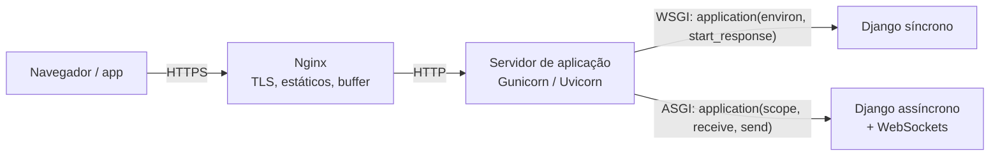

# 5. WSGI × ASGI

> ⏱️ ~1h30 · Módulo 7 · Pré-requisitos: [7.01](01-bloqueante-io-cpu.md), [7.02](02-threads-processos-gil.md), [7.03](03-asyncio.md), [5.01 (ciclo da requisição e middlewares)](../05-django/01-projeto-apps-mvt.md)

> ✅ **Verificação.** Código executado em 2026-11-08 com **Python 3.13, Django 5.2.19, Gunicorn 26.2.0 e Uvicorn 0.54.0**, num computador de 12 núcleos. O *benchmark* sobe cada servidor de verdade e dispara 20 requisições simultâneas com `httpx`. **As saídas dos exemplos 2 e 3 foram geradas ao montar a aula**; a tabela do exemplo 1 é a saída do `bench.py` (executado na mesma sessão; leva cerca de 40 s). Os tempos variam um pouco; as **proporções** não.

## 🎯 Objetivos
Ao final desta aula você consegue:
- Explicar o que são **WSGI** e **ASGI** (a interface entre servidor e aplicação), escrevendo uma aplicação mínima de cada
- Descrever os papéis de **Nginx**, **Gunicorn** e **Uvicorn** na frente do Django e escolher uma configuração de *workers*
- **Medir** quanta concorrência cada combinação servidor × tipo de *view* entrega, em vez de supor
- Explicar por que uma *view* `async` sob WSGI **não ajuda** e o que o Django faz com *views* síncronas sob ASGI
- Escrever um *middleware* ASGI (e um WSGI) e proteger o servidor com **limite de carga** (*load shedding*)

## 🤔 Por que isso importa
O `runserver` do desenvolvimento não é o que roda em produção. Em produção há um **servidor de aplicação** entre o navegador (ou o Nginx) e o seu código Django, e a escolha dele (e do número de *workers*, *threads*, tipo de *view*) define **quantos pedidos por segundo** você aguenta e **o que acontece quando uma chamada externa demora**. Entrevistas perguntam “o que é WSGI?”, “diferença para ASGI?” e “como você configuraria o Gunicorn?”; e o módulo 11 (Docker) vai precisar disso para escrever o `CMD` do contêiner.

## 💡 Intuição (explicação simples)
O servidor de aplicação é a **recepção do prédio** e o Django é o **escritório do andar**. WSGI e ASGI são o **protocolo entre a recepção e o escritório**: “quando chegar uma visita, entregue este formulário (a requisição) e traga de volta esta resposta”. No **WSGI**, a recepção entrega **uma visita por funcionário**: ele atende do começo ao fim, e se precisar esperar uma resposta de fora, **fica parado com a visita** (um funcionário por visita). No **ASGI**, o funcionário pode **deixar a visita aguardando** enquanto espera o telefone e atender outra (concorrência), e o prédio ganha **novos tipos de visita** que ficam por muito tempo (WebSocket).

## 🔬 Como funciona por dentro

- **WSGI** (*Web Server Gateway Interface*, PEP 3333, 2003): a aplicação é uma **função síncrona** `app(environ, start_response)`. O servidor entrega um dicionário `environ` (método, caminho, cabeçalhos como `HTTP_X_TESTE`, corpo) e a função devolve um **iterável de bytes**. **Uma requisição ocupa um *worker*/*thread* do começo ao fim**. Não suporta WebSocket nem *long polling* de forma natural.
- **ASGI** (*Asynchronous Server Gateway Interface*): a aplicação é uma **corrotina** `app(scope, receive, send)`. O `scope` descreve a conexão (`type` = `http`, `websocket` ou `lifespan`); `receive()` e `send()` trocam **mensagens/eventos** (`http.request`, `http.response.start`, `http.response.body`…). Suporta **WebSocket**, *streaming*, e muitas conexões em espera numa só *thread* (aula 03).
- **Middleware** em ambos é “uma aplicação que **envolve** outra”: em WSGI, uma função que chama a próxima `app`; em ASGI, uma corrotina que faz `await app(scope, receive, send)`. Os `MIDDLEWARE` do Django (aula 5.01) são a versão do Django dessa ideia.
- **Servidores:**
  | Servidor | Interface | Notas |
  |---|---|---|
  | `runserver` | WSGI/ASGI | **só desenvolvimento** (uma *thread* por requisição, sem robustez) |
  | **Gunicorn** | WSGI | gerenciador de **processos** (*pre-fork*); *workers* `sync` (1 req por vez), `gthread` (threads), `gevent` |
  | **Uvicorn** | ASGI | servidor assíncrono; pode rodar sozinho (`--workers N`) ou sob o Gunicorn |
  | Daphne / Hypercorn / Granian | ASGI | alternativas |
  | **Nginx** | proxy reverso | na frente: TLS, arquivos estáticos, *buffering* de clientes lentos, balanceamento |
- **Por que um proxy na frente?** Clientes lentos (3G) ocupariam um *worker* durante o envio; o Nginx **absorve** a conexão lenta e entrega a requisição pronta ao *worker*, que fica livre rápido.
- **Quantos *workers*?** A regra popular do Gunicorn é `2 × núcleos + 1`, mas é **heurística**: o certo depende de CPU × espera (aula 01). Cada *worker sync* é **um processo** (memória!); para muita espera por I/O, **threads** (`--threads`) ou ASGI rendem mais por MB de memória.
- **Django sob ASGI:** *views* **assíncronas** rodam direto no laço de eventos; *views* **síncronas** são executadas numa **thread** (`sync_to_async`) para não travar o laço. O Django dá a **cada requisição** o seu contexto de *thread* (por isso várias *views* síncronas **não** se serializam). Um **middleware síncrono** no meio da cadeia força a adaptação (com custo) das duas pontas.
- **Django sob WSGI:** uma *view* `async def` funciona (o Django cria um laço de eventos **para aquela requisição** e a executa até o fim), mas **não traz concorrência alguma**: o *worker* continua preso à requisição.
- **Outros parâmetros do Gunicorn que importam:** `--timeout` (mata *worker* travado; padrão 30 s), `--max-requests` (recicla *workers* para conter vazamento de memória), `--preload` (carrega o app antes do *fork*, economiza memória), `--graceful-timeout` (desligamento sem derrubar requisições). Em contêineres, o log vai para o `stdout` (aula 5.14).
- **Falhar rápido sob carga (*load shedding*):** quando o servidor está saturado, enfileirar tudo só **aumenta a latência de todos**; devolver `503` + `Retry-After` às excedentes preserva quem já está sendo atendido (e combina com o *backoff* do cliente, aula 04).

## 🛠️ Exemplo prático
**1. O experimento: quanta concorrência cada combinação entrega?** (`bench.py`)
O arquivo `config/views_demo.py` do laboratório tem duas *views* que **esperam 0,5 s** (como uma chamada a uma API externa):
```python
import asyncio
import time

from django.http import JsonResponse


def espera_sync(request):                       # view SÍNCRONA que espera 0,5 s (como uma chamada a API externa)
    time.sleep(0.5)
    return JsonResponse({"tipo": "sync"})


async def espera_async(request):                # view ASSÍNCRONA que espera 0,5 s sem bloquear o laço
    await asyncio.sleep(0.5)
    return JsonResponse({"tipo": "async"})
```
O `bench.py` sobe cada servidor de verdade (processo separado), aquece, dispara **20 requisições simultâneas** com `httpx.AsyncClient` e mede o tempo total:
```bash
uv add gunicorn uvicorn
LAB=$PWD uv run python bench.py
```
```text
20 requisições simultâneas; cada view espera 0,5 s
servidor / view                            tempo total       vazão
gunicorn WSGI, 1 worker sync                   10.04 s      2.0 req/s
gunicorn WSGI, 4 workers sync                   2.52 s      7.9 req/s
gunicorn WSGI, 1 worker, 20 threads             0.51 s     38.8 req/s
uvicorn ASGI, view SÍNCRONA                     0.54 s     37.1 req/s
uvicorn ASGI, view ASSÍNCRONA                   0.54 s     37.2 req/s
gunicorn WSGI, view ASSÍNCRONA                 10.06 s      2.0 req/s
```
Interpretação, linha a linha (20 requisições × 0,5 s = 10 s de espera acumulada):
1. **Gunicorn, 1 *worker sync*: 10,04 s (2 req/s).** Atende **uma de cada vez**: as outras 19 esperam na fila. É a soma das esperas.
2. **4 *workers sync*: 2,52 s (7,9 req/s).** Quatro processos dividem o trabalho (20 ÷ 4 × 0,5 s). Funciona, mas cada processo carrega o Django inteiro.
3. **1 *worker* com 20 *threads*: 0,51 s (38,8 req/s).** Para **esperar**, threads bastam e custam pouca memória (lembre da aula 02: o GIL é liberado na espera).
4. **Uvicorn ASGI, *view* síncrona: 0,54 s.** O Django executa cada *view* síncrona numa *thread* própria, então ela também **sobrepõe as esperas**. (Esperava-se que fossem serializadas; a medição mostrou o contrário: **meça antes de afirmar**.)
5. **Uvicorn ASGI, *view* assíncrona: 0,54 s.** Resultado equivalente, mas **sem uma *thread* por requisição**: é o que escala para milhares de conexões em espera.
6. **Gunicorn WSGI, *view* `async`: 10,06 s.** **Idêntico ao caso 1**: escrever `async def` sob WSGI **não dá concorrência**. A concorrência vem do **servidor**, não da palavra `async`.

Conclusão prática: para um sistema Django típico, **Gunicorn com algumas *threads*** (ou ASGI) resolve esperas de I/O sem reescrever o código; `async` de ponta a ponta só compensa quando há **muitas** conexões longas (WebSocket) ou **muitas** esperas por requisição; e **tirar a espera do caminho** (fila, aula 06) vence todos.

**2. WSGI e ASGI “nus”, com *middleware*** (`wsgi_asgi.py`)
```python
"""WSGI e ASGI sem framework: a interface entre o servidor e a aplicação, nua e crua."""
import asyncio
import json
import threading
import time
from wsgiref.simple_server import WSGIRequestHandler, make_server

import httpx
import uvicorn


# ------------------------------------------------------------------ WSGI: uma FUNÇÃO síncrona
def app_wsgi(environ, start_response):
    corpo = json.dumps({
        "metodo": environ["REQUEST_METHOD"],
        "caminho": environ["PATH_INFO"],
        "query": environ["QUERY_STRING"],
        "cabecalho_x": environ.get("HTTP_X_TESTE"),            # cabeçalhos viram HTTP_<NOME_EM_MAIUSCULAS>
    }).encode()
    start_response("200 OK", [("Content-Type", "application/json"), ("Content-Length", str(len(corpo)))])
    return [corpo]                                              # um iterável de bytes


# middleware WSGI = uma função que ENVOLVE outra aplicação WSGI
def tempo_wsgi(app):
    def novo(environ, start_response):
        t = time.perf_counter()
        def sr(status, headers, exc_info=None):
            headers.append(("X-Tempo-ms", f"{(time.perf_counter() - t) * 1000:.2f}"))
            return start_response(status, headers, exc_info)
        return app(environ, sr)
    return novo


# ------------------------------------------------------------------ ASGI: uma CORROTINA com (scope, receive, send)
EVENTOS = []


async def app_asgi(scope, receive, send):
    EVENTOS.append(f"scope: type={scope['type']} method={scope.get('method')} path={scope.get('path')}")
    if scope["type"] != "http":
        return
    evento = await receive()                                    # {"type": "http.request", "body": b"", "more_body": False}
    EVENTOS.append(f"receive: {evento['type']}")
    await asyncio.sleep(0.2)                                    # espera SEM bloquear o laço
    corpo = json.dumps({"metodo": scope["method"], "caminho": scope["path"], "esperou": "0,2 s sem bloquear"}).encode()
    await send({"type": "http.response.start", "status": 200,
                "headers": [(b"content-type", b"application/json"), (b"content-length", str(len(corpo)).encode())]})
    await send({"type": "http.response.body", "body": corpo})
    EVENTOS.append("send: http.response.start + http.response.body")


# middleware ASGI = uma corrotina que ENVOLVE outra aplicação ASGI
def tempo_asgi(app):
    async def novo(scope, receive, send):
        if scope["type"] != "http":
            return await app(scope, receive, send)
        t = time.perf_counter()
        async def send2(msg):
            if msg["type"] == "http.response.start":
                msg["headers"].append((b"x-tempo-ms", f"{(time.perf_counter() - t) * 1000:.0f}".encode()))
            await send(msg)
        await app(scope, receive, send2)
    return novo


class Mudo(WSGIRequestHandler):
    def log_message(self, *a):
        pass


# ------------------------------------------------------------------ execução
srv_w = make_server("127.0.0.1", 0, tempo_wsgi(app_wsgi), handler_class=Mudo)
threading.Thread(target=srv_w.serve_forever, daemon=True).start()
r = httpx.get(f"http://127.0.0.1:{srv_w.server_port}/produtos/?q=mouse", headers={"X-Teste": "oi"})
print("WSGI →", r.status_code, r.json())
print("       cabeçalho do middleware X-Tempo-ms:", r.headers["x-tempo-ms"])

config = uvicorn.Config(tempo_asgi(app_asgi), host="127.0.0.1", port=8151, log_level="error")
srv_a = uvicorn.Server(config)
threading.Thread(target=srv_a.run, daemon=True).start()
while not srv_a.started:
    time.sleep(0.05)
r = httpx.get("http://127.0.0.1:8151/produtos/")
print("\nASGI →", r.status_code, r.json())
print("       cabeçalho do middleware x-tempo-ms:", r.headers["x-tempo-ms"])
print("       o que o servidor entregou à aplicação:")
for e in EVENTOS:
    print("        ·", e)
srv_a.should_exit = True
srv_w.shutdown()
```
```bash
uv run python wsgi_asgi.py
```
```text
WSGI → 200 {'metodo': 'GET', 'caminho': '/produtos/', 'query': 'q=mouse', 'cabecalho_x': 'oi'}
       cabeçalho do middleware X-Tempo-ms: 0.02

ASGI → 200 {'metodo': 'GET', 'caminho': '/produtos/', 'esperou': '0,2 s sem bloquear'}
       cabeçalho do middleware x-tempo-ms: 201
       o que o servidor entregou à aplicação:
        · scope: type=lifespan method=None path=None
        · scope: type=http method=GET path=/produtos/
        · receive: http.request
        · send: http.response.start + http.response.body
```
- A aplicação **WSGI** é uma **função** que recebe um dicionário (`environ`) e devolve uma lista de bytes. O cabeçalho `X-Teste` chegou como `HTTP_X_TESTE`; o *middleware* **embrulhou** `start_response` para acrescentar `X-Tempo-ms`.
- A aplicação **ASGI** é uma **corrotina** que troca eventos. A lista mostra o que o Uvicorn entregou: primeiro um `scope` do tipo **`lifespan`** (início/fim do servidor), depois o `scope` `http`, o evento `http.request` e, na volta, `http.response.start` + `http.response.body`. O `await asyncio.sleep(0.2)` não bloqueou o laço, e o *middleware* mediu **201 ms**.
- É exatamente por esse contrato que o Django, o FastAPI (módulo 15) e o Starlette funcionam em qualquer servidor compatível.

**3. *Load shedding*: um *middleware* ASGI que protege o servidor** (`shed.py`)
```python
"""Middleware ASGI de 'load shedding': se há requisições demais em andamento, recusa as excedentes com 503 + Retry-After."""
import asyncio
import threading
import time

import httpx
import uvicorn


def limitar(app, maximo):
    em_andamento = 0

    async def novo(scope, receive, send):
        nonlocal em_andamento
        if scope["type"] != "http":
            return await app(scope, receive, send)
        if em_andamento >= maximo:                                   # sem vaga: falhar RÁPIDO é melhor que enfileirar sem fim
            corpo = b'{"detail":"servidor ocupado","code":"overloaded"}'
            await send({"type": "http.response.start", "status": 503,
                        "headers": [(b"content-type", b"application/json"), (b"retry-after", b"1"),
                                    (b"content-length", str(len(corpo)).encode())]})
            return await send({"type": "http.response.body", "body": corpo})
        em_andamento += 1
        try:
            await app(scope, receive, send)
        finally:
            em_andamento -= 1                                        # sempre libera a vaga, mesmo com erro
    return novo


async def lenta(scope, receive, send):
    if scope["type"] != "http":
        return
    await asyncio.sleep(0.5)
    await send({"type": "http.response.start", "status": 200, "headers": [(b"content-length", b"2")]})
    await send({"type": "http.response.body", "body": b"ok"})


srv = uvicorn.Server(uvicorn.Config(limitar(lenta, 4), host="127.0.0.1", port=8152, log_level="error"))
threading.Thread(target=srv.run, daemon=True).start()
while not srv.started:
    time.sleep(0.05)


async def disparar():
    async with httpx.AsyncClient() as c:
        return await asyncio.gather(*(c.get("http://127.0.0.1:8152/") for _ in range(10)))


t = time.perf_counter()
rs = asyncio.run(disparar())
codigos = sorted(r.status_code for r in rs)
print(f"10 requisições simultâneas, limite de 4 em andamento → {codigos.count(200)} × 200 e {codigos.count(503)} × 503 em {time.perf_counter() - t:.2f} s")
recusada = next(r for r in rs if r.status_code == 503)
print("exemplo de recusa:", recusada.status_code, recusada.json(), "| Retry-After:", recusada.headers["retry-after"])
srv.should_exit = True
```
```bash
uv run python shed.py
```
```text
10 requisições simultâneas, limite de 4 em andamento → 4 × 200 e 6 × 503 em 0.53 s
exemplo de recusa: 503 {'detail': 'servidor ocupado', 'code': 'overloaded'} | Retry-After: 1
```
Dez requisições simultâneas, **limite de 4 em andamento**: 4 receberam `200` e **6 foram recusadas na hora** com `503` e `Retry-After: 1`, **em ≈ 0,5 s no total**. Sem o limite, as 10 entrariam e **todas** ficariam lentas se o servidor estivesse no limite. O `try/finally` garante que a vaga seja devolvida mesmo quando a aplicação falha. Na prática, esse papel costuma ser do Nginx, do balanceador ou do *throttling* (aula 6.09); o exemplo mostra o **mecanismo**.

**4. Configuração de produção (o que vai no `CMD` do contêiner, módulo 11)**
```bash
# WSGI (o caso comum): 4 workers, 4 threads cada, reciclando workers e logando no stdout
gunicorn config.wsgi:application --bind 0.0.0.0:8000 --workers 4 --threads 4 \
         --timeout 30 --max-requests 1000 --max-requests-jitter 100 --access-logfile - --error-logfile -

# ASGI (WebSockets/async): Uvicorn direto, vários processos
uvicorn config.asgi:application --host 0.0.0.0 --port 8000 --workers 4 --no-server-header

# Arquivos estáticos e TLS: Nginx na frente (aula 5.13/11); NUNCA o runserver
```
Os valores (`4 × 4`) são ponto de partida: ajuste **medindo** (CPU, memória, latência, fila). Cuidado com o produto `workers × threads × conexões do banco` (aula 02: cada *thread* abre a sua).

## 🧠 Pausa para lógica
**Problema (um *middleware* ASGI de limite).** Escreva `limitar(app, maximo)` que conte as requisições HTTP **em andamento** e devolva `503` com `Retry-After` quando passar do máximo, sempre liberando a vaga no `finally`. Prove com 10 requisições simultâneas e limite 4.

<details><summary>Dica</summary>
Uma variável `em_andamento` (com <code>nonlocal</code>) incrementada antes de <code>await app(...)</code> e decrementada no <code>finally</code>. Como o laço é de uma <em>thread</em> só e não há <code>await</code> entre ler e incrementar, não precisa de <code>Lock</code>. Responda com os dois eventos ASGI (<code>http.response.start</code> e <code>http.response.body</code>).
</details>

<details><summary>Solução comentada</summary>

A solução é o `shed.py` do exemplo 3 (executado: 4 × 200 e 6 × 503). Observação: o contador funciona **sem trava** porque `asyncio` é cooperativo: a leitura e o incremento acontecem **sem `await` no meio**, então nenhuma outra corrotina intercala (compare com a corrida das *threads* na aula 02). Com vários processos (Uvicorn `--workers 4`), cada processo teria o seu contador: o limite global exigiria um contador compartilhado (Redis) ou o limite no Nginx.
</details>

## ⚠️ Erros comuns e boas práticas
| Mensagem / sintoma | Causa | Solução |
|---|---|---|
| `[CRITICAL] WORKER TIMEOUT (pid:...)` no Gunicorn | Uma requisição passou do `--timeout` (chamada externa lenta, cálculo longo) | Reduzir a espera (fila, timeout nas chamadas), ajustar `--timeout` conscientemente |
| Sistema lento com CPU baixa e *workers* ocupados | *Workers* `sync` presos esperando I/O | `--threads`, mais *workers*, ou tirar a espera do caminho (fila) |
| “Usei `async def` e não melhorou” | View async sob **WSGI** | Servir com ASGI (Uvicorn) ou aceitar que é só sintaxe |
| `SynchronousOnlyOperation` em view async | ORM síncrono no laço | `await Model.objects.aget(...)`, `sync_to_async` (aula 03) |
| Aviso “Synchronous middleware X adapted” / lentidão em ASGI | Middleware síncrono em cadeia assíncrona | Middlewares com `async_capable` ou removê-los |
| `django.db.utils.OperationalError: too many connections` / `FATAL: sorry, too many clients` | `workers × threads` > `max_connections` do banco | Reduzir, pool de conexões (PgBouncer), `CONN_MAX_AGE` |
| Memória cresce até o contêiner ser morto | Vazamento/fragmentação em processos longos | `--max-requests` com *jitter* |
| Estáticos lentos ou 404 em produção | Gunicorn não serve estáticos | WhiteNoise/Nginx (aula 5.13) |
| IP sempre `127.0.0.1` / HTTPS não detectado | Atrás de proxy sem cabeçalhos confiáveis | `X-Forwarded-For`/`X-Forwarded-Proto` e `SECURE_PROXY_SSL_HEADER` (aula 5.14), `--forwarded-allow-ips` |
| `RuntimeError: Event loop is closed` ao misturar `async_to_sync` | Laço criado/fechado no lugar errado | Seguir o padrão do Django; evitar `asyncio.run` dentro de views |
| Uvicorn com `--reload` em produção | Opção de desenvolvimento | Remover |

- **Escolha o servidor pelo problema:** CRUD tradicional → Gunicorn (WSGI) com poucas *threads*; WebSocket/*streaming*/muitas esperas → ASGI (Uvicorn).
- **Não misture sem motivo:** um projeto simples deve começar em WSGI. Migrar para ASGI é **trocar o servidor** e revisar *middlewares*, não reescrever tudo em `async`.
- **Nginx na frente** sempre que possível (TLS, estáticos, clientes lentos, *buffering*).
- **Meça** em ambiente parecido com o de produção: 20 requisições simultâneas mostraram, em segundos, o que a teoria só sugere.
- **Defina limites** (timeout do *worker*, tamanho do corpo, número de conexões) para que o sistema **degrade com elegância** em vez de cair.

## 🧩 Exercícios
**1. Fixação**
(a) Qual a assinatura de uma aplicação WSGI e de uma ASGI? (b) Por que uma *view* `async def` sob Gunicorn *sync* não deu concorrência? (c) Para que serve o Nginx na frente do Gunicorn? (d) O que `--max-requests` resolve?

<details><summary>Solução</summary>

(a) WSGI: `app(environ, start_response)` devolvendo um iterável de bytes; ASGI: `async app(scope, receive, send)`, trocando eventos. (b) O *worker* sync atende **uma requisição por vez**; o Django só cria um laço de eventos temporário dentro dela, sem permitir sobrepor requisições. (c) Termina TLS, serve estáticos, absorve clientes lentos (*buffering*) e balanceia, liberando os *workers* rapidamente. (d) Recicla *workers* depois de N requisições, limitando vazamentos de memória.
</details>

**2. Aplicação no projeto MiniShop**
Escolha e documente como o MiniShop vai ser servido.

Critérios de pronto:
- [ ] `config/wsgi.py` e `config/asgi.py` funcionando; `gunicorn config.wsgi` e `uvicorn config.asgi:application` sobem e respondem a API
- [ ] Um *benchmark* próprio (adapte o `bench.py`) comparando, para o `POST /orders/` com um **antifraude simulado de 0,3 s**, 1 *worker sync*, 4 *workers* e 1 *worker* com *threads*, com os números em `docs/servidor.md`
- [ ] Uma decisão registrada (ADR curto): servidor, número de *workers/threads*, `--timeout`, `--max-requests`, e **por que**
- [ ] O `CMD` do futuro `Dockerfile` (módulo 11) escrito no `docs/servidor.md`
- [ ] Um teste que garante que `config.wsgi.application` e `config.asgi.application` são importáveis e respondem a `/api/v1/categories/`
- [ ] Verificação de que o produto `workers × threads` **não** passa de metade do `max_connections` do PostgreSQL
- [ ] Commit `docs(server): gunicorn configuration and benchmark`

<details><summary>Solução de referência (teste dos pontos de entrada)</summary>

```python
import pytest
from django.test import Client
from config.wsgi import application as wsgi_app
from config.asgi import application as asgi_app


def test_pontos_de_entrada_importaveis():
    assert callable(wsgi_app) and callable(asgi_app)


@pytest.mark.django_db
def test_api_responde_no_django():
    assert Client().get("/api/v1/categories/").status_code == 200
```
Para o teste do ASGI de verdade, use `django.test.AsyncClient` com `await client.get(...)`.
</details>

**3. Desafio (opcional)**
Acrescente ao `bench.py` o *worker* `gevent` do Gunicorn (`-k gevent`, `uv add gevent`) e o `uvicorn --workers 4`, e compare memória (`ps -o rss`) e vazão com os demais. Escreva em três linhas quando você preferiria cada um.

## 🎤 Na entrevista
- **O que é WSGI e o que é ASGI?** Interfaces padrão entre servidores web e aplicações Python: WSGI é síncrono (`app(environ, start_response)`), uma requisição por *worker*; ASGI é assíncrono (`app(scope, receive, send)`), baseado em eventos, e suporta WebSocket, *streaming* e alta concorrência de conexões em espera.
- **Qual a função do Gunicorn, do Uvicorn e do Nginx?** Gunicorn: gerenciador de processos/*workers* para WSGI; Uvicorn: servidor ASGI; Nginx: proxy reverso na frente (TLS, estáticos, *buffering*, balanceamento).
- **Uma *view* `async` melhora o desempenho no Django?** Só se servida por ASGI e quando há esperas de I/O a sobrepor; sob WSGI não traz concorrência alguma.
- **Como dimensionar *workers*?** Pela razão CPU/espera e pela memória: CPU-bound ≈ número de núcleos; muito I/O → mais *threads* ou *workers* assíncronos; sempre medindo e respeitando o limite de conexões do banco.
- **O que é *load shedding*?** Recusar rapidamente (503 + `Retry-After`) o excedente quando o servidor está saturado, para manter a latência de quem já está sendo atendido.

## 📚 Para ir além
- 📄 Especificação: [PEP 3333 — WSGI](https://peps.python.org/pep-3333/). A interface síncrona (versão do Python 3).
- 📄 Especificação: [ASGI](https://asgi.readthedocs.io/en/latest/). `scope`, `receive`, `send`, `lifespan`, WebSocket.
- 📄 Documentação oficial: [Django — implantar com ASGI](https://docs.djangoproject.com/en/5.2/howto/deployment/asgi/). Servidores e configuração.
- 📄 Documentação oficial: [Django — implantar com Gunicorn](https://docs.djangoproject.com/en/5.2/howto/deployment/wsgi/gunicorn/). Passo a passo e dicas.
- 📄 Documentação oficial: [Django — views assíncronas](https://docs.djangoproject.com/en/5.2/topics/async/#async-views). O que acontece com views síncronas e assíncronas.
- 📄 Documentação: [Gunicorn](https://docs.gunicorn.org/). Tipos de *worker*, `--timeout`, `--max-requests`.
- 📄 Documentação: [Uvicorn](https://uvicorn.dev/). Servidor ASGI, `--workers`, *lifespan*.
- 🏋️ Prática extra: rode `gunicorn config.wsgi -w 2 --threads 8` e observe com `ps`/`htop` os processos e *threads* criados.

> Links verificados em 2026-11-08 (HTTP 200).

## ✅ Checklist da aula
- [ ] Sei a assinatura de uma aplicação WSGI e de uma ASGI e escrevi um *middleware* de cada
- [ ] Rodei o *benchmark* e expliquei as seis linhas, inclusive “`async` sob WSGI não ajuda”
- [ ] Sei dizer o papel de Nginx, Gunicorn e Uvicorn
- [ ] Escolhi e documentei *workers/threads/timeout* do MiniShop
- [ ] Implementei *load shedding* com `503` + `Retry-After`
