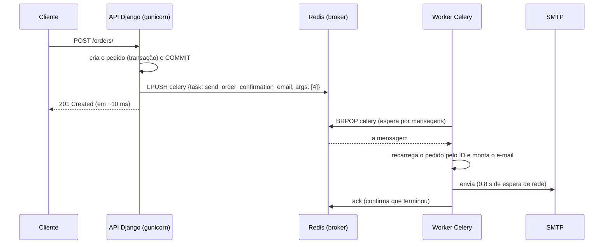

# 6. Filas e tarefas em segundo plano (Celery + Redis)

> ⏱️ ~1h30 · Módulo 7 · Pré-requisitos: [7.01](01-bloqueante-io-cpu.md), [7.02](02-threads-processos-gil.md), [5.17 (transações)](../05-django/17-pedidos-estoque-transacao.md), [5.14 (configuração por ambiente)](../05-django/14-config-env-logging.md); Docker instalado ([aula 3.03](../03-banco-de-dados/03-postgres-docker-ddl-dml.md))

> ✅ **Verificação.** Código executado em 2026-11-08 com **Celery 5.7.0**, **redis-py 8.1.0**, **Redis 8.10** (contêiner `redis:8` numa porta própria), Django 5.2.19 e Gunicorn, no laboratório do módulo 6. **Todas as saídas abaixo são reais**: o demo sobe o Gunicorn, o worker do Celery e o Redis de verdade e mede o tempo da API. Os 4 testes da aula e os 67 anteriores passaram (**71**). Os tempos variam alguns centésimos.

## 🎯 Objetivos
Ao final desta aula você consegue:
- Explicar o modelo **produtor → broker → worker** e o papel de cada peça (Django, Redis, Celery)
- Configurar o Celery no Django e escrever uma **tarefa** que recebe **apenas IDs** e recarrega os dados
- Mostrar, medindo, que enfileirar o e-mail tira ~**0,8 s** do `POST /orders/` e que o worker o envia depois
- Enfileirar **depois do commit** com `transaction.on_commit` e provar o erro de fazê-lo antes
- Testar tarefas e o enfileiramento **sem broker** e explicar entrega **“pelo menos uma vez”**

## 🤔 Por que isso importa
Na aula 01 o pedido ficou **1,4 s** esperando e-mail e antifraude, com a CPU parada. A solução profissional é **responder já** e fazer o trabalho lento **em segundo plano**, por um processo separado que lê de uma **fila**. É o padrão de quase todo sistema web real: e-mails, relatórios, miniaturas de imagem, integrações. “Como você enviaria um e-mail sem travar a requisição?” é a pergunta mais clássica sobre o assunto, e a resposta tem armadilhas (transação, idempotência, falhas) que esta e a próxima aula cobrem.

## 💡 Intuição (explicação simples)
No restaurante, o **garçom** (a API) anota o pedido e o **pendura no varal da cozinha** (a fila no broker); em seguida atende a próxima mesa. Os **cozinheiros** (workers), em outra sala, pegam as comandas do varal na ordem e preparam. Se a cozinha está cheia, as comandas **esperam no varal**, mas o garçom não para. Se um cozinheiro se acidenta com a comanda na mão, a comanda **volta ao varal** para outro pegar, o que pode fazer um prato sair **duas vezes**: por isso a receita precisa ser “à prova de repetição”. E o garçom **só pendura a comanda depois que o cliente confirmou o pedido**: pendurar antes pode mandar a cozinha preparar algo que o cliente acabou desistindo.

## 🔬 Como funciona por dentro

- **Fila de tarefas (*task queue*)**: um **produtor** (o Django) publica **mensagens** descrevendo trabalho; um **broker** as guarda; **consumidores** (*workers*) as executam, de forma **assíncrona** e **desacoplada** (processos, até máquinas, diferentes).
- **Celery** é a biblioteca de filas de tarefas mais usada em Python. Peças:
  | Peça | Papel | No MiniShop |
  |---|---|---|
  | **Aplicação** (`Celery("minishop")`) | configuração e registro das tarefas | `config/celery.py` |
  | **Tarefa** (`@shared_task`) | uma função executada pelo worker | `send_order_confirmation_email` |
  | **Broker** | guarda as mensagens até um worker pegar | **Redis** (também RabbitMQ, SQS) |
  | **Worker** | processo(s) que consomem e executam | `celery -A config worker` |
  | **Result backend** | guarda o **retorno** (opcional) | desligado: a tarefa tem **efeito**, não valor |
- **Redis** aqui é só o **broker**: uma lista (`celery`) onde o Django faz `LPUSH` e o worker, `BRPOP`. É rápido, simples e já será usado para cache (módulo 14). RabbitMQ oferece garantias e roteamento mais ricos (aula 10).
- **Pool de execução:** por padrão o worker usa **processos** (*prefork*): `-c 4` = 4 processos, cada um executando uma tarefa por vez (lembre da aula 02: processos escapam do GIL e isolam falhas). Para tarefas de **muita espera**, `--pool=threads` ou `gevent` rendem mais por memória.
- **Mensagem = dados simples.** O Celery serializa em **JSON**: passe **IDs e valores**, nunca objetos do ORM. Dois motivos: (1) o objeto não é serializável de forma segura; (2) o objeto **envelhece**: quando o worker rodar (segundos ou horas depois), o estado do banco pode ter mudado. Recarregue **dentro da tarefa**.
- **`on_commit`: enfileirar só depois do commit.** O `create_order` roda numa transação. Se a tarefa for enfileirada **antes do COMMIT**, o worker (rápido) pode tentar ler um pedido que **ainda não existe** para ele (`DoesNotExist`). `transaction.on_commit(callback)` executa o callback **só depois que a transação mais externa confirma**; se houver *rollback*, o callback **nunca** roda (nenhum e-mail para um pedido que não existe).
- **Entrega “pelo menos uma vez” (*at-least-once*):** o worker só **confirma** (*ack*) depois de terminar; se ele morrer no meio, a mensagem **volta** e outro worker a executa de novo. Resultado: a tarefa pode rodar **duas vezes** (exemplo 5). **Toda tarefa deve ser idempotente** (aula 07).
- **`delay()` × `apply_async()`:** `tarefa.delay(1)` = `tarefa.apply_async(args=(1,))`. O segundo aceita `countdown=` (esperar N s), `eta=`, `queue=`, `expires=`, `retry=`.
- **Testes:** (a) chame a **função** direto (`tarefa(args)`); (b) *monkeypatch* de `.delay` e `django_capture_on_commit_callbacks` para provar **quando** enfileira; (c) `CELERY_TASK_ALWAYS_EAGER=True` executa na hora, sem broker (útil, mas esconde problemas reais de serialização e de commit).
- **Alternativas:** RQ, Dramatiq, Huey, `arq` (assíncrono); e o **Django 6.0** trouxe uma API de tarefas própria ([`django.tasks`](https://docs.djangoproject.com/en/6.0/topics/tasks/)), com *backends* plugáveis. O curso fica no **Django 5.2 LTS**, onde o Celery é o padrão de mercado.
- **Operação:** monitore a **fila** (tamanho crescendo = workers insuficientes), use o **Flower** (painel web), defina **limites de tempo** (`task_time_limit`) e **reinicie** workers periodicamente (`--max-tasks-per-child`).

## 🛠️ Exemplo prático
**1. Infraestrutura: Redis em um contêiner** (porta própria para não colidir com outro Redis seu)
```bash
docker run -d --name minishop-redis-dev -p 127.0.0.1:6379:6379 redis:8
uv add celery redis
```
```text
# (no laboratório desta aula o Redis foi publicado na porta 6390, para não interferir com outro contêiner da máquina)
```
**2. Configuração do Celery no Django**
```python
# config/celery.py
import os

from celery import Celery

os.environ.setdefault("DJANGO_SETTINGS_MODULE", "config.settings")

app = Celery("minishop")
app.config_from_object("django.conf:settings", namespace="CELERY")   # lê as chaves CELERY_* do settings.py
app.autodiscover_tasks()                                              # procura apps/*/tasks.py
```
```python
# config/__init__.py
from .celery import app as celery_app          # garante que o app Celery carrega junto com o Django

__all__ = ("celery_app",)
```
```python
# config/settings.py
CELERY_BROKER_URL = os.environ.get("CELERY_BROKER_URL", "redis://127.0.0.1:6379/0")
CELERY_RESULT_BACKEND = None                          # não guardamos resultados: a tarefa tem efeito (e-mail), não valor
CELERY_TASK_IGNORE_RESULT = True
CELERY_TASK_SERIALIZER = "json"                       # só dados simples: ids, textos (nunca objetos do ORM)
CELERY_ACCEPT_CONTENT = ["json"]
CELERY_TIMEZONE = "UTC"
CELERY_BROKER_CONNECTION_RETRY_ON_STARTUP = True
EMAIL_BACKEND = "apps.orders.email_backend.SmtpLentoEmailBackend"        # em produção: SMTP real (ou um serviço de e-mail)
EMAIL_SIMULATED_DELAY = float(os.environ.get("EMAIL_SIMULATED_DELAY", "0.8"))
EMAIL_OUTBOX_FILE = os.environ.get("EMAIL_OUTBOX_FILE", str(BASE_DIR / "outbox.jsonl"))
ORDER_EMAIL_MODE = os.environ.get("ORDER_EMAIL_MODE", "async")           # "sync" | "async" | "off"
```
**3. A tarefa e o enfileiramento**
```python
# apps/orders/tasks.py
import logging

from celery import shared_task
from django.core.mail import send_mail

from .models import Order

logger = logging.getLogger(__name__)


@shared_task(name="orders.send_order_confirmation_email")
def send_order_confirmation_email(order_id):
    """Envia o e-mail de confirmação. Recebe só o ID: o objeto é recarregado AQUI, com o estado atual do banco."""
    order = Order.objects.select_related("user").prefetch_related("items__product").get(pk=order_id)
    linhas = "\n".join(f"- {i.quantity} × {i.product.name}: R$ {i.subtotal}" for i in order.items.all())
    send_mail(
        subject=f"MiniShop: pedido #{order.pk} recebido",
        message=f"Olá, {order.user.username}!\n\nRecebemos o seu pedido #{order.pk}:\n{linhas}\n\nTotal: R$ {order.total}\n",
        from_email=None,
        recipient_list=[order.user.email],
    )
    logger.info("email_sent order=%s to=%s", order.pk, order.user.email)
```
```python
# apps/orders/notifications.py
from django.conf import settings
from django.db import transaction

from .tasks import send_order_confirmation_email


def notificar_pedido_criado(order):
    """O que fazer DEPOIS que o pedido foi criado, conforme ORDER_EMAIL_MODE."""
    modo = settings.ORDER_EMAIL_MODE
    if modo == "sync":                                   # ANTES (aula 7.01): o cliente espera o SMTP
        send_order_confirmation_email(order.pk)
    elif modo == "async":                                # DEPOIS: enfileira, e só depois do COMMIT
        transaction.on_commit(lambda: send_order_confirmation_email.delay(order.pk))
```
```python
# apps/orders/api.py (OrderViewSet): uma linha nova, depois de criar o pedido
def _criar(self, request):
    order = services.create_order(request.user)
    notificar_pedido_criado(order)
    return Response(OrderSerializer(order).data, status=status.HTTP_201_CREATED, headers={"Location": f"/api/v1/orders/{order.pk}/"})
```
O “SMTP” do laboratório (`SmtpLentoEmailBackend`) **dorme 0,8 s** por e-mail, como um servidor real, e anota cada e-mail num arquivo que **qualquer processo** consegue ler (a API e o worker são processos diferentes):
```python
# apps/orders/email_backend.py
import json
import time

from django.conf import settings
from django.core.mail.backends.base import BaseEmailBackend


class SmtpLentoEmailBackend(BaseEmailBackend):
    def send_messages(self, email_messages):
        for m in email_messages:
            time.sleep(settings.EMAIL_SIMULATED_DELAY)                       # a ESPERA de rede do SMTP
            with open(settings.EMAIL_OUTBOX_FILE, "a") as f:
                f.write(json.dumps({"to": m.to, "subject": m.subject, "body": m.body}, ensure_ascii=False) + "\n")
        return len(email_messages)
```
**4. O experimento completo** (`celery_demo.py`): sobe o Gunicorn, mede o `POST /orders/` nos dois modos, inspeciona a fila **com o worker desligado**, liga o worker e acompanha
```bash
docker start m7-redis                                            # o Redis
uv run celery -A config worker -l info -c 4                      # o worker (outro terminal)
uv run gunicorn config.wsgi --threads 8                          # a API (outro terminal)
LAB=$PWD uv run python celery_demo.py                            # o experimento (sobe tudo sozinho)
```
(O `celery_demo.py` e o `oncommit_demo.py` completos estão em [`projeto/referencia-api-m7/scripts/`](../projeto/referencia-api-m7/README.md).)
```text
=== A) e-mail SÍNCRONO dentro da requisição (como em 7.01)
POST /orders/ com SMTP de 0,8 s no meio → 0.82 s, 0.81 s, 0.81 s | e-mails já enviados quando a resposta chegou: 3

=== B) e-mail ASSÍNCRONO: a API só ENFILEIRA (e o worker ainda está desligado)
POST /orders/ → 201 em 0.06 s | e-mails enviados: 0 | mensagens esperando na fila 'celery' do Redis: 1
a mensagem na fila (resumo):
   tarefa   : orders.send_order_confirmation_email
   id       : be08f7aa…
   argumentos: [4]  ← só o ID do pedido, nunca o objeto

=== C) ligamos o worker: ele consome a fila
e-mail enviado 1.4 s depois de ligar o worker (inclui a partida do worker) | fila agora: 0
e-mail gravado: {'to': ['cliente@minishop.local'], 'subject': 'MiniShop: pedido #4 recebido', 'body': 'Recebemos o seu pedido #4:'}

=== D) 8 pedidos em sequência: a API não espera pelos e-mails
as 8 respostas da API levaram 0.16 s no total (média 11 ms cada)
os 8 e-mails (0,8 s cada; 4 workers em paralelo) terminaram 1.6 s depois da última resposta | total de e-mails: 9

=== log do worker (primeiras linhas relevantes)
   Task orders.send_order_confirmation_email[be08f7aa-6014-4307-9378-03d0982257e2] received
   Task orders.send_order_confirmation_email[be08f7aa-6014-4307-9378-03d0982257e2] succeeded in 0.8065022740047425s: None
   Task orders.send_order_confirmation_email[ddaf4f95-e8c4-4661-9d9b-fb5ae4826d7b] received
   Task orders.send_order_confirmation_email[ae6e5f0b-2ad1-4d7d-9e02-2dedcecdcc79] received
   ... (18 linhas de tarefas no total)
```
Como ler, passo a passo:
- **(A) Síncrono:** `POST /orders/` levou **0,81–0,82 s**, e **3 e-mails já estavam enviados** quando a resposta chegou: o cliente esperou o SMTP.
- **(B) Assíncrono, worker desligado:** a API respondeu **`201` em ~0,06 s**; **nenhum e-mail** saiu ainda, e **1 mensagem esperava na fila** do Redis. A mensagem é **JSON**: o nome da tarefa, um *id* e os **argumentos `[4]`**, só o ID do pedido. Repare: com o worker parado, a API **continua funcionando**; o trabalho acumula e **não se perde** (o Redis guarda a fila).
- **(C) Ligando o worker:** ele partiu, consumiu a mensagem e o e-mail saiu (**1,4 s** contando a partida do processo); a fila voltou a **0**. O log do worker mostra `received` e `succeeded in 0.80s`.
- **(D) Oito pedidos:** a API respondeu às 8 em **0,16 s no total** (**~11 ms cada**, contra 800 ms). Os 8 e-mails (0,8 s cada) foram enviados **em paralelo pelos 4 processos do worker**, terminando **~1,6 s** depois (2 rodadas de 0,8 s). Se chegar mais pedido do que o worker dá conta, a fila **cresce** (e você escala os workers), sem derrubar a API.

**5. O erro clássico: enfileirar antes do commit** (`oncommit_demo.py`, com o worker ligado)
```python
def com_erro():
    with transaction.atomic():
        pedido = Order.objects.create(user=usuario, total=10)
        send_order_confirmation_email.delay(pedido.pk)             # ERRADO: o worker é mais rápido que o COMMIT
        time.sleep(0.6)                                            # (o resto da view demorando um pouco)
    return pedido.pk


def correto():
    with transaction.atomic():
        pedido = Order.objects.create(user=usuario, total=10)
        transaction.on_commit(lambda: send_order_confirmation_email.delay(pedido.pk))   # só DEPOIS do commit
        time.sleep(0.6)
    return pedido.pk
```
```text
  Task orders.send_order_confirmation_email[29e4e9ad-a503-48d9-bea2-a5e15f5ebc61] raised unexpected: DoesNotExist('Order matching query does not exist.'
  Task orders.send_order_confirmation_email[28683587-30ac-44c9-aa99-a644d6a59681] succeeded in 0.8032193210092373s: None
(pedido do caso ERRADO: #13; pedido do caso CORRETO: #14)
```
A primeira tarefa **falhou** com `DoesNotExist('Order matching query does not exist.')`: o worker leu o banco **antes** do `COMMIT`, quando o pedido ainda era invisível para ele. A segunda, enfileirada com `on_commit`, **funcionou**. É um bug intermitente típico: em desenvolvimento (poucas requisições, commit instantâneo) quase nunca aparece; em produção, aparece. Só **enfileire depois do commit**.

**6. Entrega “pelo menos uma vez”** (`mini_broker.py`: uma fila com *ack* e prazo de visibilidade, como a do Celery/SQS)
```python
import collections
import itertools


class MiniBroker:
    """Fila com 'ack' e prazo de visibilidade: mensagem reservada e NÃO confirmada volta para a fila (entrega at-least-once)."""

    def __init__(self, prazo, relogio):
        self.prazo, self.relogio = prazo, relogio
        self.fila = collections.deque()
        self.reservadas = {}                                  # id -> (mensagem, reservada_em, worker)
        self.ids = itertools.count(1)

    def publicar(self, corpo):
        self.fila.append((next(self.ids), corpo))

    def _devolver_vencidas(self):
        for mid, (msg, em, worker) in list(self.reservadas.items()):
            if self.relogio() - em >= self.prazo:
                del self.reservadas[mid]
                self.fila.appendleft(msg)                      # visível de novo: outro worker pode pegar
                print(f"    [broker t={self.relogio():>2}] mensagem {mid} não foi confirmada por {worker}: volta para a fila")

    def reservar(self, worker):
        self._devolver_vencidas()
        if not self.fila:
            return None
        msg = self.fila.popleft()
        self.reservadas[msg[0]] = (msg, self.relogio(), worker)
        return msg

    def ack(self, mid):
        self.reservadas.pop(mid, None)                         # confirmada: some de vez


t = [0]
broker = MiniBroker(prazo=5, relogio=lambda: t[0])
efeitos = []                                                   # o que realmente aconteceu no "mundo" (e-mails enviados)

broker.publicar({"enviar_email": "pedido #7"})

print("t=0  worker A reserva e ENVIA o e-mail...")
mid, corpo = broker.reservar("A")
efeitos.append(f"e-mail do {corpo['enviar_email']} enviado por A")
print("     ...mas A cai (kill -9, falta de memória) ANTES de confirmar (ack).")

t[0] = 3; print("t=3  worker B pede trabalho:", broker.reservar("B"), "(a mensagem de A ainda está reservada)")
t[0] = 6
print("t=6  worker B pede trabalho de novo:")
mid2, corpo2 = broker.reservar("B")
efeitos.append(f"e-mail do {corpo2['enviar_email']} enviado por B")
broker.ack(mid2)
print("\nefeitos no mundo real:")
for e in efeitos:
    print("  ·", e)
print(f"→ mensagem entregue {len(efeitos)} vezes: at-least-once. A tarefa precisa ser IDEMPOTENTE (aula 7.07).")
```
```text
t=0  worker A reserva e ENVIA o e-mail...
     ...mas A cai (kill -9, falta de memória) ANTES de confirmar (ack).
t=3  worker B pede trabalho: None (a mensagem de A ainda está reservada)
t=6  worker B pede trabalho de novo:
    [broker t= 6] mensagem 1 não foi confirmada por A: volta para a fila

efeitos no mundo real:
  · e-mail do pedido #7 enviado por A
  · e-mail do pedido #7 enviado por B
→ mensagem entregue 2 vezes: at-least-once. A tarefa precisa ser IDEMPOTENTE (aula 7.07).
```
O worker A **enviou o e-mail e morreu antes de confirmar**. Como o broker não recebeu o *ack*, a mensagem **voltou para a fila** depois do prazo, e o worker B a executou **de novo**: o efeito aconteceu **duas vezes**. Não é um defeito do Celery; é o preço de **não perder** mensagens (o contrário, “no máximo uma vez”, perderia e-mails). A cura é **tornar a tarefa idempotente**, assunto da aula 07.

**7. Testes (executados)**
```python
# tests/test_email_async.py
import pytest
from django.core import mail

from apps.orders.tasks import send_order_confirmation_email

pytestmark = pytest.mark.django_db


@pytest.fixture
def cli(api_as):
    c = api_as("cliente")
    c.post("/api/v1/cart/items/", {"product": 2, "quantity": 2}, format="json")
    return c


def test_pedido_enfileira_o_email_so_apos_o_commit(cli, settings, monkeypatch, django_capture_on_commit_callbacks):
    settings.ORDER_EMAIL_MODE = "async"
    enfileirados = []
    monkeypatch.setattr(send_order_confirmation_email, "delay", lambda pk: enfileirados.append(pk))
    with django_capture_on_commit_callbacks(execute=False) as callbacks:
        r = cli.post("/api/v1/orders/")
    assert r.status_code == 201
    assert enfileirados == []                                   # nada saiu antes do commit
    for cb in callbacks:
        cb()                                                    # "o commit aconteceu"
    assert enfileirados == [r.json()["id"]]


def test_pedido_que_falha_nao_enfileira_nada(api_as, settings, monkeypatch, django_capture_on_commit_callbacks):
    settings.ORDER_EMAIL_MODE = "async"
    enfileirados = []
    monkeypatch.setattr(send_order_confirmation_email, "delay", lambda pk: enfileirados.append(pk))
    with django_capture_on_commit_callbacks(execute=True):
        r = api_as("cliente").post("/api/v1/orders/")           # carrinho vazio → 422
    assert r.status_code == 422 and enfileirados == []


def test_tarefa_monta_e_envia_o_email(cli, settings):
    settings.EMAIL_BACKEND = "django.core.mail.backends.locmem.EmailBackend"
    settings.ORDER_EMAIL_MODE = "off"
    pedido_id = cli.post("/api/v1/orders/").json()["id"]
    send_order_confirmation_email(pedido_id)                    # chamada direta (síncrona), como em um teste unitário
    assert len(mail.outbox) == 1
    m = mail.outbox[0]
    assert m.to == ["cliente@minishop.local"] and f"#{pedido_id}" in m.subject and "Notebook" in m.body
```
```bash
uv run pytest -q
```
```text
71 passed
```
(O arquivo completo tem também o teste do modo `off`; os 4 testes de e-mail somados aos 67 anteriores dão **71**.) Os testes **não precisam de Redis nem de worker**: um prova **quando** a tarefa é enfileirada (só após o commit; nunca se o pedido falha), outro prova **o que** a tarefa faz (monta e envia o e-mail) chamando a função direto, sem broker.

## 🧠 Pausa para lógica
**Problema (o broker, por conta própria).** Sem olhar o exemplo 6, implemente `MiniBroker(prazo, relogio)` com `publicar`, `reservar(worker)` e `ack(id)`. Uma mensagem **reservada e não confirmada** em `prazo` segundos deve **voltar ao início da fila**. Simule o worker A que reserva, envia o efeito e “cai”, e o worker B que recebe a mesma mensagem depois, e mostre que o efeito ocorreu **duas vezes**.

<details><summary>Dica</summary>
Uma <code>deque</code> para a fila e um dicionário <code>reservadas {id: (mensagem, instante, worker)}</code>. Em cada <code>reservar</code>, primeiro devolva as vencidas (<code>agora - instante &gt;= prazo</code>) com <code>appendleft</code>; depois tire da fila. O relógio é injetado, assim o teste não espera de verdade.
</details>

<details><summary>Solução comentada</summary>

É o `mini_broker.py` do exemplo 6 (executado). O Redis/Celery usam a mesma ideia: o Celery com `acks_late=True` só confirma depois de terminar e, ao usar Redis como broker, define um **`visibility_timeout`** (1 h por padrão) depois do qual mensagens não confirmadas são **reentregues**. Com RabbitMQ, a reentrega ocorre quando a **conexão** do consumidor cai; com SQS, após o *visibility timeout* da mensagem. Em todos, o contrato é o mesmo: **pelo menos uma vez**.
</details>

## ⚠️ Erros comuns e boas práticas
| Mensagem / sintoma | Causa | Solução |
|---|---|---|
| Tarefa enfileirada mas nada acontece | Worker desligado, fila/nome errado, ou `autodiscover_tasks` não achou `tasks.py` | Subir o worker; `celery -A config inspect registered`; conferir o nome |
| `Received unregistered task of type 'x'` | O worker não importou a tarefa | `autodiscover_tasks()`, app em `INSTALLED_APPS`, reiniciar o worker |
| `kombu.exceptions.OperationalError: [Errno 111] Connection refused` | Redis fora do ar/URL errada | Subir o Redis; conferir `CELERY_BROKER_URL` |
| `DoesNotExist` na tarefa que acabou de ser enfileirada | `.delay()` antes do **commit** | `transaction.on_commit(lambda: tarefa.delay(id))` |
| `kombu.exceptions.EncodeError: Object of type Order is not JSON serializable` | Passou um objeto do ORM/`Decimal`/`datetime` | Passar **IDs e valores simples** e recarregar na tarefa |
| Tarefa roda com dados **velhos** | Objeto serializado no momento do enfileiramento | Recarregar do banco dentro da tarefa |
| E-mail duplicado após *crash* ou *deploy* | Entrega *at-least-once* | Tarefa **idempotente** (aula 07) |
| `SynchronousOnlyOperation` / conexões do banco “mortas” no worker | Código `async` ou conexões antigas em processos longos | Tarefas síncronas; o Celery fecha conexões do Django ao fim de cada tarefa |
| Fila crescendo sem parar | Workers insuficientes ou tarefa lenta/travada | Mais workers, `--concurrency`, limites de tempo, monitorar (Flower) |
| Tarefa trava para sempre | Chamada externa sem *timeout* (aula 04) | `timeout` nas chamadas e `task_time_limit`/`soft_time_limit` |
| Testes passam, mas em produção a tarefa falha | `CELERY_TASK_ALWAYS_EAGER` esconde serialização e *commit* | Testar a serialização e o `on_commit`; ao menos um teste de integração com broker |
| `ModuleNotFoundError`/configuração diferente no worker | Worker sem as variáveis de ambiente | Mesmas variáveis (`.env`) para API e worker |

- **Tarefas pequenas, idempotentes, com IDs**, e **timeouts** em toda chamada externa.
- **Enfileire depois do commit.** Sempre.
- **Separe filas** por tipo (`emails`, `relatorios`) para que trabalho lento não bloqueie o urgente (`-Q emails`).
- Não use tarefa para o que precisa ser **síncrono e consistente** (baixar estoque do pedido continua na transação da API).
- **Não guarde segredos** nas mensagens (ficam no Redis e nos logs); passe IDs.
- Monitore: tamanho da fila, tempo na fila, tarefas falhas, idade da tarefa mais antiga.

## 🧩 Exercícios
**1. Fixação**
(a) Quais são as três peças da arquitetura de fila e o que cada uma faz? (b) Por que passar `order_id` e não o objeto `order`? (c) O que acontece se enfileirar dentro do `atomic()` sem `on_commit`? (d) O que significa “pelo menos uma vez”?

<details><summary>Solução</summary>

(a) **Produtor** (Django: publica a mensagem), **broker** (Redis: guarda as mensagens) e **worker** (Celery: consome e executa). (b) Objetos do ORM não são serializáveis com segurança e envelhecem; o ID permite recarregar o estado **atual** no worker. (c) O worker pode ler antes do commit e não achar o registro (`DoesNotExist`), e, se houver *rollback*, a tarefa roda para algo que não existe. (d) A mensagem é entregue **uma ou mais** vezes (nunca zero): em falhas, pode repetir; por isso as tarefas devem ser idempotentes.
</details>

**2. Aplicação no projeto MiniShop**
Entregue o e-mail de confirmação assíncrono (parte da entrega do módulo).

Critérios de pronto:
- [ ] Celery configurado (`config/celery.py`, `CELERY_*` no `settings.py` via variáveis de ambiente), com **Redis** no `docker-compose` (ou comando `docker run`) documentado no README
- [ ] Tarefa `send_order_confirmation_email(order_id)` com o texto em português (itens, total), usando o e-mail do usuário
- [ ] Enfileiramento **somente após o commit**, em `notificar_pedido_criado`, e **nenhum** enfileiramento quando o pedido falha
- [ ] Medição **antes × depois**: tempo do `POST /orders/` no modo síncrono e no assíncrono (registrar em `docs/assincrono.md`)
- [ ] Testes: enfileira só após o commit, não enfileira se falhar, a tarefa monta e envia o e-mail
- [ ] README: como subir Redis, API e worker (três comandos) e como ver a fila (`redis-cli LLEN celery`)
- [ ] Commit `feat(orders): async order confirmation email with Celery and Redis`

<details><summary>Solução de referência (ver a fila e o worker)</summary>

```bash
docker exec m7-redis redis-cli LLEN celery                       # tamanho da fila
uv run celery -A config inspect registered                       # tarefas que o worker conhece
uv run celery -A config inspect active                           # o que está executando agora
uv run celery -A config purge -f                                 # esvazia a fila (cuidado em produção)
```
Para uma fila separada: `@shared_task(queue="emails")` (ou `CELERY_TASK_ROUTES`) e `celery -A config worker -Q emails -c 4`.
</details>

**3. Desafio (opcional)**
Suba o **Flower** (`uv add flower && celery -A config flower`) e observe as tarefas dos 8 pedidos; depois defina `CELERY_TASK_TIME_LIMIT=5` e uma tarefa que dorme 10 s, e veja o worker matá-la. Registre o que aparece no Flower.

## 🎤 Na entrevista
- **Como você enviaria um e-mail sem travar a requisição?** Enfileirando uma tarefa (Celery + Redis/RabbitMQ) **depois do commit** da transação, passando só o ID; um worker separado carrega os dados e envia, com retentativas e idempotência.
- **Por que `transaction.on_commit`?** Para só enfileirar quando o dado já está confirmado no banco: evita que o worker leia um registro inexistente e evita executar a tarefa se a transação sofrer *rollback*.
- **O que é entrega *at-least-once* e o que ela exige?** O broker só remove a mensagem após o *ack*; se o worker cair, ela é reentregue; portanto, a tarefa pode rodar mais de uma vez e deve ser idempotente.
- **Qual o papel do broker e do result backend?** O broker guarda as mensagens até um worker consumir; o result backend (opcional) guarda os resultados/estados das tarefas; para tarefas com efeito colateral, geralmente não é necessário.
- **Celery ou threads dentro da API?** Threads/`asyncio` só adiam dentro do mesmo processo (e morrem com ele, sem retentativa nem visibilidade); fila + worker sobrevive a *deploys*, escala em separado e permite repetir, agendar e monitorar.

## 📚 Para ir além
- 📄 Documentação: [Celery](https://docs.celeryq.dev/en/stable/). Visão geral e primeiros passos.
- 📄 Documentação: [Celery com Django](https://docs.celeryq.dev/en/stable/django/first-steps-with-django.html). `config/celery.py`, `autodiscover_tasks`, `namespace="CELERY"`.
- 📄 Documentação: [Celery — Tarefas](https://docs.celeryq.dev/en/stable/userguide/tasks.html). `shared_task`, `bind`, retentativas, `acks_late`.
- 📄 Documentação: [Celery — Configuração](https://docs.celeryq.dev/en/stable/userguide/configuration.html). Todas as chaves `CELERY_*`.
- 📄 Documentação: [Celery — Redis como broker](https://docs.celeryq.dev/en/stable/getting-started/backends-and-brokers/redis.html). `visibility_timeout` e cuidados.
- 📄 Documentação: [Celery — Testes](https://docs.celeryq.dev/en/stable/userguide/testing.html). Modo *eager* e *fixtures*.
- 📄 Documentação oficial: [Django — ações após o commit](https://docs.djangoproject.com/en/5.2/topics/db/transactions/#performing-actions-after-commit). `transaction.on_commit`.
- 📄 Documentação oficial: [Django — e-mail](https://docs.djangoproject.com/en/5.2/topics/email/). `send_mail` e *backends*.
- 📄 Documentação: [Flower](https://flower.readthedocs.io/). Monitor web do Celery.
- 📄 Documentação: [Redis](https://redis.io/docs/latest/). Estruturas de dados e persistência.
- 🏋️ Prática extra: pare o worker, faça 5 pedidos, confira `LLEN celery` = 5, suba o worker e veja a fila esvaziar.

> Links verificados em 2026-11-08 (HTTP 200).

## ✅ Checklist da aula
- [ ] Redis, API e worker rodando; vi a mensagem na fila com o worker desligado
- [ ] Medi o `POST /orders/` síncrono (≈ 0,8 s) e assíncrono (≈ dezenas de ms)
- [ ] A tarefa recebe só o ID e recarrega os dados
- [ ] Enfileiro com `transaction.on_commit` e reproduzi o `DoesNotExist` do erro
- [ ] Testei o enfileiramento e a tarefa sem broker, e sei o que é *at-least-once*
