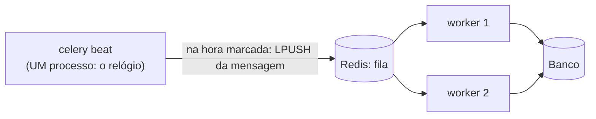

# 8. Agendamento de tarefas

> ⏱️ ~1h30 · Módulo 7 · Pré-requisitos: [7.06](06-filas-celery.md), [7.07](07-retentativas-idempotencia.md), [5.17](../05-django/17-pedidos-estoque-transacao.md) (cancelamento e estoque), [6.13](../06-apis-rest/13-graphql-grpc-api-completa.md) (chaves de idempotência)

> ✅ **Verificação.** Código executado em 2026-11-08 com **Celery 5.7.0** (worker e **beat** de verdade), Redis 8 e Django 5.2.19. **As saídas são reais**: o experimento sobe worker e beat como processos separados e conta o que cada um fez. O interpretador de *cron* foi **comparado com o `crontab` do Celery** para as seis expressões da aula. **81 testes** do laboratório passaram (4 novos nesta aula).

## 🎯 Objetivos
Ao final desta aula você consegue:
- Agendar tarefas recorrentes com o **Celery beat** (`CELERY_BEAT_SCHEDULE`, `crontab`, intervalos) e entender a divisão **beat = relógio, worker = executor**
- Ler e escrever expressões **cron** de cinco campos e calcular as próximas execuções
- Escrever tarefas agendadas **idempotentes e “de nível”** (processam *tudo* que está atrasado), seguras contra execução dupla e contra *beat* parado
- Evitar as armadilhas: **dois *beats*** (execução duplicada), **fuso horário e horário de verão**, nomes de tarefa com erro de digitação
- Escolher entre Celery beat, *cron* do sistema, *CronJob* do Kubernetes e agendadores da nuvem

## 🤔 Por que isso importa
Todo sistema tem trabalho que **ninguém dispara**: expirar pedidos não pagos, limpar chaves antigas, reenviar e-mails que falharam, gerar relatório às 3 da manhã, renovar assinaturas. “Cron” é a resposta, mas fazê-lo **do jeito certo** em produção (vários servidores, *deploys*, quedas, fusos) é onde júnior tropeça: o relatório que sai **duas vezes**, o pedido que **nunca expira** porque o agendador estava fora do ar, o job que **pula um dia** por causa do horário de verão.

## 💡 Intuição (explicação simples)
Pense num **despertador que não acorda você, mas a equipe**. O **beat** é o despertador: só olha o relógio e, na hora marcada, **cola um bilhete** no quadro (a fila): “limpar chaves antigas”. Quem faz o trabalho são os **funcionários** (workers), como com qualquer outra tarefa. Cuidados: se você colocar **dois despertadores** idênticos no quarto, os bilhetes saem em dobro; se o despertador **quebrar por uma noite**, o bilhete daquela noite **talvez nem seja colado depois** (só se ele lembrar da última vez que tocou; então a tarefa deve olhar “o que está atrasado?”, não “o que aconteceu na última hora?”); e “às 2h30 da manhã” pode **não existir** no dia da mudança de horário.

## 🔬 Como funciona por dentro

- **Agendamento** = repetir uma tarefa por tempo. No Celery há **duas peças**: o **beat** lê a agenda e **apenas enfileira** as mensagens na hora certa; os **workers** as executam como qualquer outra tarefa (com retentativas, `acks_late` etc.). Por isso uma tarefa agendada também pode ser chamada **à mão** com `.delay()`.
- **Tipos de agenda** (`CELERY_BEAT_SCHEDULE`):
  | Forma | Exemplo | Significa |
  |---|---|---|
  | Intervalo | `"schedule": 30.0` | a cada 30 s (a partir do início do beat) |
  | `crontab(...)` | `crontab(minute=0, hour=3)` | todo dia às 03:00 |
  | `solar(...)` | nascer/pôr do sol de uma coordenada | raro |
  | Execução única | `apply_async(eta=...)`/`countdown=` | uma vez, no futuro |
- **Expressão *cron*** (cinco campos): `minuto hora dia-do-mês mês dia-da-semana`:
  | Campo | Valores | Símbolos |
  |---|---|---|
  | minuto | 0–59 | `*` qualquer · `5` exato · `1,15` lista · `10-20` faixa · `*/15` passo |
  | hora | 0–23 | idem |
  | dia do mês | 1–31 | idem |
  | mês | 1–12 | idem |
  | dia da semana | 0–7 (0 e 7 = domingo) | `1-5` = segunda a sexta |
  Exemplos: `*/15 * * * *` (a cada 15 min), `0 3 * * *` (03:00 todo dia), `30 8 * * 1-5` (08:30 de segunda a sexta), `0 9 1 * *` (09:00 no dia 1 de cada mês). Detalhe clássico: quando **dia do mês e dia da semana** estão ambos definidos, o *cron* tradicional dispara quando **qualquer um** casa.
- **Só pode haver UM *beat*.** Dois processos *beat* com a mesma agenda enfileiram **cada tarefa duas vezes** (o exemplo 2 prova). Em produção: **uma** instância (um contêiner, um *deployment* com 1 réplica); o **worker** é que escala. Para garantia extra, o `django-celery-beat` guarda a agenda no **banco** (editável no Admin) e/ou use uma trava (`redis lock`) por tarefa.
- **O que o beat faz com execuções perdidas (medido no exemplo 3).** O beat guarda o `last_run_at` de cada tarefa (por padrão num **arquivo local**, `celerybeat-schedule`; com `django-celery-beat`, no **banco**). Ao religar, se **uma** execução ficou para trás, ele a dispara **uma vez, logo na partida**; mas só se o `last_run_at` **sobreviveu**: num **contêiner novo** (arquivo perdido no *deploy*), ele **não** recupera nada e espera o próximo horário. E **nunca** recupera as várias execuções de uma queda longa (só uma). Por isso a tarefa agendada deve ser **“de nível” (*level-triggered*)**: “cancele **todos** os pedidos pendentes com mais de 24 h” (processa **tudo** o que estiver atrasado), e **não** “cancele os pedidos da última hora” (que perderia quem caiu na janela em que o beat estava fora).
- **Tarefas agendadas são idempotentes** (aula 07): pode haver **execução duplicada** (dois beats, reentrega, *deploy*) ou **sobreposição** (a execução anterior ainda não acabou). O `UPDATE ... WHERE status='pending'` e `select_for_update` fazem o trabalho.
- **Fuso horário:** configure `CELERY_TIMEZONE = "UTC"` e pense a agenda em UTC; horários locais **pulam ou repetem** no horário de verão (no dia da mudança, “02:30” pode **não existir**; no outono, pode ocorrer **duas vezes**). Se o negócio exige “às 8h de Brasília”, calcule o UTC equivalente (o Brasil não tem horário de verão desde 2019, mas outros fusos têm).
- **Alternativas:**
  | Ferramenta | Quando |
  |---|---|
  | **Celery beat** | você já usa Celery; agenda no código |
  | `django-celery-beat` | agenda **editável no Admin**/em runtime |
  | ***cron* do sistema/systemd timers** chamando `manage.py comando` | poucos jobs, servidor único |
  | **CronJob do Kubernetes** | cada execução = um contêiner novo, isolado |
  | **AWS EventBridge Scheduler** | nuvem: dispara Lambda/ECS/fila sem servidor de agenda (módulo 13) |
  | APScheduler | agenda dentro de um processo Python (cuidado com múltiplas réplicas) |
- **Operação:** registre **início, fim e contagem** de cada execução (logs), alerte se uma tarefa agendada **não rodar** (“ausência de sinal”: *dead man's switch*), e limite o tempo (`soft_time_limit`).

## 🛠️ Exemplo prático
**1. As tarefas agendadas do MiniShop** (todas idempotentes e de nível)
```python
# apps/orders/tasks.py (acréscimos)
@shared_task(name="orders.cancelar_pedidos_pendentes_antigos")
def cancelar_pedidos_pendentes_antigos(horas=24):
    """Cancela (devolvendo o estoque) pedidos pendentes há mais de `horas`. Idempotente e 'nível': processa TUDO o que está atrasado."""
    from . import services

    limite = timezone.now() - timedelta(hours=horas)
    ids = list(Order.objects.filter(status=Order.Status.PENDING, created_at__lt=limite).values_list("pk", "user_id"))
    cancelados = 0
    for pk, user_id in ids:
        try:
            services.cancel_order(Order.objects.get(pk=pk).user, pk)    # o serviço revalida o status DENTRO da transação
            cancelados += 1
        except services.OrderError:                                      # já foi pago/cancelado por outro caminho: tudo bem
            continue
    logger.info("pendentes_antigos candidatos=%s cancelados=%s", len(ids), cancelados)
    return cancelados


@shared_task(name="orders.limpar_chaves_de_idempotencia")
def limpar_chaves_de_idempotencia(horas=24):
    from .models import IdempotencyKey

    apagadas, _ = IdempotencyKey.objects.filter(created_at__lt=timezone.now() - timedelta(hours=horas)).delete()
    logger.info("chaves_apagadas=%s", apagadas)
    return apagadas


@shared_task(name="orders.reenviar_emails_falhos")
def reenviar_emails_falhos():
    ids = list(EmailLog.objects.filter(status=EmailLog.Status.FAILED).values_list("order_id", flat=True))
    EmailLog.objects.filter(order_id__in=ids, status=EmailLog.Status.FAILED).update(status=EmailLog.Status.PENDING, attempts=0)
    for i in ids:
        send_order_confirmation_email.delay(i)
    return len(ids)
```
```python
# config/settings.py
from celery.schedules import crontab

CELERY_BEAT_SCHEDULE = {
    "limpar-chaves-de-idempotencia": {"task": "orders.limpar_chaves_de_idempotencia", "schedule": crontab(minute=0, hour=3)},   # todo dia, 03:00 UTC
    "cancelar-pedidos-pendentes": {"task": "orders.cancelar_pedidos_pendentes_antigos", "schedule": crontab(minute="*/15")},   # a cada 15 min
    "reenviar-emails-falhos": {"task": "orders.reenviar_emails_falhos", "schedule": crontab(minute=5)},                          # toda hora, no minuto 5
}
```
```bash
uv run celery -A config worker -l info -c 2            # quem executa
uv run celery -A config beat -l info                    # quem agenda: UMA instância só
```
Note os desenhos: o cancelamento chama o **serviço** da aula 5.17 (`cancel_order`), que revalida o estado dentro da transação: se o pedido foi pago no meio, o serviço recusa e a tarefa segue; rodar a tarefa **duas vezes** não devolve o estoque em dobro.

**2. O beat e o worker em ação, e o erro dos dois beats** (`beat_demo.py`: agenda de “pulso” a cada 2 s, só para a demonstração)
```bash
LAB=$PWD uv run python beat_demo.py
```
```text
=== 1) um worker + UM beat (agenda: a tarefa 'pulso' a cada 2 s)
o beat enfileirou 5 vezes (≈ 1 a cada 2 s em ~10 s) e o worker executou 5
horários dos batimentos: ['15:27:49', '15:27:51', '15:27:53', '15:27:55', '15:27:57'] …

=== 2) o mesmo, mas com DOIS beats rodando ao mesmo tempo (erro de implantação clássico)
beat 1 enfileirou 5, beat 2 enfileirou 5; o worker executou 10 (o dobro do esperado)
```
- **Um beat:** em ~10 s ele **enfileirou 5** vezes (uma a cada 2 s) e o worker **executou 5**; os horários dos batimentos (`:49`, `:51`, `:53`…) mostram o **ritmo de 2 s**. O beat só **agenda**; o trabalho foi do worker.
- **Dois beats:** cada um enfileirou 5 e o worker executou **10**: **o dobro**. Se a tarefa fosse “cobrar a mensalidade”, o cliente pagaria **duas vezes**. É um erro de **implantação** (duas réplicas do beat, ou um beat a mais no `docker compose`), não de código; por isso as tarefas agendadas precisam ser idempotentes *mesmo assim* e o beat roda numa **única** réplica.

**3. Expressões cron, as próximas execuções e o fuso** (`cron.py`: um interpretador de cron de 5 campos, conferido contra o `crontab` do Celery)
```python
"""Um interpretador de cron de 5 campos (min hora dia mês dia_da_semana), verificado contra o crontab do Celery."""
from datetime import datetime, timedelta, timezone
from zoneinfo import ZoneInfo


def campo(texto, minimo, maximo):
    """'*/15' → {0,15,30,45}; '1-5' → {1..5}; '0,30' → {0,30}; '*' → todos; '10-20/5' → {10,15,20}"""
    valores = set()
    for parte in texto.split(","):
        faixa, barra, passo = parte.partition("/")
        passo = int(passo) if barra else 1
        if faixa == "*":
            ini, fim = minimo, maximo
        elif "-" in faixa:
            ini, fim = (int(x) for x in faixa.split("-"))
        else:
            ini = int(faixa)
            fim = maximo if barra else ini                      # "5/10" = a partir do 5, de 10 em 10
        valores |= set(range(ini, fim + 1, passo))
    return valores


class Cron:
    def __init__(self, expr):
        m, h, dom, mon, dow = expr.split()
        self.min, self.hora = campo(m, 0, 59), campo(h, 0, 23)
        self.dia, self.mes = campo(dom, 1, 31), campo(mon, 1, 12)
        self.sem = {d % 7 for d in campo(dow, 0, 7)}          # 0 e 7 = domingo
        self.dia_livre, self.sem_livre = dom == "*", dow == "*"

    def casa(self, dt):
        dow = (dt.weekday() + 1) % 7                           # segunda=0 → domingo=0
        if dt.minute not in self.min or dt.hour not in self.hora or dt.month not in self.mes:
            return False
        if self.dia_livre or self.sem_livre:                   # um dos dois é "*": vale o outro
            return dt.day in self.dia and dow in self.sem
        return dt.day in self.dia or dow in self.sem           # os dois definidos: vale QUALQUER um (regra clássica do cron)

    def proximas(self, desde, n=3):
        dt = desde.replace(second=0, microsecond=0) + timedelta(minutes=1)
        achadas = []
        while len(achadas) < n:
            if self.casa(dt):
                achadas.append(dt)
            dt += timedelta(minutes=1)
        return achadas


if __name__ == "__main__":
    from celery.schedules import crontab

    inicio = datetime(2026, 11, 8, 15, 27, tzinfo=timezone.utc)          # domingo
    casos = {
        "*/15 * * * *": dict(minute="*/15"),
        "0 3 * * *": dict(minute=0, hour=3),
        "5 * * * *": dict(minute=5),
        "30 8 * * 1-5": dict(minute=30, hour=8, day_of_week="1-5"),
        "0 9 1 * *": dict(minute=0, hour=9, day_of_month=1),
        "0,30 */6 * * *": dict(minute="0,30", hour="*/6"),
    }
    print(f"agora (UTC): {inicio:%Y-%m-%d %H:%M} ({['seg','ter','qua','qui','sex','sáb','dom'][inicio.weekday()]})")
    todos_batem = True
    for expr, kwargs in casos.items():
        minhas = Cron(expr).proximas(inicio, 3)
        celery_prox = inicio + crontab(**kwargs).remaining_delta(inicio)[1]     # próxima execução segundo o Celery
        bate = minhas[0] == celery_prox
        todos_batem &= bate
        print(f"{expr:<16} → " + " | ".join(f"{d:%a %d/%m %H:%M}" for d in minhas) + f"   {'✔ igual ao Celery' if bate else '✘ DIFERE: ' + str(celery_prox)}")
    print("todas as primeiras execuções coincidem com o crontab do Celery:", todos_batem)

    print("\nFUSO HORÁRIO: '02:30' em Nova York no dia em que o horário de verão começa (2026-03-08)")
    ny = ZoneInfo("America/New_York")
    d = datetime(2026, 3, 8, 2, 30, tzinfo=ny)
    ida_e_volta = d.astimezone(timezone.utc).astimezone(ny)
    print(f"  datetime(2026-03-08 02:30, NY) → em UTC: {d.astimezone(timezone.utc):%H:%M} → de volta a NY: {ida_e_volta:%H:%M}  (02:30 NÃO EXISTE nesse dia)")
    print("  → um job 'todo dia às 02:30 locais' pularia (ou duplicaria, no outono) nesse dia. Em UTC não há saltos.")
```
```bash
uv run python cron.py
```
```text
agora (UTC): 2026-11-08 15:27 (dom)
*/15 * * * *     → Sun 08/11 15:30 | Sun 08/11 15:45 | Sun 08/11 16:00   ✔ igual ao Celery
0 3 * * *        → Mon 09/11 03:00 | Tue 10/11 03:00 | Wed 11/11 03:00   ✔ igual ao Celery
5 * * * *        → Sun 08/11 16:05 | Sun 08/11 17:05 | Sun 08/11 18:05   ✔ igual ao Celery
30 8 * * 1-5     → Mon 09/11 08:30 | Tue 10/11 08:30 | Wed 11/11 08:30   ✔ igual ao Celery
0 9 1 * *        → Tue 01/12 09:00 | Fri 01/01 09:00 | Mon 01/02 09:00   ✔ igual ao Celery
0,30 */6 * * *   → Sun 08/11 18:00 | Sun 08/11 18:30 | Mon 09/11 00:00   ✔ igual ao Celery
todas as primeiras execuções coincidem com o crontab do Celery: True

FUSO HORÁRIO: '02:30' em Nova York no dia em que o horário de verão começa (2026-03-08)
  datetime(2026-03-08 02:30, NY) → em UTC: 07:30 → de volta a NY: 03:30  (02:30 NÃO EXISTE nesse dia)
  → um job 'todo dia às 02:30 locais' pularia (ou duplicaria, no outono) nesse dia. Em UTC não há saltos.
```
- As seis expressões da aula têm a **primeira execução idêntica** à calculada pelo Celery (`✔ igual ao Celery`); as colunas seguintes mostram as próximas. Repare em `0 9 1 * *`: **1º de dezembro, 1º de janeiro, 1º de fevereiro**: mensal.
- **Fuso:** `02:30` em Nova York no dia da mudança para o horário de verão **não existe**: convertido para UTC e de volta, vira **03:30**. Um job “todo dia às 02:30 locais” **pularia** esse dia (e, no outono, **rodaria duas vezes**). Em **UTC** não há saltos, por isso a agenda do MiniShop é em UTC.

**4. O beat recupera uma execução perdida? (executado: mede o que o texto afirma)** (`beat_catchup.py`: `crontab(minute="*")`, beat parado durante uma virada de minuto)
```text
=== PASSO 1: beat com crontab 'todo minuto' e arquivo de agenda PERSISTENTE; deixa disparar uma vez
disparou em: ['15:31:00'] | beat PARADO às 12:31:02

=== PASSO 2: o beat fica 'fora do ar' durante uma virada de minuto (uma execução perdida)
(uma execução deveria ter ocorrido às 12:32:00 com o beat desligado)

=== PASSO 3a: religa o beat COM o mesmo arquivo de agenda
disparou logo ao subir (recuperou a execução perdida)? ['15:32:02'] | subiu às 12:32:08

=== PASSO 3b: religa o beat SEM o arquivo (como num contêiner novo depois de um deploy)
disparou logo ao subir? NÃO (espera a próxima virada do minuto)

[exited with code 0]
```
(Os horários dos `Sending due task` estão em **UTC** e os `beat PARADO às`/`subiu às` em horário local de Brasília, UTC−3: `15:32:02` UTC = `12:32:02` local.) O resultado:
- **Passo 3a, com o arquivo de agenda persistente:** o beat, ao religar às 12:32:08, **disparou imediatamente** a execução das 12:32 que perdeu enquanto estava fora (`['15:32:02']`).
- **Passo 3b, sem o arquivo** (como um contêiner novo): **não disparou nada** ao subir; esperou a próxima virada de minuto.
É a diferença entre uma agenda que **sobrevive a *deploys*** e uma que **esquece**. Em contêineres, ou guarde o arquivo num volume, ou use o `django-celery-beat` (a agenda e o `last_run_at` ficam no banco). E mesmo assim vale o princípio “de nível”: só **uma** execução é recuperada.

**5. Testes das tarefas agendadas** (executados; incluem um que protege contra o erro de digitação mais traiçoeiro)
```python
# tests/test_agendadas.py
def test_cancela_so_os_pendentes_antigos_e_devolve_estoque(cliente):
    antes = Product.objects.get(pk=2).stock
    velho = pedido_com_idade(cliente, 30)
    novo = pedido_com_idade(cliente, 1)
    pago = pedido_com_idade(cliente, 40)
    Order.objects.filter(pk=pago.pk).update(status="paid")
    assert Product.objects.get(pk=2).stock == antes - 6
    assert cancelar_pedidos_pendentes_antigos(horas=24) == 1
    status = {o.pk: o.status for o in Order.objects.all()}
    assert status == {velho.pk: "cancelled", novo.pk: "pending", pago.pk: "paid"}
    assert Product.objects.get(pk=2).stock == antes - 4                    # só os 2 do pedido cancelado voltaram


def test_rodar_de_novo_nao_faz_nada_idempotente(cliente):
    pedido_com_idade(cliente, 30)
    assert cancelar_pedidos_pendentes_antigos(horas=24) == 1
    assert cancelar_pedidos_pendentes_antigos(horas=24) == 0


def test_agenda_do_beat_aponta_para_tarefas_que_existem():
    from django.conf import settings
    from config.celery import app
    app.loader.import_default_modules()
    for nome, item in settings.CELERY_BEAT_SCHEDULE.items():
        assert item["task"] in app.tasks, f"{nome}: tarefa {item['task']} não registrada"
```
```bash
uv run pytest -q
```
```text
81 passed
```
O último teste vale ouro: se alguém digitar `"orders.cancelar_pedidos_pendentes"` (faltou `_antigos`) na agenda, **nada quebra**: o beat enfileira uma mensagem para uma tarefa que o worker não conhece (“*Received unregistered task*”) e o job **simplesmente nunca roda**, sem erro na sua aplicação. O teste transforma esse erro silencioso em falha de CI. (Os 4 testes novos desta aula somam-se aos 77 anteriores.)

## 🧠 Pausa para lógica
**Problema (um interpretador de cron).** Implemente `Cron(expr)` para 5 campos com `*`, valores, listas (`1,15`), faixas (`1-5`), passos (`*/15`, `10-20/5`) e `0/7` = domingo; o método `casa(dt)` diz se um instante dispara, e `proximas(desde, n)` devolve as próximas `n` execuções. **Valide** contra o `crontab` do Celery para pelo menos cinco expressões.

<details><summary>Dica</summary>
Converta cada campo num <code>set</code> de valores permitidos (<code>range(ini, fim + 1, passo)</code>). <code>casa</code> confere minuto, hora, mês e (dia do mês <em>ou</em> dia da semana). <code>proximas</code> anda minuto a minuto a partir do próximo minuto cheio. Cuidado: o <code>weekday()</code> do Python começa na segunda (0); no cron, domingo é 0.
</details>

<details><summary>Solução comentada</summary>

É o `cron.py` do exemplo 3 (executado: as seis primeiras execuções coincidem com o Celery). Dois detalhes: (1) a regra do **“ou”** entre dia do mês e dia da semana quando ambos estão definidos (e o “e” quando um é `*`), herdada do *cron* original; (2) `proximas` anda minuto a minuto, simples e suficiente para poucas execuções; bibliotecas como `croniter` fazem saltos inteligentes e tratam fusos. Em produção, **não** escreva o seu: use `crontab` do Celery ou `croniter`.
</details>

## ⚠️ Erros comuns e boas práticas
| Mensagem / sintoma | Causa | Solução |
|---|---|---|
| Tarefa agendada nunca roda; worker mostra `Received unregistered task of type 'x'` | Nome da tarefa na agenda ≠ nome registrado | Teste que confere `CELERY_BEAT_SCHEDULE` × `app.tasks` |
| Tarefa roda **duas vezes** por agendamento | Dois *beats* (réplicas, contêiner duplicado) | **Um** beat; tarefas idempotentes; trava distribuída |
| Job “do dia” não rodou depois de uma queda ou *deploy* | O `last_run_at` se perdeu (contêiner novo) ou a queda cobriu várias execuções | Arquivo de agenda em volume persistente ou `django-celery-beat`; tarefas “de nível”; alerta de ausência |
| Job deslocado em 1 h duas vezes por ano | Fuso local com horário de verão | Agenda e `CELERY_TIMEZONE` em UTC |
| Execuções se **sobrepõem** (a anterior não terminou) | Tarefa mais lenta que o intervalo | Trava por tarefa (`cache.add`/`redis lock`), limites de tempo, intervalo maior |
| `celerybeat-schedule` corrompido/desatualizado | Arquivo local do beat (padrão) | Arquivo em volume gravável ou `django-celery-beat` (agenda no banco) |
| Beat em contêiner sem escrita em disco | `PermissionError` no arquivo de agenda | `--schedule /tmp/celerybeat-schedule` |
| Mudou a agenda e nada mudou | Beat não reiniciado (agenda lida no início) | Reiniciar o beat após o *deploy* (ou usar `django-celery-beat`) |
| Cron `0 0 31 * *` “não roda em fevereiro” | Mês sem o dia 31 | Pensar no calendário; usar “último dia” por código |
| Tarefa “limpa tudo” apaga dado que não devia | Filtro frouxo no `DELETE` | Testes com dados de bordas; `dry-run`; limites por lote |
| Ninguém notou que o job parou há semanas | Sem monitoramento | Heartbeat/alerta (“última execução há mais de X”) |
| Tarefa lenta bloqueia as de urgência | Mesma fila | Filas separadas (`-Q agendadas`) |

- **Tarefa agendada = idempotente + de nível + com limite de tempo + registrada em log.**
- **Um** beat, **N** workers. Em contêineres, o beat é um serviço próprio com 1 réplica.
- **Agenda em UTC.** Converta na hora de explicar ao negócio (“03:00 UTC = 00:00 em Brasília”).
- Trabalho pesado agendado deve **processar em lotes** e ser **retomável** (aula 7.07).
- Prefira **eventos** a polling quando possível (webhook da aula 09): agendar “consulte o pagamento a cada minuto” é um sinal de que falta um webhook.

## 🧩 Exercícios
**1. Fixação**
(a) Qual a divisão de trabalho entre beat e worker? (b) O que acontece se houver dois beats? (c) Por que uma tarefa agendada deve ser “de nível” e idempotente? (d) Interprete `30 8 * * 1-5` e `*/15 * * * *`.

<details><summary>Solução</summary>

(a) O beat **enfileira** as mensagens nos horários da agenda; os workers **executam**. (b) Cada tarefa é enfileirada duas vezes (execução dupla). (c) O beat recupera no máximo **uma** execução perdida (e só se o `last_run_at` sobreviveu ao reinício), então a tarefa deve processar *tudo* que estiver atrasado; e execuções duplicadas ou sobrepostas são possíveis, então repetir não pode causar dano. (d) 08:30 de segunda a sexta; a cada 15 minutos (minutos 0, 15, 30 e 45).
</details>

**2. Aplicação no projeto MiniShop**
Entregue as rotinas agendadas do MiniShop.

Critérios de pronto:
- [ ] Tarefas `cancelar_pedidos_pendentes_antigos` (24 h), `limpar_chaves_de_idempotencia` (24 h) e `reenviar_emails_falhos`, todas idempotentes e “de nível”
- [ ] `CELERY_BEAT_SCHEDULE` em UTC, com a explicação de cada horário e **um beat só** no README (e no `docker compose` do módulo 11)
- [ ] Teste de que cada item da agenda aponta para uma tarefa **registrada**
- [ ] Testes de cada tarefa: só os alvos certos, estoque devolvido uma única vez, segunda execução sem efeito
- [ ] Uma **trava** (`cache.add("lock:cancelar_pendentes", 1, timeout=600)`) que impede **duas execuções simultâneas** da mesma tarefa, e um teste
- [ ] Log de cada execução com contagens, e um alerta (comentário no `docs/operacao.md`) para “a tarefa X não rodou nas últimas Y horas”
- [ ] Commit `feat(orders): scheduled housekeeping tasks with Celery beat`

<details><summary>Solução de referência (trava contra sobreposição)</summary>

```python
from django.core.cache import cache


def com_trava(nome, timeout=600):
    def decorador(fn):
        def interna(*a, **k):
            if not cache.add(f"lock:{nome}", "1", timeout):          # add só grava se a chave NÃO existe (atômico no Redis)
                return "ja_em_execucao"
            try:
                return fn(*a, **k)
            finally:
                cache.delete(f"lock:{nome}")
        return interna
    return decorador
```
`cache.add` é atômico no Redis (`SET NX`); com o cache em memória (por processo) ele **não** protege entre processos diferentes: use um cache compartilhado (Redis) em produção.
</details>

**3. Desafio (opcional)**
Instale o `django-celery-beat`, mova a agenda para o banco, cadastre pelo Admin um novo job (por exemplo, “limpar e-mails antigos” de hora em hora) **sem reiniciar o beat** e mostre a execução no log do worker.

## 🎤 Na entrevista
- **Como agendar tarefas recorrentes em Django?** Com o Celery beat (a agenda enfileira, os workers executam), ou `cron`/systemd/CronJob chamando comandos de gerenciamento; no beat, `crontab` em UTC e **uma única** instância do agendador.
- **O que pode dar errado e como se protege?** Execução duplicada (dois beats, reentrega), sobreposição (tarefa mais lenta que o intervalo), execução perdida (beat fora do ar) e fuso/horário de verão; protege-se com tarefas idempotentes e “de nível”, travas, UTC, monitoramento e um beat só.
- **Interprete `0 3 * * *`.** Todo dia às 03:00 (no fuso configurado, aqui UTC).
- **Por que preferir um webhook a consultar periodicamente?** Consultar a cada minuto gasta chamadas, atrasa a reação até um minuto e exige agendamento; o webhook avisa **quando acontece** (aula 09).
- **Beat ou cron do sistema?** Beat quando já há Celery e a agenda deve viver no código/banco da aplicação; cron/CronJob para poucos jobs simples ou quando cada execução deve rodar isolada.

## 📚 Para ir além
- 📄 Documentação: [Celery — Tarefas periódicas](https://docs.celeryq.dev/en/stable/userguide/periodic-tasks.html). `crontab`, `beat_schedule`, fusos.
- 📄 Documentação: [django-celery-beat](https://django-celery-beat.readthedocs.io/). Agenda no banco e no Admin.
- 📄 Ferramenta: [crontab.guru](https://crontab.guru/). Editor que explica uma expressão cron em inglês simples.
- 📄 Referência: [Manual do `crontab` (man7)](https://man7.org/linux/man-pages/man5/crontab.5.html). Regras originais, incluindo o “ou” entre dia do mês e da semana.
- 📄 Documentação oficial: [`zoneinfo` (Python)](https://docs.python.org/3/library/zoneinfo.html). Fusos e horário de verão.
- 📄 Documentação: [Kubernetes — CronJob](https://kubernetes.io/docs/concepts/workloads/controllers/cron-jobs/). Agendamento no orquestrador.
- 📄 Documentação: [AWS — EventBridge Scheduler](https://docs.aws.amazon.com/scheduler/latest/UserGuide/what-is-scheduler.html). Agendamento na nuvem (módulo 13).
- 📄 Documentação: [APScheduler](https://apscheduler.readthedocs.io/). Agendador dentro do processo Python.
- 🏋️ Prática extra: suba o beat com `-l debug` e acompanhe quando ele decide que uma tarefa está “due”.

> Links verificados em 2026-11-08 (HTTP 200).

## ✅ Checklist da aula
- [ ] Sei a divisão beat (enfileira) × worker (executa)
- [ ] Vi o beat disparar no ritmo certo e provoquei a execução em dobro com dois beats
- [ ] Interpreto expressões cron e conferi as próximas execuções
- [ ] Minhas tarefas agendadas são idempotentes, “de nível” e à prova de sobreposição
- [ ] A agenda está em UTC e há um teste que aponta para tarefas registradas
