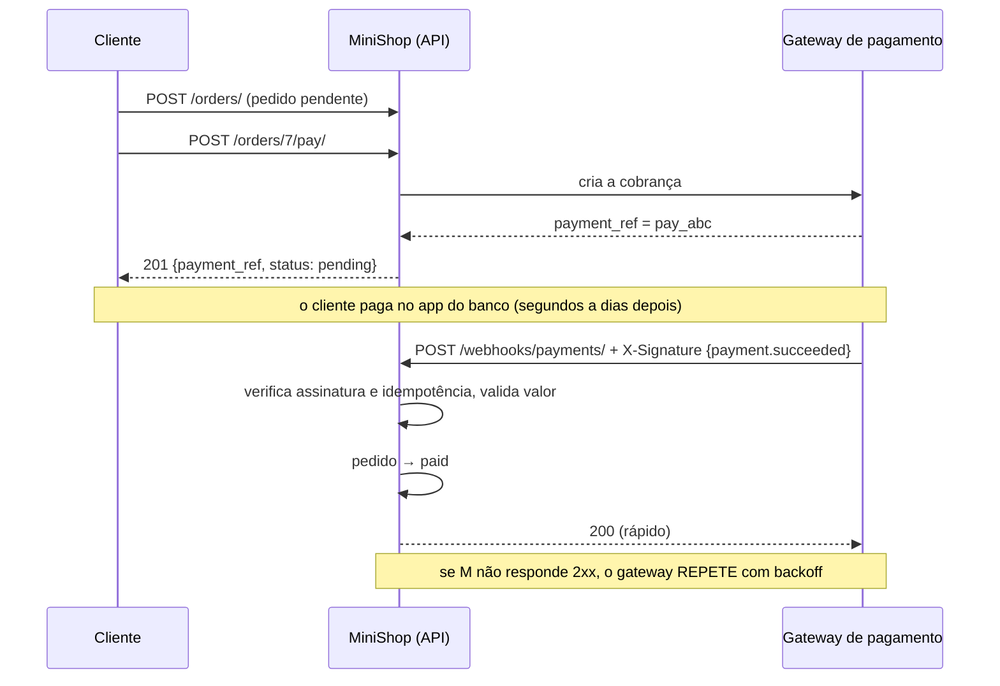

# 9. Webhooks: pagamento simulado

> ⏱️ ~1h30 · Módulo 7 · Pré-requisitos: [7.04](04-httpx-timeouts-retries.md), [7.06](06-filas-celery.md), [7.07](07-retentativas-idempotencia.md), [6.06 (JWT) e 6.13 (idempotência)](../06-apis-rest/13-graphql-grpc-api-completa.md), [5.17](../05-django/17-pedidos-estoque-transacao.md); noções de HMAC ([aula 6.06](../06-apis-rest/06-autenticacao-token-jwt.md))

> ✅ **Verificação.** Código executado em 2026-11-08 com Django 5.2.19 e **Gunicorn** servindo a API de verdade; um **gateway de pagamento de mentira** (script separado, com `httpx`) envia eventos assinados por HTTP real. **As saídas do exemplo 2 são reais**, assim como os 11 testes novos do endpoint (**92** no laboratório). Nenhum gateway real foi usado: o MiniShop continua um projeto de estudo e **não processa pagamentos de verdade**.

## 🎯 Objetivos
Ao final desta aula você consegue:
- Explicar o que é um **webhook** (a API “liga para você”), por que ele substitui o *polling* e como se encaixa no fluxo do pedido
- Receber webhooks com **segurança**: **assinatura HMAC** sobre o corpo bruto, **tolerância de tempo** (anti-*replay*), comparação em tempo constante e limites de tamanho
- Torná-los **idempotentes** (tabela de eventos com `event_id` único) e tolerantes a **duplicatas e à ordem**
- **Validar o que o corpo diz** (valor, pagamento existente) em vez de confiar nele, e **responder 2xx rápido**
- Testar um webhook ponta a ponta, inclusive os ataques (corpo alterado, *replay*, segredo errado)

## 🤔 Por que isso importa
O pagamento por cartão ou Pix **não termina na sua requisição**: o cliente paga no *app* do banco, minutos depois. Como o MiniShop descobre? Há duas formas: **perguntar a cada minuto** (*polling*: caro, lento e exige agendamento) ou **ser avisado** quando acontecer (**webhook**). Só que o webhook é uma **porta aberta na internet**: qualquer um pode fazer `POST` nela dizendo “pedido #7 pago!”. A diferença entre um sistema e uma fraude é a **assinatura**; e a diferença entre um sistema confiável e um que cobra/libera em dobro é a **idempotência**. É tópico de entrevista de qualquer vaga que toque pagamentos.

## 💡 Intuição (explicação simples)
Em vez de você ficar **ligando para a transportadora** a cada hora (“meu pacote chegou?”), ela **liga para você** quando entregar: é o webhook. Dois cuidados. **Quem está ligando é mesmo a transportadora?** Por isso cada ligação traz uma **senha combinada** que só os dois sabem montar (a assinatura); um golpista sem o segredo não consegue. E a transportadora, se você não atender, **liga de novo** até conseguir, às vezes duas ligações chegam juntas, ou a de “entregue” antes da de “saiu para entrega”: você precisa **anotar o número de cada ligação** (para não tratar a mesma duas vezes) e **só aceitar mudanças que avançam o estado**. E atenda **rápido** (“ok, anotei”): o trabalho demorado você faz depois.

## 🔬 Como funciona por dentro

- **Webhook** = uma requisição HTTP `POST` que **o provedor faz para uma URL sua** quando algo acontece (“pagamento aprovado”). Também chamado de *HTTP callback* ou *push*. Seu servidor deixa de ser **cliente** e passa a ser **servidor** de quem você integra.
- **O que o provedor garante:** entrega ***at-least-once*** (**pelo menos uma vez**): se você não responder `2xx` a tempo, ele **repete** (horas, às vezes dias, com *backoff*). Não garante ordem. Logo, o webhook exige **o mesmo desenho das filas** (aula 07): idempotência e tolerância a ordem.
- **Segurança, em camadas:**
  | Camada | O que faz | Por quê |
  |---|---|---|
  | **Assinatura HMAC** | `HMAC-SHA256(segredo, f"{t}.{corpo}")` no cabeçalho | prova que veio de quem conhece o segredo e que o corpo **não foi alterado** |
  | **Corpo bruto** | assinar/verificar os **bytes** recebidos (`request.body`) | re-serializar o JSON muda espaços/ordem e quebra a assinatura |
  | **`compare_digest`** | comparação em tempo constante | evita descobrir a assinatura por tempo de resposta |
  | **Timestamp + tolerância** (5 min) | rejeita assinatura antiga | **anti-*replay***: um atacante que captura uma requisição válida não consegue reenviá-la depois |
  | **Segredo por ambiente**, nunca no Git | `WEBHOOK_SECRET` em variável de ambiente | vazou → rotacione |
  | **HTTPS** | TLS na URL | o segredo não trafega, mas o corpo (dados do cliente) sim |
  | **Limite de tamanho / método** | `413`, `405` | reduz abuso |
  | **Mensagem de erro genérica** | `401 invalid_signature` | não diz **qual** parte falhou |
  | **Allowlist de IP** (se o provedor publica) | defesa extra, **não** substitui a assinatura | IPs mudam e podem ser forjados em certas redes |
- **Idempotência e ordem:** uma tabela `WebhookEvent` com `event_id` **único**: o 1º processa e grava; repetições encontram o registro e respondem `200` sem reprocessar. O **estado só avança** (`pending < failed < paid < refunded`): um `payment.failed` que chega **depois** de `payment.succeeded` é **ignorado**. Assim o resultado final é o **mesmo em qualquer ordem** (exemplo 3).
- **Não confie no corpo para o que importa:** a assinatura prova **quem** mandou, não que o conteúdo seja coerente com o **seu** banco. Confira o **valor** (`amount` ≠ total do pedido → rejeita), o pagamento (referência conhecida) e o **estado** do pedido (se já foi cancelado, não o “pague”, e sinalize). Em provedores reais, uma prática comum é **buscar o estado na API do provedor** (“verificação por *callback*”) em vez de aceitar o que o corpo afirma.
- **Responder rápido:** o provedor tem *timeout* curto (5–30 s). Faça só o essencial no `POST` (verificar, registrar, mudar o estado) e **adie o resto** (e-mail de recibo, nota fiscal, integração com ERP) para uma **tarefa em fila** (aula 06), enfileirada com `on_commit`. Devolva `2xx` **até para duplicatas** e para eventos que você **ignora**; use `4xx`/`5xx` só quando quer que **repitam** (`401` aqui indica um problema que a repetição não resolve).
- **Códigos de resposta:** `2xx` = “recebi, não repita”; `5xx` ou *timeout* = “repita”; `401/403` = assinatura ruim (o provedor normalmente continua repetindo até desistir, mas **você** não processa).
- **CSRF e autenticação:** o endpoint é **público** (sem JWT, sem cookie), então `@csrf_exempt`; a **assinatura é a autenticação**. Nunca desligue o CSRF de views com sessão.
- **Auditoria:** guardar o **evento bruto** (`payload`) e o **resultado** (`processed/ignored/rejected`) permite reconstruir o que aconteceu (e **reprocessar** um evento após corrigir um bug).
- **Sem o gateway real:** o *gateway fake* do exemplo implementa o papel do provedor (assina, envia, repete). No módulo 8, a criação da cobrança passa a ficar atrás de um **Adapter**, e trocar o *fake* pelo provedor real é só implementar essa interface.

## 🛠️ Exemplo prático
**1. Modelos, assinatura e processamento**
```python
# apps/payments/models.py (essencial)
class Payment(models.Model):
    class Status(models.TextChoices):
        PENDING = "pending", "Pendente"
        PAID = "paid", "Pago"
        FAILED = "failed", "Falhou"
        REFUNDED = "refunded", "Estornado"

    order = models.OneToOneField(Order, on_delete=models.PROTECT, related_name="payment")
    provider_ref = models.CharField(max_length=64, unique=True)
    amount = models.DecimalField(max_digits=12, decimal_places=2)
    status = models.CharField(max_length=10, choices=Status.choices, default=Status.PENDING)
    paid_at = models.DateTimeField(null=True, blank=True)
    created_at = models.DateTimeField(auto_now_add=True)


class WebhookEvent(models.Model):
    """Cada evento recebido do gateway, UMA vez (event_id único): é o que torna o webhook idempotente e auditável."""

    class Result(models.TextChoices):
        PROCESSED = "processed", "Processado"
        IGNORED = "ignored", "Ignorado (fora de ordem ou irrelevante)"
        REJECTED = "rejected", "Rejeitado (inconsistente)"

    event_id = models.CharField(max_length=64, unique=True)
    type = models.CharField(max_length=40)
    payload = models.JSONField()
    result = models.CharField(max_length=10, choices=Result.choices)
    detail = models.CharField(max_length=200, blank=True)
    received_at = models.DateTimeField(auto_now_add=True)
```
```python
# apps/payments/security.py
"""Assinatura de webhooks no estilo Stripe: `X-Signature: t=<unix>,v1=<hex>` com v1 = HMAC-SHA256(segredo, f"{t}.{corpo_bruto}")."""
import hashlib
import hmac
import time

TOLERANCIA = 300                                              # segundos: acima disso, é replay


class AssinaturaInvalida(Exception):
    pass


def assinar(segredo: str, corpo: bytes, agora: int | None = None) -> str:
    t = int(agora if agora is not None else time.time())
    v1 = hmac.new(segredo.encode(), f"{t}.".encode() + corpo, hashlib.sha256).hexdigest()
    return f"t={t},v1={v1}"


def verificar(segredo: str, corpo: bytes, cabecalho: str | None, agora: int | None = None) -> None:
    if not cabecalho:
        raise AssinaturaInvalida("cabeçalho ausente")
    try:
        partes = dict(p.split("=", 1) for p in cabecalho.split(","))
        t, recebida = int(partes["t"]), partes["v1"]
    except (KeyError, ValueError):
        raise AssinaturaInvalida("cabeçalho malformado") from None
    esperada = hmac.new(segredo.encode(), f"{t}.".encode() + corpo, hashlib.sha256).hexdigest()
    if not hmac.compare_digest(esperada, recebida):          # tempo constante: não vaza quantos caracteres bateram
        raise AssinaturaInvalida("assinatura não confere")
    if abs((agora if agora is not None else time.time()) - t) > TOLERANCIA:
        raise AssinaturaInvalida("timestamp fora da tolerância (replay?)")
```
```python
# apps/payments/services.py
ORDEM = {"pending": 0, "failed": 1, "paid": 2, "refunded": 3}      # estados só ANDAM para frente (fora de ordem não retrocede)


@transaction.atomic
def processar_evento(evento: dict) -> tuple[str, str]:
    """Aplica UM evento do gateway. Devolve (resultado, detalhe). Idempotente por event_id; tolerante a ordem e duplicata."""
    existente = WebhookEvent.objects.filter(event_id=evento["id"]).first()
    if existente:
        return "duplicate", f"evento já {existente.result}"
    tipo, dados = evento["type"], evento.get("data", {})

    def registrar(resultado, detalhe=""):
        WebhookEvent.objects.create(event_id=evento["id"], type=tipo, payload=evento, result=resultado, detail=detalhe)
        return resultado, detalhe

    novo = {"payment.succeeded": "paid", "payment.failed": "failed", "payment.refunded": "refunded"}.get(tipo)
    if novo is None:
        return registrar("ignored", f"tipo desconhecido: {tipo}")
    pagamento = Payment.objects.select_for_update().select_related("order").filter(provider_ref=dados.get("payment_ref")).first()
    if pagamento is None:
        return registrar("rejected", "pagamento desconhecido")
    if novo == "paid" and Decimal(str(dados.get("amount"))) != pagamento.amount:           # NUNCA confie só no que o corpo diz
        return registrar("rejected", f"valor divergente: recebido {dados.get('amount')} ≠ esperado {pagamento.amount}")
    if ORDEM[novo] <= ORDEM[pagamento.status]:
        return registrar("ignored", f"fora de ordem: já está {pagamento.status}, chegou {novo}")
    pagamento.status = novo
    if novo == "paid":
        pagamento.paid_at = timezone.now()
        order = Order.objects.select_for_update().get(pk=pagamento.order_id)
        if order.status == Order.Status.PENDING:
            order.status = Order.Status.PAID
            order.save(update_fields=["status"])
        else:                                                                                  # pagou um pedido já cancelado: precisa de atenção humana
            logger.warning("pagamento_em_pedido_nao_pendente order=%s status=%s", order.pk, order.status)
    pagamento.save()
    return registrar("processed", f"pagamento {novo}")
```
Pontos de desenho: `select_for_update` no pagamento e no pedido (dois webhooks simultâneos do mesmo pagamento **serializam**); o `WebhookEvent` é gravado **na mesma transação** que muda o estado (ou os dois, ou nenhum); o valor é comparado como `Decimal` (nunca `float`, aula 5.16); e eventos **inconsistentes** ficam **registrados** como `rejected`, não perdidos.

**2. O endpoint e o início do pagamento**
```python
# apps/payments/api.py
import json
import logging

from django.conf import settings
from django.http import JsonResponse
from django.views.decorators.csrf import csrf_exempt
from django.views.decorators.http import require_POST

from .security import AssinaturaInvalida, verificar
from .services import processar_evento

logger = logging.getLogger(__name__)
LIMITE_CORPO = 64 * 1024


@csrf_exempt                                                  # não há sessão/cookie: a autenticação é a ASSINATURA
@require_POST
def webhook_pagamentos(request):
    corpo = request.body                                      # BYTES brutos: a assinatura é sobre eles (nunca re-serialize o JSON)
    if len(corpo) > LIMITE_CORPO:
        return JsonResponse({"detail": "corpo grande demais", "code": "payload_too_large"}, status=413)
    try:
        verificar(settings.WEBHOOK_SECRET, corpo, request.headers.get("X-Signature"))
    except AssinaturaInvalida as e:
        logger.warning("webhook_rejeitado motivo=%s ip=%s", e, request.META.get("REMOTE_ADDR"))
        return JsonResponse({"detail": "assinatura inválida", "code": "invalid_signature"}, status=401)   # mensagem genérica
    try:
        evento = json.loads(corpo)
        evento["id"], evento["type"]
    except (ValueError, KeyError, TypeError):
        return JsonResponse({"detail": "evento malformado", "code": "bad_event"}, status=400)
    resultado, detalhe = processar_evento(evento)
    logger.info("webhook evento=%s tipo=%s resultado=%s detalhe=%s", evento["id"], evento["type"], resultado, detalhe)
    return JsonResponse({"received": True, "result": resultado}, status=200)                             # 2xx RÁPIDO, mesmo p/ duplicata
```
```python
# config/urls.py
path("api/v1/webhooks/payments/", webhook_pagamentos, name="webhook-payments"),

# config/settings.py
WEBHOOK_SECRET = os.environ.get("WEBHOOK_SECRET", "whsec_lab_apenas_para_estudo")   # em produção: variável de ambiente, longa e aleatória
```
```python
# apps/orders/api.py (OrderViewSet): o cliente pede para pagar; o MiniShop cria a cobrança (aqui, com uma referência gerada localmente)
@action(detail=True, methods=["post"])
def pay(self, request, pk=None, **kwargs):
    from apps.payments import services as pagamentos
    order = self.get_object()
    if order.status != Order.Status.PENDING:
        raise ValidationError({"detail": "Só pedidos pendentes podem ser pagos."})
    existente = getattr(order, "payment", None)
    if existente:                                             # idempotente: pagar duas vezes devolve a mesma cobrança
        return Response({"payment_ref": existente.provider_ref, "amount": str(existente.amount), "status": existente.status})
    ref = "pay_" + uuid.uuid4().hex[:16]                      # no real: a referência vem da API do gateway (módulo 8: Adapter)
    p = pagamentos.criar_pagamento(order, ref)
    return Response({"payment_ref": p.provider_ref, "amount": str(p.amount), "status": p.status}, status=status.HTTP_201_CREATED)
```
(O `pay` usa as mesmas permissões do `cancel`: só o **dono** do pedido, aula 6.07.)

**3. O “gateway” de mentira e a bateria de ataques** (`gateway_fake.py` + `webhook_demo.py`; a API roda no Gunicorn e **o nosso servidor falha de propósito nas 2 primeiras entregas**)
```python
# gateway_fake.py (o papel do provedor: assina, envia, e REPETE até receber 2xx)
def enviar(url, segredo, ev, *, corpo=None, cabecalho=None, timestamp=None, tentativas=1, espera=0.2, dormir=time.sleep):
    """Envia o evento. `corpo`/`cabecalho` permitem forjar ataques. Repete (como o gateway) enquanto não vier 2xx."""
    bruto = corpo if corpo is not None else json.dumps(ev, separators=(",", ":")).encode()
    assinatura = cabecalho if cabecalho is not None else assinar(segredo, bruto, agora=timestamp)
    for n in range(tentativas):
        r = httpx.post(url, content=bruto, headers={"Content-Type": "application/json", "X-Signature": assinatura}, timeout=5)
        if 200 <= r.status_code < 300:
            return r, n + 1
        if n + 1 < tentativas:
            dormir(espera * 2 ** n)                                   # backoff do gateway
    return r, tentativas
```
```bash
LAB=$PWD uv run python webhook_demo.py
```
```text
pedido #1 criado (total 114.60); POST /orders/1/pay/ → pay_653f85e3c0f4477f (pending)
antes de qualquer webhook: pedido=pending, pagamento=pending 

--- o gateway tenta entregar, mas NOSSO servidor está instável (503 nas 2 primeiras vezes)
1) payment.succeeded (entregue na tentativa 3)             → 200 processed          pedido=paid, pagamento=paid

--- depois disso, tudo o que pode dar errado:
2) o MESMO evento de novo (duplicata)                      → 200 duplicate          eventos gravados: 1
3) corpo ALTERADO depois de assinado                       → 401 invalid_signature  
4) assinado com o segredo ERRADO                           → 401 invalid_signature  
5) REPLAY: assinatura válida, mas de 10 minutos atrás      → 401 invalid_signature  
6) sem assinatura                                          → 401 invalid_signature  
7) payment.failed chegando DEPOIS do succeeded (fora de ordem) → 200 ignored            pedido=paid, pagamento=paid
8) pagamento desconhecido                                  → 200 rejected           
9) valor DIVERGENTE (0,01 em vez de 57.30)                 → 200 rejected           pedido=pending, pagamento=pending
10) assinatura válida, corpo não é JSON                    → 400 bad_event          
11) corpo de 70 KB (limite 64 KB)                          → 413 payload_too_large  
12) GET no endpoint                                        → 405

--- auditoria: tabela WebhookEvent
  evt_sucesso_1      payment.succeeded  processed  pagamento paid
  evt_da662da2ae2c   payment.failed     ignored    fora de ordem: já está paid, chegou failed
  evt_ed822cfd2945   payment.succeeded  rejected   pagamento desconhecido
  evt_633b52c17701   payment.succeeded  rejected   valor divergente: recebido 0.01 ≠ esperado 57.30
```
Como ler (cada linha é um cenário real, por HTTP):
- **1) Entrega com falhas:** o nosso servidor devolveu `503` duas vezes; o gateway **repetiu** (backoff) e a **3ª tentativa** foi processada: pedido e pagamento `paid`. É o *at-least-once* em ação.
- **2) Duplicata:** o mesmo evento outra vez → `200 duplicate`, **1** evento gravado: nada foi reprocessado.
- **3) Corpo alterado depois de assinado** (o atacante troca o valor): **`401`**. A assinatura cobre os bytes; mudar um caractere a invalida.
- **4) Segredo errado:** `401`. Sem o segredo, não há assinatura válida.
- **5) *Replay*:** assinatura **válida**, mas de **10 minutos atrás** → `401`: o carimbo de tempo fora da tolerância bloqueia a reutilização de uma captura.
- **6) Sem assinatura:** `401`.
- **7) Fora de ordem:** `payment.failed` depois de `succeeded` → `200 ignored`; o pedido **continua `paid`**.
- **8) Pagamento desconhecido** e **9) valor divergente** (0,01 em vez de 57,30): `200 rejected`, **registrados**, e o pedido **continua pendente**. Repare: devolvemos `200` mesmo rejeitando, para o gateway **não ficar repetindo** um evento que nunca será aceito, e guardamos o motivo para auditoria.
- **10) Corpo que não é JSON** (com assinatura válida): `400`; **11) 70 KB**: `413`; **12) `GET`**: `405`.
- A tabela **`WebhookEvent`** no fim é a trilha de auditoria: 4 eventos únicos, cada um com `processed/ignored/rejected` e o motivo (as rejeições por assinatura **não** entram: eram requisições falsas e não eventos).

**4. Ordem e duplicatas, sem banco** (`reducer.py`)
```python
"""Eventos podem chegar duplicados e FORA DE ORDEM. Um 'redutor' correto dá o MESMO estado final em qualquer ordem."""
import itertools

ORDEM = {"pending": 0, "failed": 1, "paid": 2, "refunded": 3}
TIPO_PARA_ESTADO = {"payment.failed": "failed", "payment.succeeded": "paid", "payment.refunded": "refunded"}


def aplicar(estado_atual, tipo):
    novo = TIPO_PARA_ESTADO[tipo]
    return novo if ORDEM[novo] > ORDEM[estado_atual] else estado_atual        # só ANDA para frente


def reduzir(eventos):
    vistos, estado = set(), "pending"
    for eid, tipo in eventos:
        if eid in vistos:                                                      # duplicata: ignora
            continue
        vistos.add(eid)
        estado = aplicar(estado, tipo)
    return estado


eventos = [("e1", "payment.failed"), ("e2", "payment.succeeded"), ("e3", "payment.refunded")]
finais = {}
for perm in itertools.permutations(eventos):
    finais.setdefault(reduzir(perm), []).append([tipo.split(".")[1] for _, tipo in perm])
print("6 ordens possíveis de chegada → estados finais distintos:", list(finais))
print("exemplo: refunded, failed, succeeded →", reduzir([("e3", "payment.refunded"), ("e1", "payment.failed"), ("e2", "payment.succeeded")]))
print("com duplicatas (e2 chega 3 vezes)    →", reduzir([("e2", "payment.succeeded")] * 3))

# o ERRO clássico: aplicar 'o último que chegou' (sem ordem de estados) depende da ordem
def ingenuo(evs):
    estado = "pending"
    for _, tipo in evs:
        estado = TIPO_PARA_ESTADO[tipo]
    return estado

print("\nredutor ingênuo ('o último vence'):", {ingenuo(p) for p in itertools.permutations(eventos)}, "← depende da ordem: BUG")
```
```text
6 ordens possíveis de chegada → estados finais distintos: ['refunded']
exemplo: refunded, failed, succeeded → refunded
com duplicatas (e2 chega 3 vezes)    → paid

redutor ingênuo ('o último vence'): {'failed', 'paid', 'refunded'} ← depende da ordem: BUG
```
Com a regra “o estado só avança”, as **seis** ordens possíveis de chegada de três eventos terminam **sempre** em `refunded`, e três cópias do mesmo evento valem por um. O redutor “ingênuo” (“o último que chegou vence”) produziu **três** resultados diferentes conforme a ordem: **bug que só aparece em produção**, quando o gateway reordena.

**5. Testes (executados: 11 do webhook)**
```python
# tests/test_webhooks.py (trechos)
def test_evento_duplicado_nao_reprocessa(pagamento):
    assert enviar(evento(pagamento)).json()["result"] == "processed"
    assert enviar(evento(pagamento)).json()["result"] == "duplicate"
    assert WebhookEvent.objects.count() == 1


def test_assinatura_errada_adulterada_ou_ausente_da_401(pagamento):
    ev = evento(pagamento)
    assert enviar(ev, segredo="outro").status_code == 401
    bruto = json.dumps(ev, separators=(",", ":")).encode()
    assert enviar(None, corpo=bruto.replace(b"evt_1", b"evt_2"), cabecalho=security.assinar(SEGREDO, bruto)).status_code == 401
    assert enviar(ev, cabecalho="").status_code == 401
    pagamento.refresh_from_db()
    assert pagamento.status == "pending" and WebhookEvent.objects.count() == 0       # nada foi gravado


def test_replay_antigo_e_rejeitado(pagamento):
    assert enviar(evento(pagamento), agora=int(time.time()) - 600).status_code == 401
    assert enviar(evento(pagamento), agora=int(time.time()) - 60).status_code == 200      # dentro da tolerância


def test_valor_divergente_e_rejeitado(pagamento):
    r = enviar(evento(pagamento, valor="0.01"))
    assert r.json()["result"] == "rejected"
    pagamento.refresh_from_db()
    assert pagamento.status == "pending" and pagamento.order.status == "pending"
```
```bash
uv run pytest -q
```
```text
92 passed
```
Os testes usam o cliente de teste do Django com o corpo bruto e a assinatura calculada, sem servidor nem rede. Um deles confere que a verificação usa `compare_digest` (um lembrete de que o tempo constante é parte do contrato de segurança). Ao acrescentar o endpoint `pay`, o **teste do schema commitado** falhou, como deveria: o contrato mudou; foi só regenerar o `schema.yml` (aula 6.10). E a verificação de **cobertura de rotas** (aula 6.12) apontou o `pay` “sem teste” até o teste passar a usar uma variável simples na URL: lembrete de que aquele verificador é uma **heurística** (procura a chamada com um padrão de texto).

## 🧠 Pausa para lógica
**Problema (o redutor de eventos).** Escreva `reduzir(eventos)`, onde cada evento é `(id, tipo)` com tipos `payment.failed`, `payment.succeeded` e `payment.refunded`. Regras: ignore ids repetidos; o estado só **avança** na ordem `pending < failed < paid < refunded`. Prove, com `itertools.permutations`, que o estado final é o **mesmo** em todas as ordens de chegada, e mostre um redutor “ingênuo” cujo resultado **depende** da ordem.

<details><summary>Dica</summary>
Um dicionário <code>ORDEM</code> dá um número a cada estado; <code>novo if ORDEM[novo] &gt; ORDEM[atual] else atual</code> é a função de avanço. Ela é <strong>comutativa e idempotente</strong> (é um <code>max</code>), por isso a ordem e a repetição não importam.
</details>

<details><summary>Solução comentada</summary>

É o `reducer.py` do exemplo 4 (executado). A ideia matemática: o redutor é um **máximo** sobre um conjunto ordenado, e `max` é comutativo, associativo e idempotente; essas três propriedades garantem o mesmo resultado para qualquer permutação e para repetições. Em sistemas distribuídos isso se chama **CRDT** (tipo de dado replicado sem conflito) em sua forma mais simples. O mesmo raciocínio vale para qualquer máquina de estados alimentada por mensagens não ordenadas.
</details>

## ⚠️ Erros comuns e boas práticas
| Mensagem / sintoma | Causa | Solução |
|---|---|---|
| Assinatura “nunca confere” só com o provedor real | Verificou sobre o JSON **re-serializado** (`request.data`) | Verificar sobre `request.body` (bytes brutos) |
| `403 CSRF verification failed` no webhook | CSRF ativo numa rota sem sessão | `@csrf_exempt` **só** nessa view (a assinatura autentica) |
| Pedido liberado duas vezes / e-mail duplicado | Webhook repetido sem idempotência | `WebhookEvent.event_id` único + estado que só avança |
| Gateway desiste e o pedido fica `pending` | O endpoint demora (> timeout) ou devolve `5xx` por trabalho pesado | Responder 2xx rápido; enfileirar o resto (aula 06) |
| Gateway repete eternamente um evento inútil | Devolvemos `4xx/5xx` para evento irrelevante | `2xx` para duplicatas/ignorados/rejeitados (e registrar) |
| Atacante “paga” pedidos sem pagar | Endpoint sem verificação de assinatura, ou segredo fraco/vazado | HMAC + segredo forte por ambiente + rotação |
| *Replay* de uma requisição capturada funciona | Sem timestamp/tolerância | `t=` na assinatura e janela de 5 min |
| Valor do pedido alterado por um corpo forjado/bug | Confiança no `amount` do evento | Comparar com o valor **gravado** (`Decimal`); rejeitar divergências |
| Status volta de `paid` para `failed` | “O último que chegou vence” | Ordem de estados que só avança |
| Segredo no repositório/log | `WEBHOOK_SECRET` fixo no código; `print(headers)` | Variável de ambiente; nunca registrar cabeçalhos de assinatura |
| Comparar assinaturas com `==` | Vazamento por tempo | `hmac.compare_digest` |
| Sem trilha de auditoria | Eventos não gravados | Guardar `payload`, `result` e `detail` |

- **Trate o webhook como entrada hostil:** verifique a assinatura **antes** de qualquer outro trabalho, valide tudo o que o corpo afirma e **não** exponha detalhes no erro.
- **Idempotência + ordem + auditoria** são o trio obrigatório; **resposta rápida + fila** é o que o mantém de pé sob carga.
- **Rotação de segredo:** aceite temporariamente dois segredos (o novo e o antigo) durante a troca.
- **Teste os ataques**, não só o caminho feliz: corpo alterado, segredo errado, *replay*, duplicata, fora de ordem, valor divergente.
- **Não faça `polling` por hábito:** se o provedor oferece webhook, use-o; mantenha um *job* de **reconciliação** (aula 08) para casos em que o evento nunca chegou (“pagamentos pendentes há mais de X minutos: consulte o provedor”).
- Para **enviar** webhooks (o MiniShop avisando parceiros) valem as mesmas regras do outro lado: assinar, repetir com *backoff*, `event_id`, ordem e **timeout** curto.

## 🧩 Exercícios
**1. Fixação**
(a) Que problema o webhook resolve em relação ao *polling*? (b) O que a assinatura HMAC garante e o que **não** garante? (c) Para que serve o timestamp na assinatura? (d) Por que devolver `200` para um evento duplicado ou rejeitado?

<details><summary>Solução</summary>

(a) Evita consultar periodicamente (caro e lento) e reage no instante do evento. (b) Garante autoria (quem tem o segredo) e integridade (corpo não alterado); **não** garante que o conteúdo seja coerente com o seu banco, nem protege contra *replay* sem timestamp. (c) Limita a validade de uma assinatura, impedindo que uma requisição capturada seja reenviada depois. (d) `2xx` diz ao provedor “recebi, não repita”; um `4xx/5xx` faria o provedor repetir um evento que nunca será aceito ou que já foi tratado.
</details>

**2. Aplicação no projeto MiniShop** *(entrega do módulo: webhook de pagamento que muda o pedido para `paid`)*
Implemente o recebimento do pagamento simulado.

Critérios de pronto:
- [ ] Modelos `Payment` e `WebhookEvent` com restrições (`provider_ref` único, `event_id` único, valor ≥ 0) e migrações
- [ ] `POST /orders/{id}/pay/` (só o dono; idempotente) e `POST /api/v1/webhooks/payments/` com **assinatura HMAC + timestamp + `compare_digest`**, `csrf_exempt`, limite de 64 KB e erro genérico
- [ ] Processamento **idempotente por `event_id`**, estado que só avança, valor comparado como `Decimal` e eventos inconsistentes registrados como `rejected`
- [ ] Um script de **gateway de mentira** que assina, envia e **repete** com *backoff*, mais a bateria de ataques (adulterado, segredo errado, *replay*, duplicata, fora de ordem, valor divergente)
- [ ] Testes de todos os cenários, sem servidor; o `schema.yml` regenerado e a cobertura de rotas em 100%
- [ ] `WEBHOOK_SECRET` por variável de ambiente (`.env.example`), documentado no README com as regras de **rotação**
- [ ] Ao pagar: `transaction.on_commit` para enfileirar o e-mail de recibo (reaproveite a tarefa idempotente da aula 07, criando um tipo `payment_receipt`)
- [ ] Um *job* agendado (aula 08) que, para `Payment` pendente há mais de 30 min, apenas **registra um alerta** (no real, consultaria o provedor)
- [ ] Commit `feat(payments): signed, idempotent payment webhook`

<details><summary>Solução de referência (rotação de segredo)</summary>

```python
# settings: WEBHOOK_SECRETS = os.environ["WEBHOOK_SECRETS"].split(",")   # novo,antigo durante a troca
def verificar_com_rotacao(segredos, corpo, cabecalho):
    erro = None
    for s in segredos:
        try:
            return verificar(s, corpo, cabecalho)
        except AssinaturaInvalida as e:
            erro = e
    raise erro
```
Depois que o provedor passar a usar apenas o segredo novo (e os eventos antigos tiverem sido entregues), remova o antigo da lista.
</details>

**3. Desafio (opcional)**
Implemente a **verificação por *callback***: ao receber `payment.succeeded`, **não** confie no corpo: consulte (com `httpx`, *timeout* e retentativa da aula 04) um endpoint do gateway falso `GET /payments/{ref}` e só marque como pago se **ele** disser que está pago e o valor bater. Mostre um ataque em que o corpo forjado (com assinatura válida, por um segredo vazado) é recusado porque a consulta ao provedor discorda.

## 🎤 Na entrevista
- **O que é um webhook e como difere do polling?** O provedor chama uma URL sua quando algo acontece; no polling você pergunta periodicamente. O webhook é imediato e mais barato, mas exige endpoint público seguro e tolerância a duplicatas/ordem.
- **Como proteger um webhook?** Assinatura HMAC sobre o corpo bruto com segredo compartilhado, comparação em tempo constante, timestamp com tolerância contra *replay*, HTTPS, limite de tamanho, erro genérico e, como camada extra, allowlist de IP; e validar o conteúdo contra o seu banco.
- **Como tratar webhooks duplicados e fora de ordem?** Guardar o `event_id` único (idempotência), aplicar transições de estado que só avançam, e responder `2xx` para o que já foi tratado; opcionalmente reconciliar consultando o provedor.
- **Por que responder rápido ao webhook?** Provedores têm *timeout* curto e repetem se não houver 2xx; faz-se o mínimo (verificar, registrar, mudar o estado) e o resto vai para uma fila.
- **O que fazer se o webhook nunca chega?** Uma rotina agendada de reconciliação que consulta pagamentos pendentes antigos na API do provedor.

## 📚 Para ir além
- 📄 Documentação: [Stripe — Webhooks](https://docs.stripe.com/webhooks). Assinatura com `t=` e `v1=`, tolerância e retentativas (modelo da aula).
- 📄 Documentação: [GitHub — Validando entregas de webhook](https://docs.github.com/en/webhooks/using-webhooks/validating-webhook-deliveries). HMAC-SHA256 e comparação segura.
- 📄 Especificação aberta: [Standard Webhooks](https://www.standardwebhooks.com/). Convenções de assinatura e entrega.
- 📄 Documentação oficial: [`hmac` (Python)](https://docs.python.org/3/library/hmac.html). `hmac.new`, `compare_digest`.
- 📄 Especificação: [RFC 2104 — HMAC](https://www.rfc-editor.org/rfc/rfc2104). Como o HMAC funciona.
- 📄 Documentação oficial: [Django — CSRF](https://docs.djangoproject.com/en/5.2/ref/csrf/). `csrf_exempt` e quando é seguro.
- 📄 Documentação oficial: [Django — transações](https://docs.djangoproject.com/en/5.2/topics/db/transactions/). `atomic`, `on_commit`, `select_for_update`.
- 📑 Artigo/tutorial: [OWASP — Input Validation Cheat Sheet](https://cheatsheetseries.owasp.org/cheatsheets/Input_Validation_Cheat_Sheet.html). Validar o que vem de fora.
- 🏋️ Prática extra: use `curl` para enviar um webhook assinado ao endpoint (calcule a assinatura com `openssl dgst -sha256 -hmac`) e depois altere um byte do corpo.

> Links verificados em 2026-11-08 (HTTP 200).

## ✅ Checklist da aula
- [ ] Entendi o fluxo: pedido → pagar → webhook → pedido `paid`
- [ ] Verifico a assinatura HMAC sobre o corpo **bruto**, com timestamp e `compare_digest`
- [ ] O processamento é idempotente por `event_id` e o estado só avança
- [ ] Valido o valor e o pagamento contra o meu banco e respondo rápido
- [ ] Testei duplicata, adulteração, *replay*, fora de ordem e valor divergente
