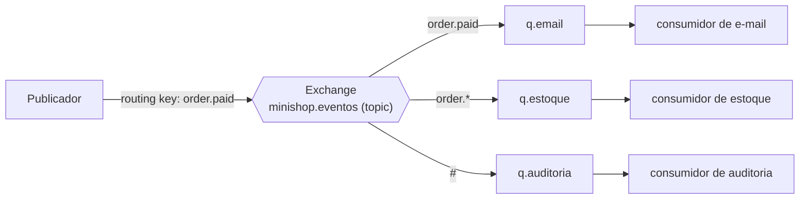

# 10. Mensageria (RabbitMQ/SQS), eventos e WebSockets

> ⏱️ ~1h30 · Módulo 7 · Pré-requisitos: [7.05 (ASGI)](05-wsgi-asgi.md), [7.06](06-filas-celery.md), [7.07](07-retentativas-idempotencia.md), [7.09](09-webhooks.md), [5.17 (transações)](../05-django/17-pedidos-estoque-transacao.md)

> ✅ **Verificação.** Código executado em 2026-11-08 com **RabbitMQ 4.4** (contêiner oficial), **pika 1.4.4**, **Django Channels 4.3.2**, **channels-redis 4.3.0**, Redis 8, Uvicorn, Gunicorn e `websockets` 17. **Todas as saídas abaixo são reais.** O **Amazon SQS não foi executado** (exige conta AWS, assunto do módulo 13): os números citados vêm da documentação oficial, consultada em 2026-11-08. **97 testes** do laboratório passaram (5 novos nesta aula: WebSocket e *outbox*).

## 🎯 Objetivos
Ao final desta aula você consegue:
- Distinguir **fila de tarefas**, **mensageria (broker)** e **log de eventos**, e escolher entre Celery/Redis, RabbitMQ, SQS e Kafka
- Usar RabbitMQ: *exchanges* (`direct`/`topic`/`fanout`), filas, *bindings*, `ack`, *prefetch*, mensagens persistentes, **fila de mortos** e **confirmação de publicação**
- Explicar **arquitetura orientada a eventos** e o problema da **escrita dupla**, e resolvê-lo com o **outbox transacional** e **consumidores idempotentes**
- Colocar **tempo real** no MiniShop com **WebSockets** (Django Channels): autenticação, **autorização por recurso** e *broadcast* entre processos
- Comparar WebSocket, **SSE** e *long polling*

## 🤔 Por que isso importa
Conforme o sistema cresce, “o pedido foi pago” precisa **acionar vários interessados**: e-mail de recibo, baixa de estoque, nota fiscal, métricas, o painel do cliente em tempo real. Se o código do pagamento chamar cada um (acoplamento), qualquer lentidão ou falha nesses vizinhos **derruba o pagamento**. A solução é **publicar um evento** (“pedido pago”) e deixar cada interessado **reagir por conta própria**. Isso introduz perguntas que entrevistas adoram: como garantir que o evento **não se perde** (e que não duplica efeito)? e como mostrar ao usuário **na hora**, sem ele recarregar a página?

## 💡 Intuição (explicação simples)
Pense no **quadro de avisos de um condomínio** (o *exchange*). Em vez de a portaria ligar para cada morador, ela **pendura um aviso** (“encomenda chegou”, com um assunto). Cada morador tem uma **caixinha de correio** (a fila) e escolheu **quais assuntos** quer receber (*binding*): o do 12 só quer “encomenda”, o síndico quer **tudo** (“#”). Quem lê precisa **assinar o recibo** (ack) para o aviso sair da caixinha; se o morador some sem assinar, o aviso **volta** para a caixinha. E há um detalhe da portaria: ela **primeiro anota no livro** (o banco) e só depois pendura o aviso; se tentasse fazer as duas coisas “ao mesmo tempo” e caísse no meio, o aviso **sumiria**. Por isso o **livro de saída** (outbox) guarda o aviso **junto com a anotação**, e um funcionário o pendura em seguida. E o **WebSocket** é o **interfone aberto**: o prédio avisa o morador **na hora**, sem ele descer para perguntar.

## 🔬 Como funciona por dentro
**Três ideias que se confundem**
| | Fila de tarefas (Celery) | Broker de mensagens (RabbitMQ, SQS) | Log de eventos (Kafka) |
|---|---|---|---|
| Foco | “execute esta função depois” | “entregue esta mensagem a quem interessa” | “registre fatos em ordem; vários leem quando quiserem” |
| Consumo | uma tarefa → **um** worker | fila: um consumidor; *pub/sub*: **vários** (uma cópia por fila) | consumidores **relêem** do passado (retenção) |
| Retenção | some depois do `ack` | some depois do `ack` | **fica** (dias/semanas/para sempre) |
| Bom para | tarefas em segundo plano | integrar serviços, *fan-out*, desacoplar | *streaming*, reprocessar histórico, alta vazão |

**RabbitMQ (AMQP)**

- **Publicador → *exchange* → fila → consumidor.** O publicador **nunca** escreve direto numa fila: entrega a um ***exchange***, que roteia segundo as regras (***bindings***) para as filas. Tipos: **`direct`** (chave exata), **`topic`** (padrões: `order.*` = uma palavra, `#` = zero ou mais), **`fanout`** (todas as filas ligadas), `headers`.
- **Confirmações (*acks*):** o consumidor só confirma (`basic_ack`) **depois** de processar; sem *ack* (conexão caiu), o broker **reentrega** com `redelivered=True`. `basic_nack(requeue=False)` rejeita **sem** reentregar (vai para a fila de mortos).
- **Prefetch (`basic_qos`):** quantas mensagens **não confirmadas** um consumidor pode ter. Sem limite, o broker empurra **tudo** para quem conectou primeiro (o experimento mostra). Com `prefetch=1`, o trabalho é distribuído por **capacidade** (despacho justo).
- **Durabilidade:** `durable=True` (a fila sobrevive a reinício) **e** `delivery_mode=2` (a mensagem é persistente). As duas.
- **Confirmação do publicador (*publisher confirms*) e `mandatory`:** com `confirm_delivery()`, o broker confirma que **recebeu**; com `mandatory=True`, uma mensagem que **não casou com nenhuma fila** é devolvida (`UnroutableError`), em vez de sumir em silêncio.
- **Fila de mortos (*dead-letter*):** mensagens **rejeitadas**, **expiradas** (TTL) ou que excederam o limite vão para uma *exchange* de mortos (`x-dead-letter-exchange`), onde ficam para análise/reprocessamento, sem travar a fila principal.
- **Ordem:** garantida **dentro de uma fila com um consumidor**; com vários consumidores (ou reentregas), **não**. Projete para **tolerar** a ordem (aula 09).

**Amazon SQS (conceito; módulo 13)**
| Característica | Fila **Standard** | Fila **FIFO** |
|---|---|---|
| Entrega | **pelo menos uma vez** (duplicatas possíveis) | **uma vez** dentro de uma janela de deduplicação |
| Ordem | **melhor esforço** | **garantida** por grupo de mensagens (`MessageGroupId`) |
| Vazão | muito alta | menor |
- **Visibilidade (*visibility timeout*):** ao receber, a mensagem fica **invisível** para outros por um tempo (padrão **30 s**, máximo 12 h); se você não a **apagar** (equivalente ao *ack*) até lá, ela **reaparece**: é a mesma lógica do `mini_broker` da aula 06. **Retenção:** 4 dias por padrão (60 s a 14 dias). **Tamanho:** até 1 MiB. **Fila de mortos (DLQ):** após `maxReceiveCount` entregas sem sucesso, a mensagem vai para a DLQ. ***Long polling*** (`WaitTimeSeconds`) reduz chamadas vazias. Preço por requisição; sem servidor para operar.
- **Quando cada um:** **Celery + Redis** (o que usamos) para tarefas simples; **RabbitMQ** quando há roteamento rico, vários consumidores por evento e você opera o broker; **SQS (+SNS)** na AWS, sem operar nada; **Kafka** quando o log de eventos e o reprocessamento do histórico são o ponto.

**Eventos e o problema da escrita dupla**
- **Comando × evento:** um **comando** pede uma ação (“cobre o pedido 7”; pode falhar, tem **um** destinatário); um **evento** relata um **fato passado** (“pedido 7 foi pago”; não se discute, tem **muitos** interessados). Nomeie eventos no passado (`order.paid`).
- **Orquestração × coreografia:** na *orquestração*, um coordenador manda cada passo; na *coreografia*, cada serviço **reage a eventos** e emite os seus. A segunda desacopla mais, mas torna o fluxo mais difícil de enxergar (use rastreamento, módulo 14).
- **Consistência eventual:** os consumidores atualizam **depois**; por instantes, sistemas divergem. Aceite isso conscientemente.
- **A escrita dupla (*dual write*):** “atualizar o banco **e** publicar a mensagem” envolve **dois sistemas sem transação em comum**. Se o processo cai **entre** os dois, ou o banco muda e o evento se perde, ou o evento sai e o banco não mudou. **Não há `try/except` que resolva.** (O experimento A mostra o evento perdido.)
- **Outbox transacional:** grave o **evento numa tabela do próprio banco, na mesma transação** que muda o estado (**ou ambos, ou nenhum**); um **relé** lê os eventos não publicados e os publica no broker, marcando-os depois. Se o relé cair entre publicar e marcar, o evento é publicado **de novo**: *at-least-once*. Logo o **consumidor precisa ser idempotente** (registrar o `message_id` processado). É a mesma dupla “entrega *at-least-once* + efeito idempotente” de toda a aula 07.
- **Versionar eventos:** o evento é um **contrato** (aula 6.02): acrescente campos opcionais; não renomeie nem remova; inclua `id`, `type`, `version`, `occurred_at`.

**WebSockets (tempo real)**
| | *Polling* / *long polling* | **SSE** (Server-Sent Events) | **WebSocket** |
|---|---|---|---|
| Direção | cliente pergunta | só **servidor → cliente** | **bidirecional** |
| Protocolo | HTTP normal | HTTP (`text/event-stream`) | upgrade para `ws://`/`wss://` |
| Reconexão | você escreve | **automática** no navegador | você escreve |
| Bom para | simples, baixa frequência | notificações, painéis, *feeds* | chat, jogos, colaboração |
- O **WebSocket** começa como um `GET` HTTP com `Upgrade: websocket`; depois a conexão fica **aberta** e os dois lados trocam mensagens. Exige **ASGI** (aula 05): uma conexão aberta ocupa uma corrotina, não uma *thread*.
- **Django Channels** traz o WebSocket para o Django: um ***consumer*** (como uma *view* de conexão longa), **rotas** (`ws/pedidos/<id>/`), ***groups*** (conjuntos de conexões que recebem a mesma mensagem) e a ***channel layer***: o “correio” entre **processos**. Com vários servidores, a *layer* precisa ser **compartilhada** (Redis); a em memória só serve em desenvolvimento/testes.
- **Autenticação:** o navegador **não** permite cabeçalhos em `new WebSocket(url)`, então o *access token* vai na **query string** (ou num cookie de sessão, ou numa mensagem inicial); valide **antes** de aceitar e **não registre a URL completa** em logs. **Autorização:** a conexão ao pedido #7 só é aceita se o pedido **é do usuário**: a mesma regra de IDOR da aula 6.07, agora no WebSocket. Valide também a **origem** (`AllowedHostsOriginValidator`).
- **Operação:** conexões longas consomem descritores e memória (milhares por processo); o balanceador precisa suportar `Upgrade` e **tempos limite** altos; o cliente deve **reconectar com *backoff*** e **ressincronizar** o estado (por isso o consumidor envia o **estado atual** ao conectar).
- **Notificar só depois do commit** (aula 06): a mensagem em tempo real sai de um `transaction.on_commit`; e uma falha da notificação **não pode desfazer** o pagamento.

## 🛠️ Exemplo prático
**1. RabbitMQ em Docker e as cinco demonstrações** (`rabbit_demo.py`; no laboratório o RabbitMQ foi publicado na porta **5680**, por isso o código usa essa porta)
```bash
docker run -d --name minishop-rabbit -p 127.0.0.1:5672:5672 -p 127.0.0.1:15672:15672 rabbitmq:4-management
uv add pika           # painel de gestão em http://127.0.0.1:15672 (usuário/senha: guest/guest, só para laboratório)
```
```python
"""RabbitMQ na prática (pika): fila de trabalho, ack, reentrega, exchange 'topic', fila de mortos e confirmação de publicação."""
import threading
import time

import pika
from pika.exceptions import UnroutableError

PARAMS = pika.ConnectionParameters("127.0.0.1", 5680, heartbeat=30)


def conectar():
    c = pika.BlockingConnection(PARAMS)
    return c, c.channel()


def limpar(*filas, trocas=()):
    c, ch = conectar()
    for f in filas:
        ch.queue_delete(f)
    for t in trocas:
        ch.exchange_delete(t)
    c.close()


# ------------------------------------------------------------------ 1) fila de trabalho: consumidores concorrentes
def fila_de_trabalho(prefetch):
    limpar("tarefas")
    c, ch = conectar()
    ch.queue_declare("tarefas", durable=True)                         # sobrevive a reinício do broker
    for i in range(1, 11):
        ch.basic_publish("", "tarefas", f"tarefa-{i}".encode(), pika.BasicProperties(delivery_mode=2))   # 2 = mensagem persistente
    c.close()
    feitas = {"rapido": [], "lento": []}

    def consumidor(nome, duracao):
        cc, cch = conectar()
        if prefetch:
            cch.basic_qos(prefetch_count=prefetch)                      # "só me dê N mensagens não confirmadas por vez"
        for metodo, props, corpo in cch.consume("tarefas", inactivity_timeout=1):
            if metodo is None:
                break
            time.sleep(duracao)                                         # processa
            feitas[nome].append(corpo.decode())
            cch.basic_ack(metodo.delivery_tag)                          # CONFIRMA só depois de terminar
        cc.close()

    ts = [threading.Thread(target=consumidor, args=("rapido", 0.05)), threading.Thread(target=consumidor, args=("lento", 0.3))]
    [t.start() for t in ts]; [t.join() for t in ts]
    return {k: len(v) for k, v in feitas.items()}


print("--- 1) fila de trabalho, 2 consumidores (um rápido, um lento), 10 mensagens")
print("sem prefetch (o broker empurra TUDO para quem conectou primeiro):", fila_de_trabalho(prefetch=0))
print("com prefetch=1 (cada consumidor só recebe a próxima quando confirma a atual):  ", fila_de_trabalho(prefetch=1))

# ------------------------------------------------------------------ 2) ack e reentrega
print("\n--- 2) consumidor A recebe a mensagem e CAI antes do ack")
limpar("pagamentos")
c, ch = conectar(); ch.queue_declare("pagamentos", durable=True)
ch.basic_publish("", "pagamentos", b"cobrar pedido #7", pika.BasicProperties(delivery_mode=2)); c.close()
ca, cha = conectar()
metodo, props, corpo = cha.basic_get("pagamentos", auto_ack=False)
print(f"A recebeu {corpo.decode()!r} (redelivered={metodo.redelivered}) e vai cair sem confirmar...")
ca.close()                                                             # conexão cai: sem ack
time.sleep(0.5)
cb, chb = conectar()
metodo, props, corpo = chb.basic_get("pagamentos", auto_ack=False)
print(f"B recebeu {corpo.decode()!r} (redelivered={metodo.redelivered})  ← o broker devolveu a mensagem para a fila")
chb.basic_ack(metodo.delivery_tag); cb.close()

# ------------------------------------------------------------------ 3) exchange topic (publicar/assinar)
print("\n--- 3) exchange 'topic': UM evento publicado, vários interessados, cada um com a sua fila")
limpar("q.email", "q.estoque", "q.auditoria", trocas=("minishop.eventos",))
c, ch = conectar()
ch.exchange_declare("minishop.eventos", exchange_type="topic", durable=True)
for fila, padrao in (("q.email", "order.paid"), ("q.estoque", "order.*"), ("q.auditoria", "#")):
    ch.queue_declare(fila, durable=True)
    ch.queue_bind(fila, "minishop.eventos", routing_key=padrao)
    print(f"  fila {fila:<12} assina o padrão {padrao!r}")
for chave in ("order.created", "order.paid", "order.cancelled", "payment.failed"):
    ch.basic_publish("minishop.eventos", chave, chave.encode())
for fila in ("q.email", "q.estoque", "q.auditoria"):
    ch.queue_declare(fila, passive=True)
    recebidas = []
    while True:
        m, p, b = ch.basic_get(fila, auto_ack=True)
        if m is None:
            break
        recebidas.append(b.decode())
    print(f"  {fila:<12} recebeu: {recebidas}")
c.close()

# ------------------------------------------------------------------ 4) fila de mortos
print("\n--- 4) fila de mortos (dead letter): uma mensagem 'venenosa' é rejeitada sem reentrega")
limpar("emails", "emails.mortos", trocas=("minishop.mortos",))
c, ch = conectar()
ch.exchange_declare("minishop.mortos", exchange_type="fanout", durable=True)
ch.queue_declare("emails.mortos", durable=True); ch.queue_bind("emails.mortos", "minishop.mortos")
ch.queue_declare("emails", durable=True, arguments={"x-dead-letter-exchange": "minishop.mortos", "x-message-ttl": 3000})
ch.basic_publish("", "emails", b"e-mail com dados invalidos"); ch.basic_publish("", "emails", b"e-mail normal")
m, p, b = ch.basic_get("emails")
ch.basic_nack(m.delivery_tag, requeue=False)                           # "não consigo processar e não adianta repetir": vai para os mortos
m, p, b = ch.basic_get("emails"); ch.basic_ack(m.delivery_tag)         # a mensagem normal é processada
m, p, b = ch.basic_get("emails.mortos", auto_ack=True)
motivo = p.headers["x-death"][0]
print(f"na fila de mortos: {b.decode()!r} | motivo: {motivo['reason']} | fila de origem: {motivo['queue']}")
ch.basic_publish("", "emails", b"mensagem que ninguem consumiu")
print("outra mensagem fica 3 s na fila (TTL) sem consumidor, expira e também vai para os mortos...")
time.sleep(3.5)
m, p, b = ch.basic_get("emails.mortos", auto_ack=True)
print(f"na fila de mortos: {b.decode()!r} | motivo: {p.headers['x-death'][0]['reason']}")
c.close()

# ------------------------------------------------------------------ 5) confirmação de publicação
print("\n--- 5) confirmação do publicador: como saber que o broker REALMENTE aceitou e roteou a mensagem?")
c, ch = conectar()
ch.confirm_delivery()
ch.exchange_declare("sem_destino", exchange_type="direct")
try:
    ch.basic_publish("sem_destino", "ninguem", b"evento perdido", mandatory=True)
    print("publicou (sem erro)")
except UnroutableError:
    print("UnroutableError: o broker recebeu, mas NENHUMA fila estava ligada, e devolveu (mandatory=True)")
ch.queue_declare("destino", durable=True); ch.queue_bind("destino", "sem_destino", routing_key="chave")
ch.basic_publish("sem_destino", "chave", b"evento entregue", mandatory=True)
print("com uma fila ligada à chave: publicado e confirmado sem erro")
c.close()
limpar("tarefas", "pagamentos", "q.email", "q.estoque", "q.auditoria", "emails", "emails.mortos", "destino",
       trocas=("minishop.eventos", "minishop.mortos", "sem_destino"))
```
```bash
uv run python rabbit_demo.py
```
```text
--- 1) fila de trabalho, 2 consumidores (um rápido, um lento), 10 mensagens
sem prefetch (o broker empurra TUDO para quem conectou primeiro): {'rapido': 0, 'lento': 10}
com prefetch=1 (cada consumidor só recebe a próxima quando confirma a atual):   {'rapido': 8, 'lento': 2}

--- 2) consumidor A recebe a mensagem e CAI antes do ack
A recebeu 'cobrar pedido #7' (redelivered=False) e vai cair sem confirmar...
B recebeu 'cobrar pedido #7' (redelivered=True)  ← o broker devolveu a mensagem para a fila

--- 3) exchange 'topic': UM evento publicado, vários interessados, cada um com a sua fila
  fila q.email      assina o padrão 'order.paid'
  fila q.estoque    assina o padrão 'order.*'
  fila q.auditoria  assina o padrão '#'
  q.email      recebeu: ['order.paid']
  q.estoque    recebeu: ['order.created', 'order.paid', 'order.cancelled']
  q.auditoria  recebeu: ['order.created', 'order.paid', 'order.cancelled', 'payment.failed']

--- 4) fila de mortos (dead letter): uma mensagem 'venenosa' é rejeitada sem reentrega
na fila de mortos: 'e-mail com dados invalidos' | motivo: rejected | fila de origem: emails
outra mensagem fica 3 s na fila (TTL) sem consumidor, expira e também vai para os mortos...
na fila de mortos: 'mensagem que ninguem consumiu' | motivo: expired

--- 5) confirmação do publicador: como saber que o broker REALMENTE aceitou e roteou a mensagem?
UnroutableError: o broker recebeu, mas NENHUMA fila estava ligada, e devolveu (mandatory=True)
com uma fila ligada à chave: publicado e confirmado sem erro
```
Como ler:
1. **Fila de trabalho.** *Sem* `prefetch`, **um único consumidor levou as 10 mensagens** e o outro, nenhuma: o broker empurrou tudo para quem conectou primeiro (qual dos dois varia de execução para execução, porque as *threads* disputam a conexão; o que **não** varia é a injustiça). Com **`prefetch=1`**, o rápido processou **8** e o lento **2**: despacho por capacidade.
2. **`ack` e reentrega.** A recebeu `cobrar pedido #7` (`redelivered=False`) e **caiu** sem confirmar; B recebeu **a mesma mensagem** com **`redelivered=True`**. Nada se perdeu, e o efeito pode ter ocorrido duas vezes: consumidor idempotente (aula 07).
3. ***Exchange* `topic`.** Quatro eventos publicados **uma vez** chegaram a **três filas diferentes**, cada uma só com o que assina: `q.email` recebeu só `order.paid`; `q.estoque` (`order.*`) recebeu os três `order.*` e **não** o `payment.failed`; `q.auditoria` (`#`) recebeu **todos**. O publicador não sabe quantos consomem: é o **desacoplamento**.
4. **Fila de mortos.** A mensagem rejeitada com `basic_nack(requeue=False)` foi para a fila de mortos com `reason=rejected` e a fila de origem; outra, que **ninguém consumiu em 3 s**, **expirou** (`reason=expired`) e também foi para lá.
5. **Confirmação do publicador.** Publicar numa *exchange* **sem fila ligada** com `mandatory=True` levantou **`UnroutableError`**: sem isso a mensagem **sumiria sem aviso**. Com uma fila ligada à chave, publicou e confirmou.

> **Tropeço real do laboratório:** o contêiner do RabbitMQ deste ambiente **caiu ao iniciar** com `Error when reading /var/lib/rabbitmq/.erlang.cookie: eacces` (permissão do *cookie* do Erlang em alguns ambientes de contêiner). A saída foi iniciar o contêiner com um *entrypoint* que cria o arquivo com o dono certo (`printf ... > .erlang.cookie && chown rabbitmq && chmod 400 && exec gosu rabbitmq rabbitmq-server`). Se acontecer com você, procure essa mensagem nos `docker logs`.

**2. O outbox transacional e o consumidor idempotente** (`outbox_demo.py`, com Django + RabbitMQ)
```python
# apps/payments/models.py (acréscimos)
class OutboxEvent(models.Model):
    """Padrão 'outbox transacional': o evento é gravado NA MESMA transação que muda o estado; um relé publica depois."""
    type = models.CharField(max_length=60)
    payload = models.JSONField()
    created_at = models.DateTimeField(auto_now_add=True)
    published_at = models.DateTimeField(null=True, blank=True)

    class Meta:
        indexes = [models.Index(fields=["published_at", "id"], name="outbox_pendentes_idx")]


class MensagemProcessada(models.Model):
    """Do lado do CONSUMIDOR: cada message_id é processado uma única vez (consumidor idempotente)."""
    message_id = models.CharField(max_length=64, unique=True)
    processed_at = models.DateTimeField(auto_now_add=True)
```
```python
# apps/payments/services.py: no `processar_evento`, quando o pagamento fica 'paid':
OutboxEvent.objects.create(type="order.paid", payload={"order_id": pagamento.order_id, "amount": str(pagamento.amount),
                                                       "webhook_event": evento["id"]})      # MESMA transação do pedido → paid
```
```python
# apps/payments/outbox.py
def publicar_pendentes(ch, limite=100, cair_depois_de_publicar=False):
    """Publica os eventos pendentes. Se o processo cair ENTRE publicar e marcar, o evento será publicado de novo (at-least-once)."""
    publicados = 0
    for ev in OutboxEvent.objects.filter(published_at__isnull=True).order_by("id")[:limite]:
        ch.basic_publish(EXCHANGE, ev.type, json.dumps(ev.payload).encode(),
                         pika.BasicProperties(delivery_mode=2, message_id=f"outbox-{ev.pk}", content_type="application/json"),
                         mandatory=True)
        if cair_depois_de_publicar:
            raise RuntimeError("💥 o relé caiu depois de publicar e antes de marcar como publicado")
        OutboxEvent.objects.filter(pk=ev.pk).update(published_at=timezone.now())
        publicados += 1
    return publicados


def consumir(ch, fila, tratar, maximo=10):
    """Consumidor IDEMPOTENTE: ignora message_id já visto. Devolve (executadas, ignoradas)."""
    feitas = ignoradas = 0
    for _ in range(maximo):
        metodo, props, corpo = ch.basic_get(fila, auto_ack=False)
        if metodo is None:
            break
        with transaction.atomic():
            _, novo = MensagemProcessada.objects.get_or_create(message_id=props.message_id)
            if novo:
                tratar(json.loads(corpo))
                feitas += 1
            else:
                ignoradas += 1
        ch.basic_ack(metodo.delivery_tag)                           # confirma DEPOIS de gravar o efeito
    return feitas, ignoradas
```
```python
"""O problema da ESCRITA DUPLA (banco + broker) e o padrão outbox, com Django e RabbitMQ de verdade."""
import os
import sys
from pathlib import Path

LAB = Path(os.environ["LAB"])
sys.path.insert(0, str(LAB))
os.environ["DJANGO_SETTINGS_MODULE"] = "config.settings"

import django

django.setup()
import pika
from django.contrib.auth import get_user_model
from django.db import transaction

from apps.orders.models import Order
from apps.payments.models import MensagemProcessada, OutboxEvent
from apps.payments.outbox import EXCHANGE, conexao, consumir, publicar_pendentes

usuario = get_user_model().objects.get(username="cliente")
OutboxEvent.objects.all().delete(); MensagemProcessada.objects.all().delete()

c, ch = conexao()
ch.queue_delete("q.recibo")
ch.queue_declare("q.recibo", durable=True)
ch.queue_bind("q.recibo", EXCHANGE, routing_key="order.paid")


def na_fila():
    return ch.queue_declare("q.recibo", passive=True).method.message_count


def novo_pedido_pago():
    return Order.objects.create(user=usuario, total=10, status="paid")


print("--- A) ESCRITA DUPLA ingênua: grava no banco, DEPOIS publica (dois sistemas, sem transação entre eles)")
try:
    with transaction.atomic():
        pedido_a = novo_pedido_pago()                                  # 1) o banco confirma
    raise ConnectionError("💥 o processo caiu AQUI, depois do commit e antes de publicar")
    ch.basic_publish(EXCHANGE, "order.paid", b"{}")                    # 2) nunca executa
except ConnectionError as e:
    print(e)
print(f"pedido #{pedido_a.pk} está 'paid' no banco, mas mensagens na fila de recibos: {na_fila()}  ← o evento se PERDEU para sempre\n")

print("--- B) OUTBOX: o evento é gravado NA MESMA transação do estado")
with transaction.atomic():
    pedido_b = novo_pedido_pago()
    OutboxEvent.objects.create(type="order.paid", payload={"order_id": pedido_b.pk})
print(f"pedido #{pedido_b.pk} 'paid' e evento no outbox, atomicamente. Pendentes no outbox: {OutboxEvent.objects.filter(published_at__isnull=True).count()} | na fila: {na_fila()}")
print("(mesmo que o processo caia agora, o evento NÃO se perde: está no banco)")
print("o relé roda (agora ou minutos depois) → publicados:", publicar_pendentes(ch), "| na fila:", na_fila(), "| pendentes no outbox:", OutboxEvent.objects.filter(published_at__isnull=True).count())

print("\n--- C) o relé cai DEPOIS de publicar e ANTES de marcar → o evento é publicado de NOVO (at-least-once)")
with transaction.atomic():
    pedido_c = novo_pedido_pago()
    OutboxEvent.objects.create(type="order.paid", payload={"order_id": pedido_c.pk})
try:
    publicar_pendentes(ch, cair_depois_de_publicar=True)
except RuntimeError as e:
    print(e)
print("rodando o relé outra vez → publicados:", publicar_pendentes(ch), "| mensagens na fila (3 = 1 do passo B + 2 cópias do passo C):", na_fila())

print("\n--- D) o CONSUMIDOR idempotente trata as 3 mensagens (2 têm o mesmo message_id)")
efeitos = []
feitas, ignoradas = consumir(ch, "q.recibo", lambda corpo: efeitos.append(corpo["order_id"]))
print(f"executou o efeito {feitas} vezes e ignorou {ignoradas} duplicata(s) | pedidos que receberam recibo: {efeitos}")
ch.queue_delete("q.recibo")
c.close()
Order.objects.filter(pk__in=[pedido_a.pk, pedido_b.pk, pedido_c.pk]).delete()
```
```bash
LAB=$PWD uv run python outbox_demo.py
```
```text
--- A) ESCRITA DUPLA ingênua: grava no banco, DEPOIS publica (dois sistemas, sem transação entre eles)
💥 o processo caiu AQUI, depois do commit e antes de publicar
pedido #2 está 'paid' no banco, mas mensagens na fila de recibos: 0  ← o evento se PERDEU para sempre

--- B) OUTBOX: o evento é gravado NA MESMA transação do estado
pedido #3 'paid' e evento no outbox, atomicamente. Pendentes no outbox: 1 | na fila: 0
(mesmo que o processo caia agora, o evento NÃO se perde: está no banco)
o relé roda (agora ou minutos depois) → publicados: 1 | na fila: 1 | pendentes no outbox: 0

--- C) o relé cai DEPOIS de publicar e ANTES de marcar → o evento é publicado de NOVO (at-least-once)
💥 o relé caiu depois de publicar e antes de marcar como publicado
rodando o relé outra vez → publicados: 1 | mensagens na fila (3 = 1 do passo B + 2 cópias do passo C): 3

--- D) o CONSUMIDOR idempotente trata as 3 mensagens (2 têm o mesmo message_id)
executou o efeito 2 vezes e ignorou 1 duplicata(s) | pedidos que receberam recibo: [3, 4]
```
- **A)** O processo caiu **depois do *commit* e antes de publicar**: o pedido está `paid` no banco e a fila de recibos tem **0 mensagens**: o evento **se perdeu para sempre** e o cliente nunca receberá o recibo. Nenhum `try/except` evita isso, porque são dois sistemas sem transação comum.
- **B)** Com o **outbox**, o evento nasceu **na mesma transação**: mesmo com queda logo depois, ele está no banco (1 pendente) e o **relé** o publica (`pendentes no outbox: 0`, 1 na fila).
- **C)** O relé **caiu depois de publicar e antes de marcar**: ao rodar de novo, **publicou outra vez** (3 mensagens na fila: 1 do B + 2 cópias do C). Duplicata é o preço do *at-least-once*.
- **D)** O **consumidor idempotente** executou o efeito **2 vezes** (pedidos 4 e 5) e **ignorou 1 duplicata** (mesmo `message_id`). **Perda: zero. Efeito duplicado: zero.**

**3. WebSocket com Django Channels, entre processos** (API WSGI na porta 8142, WebSocket ASGI na 8143: **processos diferentes**, ligados pelo Redis)
```python
# apps/realtime/consumers.py
class PedidoConsumer(AsyncJsonWebsocketConsumer):
    """ws://.../ws/pedidos/<id>/?token=<access>: o cliente acompanha o status do SEU pedido em tempo real."""

    async def connect(self):
        user = self.scope["user"]
        if user is None:
            return await self.close(code=4401)                       # não autenticado: recusa o handshake (o cliente vê HTTP 403)
        self.pedido_id = int(self.scope["url_route"]["kwargs"]["pedido_id"])
        status = await self._status_do_pedido(user.pk)
        if status is None:
            return await self.close(code=4403)                       # pedido inexistente OU de outra pessoa (AUTORIZAÇÃO também no WebSocket): handshake recusado
        self.grupo = f"pedido_{self.pedido_id}"
        await self.channel_layer.group_add(self.grupo, self.channel_name)
        await self.accept()
        await self.send_json({"tipo": "estado_atual", "status": status})

    async def disconnect(self, code):
        if hasattr(self, "grupo"):
            await self.channel_layer.group_discard(self.grupo, self.channel_name)

    async def pedido_atualizado(self, evento):                        # mensagens do grupo (type="pedido.atualizado")
        await self.send_json({"tipo": "atualizacao", "status": evento["status"]})

    @database_sync_to_async
    def _status_do_pedido(self, user_id):
        return Order.objects.filter(pk=self.pedido_id, user_id=user_id).values_list("status", flat=True).first()
```
```python
# config/asgi.py
application = ProtocolTypeRouter({
    "http": django_asgi_app,
    "websocket": JWTQueryMiddleware(URLRouter(websocket_urlpatterns)),     # o JWT na query string (apps/realtime/auth.py)
})

# config/settings.py
ASGI_APPLICATION = "config.asgi.application"
CHANNEL_LAYERS = {"default": {"BACKEND": "channels_redis.core.RedisChannelLayer", "CONFIG": {"hosts": [("127.0.0.1", 6379)]}}}
```
```python
# apps/payments/services.py: quem EMPURRA a mudança, só depois do commit
transaction.on_commit(lambda: notificar_navegador(pagamento.order_id, "paid"))

def notificar_navegador(order_id, status):
    """Empurra a mudança para quem está com o pedido aberto (WebSocket). Falha aqui NÃO pode desfazer o pagamento."""
    try:
        async_to_sync(get_channel_layer().group_send)(f"pedido_{order_id}", {"type": "pedido.atualizado", "status": status})
    except Exception:                                                            # Redis fora do ar: o cliente ainda vê o status ao recarregar
        logger.exception("ws_notificacao_falhou order=%s", order_id)
```
```bash
uv add channels channels-redis websockets
uvicorn config.asgi:application --port 8143         # o WebSocket (ASGI)
gunicorn config.wsgi --bind 127.0.0.1:8142           # a API e o webhook (WSGI): outro processo
```
```bash
LAB=$PWD uv run python ws_demo.py
```
```text
pedido #1 pendente; a API (WSGI) está na porta 8142 e o WebSocket (ASGI) na 8143: processos DIFERENTES

--- autenticação e autorização no WebSocket
sem token                                      → recusado no handshake (HTTP 403)
token inválido                                 → recusado no handshake (HTTP 403)
token de OUTRO usuário (gerente) no pedido da cliente → recusado no handshake (HTTP 403)

--- duas abas abertas no mesmo pedido; o webhook chega ao outro processo
as duas abas estão conectadas e aguardando (cada uma já recebeu o estado inicial)
webhook → 200 {'received': True, 'result': 'processed'}
aba 1: estado inicial = 'pending' | mensagem em tempo real = {'tipo': 'atualizacao', 'status': 'paid'} | chegou 45 ms depois de enviar o webhook
aba 2: estado inicial = 'pending' | mensagem em tempo real = {'tipo': 'atualizacao', 'status': 'paid'} | chegou 45 ms depois de enviar o webhook
```
- **Segurança:** sem token, com token inválido e com o token **de outro usuário** (a gerente tentando acompanhar o pedido da cliente), o *handshake* é **recusado** (HTTP 403). O WebSocket **repete** a regra de IDOR da API.
- **Tempo real entre processos:** o webhook foi atendido pelo **Gunicorn (WSGI)**, e a mudança chegou às **duas abas** conectadas no **Uvicorn (ASGI)** em **dezenas de milissegundos**, porque o `group_send` passa pelo **Redis**. Se a *layer* fosse em memória, o outro processo **nunca** receberia nada.
- Ao conectar, o consumidor envia o **estado atual** (`pending`): o cliente que reconecta se **ressincroniza** sem perder uma atualização que ocorreu enquanto estava desconectado.

**4. Testes (executados)**
```python
# tests/test_websocket.py (trecho)
@pytest.mark.asyncio
@pytest.mark.django_db(transaction=True, serialized_rollback=True)
async def test_dono_recebe_estado_inicial_e_atualizacao(pedido, cliente):
    com = WebsocketCommunicator(app, url(pedido, cliente))
    conectou, _ = await com.connect()
    assert conectou
    assert await com.receive_json_from() == {"tipo": "estado_atual", "status": "pending"}
    await get_channel_layer().group_send(f"pedido_{pedido.pk}", {"type": "pedido.atualizado", "status": "paid"})
    assert await com.receive_json_from() == {"tipo": "atualizacao", "status": "paid"}
    await com.disconnect()
```
```python
# tests/test_webhooks.py (acréscimos): o evento vai ao outbox na mesma transação e a notificação só depois do commit
def test_pagamento_grava_o_evento_no_outbox_na_mesma_transacao(pagamento):
    enviar(evento(pagamento))
    ev = OutboxEvent.objects.get()
    assert ev.type == "order.paid" and ev.payload["order_id"] == pagamento.order_id and ev.published_at is None
```
```bash
uv run pytest -q
```
```text
97 passed
```
Três cuidados do laboratório de testes: (1) testes de WebSocket usam `pytest-asyncio` e a *layer* **em memória** (sem Redis); (2) o `channels.testing` exige o pacote `daphne` instalado; (3) testes `transaction=True` **apagam** os dados criados por migrações (os grupos de permissão) a menos que se use **`serialized_rollback=True`**, e os ids mudam depois de um *flush*, por isso o teste busca o produto por **SKU**, não por `pk=2`.

## 🧠 Pausa para lógica
**Problema (o relé do outbox, sem broker).** Simule o outbox em memória: uma lista `outbox` com eventos `{id, publicado}`, um “broker” (lista) e um consumidor. Escreva `rele(cair_em=None)` que publica os pendentes e marca como publicados, podendo “cair” **entre publicar e marcar**. Prove que, depois de rodar o relé até esvaziar, **nenhum evento se perde** e o consumidor idempotente produz **um efeito por evento**, mesmo com duplicatas.

<details><summary>Dica</summary>
Para cada evento pendente: <code>broker.append(evento.id)</code>, depois (possivelmente cair) <code>evento.publicado = True</code>. O consumidor guarda um <code>set</code> de ids vistos. Rode o relé duas vezes: a 1ª com queda, a 2ª sem.
</details>

<details><summary>Solução comentada</summary>

```python
outbox = [{"id": i, "publicado": False} for i in (1, 2, 3)]
broker, vistos, efeitos = [], set(), []


def rele(cair_no_evento=None):
    for ev in outbox:
        if ev["publicado"]:
            continue
        broker.append(ev["id"])                                    # 1) publica
        if ev["id"] == cair_no_evento:
            raise RuntimeError(f"relé caiu depois de publicar o evento {ev['id']} e antes de marcar")
        ev["publicado"] = True                                     # 2) marca


def consumidor():
    while broker:
        mid = broker.pop(0)
        if mid in vistos:                                          # idempotência
            continue
        vistos.add(mid)
        efeitos.append(mid)


try:
    rele(cair_no_evento=2)
except RuntimeError as e:
    print(e)
print("no broker depois da queda:", broker, "| pendentes:", [e["id"] for e in outbox if not e["publicado"]])
rele()                                                              # o relé reinicia e retoma
print("no broker depois do 2º relé:", broker, "(o evento 2 aparece DUAS vezes)")
consumidor()
print("efeitos aplicados:", efeitos, "→ um por evento, nenhuma perda")
```
```text
relé caiu depois de publicar o evento 2 e antes de marcar
no broker depois da queda: [1, 2] | pendentes: [2, 3]
no broker depois do 2º relé: [1, 2, 2, 3] (o evento 2 aparece DUAS vezes)
efeitos aplicados: [1, 2, 3] → um por evento, nenhuma perda
```
(Executado em 2026-11-08.) A ordem do relé importa: **publicar primeiro, marcar depois** garante *at-least-once* (pode duplicar, nunca perde); **marcar primeiro e publicar depois** seria *at-most-once* (pode perder), exatamente o oposto do que queremos.
</details>

## ⚠️ Erros comuns e boas práticas
| Mensagem / sintoma | Causa | Solução |
|---|---|---|
| Evento perdido depois de uma queda | Escrita dupla (banco e broker sem transação comum) | **Outbox** transacional + relé |
| Efeito duplicado depois de reentrega | Consumidor não idempotente | Registrar `message_id` e deduplicar na **mesma** transação do efeito |
| Um consumidor recebe tudo e o outro fica ocioso | Sem `prefetch` | `basic_qos(prefetch_count=1)` (ou pequeno) |
| `pika.exceptions.UnroutableError` | `mandatory=True` sem fila ligada à chave | Declarar/ligar as filas antes; é o aviso que você quer |
| Mensagens somem quando o RabbitMQ reinicia | Fila/mensagem não duráveis | `durable=True` e `delivery_mode=2` |
| `StreamLostError` / conexão fechada por inatividade | Sem *heartbeat* ou consumidor lento | `heartbeat`, processar rápido, reconectar |
| Fila de trabalho cresce sem parar | Consumidores insuficientes/lentos | Escalar, medir tempo na fila, DLQ para venenosas |
| Mensagem “venenosa” trava o consumidor em laço | `requeue=True` sempre | Limite de tentativas e `nack(requeue=False)` → DLQ |
| `Error when reading /var/lib/rabbitmq/.erlang.cookie: eacces` | Permissão do *cookie* no contêiner | Ajustar dono/permissão (veja o tropeço acima) |
| WebSocket recusa conexão (403) mesmo logado | Token ausente/errado na query ou origem não permitida | Passar `?token=`; `AllowedHostsOriginValidator` |
| `RuntimeError: Event loop is closed`/consumidor não recebe do grupo | *Channel layer* em memória com vários processos | `channels_redis` (Redis) em produção |
| `daphne`/`ModuleNotFoundError` ao testar Channels | `channels.testing` importa o `daphne` | `uv add --dev daphne` |
| Usuário vê o pedido de outro pelo WebSocket | Consumer sem autorização por recurso | Verificar **dono** no `connect()` |
| Cliente fica desatualizado após cair a conexão | Só recebe deltas | Enviar o **estado atual** ao conectar; reconexão com *backoff* |

- **Publique fatos, não comandos disfarçados** (`order.paid`, não `send_email_now`); cada consumidor decide o que fazer.
- **Idempotência em todo consumidor**, DLQ em toda fila relevante e **monitoramento** (tamanho, idade da mensagem mais antiga, taxa de erro).
- **Evento = contrato**: versione e documente (aula 6.10).
- **Não use WebSocket para tudo:** notificações unidirecionais simples cabem em SSE; consultas ocasionais, em HTTP.
- **Mensageria não é banco:** não guarde estado nela; ela transporta fatos.
- **Segurança do broker:** nunca exponha o RabbitMQ à internet com `guest/guest`; TLS, usuários por serviço, *vhosts*.

## 🧩 Exercícios
**1. Fixação**
(a) Qual a diferença entre fila de tarefas, *broker* de mensagens e log de eventos? (b) O que é a escrita dupla e como o outbox a resolve? (c) Por que o consumidor precisa ser idempotente mesmo com outbox? (d) Por que o WebSocket precisa de autorização por pedido e de uma *channel layer* compartilhada?

<details><summary>Solução</summary>

(a) Fila de tarefas: executa funções depois, um worker por tarefa; *broker*: entrega mensagens a quem interessa (filas e *pub/sub*), descartando após o *ack*; log de eventos: guarda fatos em ordem, retidos, para vários leitores relerem. (b) Atualizar banco e publicar mensagem são dois sistemas sem transação comum, e uma queda entre eles perde ou inventa o evento; o outbox grava o evento no banco, na mesma transação do estado, e um relé o publica depois. (c) O relé pode publicar duas vezes (cai entre publicar e marcar), então o broker entrega *pelo menos uma vez*. (d) Sem autorização, qualquer usuário autenticado acompanharia pedidos alheios (IDOR); sem *layer* compartilhada, uma mensagem enviada por um processo não chega às conexões que estão em outro.
</details>

**2. Aplicação no projeto MiniShop**
Publique os eventos de domínio e dê tempo real ao pedido.

Critérios de pronto:
- [ ] `OutboxEvent` gravado **na mesma transação** da mudança de estado (`order.created`, `order.paid`, `order.cancelled`), com `id`, `type`, `version`, `occurred_at` no *payload*
- [ ] Comando `manage.py publicar_outbox` (relé) com confirmação de publicação e `mandatory=True`, e opção `--loop`; o agendamento (aula 08) como alternativa
- [ ] *Exchange* `topic` `minishop.eventos` e **dois consumidores independentes** (recibo por e-mail e auditoria) com **fila durável, `ack` manual, `prefetch` e DLQ**
- [ ] Consumidores **idempotentes** (`MensagemProcessada` na mesma transação do efeito) e teste: o **mesmo** `message_id` duas vezes → um efeito
- [ ] WebSocket `/ws/pedidos/<id>/` com JWT, autorização por dono, estado inicial e atualização; `channels_redis` em produção
- [ ] Testes: outbox na mesma transação, consumidor idempotente, conexão recusada (sem token e pedido alheio) e atualização recebida
- [ ] `docs/eventos.md`: catálogo dos eventos (nome, quando ocorre, campos, consumidores) e o diagrama do fluxo pagamento → outbox → RabbitMQ → consumidores/WebSocket
- [ ] Commit `feat(events): transactional outbox, RabbitMQ consumers and order WebSocket`

<details><summary>Solução de referência (relé como comando)</summary>

```python
# apps/payments/management/commands/publicar_outbox.py
import time

from django.core.management.base import BaseCommand

from apps.payments.outbox import conexao, publicar_pendentes


class Command(BaseCommand):
    help = "Publica no RabbitMQ os eventos pendentes do outbox."

    def add_arguments(self, parser):
        parser.add_argument("--loop", action="store_true", help="repete a cada segundo")

    def handle(self, *args, **opts):
        c, ch = conexao()
        try:
            while True:
                n = publicar_pendentes(ch)
                if n:
                    self.stdout.write(f"{n} evento(s) publicado(s)")
                if not opts["loop"]:
                    break
                time.sleep(1)
        finally:
            c.close()
```
Em produção, rode **uma** instância do relé (ou várias com `select_for_update(skip_locked=True)` no PostgreSQL) e monitore o número de pendentes e a idade do mais antigo.
</details>

**3. Desafio (opcional)**
Substitua o Redis da camada de canais pela implementação **SSE**: um endpoint `GET /api/v1/orders/<id>/events/` (`text/event-stream`) servido por uma *view* assíncrona do Django que envia `status` quando o pedido muda. Compare, em três linhas, o que ficou mais simples e o que ficou pior em relação ao WebSocket.

## 🎤 Na entrevista
- **Qual a diferença entre uma fila de tarefas e um broker de mensagens?** A fila de tarefas executa funções em segundo plano (um worker por tarefa); o broker entrega mensagens a consumidores, com roteamento e *pub/sub*, desacoplando produtores e consumidores; ambos garantem entrega *pelo menos uma vez* e exigem idempotência.
- **Como garantir que o evento “pedido pago” não se perde?** Com o padrão **outbox transacional**: o evento é gravado na mesma transação que muda o estado e um relé o publica depois (at-least-once); os consumidores deduplicam pelo `message_id`.
- **RabbitMQ ou SQS?** RabbitMQ: roteamento rico (exchanges), baixa latência, você opera o broker; SQS: totalmente gerenciado, simples, escala sozinho, ótimo na AWS, com Standard (at-least-once) e FIFO (ordem por grupo); Kafka quando o log retido e o reprocessamento são essenciais.
- **O que é uma dead letter queue?** Fila para onde vão mensagens rejeitadas, expiradas ou que esgotaram as tentativas, para análise e reprocessamento sem bloquear a fila principal.
- **Como funciona um WebSocket e como protegê-lo?** Um `GET` com `Upgrade` abre uma conexão bidirecional persistente; protege-se com `wss://`, autenticação na conexão (token), autorização por recurso, validação de origem, limites de conexões/mensagens e reconexão com *backoff* no cliente; em vários processos, uma *channel layer* compartilhada (Redis).
- **WebSocket, SSE ou polling?** WebSocket para bidirecional e baixa latência; SSE para fluxo só do servidor com reconexão automática; *polling* quando a frequência é baixa e a simplicidade importa.

## 📚 Para ir além
- 📄 Documentação: [RabbitMQ — documentação](https://www.rabbitmq.com/docs). Conceitos, administração e segurança.
- 📄 Tutoriais: [RabbitMQ — tutoriais (Python)](https://www.rabbitmq.com/tutorials). Fila de trabalho, *pub/sub*, roteamento, *topics*, RPC.
- 📄 Documentação: [RabbitMQ — confirmações e *acks*](https://www.rabbitmq.com/docs/confirms). *Publisher confirms*, `prefetch`.
- 📄 Documentação: [RabbitMQ — *dead letter exchanges*](https://www.rabbitmq.com/docs/dlx). Rejeitadas, expiradas, limites.
- 📄 Documentação: [Pika](https://pika.readthedocs.io/). O cliente Python usado na aula.
- 📄 Documentação: [Amazon SQS — guia do desenvolvedor](https://docs.aws.amazon.com/AWSSimpleQueueService/latest/SQSDeveloperGuide/welcome.html). Standard × FIFO, visibilidade.
- 📄 Documentação: [Amazon SQS — filas de mensagens mortas](https://docs.aws.amazon.com/AWSSimpleQueueService/latest/SQSDeveloperGuide/sqs-dead-letter-queues.html). `maxReceiveCount`.
- 📄 Documentação: [Apache Kafka](https://kafka.apache.org/documentation/). O log de eventos distribuído.
- 📑 Artigo/tutorial: [microservices.io — Transactional outbox](https://microservices.io/patterns/data/transactional-outbox.html). O padrão em detalhes (em inglês).
- 📑 Artigo/tutorial: [Martin Fowler — What do you mean by “Event-Driven”?](https://martinfowler.com/articles/201701-event-driven.html). Os quatro significados do termo (em inglês).
- 📄 Documentação: [Django Channels](https://channels.readthedocs.io/). Consumers, grupos, camadas de canais e testes.
- 📄 Referência: [API WebSocket (MDN)](https://developer.mozilla.org/pt-BR/docs/Web/API/WebSockets_API). Do lado do navegador.
- 📄 Referência: [Usando *server-sent events* (MDN)](https://developer.mozilla.org/pt-BR/docs/Web/API/Server-sent_events/Using_server-sent_events). A alternativa unidirecional.
- 🏋️ Prática extra: abra o painel do RabbitMQ (porta 15672) e acompanhe as filas e as mensagens enquanto roda o `rabbit_demo.py` com pausas.

> Links verificados em 2026-11-08 (HTTP 200). Dados do SQS conferidos na documentação oficial na mesma data.

## ✅ Checklist da aula
- [ ] Sei a diferença entre fila de tarefas, broker e log de eventos, e quando cada um
- [ ] Usei exchange `topic`, `ack`, `prefetch`, DLQ e confirmação de publicação no RabbitMQ
- [ ] Mostrei a perda de evento na escrita dupla e a resolvi com outbox + consumidor idempotente
- [ ] O pedido tem WebSocket autenticado, autorizado por dono e com *channel layer* em Redis
- [ ] Sei comparar WebSocket, SSE e *polling*, e SQS com RabbitMQ
