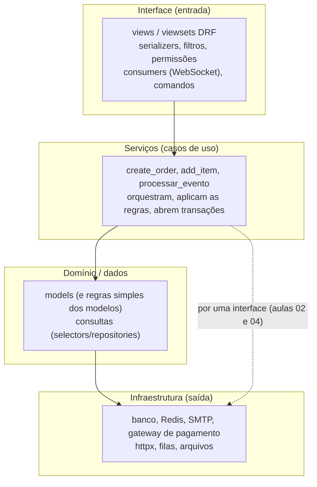

# 1. Organização de código e arquitetura em camadas

> ⏱️ ~1h30 · Módulo 8 · Pré-requisitos: [5.01 (MVT e apps)](../05-django/01-projeto-apps-mvt.md), [5.16](../05-django/16-carrinho.md) e [5.17](../05-django/17-pedidos-estoque-transacao.md) (serviços), [6.04 (viewsets)](../06-apis-rest/04-drf-views-viewsets-routers.md), [7.09 (webhook)](../07-sincrono-assincrono/09-webhooks.md)

> ✅ **Verificação.** Programas e ferramentas executados em 2026-11-08 sobre o **código real do MiniShop** do laboratório (Django 5.2.19, Python 3.13): `grimp` 3.19 e `import-linter` 2.16 (grafo de imports e contratos de arquitetura) e `radon` 6.0.1 (complexidade ciclomática). **As saídas são reais**, e as violações apontadas existem de verdade no código dos módulos anteriores: a aula 02 as corrige.

## 🎯 Objetivos
Ao final desta aula você consegue:
- Explicar as **camadas** (interface, serviços/aplicação, domínio/dados, infraestrutura) e a **regra da dependência** (as setas apontam para baixo/para dentro)
- Decidir **onde colocar** cada trecho de código (validação, regra de negócio, consulta, e-mail, chamada HTTP)
- Reconhecer *code smells* de camadas misturadas (*fat view*, lógica no model, regra no serializer)
- **Medir** a arquitetura: mapa de dependências, **contratos de importação** (`import-linter`) e **complexidade ciclomática** (`radon`)
- Detectar **dependências circulares** entre apps e entender por que atrapalham

## 🤔 Por que isso importa
Todo projeto começa limpo e vai se enrolando: a regra do pedido aparece na *view*, na tarefa do Celery e no *signal*; um app importa o outro e vice-versa; ninguém sabe onde mexer sem quebrar algo. “Onde fica essa regra?” é a pergunta que decide se uma mudança leva uma hora ou uma semana. Em entrevistas de júnior perguntam “como você organiza um projeto Django além do `views.py` gigante?”, e em *code review* o comentário mais comum é “isso não é responsabilidade da *view*”.

## 💡 Intuição (explicação simples)
Um **restaurante** tem **salão** (o garçom lida com o cliente: anota, serve, traduz), **cozinha** (o chef aplica as receitas: a regra do negócio) e **despensa** (guarda os ingredientes: os dados). O garçom **não cozinha** e o chef **não atende mesa**; e a despensa não sabe de pedidos. Se o garçom começar a mexer na panela, ou o chef a negociar com o cliente, tudo se mistura: trocar o cardápio (a regra) exige mexer no atendimento, e treinar um garçom novo (outra interface: app, API, WhatsApp) exige reaprender a cozinha. A **regra da dependência** é o fluxo certo: o salão **pede** à cozinha; a cozinha **pede** à despensa; nunca ao contrário.

## 🔬 Como funciona por dentro

- **Camada = um grupo de código com **uma** razão para mudar** (*Single Responsibility*, aula 03):
  | Camada | Faz | Não faz |
  |---|---|---|
  | **Interface** (views, serializers, consumers, comandos, tarefas Celery) | traduz o mundo externo (HTTP, JSON, WebSocket) em chamadas ao serviço; valida **formato**; escolhe status/permissões | regra de negócio, SQL, regras de preço |
  | **Serviços (casos de uso)** | uma **operação do negócio** de ponta a ponta (“criar pedido”): regras, transação, orquestração de repositórios e integrações | saber de HTTP, JSON, `request`, DRF |
  | **Domínio/dados** (models, consultas) | representar e consultar os dados; regras que **pertencem** a uma entidade (`subtotal`) | orquestrar vários casos de uso; chamar APIs externas |
  | **Infraestrutura** | falar com o mundo (SMTP, gateway, banco, fila) | decidir regras |
- **Regra da dependência** (*Clean/Hexagonal Architecture*): o código de **cima** pode importar o de **baixo**, **nunca o contrário**. `models` não importa `services`; `services` não importa `rest_framework`. Assim as regras de negócio sobrevivem a trocas de framework/interface, e podem ser **testadas sem HTTP**.
- **“Onde coloco isto?”**
  | Pergunta | Camada |
  |---|---|
  | “O campo `quantity` aceita só inteiros de 1 a 20?” (formato) | interface (serializer) |
  | “Só o dono vê o pedido” | interface (permissão/queryset) + serviço (confere de novo) |
  | “Não pode comprar mais do que há em estoque” | **serviço** (e restrição no banco) |
  | “Total = soma dos subtotais” | domínio (regra do pedido) ou serviço |
  | “Enviar e-mail depois do pedido” | serviço dispara; **tarefa** executa; infra envia |
  | “Chamar o gateway de pagamento” | serviço usa uma **interface**; um adaptador (infra) fala HTTP |
  | “Filtrar produtos por preço” | consulta (*selector*/queryset), chamada pela interface |
- ***Smells* clássicos de camadas misturadas:**
  - **View gorda (*fat view*)**: SQL, `if`s de negócio e e-mail dentro da view. Não se reaproveita (a mesma regra aparece na API, na tela e na tarefa) e só se testa com HTTP.
  - **Modelo gordo (*fat model*)** que chama `send_mail` ou `httpx`: o *model* passa a depender de infraestrutura.
  - **Regra no serializer**: o serializer valida **formato**; a regra “tem estoque?” é do serviço.
  - **Serviço que importa DRF** (`ValidationError`, `Response`): amarra o negócio ao framework HTTP.
  - **Serviço “faz-tudo”** (centenas de linhas): precisa ser quebrado em passos coesos.
  - **Dependência circular** entre apps (`orders → payments → orders`): ninguém consegue usar um sem o outro; dificulta testes e separação.
- **Como medir (em vez de opinar):**
  1. **Mapa de dependências** (`grimp`): quem importa quem, por camada e por app.
  2. **Contratos de importação** (`import-linter`): regras **executáveis** (“serviços não importam DRF”, “camadas só descem”, “apps sem ciclos”) que falham na CI.
  3. **Complexidade ciclomática** (`radon cc`): número de caminhos independentes de uma função (cada `if`, laço, `and`/`or` soma 1). Faixas usuais: **A** 1–5 (simples), **B** 6–10, **C** 11–20 (avaliar dividir), **D+** 21 ou mais (difícil de testar).
- **Camadas não são burocracia:** num projeto minúsculo, “view → model” basta (KISS e YAGNI, aula 03). As camadas **ganham valor** quando há mais de uma entrada (API, tela, tarefa, webhook), regras que **mudam** e testes que precisam ser **rápidos**: exatamente o caso do MiniShop.

## 🛠️ Exemplo prático
**1. O mapa de dependências do MiniShop** (`grafo.py`, com `grimp`: lê os `import` do código, sem executá-lo)
```python
"""Mapa de dependências do MiniShop: quem importa quem, por camada (usando `grimp`, a base do import-linter)."""
import os
import sys
from collections import defaultdict
from pathlib import Path

import grimp

LAB = Path(os.environ["LAB"])
sys.path.insert(0, str(LAB))

graph = grimp.build_graph("apps", "config", include_external_packages=True)

CAMADAS = {"api": "interface", "serializers": "interface", "filters": "interface", "permissions": "interface", "throttles": "interface",
           "consumers": "interface", "routing": "interface", "auth": "interface",
           "services": "serviços", "tasks": "serviços", "notifications": "serviços", "outbox": "serviços", "security": "serviços",
           "models": "dados"}


def camada(modulo):
    partes = modulo.split(".")
    return CAMADAS.get(partes[-1], "outro") if partes[0] == "apps" and len(partes) >= 3 else None


def app(modulo):
    p = modulo.split(".")
    return p[1] if p[0] == "apps" and len(p) > 1 else None


arestas = defaultdict(set)
for m in sorted(graph.modules):
    if camada(m) is None:
        continue
    for dep in graph.find_modules_directly_imported_by(m):
        c = camada(dep)
        if c:
            arestas[(camada(m), c)].add((m, dep))
print("dependências entre camadas (origem → destino): número de imports")
for (a, b), itens in sorted(arestas.items()):
    print(f"  {a:<10} → {b:<10} {len(itens):>3}")

print("\nregras que a arquitetura em camadas quer garantir:")
violacoes = []
for m in sorted(graph.modules):
    c = camada(m)
    if c is None:
        continue
    for dep in sorted(graph.find_modules_directly_imported_by(m)):
        raiz = dep.split(".")[0]
        if c in ("serviços", "dados") and raiz in ("rest_framework", "channels"):
            violacoes.append((m, dep, "R1: serviços/dados não devem depender de framework de interface (DRF/Channels)"))
        if c == "dados" and camada(dep) in ("serviços", "interface"):
            violacoes.append((m, dep, "R2: modelos não importam serviços nem interface"))
        if c == "serviços" and camada(dep) == "interface":
            violacoes.append((m, dep, "R3: serviços não importam a camada de interface"))
for m, dep, regra in violacoes:
    print(f"  ✘ {m}  →  {dep}\n      {regra}")
if not violacoes:
    print("  (nenhuma violação)")

print("\ndependências entre APPS (quem usa quem):")
entre = defaultdict(set)
for m in graph.modules:
    a = app(m)
    if not a:
        continue
    for dep in graph.find_modules_directly_imported_by(m):
        b = app(dep)
        if b and b != a:
            entre[a].add(b)
for a in sorted(entre):
    print(f"  {a:<9} → {', '.join(sorted(entre[a]))}")
```
```bash
uv add --dev import-linter ruff radon
LAB=$PWD uv run python grafo.py
```
```text
dependências entre camadas (origem → destino): número de imports
  dados      → dados        3
  interface  → dados        9
  interface  → interface    8
  interface  → serviços     6
  outro      → dados        4
  outro      → interface    1
  outro      → serviços     1
  serviços   → dados        9
  serviços   → serviços     2

regras que a arquitetura em camadas quer garantir:
  ✘ apps.payments.services  →  channels
      R1: serviços/dados não devem depender de framework de interface (DRF/Channels)

dependências entre APPS (quem usa quem):
  cart      → catalog
  orders    → cart, catalog, payments
  payments  → orders
  realtime  → orders
```
- As setas entre camadas **descem** (`interface → serviços → dados`), com os imports das próprias camadas (`interface → interface`, ex.: *viewset* → *serializer*). Bom sinal.
- **Violação real (R1):** `apps.payments.services → channels`. O serviço de pagamentos importa o **Django Channels** (WebSocket) para empurrar a notificação (aula 7.10). Um serviço de negócio não deveria conhecer a tecnologia de entrega.
- **Mapa por app:** `orders → cart, catalog, payments` **e** `payments → orders`: há um **ciclo** `orders ⇄ payments`. A causa: o `pay` (o início do pagamento) mora no `OrderViewSet` e importa `payments.services`, enquanto `payments` importa os modelos de `orders`.

**2. Regras de arquitetura que **falham na CI**** (`.importlinter`: três contratos)
```ini
[importlinter]
root_packages =
    apps
    config
include_external_packages = True

[importlinter:contract:camadas-dentro-de-cada-app]
name = Dentro de cada app: interface → serviços → dados (nunca no sentido contrário)
type = layers
layers =
    api
    services
    models
containers =
    apps.cart
    apps.orders
    apps.payments

[importlinter:contract:servicos-sem-framework-de-interface]
name = Serviços e modelos não dependem de DRF nem de Channels
type = forbidden
source_modules =
    apps.catalog.models
    apps.cart.models
    apps.cart.services
    apps.orders.models
    apps.orders.services
    apps.payments.models
    apps.payments.services
forbidden_modules =
    rest_framework
    channels
allow_indirect_imports = True

[importlinter:contract:apps-sem-ciclos]
name = Apps em camadas, sem dependência circular (quem está em cima pode usar quem está embaixo)
type = layers
layers =
    apps.realtime
    apps.payments
    apps.orders
    apps.cart
    apps.catalog
```
```bash
uv run lint-imports
```
```text
Analyzed 96 files, 161 dependencies.
------------------------------------

Dentro de cada app: interface → serviços → dados (nunca no sentido contrário) KEPT
Serviços e modelos não dependem de DRF nem de Channels BROKEN
Apps em camadas, sem dependência circular (quem está em cima pode usar quem está
embaixo) BROKEN

Contracts: 1 kept, 2 broken.


----------------
Broken contracts
----------------

Serviços e modelos não dependem de DRF nem de Channels
------------------------------------------------------

apps.payments.services is not allowed to import channels:

-   apps.payments.services -> channels (l.5)


Apps em camadas, sem dependência circular (quem está em cima pode usar quem está
embaixo)
--------------------------------------------------------------------------------
---------

apps.orders is not allowed to import apps.payments:

- apps.orders.api -> apps.payments.services (l.80)
```
Um contrato **cumprido** e **dois quebrados**, e a ferramenta aponta **o arquivo e a linha**: `apps.payments.services → channels (l.5)` e `apps.orders.api → apps.payments.services (l.80)` (o `pay`, que deveria estar em `payments`). Na aula 02 você corrige os dois e o `lint-imports` passa a ser parte da CI (módulo 12). Note um detalhe de desenho: o contrato `layers` **exige que todas as camadas existam** em cada app (o `catalog` não tem `services`, então ficou de fora), e a ordem da lista é a **direção permitida**.

**3. Complexidade: onde a lógica concentra** (`radon cc -s -n B`: só funções de nível B ou pior)
```bash
uv run radon cc apps/orders/services.py apps/payments/services.py apps/cart/services.py legado -s -n B
```
```text
apps/orders/services.py
    F 28:0 create_order - C (13)
apps/payments/services.py
    F 22:0 processar_evento - B (10)
apps/cart/services.py
    F 21:0 add_item - B (7)
    F 44:0 set_quantity - B (6)
legado/pedidos_legado.py
    F 9:0 processar_pedido - C (17)
```
A pior função é o **código herdado** `processar_pedido` (**C, 17 caminhos**: a refatorar na aula 07), seguido do nosso próprio `create_order` (**C, 13**), que valida, calcula e grava tudo na mesma função: na aula 02 ele é **dividido**. Complexidade alta **não é pecado em si**, é um **alarme**: mais caminhos exigem mais testes e esconde mais bugs.

**4. Quantas camadas esta função mistura?** (`mistura.py`: heurística com `ast`)
```python
"""Detecta quantas 'camadas' uma função mistura, procurando sinais no código (AST). É uma heurística didática, não um linter completo."""
import ast
import inspect
import os
import sys
from pathlib import Path

LAB = Path(os.environ["LAB"])
sys.path.insert(0, str(LAB))
os.environ["DJANGO_SETTINGS_MODULE"] = "config.settings"
import django

django.setup()

SINAIS = {
    "interface (HTTP)": {"request", "Response", "HttpResponse", "JsonResponse", "status", "render", "redirect", "ValidationError"},
    "dados (banco)": {"objects", "cursor", "execute", "save", "select_for_update", "update", "filter", "get", "create", "delete", "fetchone"},
    "infraestrutura": {"send_mail", "httpx", "requests", "print", "open", "sleep", "delay", "get_channel_layer", "logger"},
}


def camadas_de(funcao):
    arvore = ast.parse(inspect.getsource(funcao).lstrip() if inspect.getsource(funcao)[0] != " " else __import__("textwrap").dedent(inspect.getsource(funcao)))
    nomes = {n.id for n in ast.walk(arvore) if isinstance(n, ast.Name)} | {n.attr for n in ast.walk(arvore) if isinstance(n, ast.Attribute)}
    achadas = {camada: sorted(nomes & sinais) for camada, sinais in SINAIS.items() if nomes & sinais}
    ifs = sum(isinstance(n, (ast.If, ast.For, ast.While, ast.BoolOp)) for n in ast.walk(arvore))
    return achadas, ifs


from apps.orders import services as svc_pedidos
from apps.orders.api import OrderViewSet
from apps.payments import services as svc_pagamentos
from legado.pedidos_legado import processar_pedido

for nome, fn in [("legado.processar_pedido", processar_pedido), ("orders.services.create_order", svc_pedidos.create_order),
                 ("payments.services.processar_evento", svc_pagamentos.processar_evento),
                 ("orders.api.OrderViewSet.create", OrderViewSet.create), ("orders.api.OrderViewSet.get_queryset", OrderViewSet.get_queryset)]:
    achadas, ramos = camadas_de(fn)
    print(f"{nome:<38} mistura {len(achadas)} camada(s) | ramos/decisões: {ramos:>2}")
    for camada, sinais in achadas.items():
        print(f"    · {camada:<18} {', '.join(sinais)}")
```
```text
legado.processar_pedido                mistura 2 camada(s) | ramos/decisões: 16
    · dados (banco)      cursor, execute, fetchone, get
    · infraestrutura     print
orders.services.create_order           mistura 1 camada(s) | ramos/decisões:  8
    · dados (banco)      create, delete, filter, get, objects, save, select_for_update, update
payments.services.processar_evento     mistura 3 camada(s) | ramos/decisões:  9
    · interface (HTTP)   status
    · dados (banco)      create, filter, get, objects, save, select_for_update
    · infraestrutura     logger
orders.api.OrderViewSet.create         mistura 2 camada(s) | ramos/decisões:  3
    · interface (HTTP)   Response, ValidationError, request
    · dados (banco)      create, filter, get, objects
orders.api.OrderViewSet.get_queryset   mistura 2 camada(s) | ramos/decisões:  2
    · interface (HTTP)   request
    · dados (banco)      filter, objects
```
Como ler (é uma **heurística**, não um linter completo, e tem **falsos positivos**):
- **`create_order`** mistura **1** camada (só dados): é um serviço “limpo” em termos de camadas.
- **`OrderViewSet.create`** mistura **interface e dados**: ele faz `IdempotencyKey.objects...` (a lógica de idempotência) **dentro da view**. É um candidato a mover para um serviço (aula 02).
- **`processar_evento`** acusou “interface (HTTP): `status`”: **falso positivo**: é o atributo `pagamento.status` (o estado do pagamento), não `rest_framework.status`. Ferramentas baseadas em nomes erram; por isso o **contrato de importação** (que olha `import`, não nomes) é mais confiável.
- **`processar_pedido` (legado)** mistura dados e `print` (infraestrutura) e tem **16 decisões**: a campeã de ramos.

**5. Um verificador de camadas em 25 linhas** (`checa_camadas.py`)
```python
"""Um verificador de camadas em 25 linhas: dado quem importa quem e a ordem das camadas (de cima para baixo), aponta as violações."""


def violacoes(arestas, camadas):
    """arestas: lista de (origem, destino); camadas: ['interface', 'servicos', 'dados'] (de cima para baixo).
    Regra: uma camada só pode depender das que estão ABAIXO dela."""
    nivel = {c: i for i, c in enumerate(camadas)}
    ruins = []
    for origem, destino in arestas:
        co, cd = origem.split(".")[0], destino.split(".")[0]
        if co in nivel and cd in nivel and nivel[cd] < nivel[co]:
            ruins.append((origem, destino, f"'{co}' (nível {nivel[co]}) não pode depender de '{cd}' (nível {nivel[cd]}, acima)"))
    return ruins


def ciclos(arestas):
    """Dependência circular entre módulos/apps: A → B → A (busca em profundidade)."""
    grafo = {}
    for a, b in arestas:
        grafo.setdefault(a, set()).add(b)
    achados = set()

    def visita(no, caminho):
        for vizinho in grafo.get(no, ()):
            if vizinho in caminho:
                ciclo = caminho[caminho.index(vizinho):] + [vizinho]
                achados.add(tuple(ciclo))
            else:
                visita(vizinho, caminho + [vizinho])

    for no in grafo:
        visita(no, [no])
    return achados


arestas = [("interface.pedidos", "servicos.pedidos"), ("servicos.pedidos", "dados.pedido"), ("interface.pedidos", "dados.pedido"),
           ("dados.pedido", "servicos.pedidos"),                        # ERRO: o modelo conhece o serviço
           ("servicos.pedidos", "interface.serializers")]              # ERRO: o serviço conhece a interface
for o, d, motivo in violacoes(arestas, ["interface", "servicos", "dados"]):
    print(f"✘ {o} → {d}: {motivo}")

apps = [("orders", "payments"), ("payments", "orders"), ("realtime", "orders"), ("orders", "cart"), ("cart", "catalog")]
print("ciclos entre apps:", [" → ".join(c) for c in sorted(ciclos(apps))])
print("depois de mover o 'pagar' para payments:", [" → ".join(c) for c in sorted(ciclos([a for a in apps if a != ("orders", "payments")]))] or "nenhum ciclo")
```
```text
✘ dados.pedido → servicos.pedidos: 'dados' (nível 2) não pode depender de 'servicos' (nível 1, acima)
✘ servicos.pedidos → interface.serializers: 'servicos' (nível 1) não pode depender de 'interface' (nível 0, acima)
ciclos entre apps: ['orders → payments → orders', 'payments → orders → payments']
depois de mover o 'pagar' para payments: nenhum ciclo
```
É o coração do `import-linter`: **ordem das camadas + lista de imports → violações**. A segunda parte acha **ciclos** por busca em profundidade, e mostra que **mover o `pay` para `payments`** (retirando a aresta `orders → payments`) elimina o ciclo `orders ⇄ payments`.

## 🧠 Pausa para lógica
**Problema (verificador de camadas).** Sem olhar o exemplo 5, escreva `violacoes(arestas, camadas)` que receba uma lista de imports `(origem, destino)` com nomes do tipo `"servicos.pedidos"` e a ordem das camadas **de cima para baixo**, e devolva os imports que sobem de camada. Acrescente `ciclos(arestas)` que encontre dependências circulares.

<details><summary>Dica</summary>
Dê um número a cada camada pela posição na lista (0 = topo). Um import <code>origem → destino</code> é válido se <code>nivel[destino] &gt;= nivel[origem]</code>. Para ciclos, faça uma busca em profundidade guardando o caminho; se o vizinho já está no caminho, achou um ciclo.
</details>

<details><summary>Solução comentada</summary>

É o `checa_camadas.py` do exemplo 5 (executado). Dois detalhes: (1) a primeira parte do nome (`servicos.pedidos` → `servicos`) é a camada; (2) o `import-linter` real usa o **grafo transitivo** (`allow_indirect_imports = False` por padrão no tipo `forbidden`: proíbe também o caminho **indireto**, passando por intermediários), e tem contratos “independência” (módulos que **não** podem se conhecer) e “camadas” (a ordem). Na prática você escreve **contratos**, não o algoritmo.
</details>

## ⚠️ Erros comuns e boas práticas
| Mensagem / sintoma | Causa | Solução |
|---|---|---|
| `ImportError: cannot import name 'X' from partially initialized module` | Dependência circular entre módulos/apps | Reorganizar a dependência (mover o código para o app “de baixo”, ou importar dentro da função como remendo) |
| A mesma regra copiada na view, na tarefa e no webhook | Regra na interface | Extrair para um **serviço** e chamá-lo das três entradas |
| Teste de regra precisa subir o servidor/`APIClient` | Regra presa à view | Serviço testável direto (e com *fakes*, aula 02) |
| `Missing layer in container 'apps.catalog': module apps.catalog.services does not exist.` (import-linter) | Contrato `layers` exige todas as camadas | Tirar o container do contrato ou criar o módulo |
| Serviço lança `rest_framework.ValidationError` | Negócio acoplado ao HTTP | Exceções **de domínio** no serviço; a borda as converte (aula 6.05) |
| `models.py` com `send_mail`, `requests.get` | Modelo gordo com infraestrutura | Mover para um serviço/tarefa |
| Ninguém sabe onde fica a lógica de “cancelar pedido” | Código espalhado | Um caso de uso = uma função/serviço, com nome de **verbo do negócio** |
| Camadas demais num projeto pequeno | Arquitetura de “cerimônia” | Comece simples; separe quando a dor aparecer (aula 03: YAGNI) |
| Ferramenta acusa “mistura” que não existe | Heurística por nomes | Prefira contratos de importação; use heurísticas só como pista |

- **Nomeie casos de uso com verbos do negócio** (`criar_pedido`, `cancelar_pedido`, `registrar_pagamento`), não com termos técnicos (`OrderManager`, `Helper`).
- **A interface é fina:** valida o formato, chama **um** serviço, formata a resposta. Se a view passa de ~20 linhas, desconfie.
- **Serviços não conhecem HTTP:** recebem tipos simples (ids, números, objetos do domínio) e levantam exceções do domínio.
- **Automatize a regra:** o que está só na cabeça das pessoas se perde; contratos no CI **não**.
- **Camadas ≠ pastas:** `services/` cheia de código acoplado continua ruim. O que conta é a **direção das dependências**.

## 🧩 Exercícios
**1. Fixação**
(a) O que a **regra da dependência** diz? (b) Em qual camada fica “não vender mais do que há em estoque”? E “o campo quantidade é inteiro de 1 a 20”? (c) O que é complexidade ciclomática e o que significa uma função em **C**? (d) Por que `orders ⇄ payments` é um problema?

<details><summary>Solução</summary>

(a) O código das camadas de cima pode depender das de baixo, nunca o contrário (modelos não importam serviços; serviços não importam a interface). (b) A regra de estoque é do **serviço** (com restrição no banco); a validação de formato é da **interface** (serializer). (c) É o número de caminhos independentes (cada `if`/laço/`and`/`or` soma); **C** = 11 a 20: vale avaliar dividir a função. (d) Cada app só funciona com o outro: não dá para testar, reutilizar ou separar um sem o outro, e a importação circular pode quebrar a inicialização.
</details>

**2. Aplicação no projeto MiniShop**
Faça o diagnóstico de arquitetura do **seu** projeto.

Critérios de pronto:
- [ ] `.importlinter` com os três contratos (camadas por app, serviços sem DRF/Channels, apps sem ciclos), rodando com `uv run lint-imports`
- [ ] Um script que gera o **mapa de dependências** (camadas e apps) e o salva em `docs/arquitetura.md`, com um diagrama Mermaid dos apps
- [ ] `radon cc -s -n B` salvo em `docs/arquitetura.md`, listando as funções B ou piores e a **meta** de cada uma
- [ ] Lista das **violações encontradas** (arquivo:linha) com a camada correta para cada trecho (use a tabela “Onde coloco isto?”)
- [ ] Um “plano de refatoração” de 5 itens priorizados (o que, onde, risco, teste que protege)
- [ ] Commit `docs(arch): dependency map and import contracts`

<details><summary>Solução de referência (trecho de `docs/arquitetura.md`)</summary>

```markdown
## Diagnóstico (módulo 8, aula 1)
| # | Violação | Onde | Correção planejada | Teste que protege |
|---|---|---|---|---|
| 1 | serviço importa `channels` | `apps/payments/services.py:5` | notificação sai do serviço (porta/adaptador) | `test_webhooks.py` (notificação só após o commit) |
| 2 | ciclo `orders ⇄ payments` | `apps/orders/api.py:80` (`pay`) | mover `pay` para `payments` | `test_pagar_pedido_...` |
| 3 | idempotência dentro da view | `OrderViewSet.create` | serviço `criar_pedido_idempotente` | `test_idempotencia.py` |
| 4 | `create_order` C (13) | `apps/orders/services.py:28` | separar validação, cálculo e gravação | testes de pedido (aula 5.17) |
```
</details>

**3. Desafio (opcional)**
Acrescente um contrato de **independência** (`type = independence`) entre `apps.cart` e `apps.payments` (nenhum pode importar o outro, nem indiretamente) e um de **proibição** para `apps.*.models` não importarem `httpx`/`requests`/`celery`. Quebre-os de propósito num *branch* e mostre a mensagem da ferramenta.

## 🎤 Na entrevista
- **Como você organiza um projeto Django além de `views.py` e `models.py`?** Em camadas: interface fina (views/serializers/consumers), serviços com os casos de uso e as regras (transações, orquestração), modelos/consultas para os dados e adaptadores para a infraestrutura (e-mail, gateway); com a regra de que as dependências só descem, verificada por contratos de importação na CI.
- **O que é uma *fat view* e por que é ruim?** Uma *view* que contém regra de negócio, acesso a dados e integrações; é difícil de testar, não é reaproveitável (a regra aparece na API, na tela e na tarefa) e qualquer mudança de regra mexe na camada HTTP.
- **O que é dependência circular e como resolver?** Dois módulos/apps que dependem um do outro; resolve-se movendo o código compartilhado para um módulo “de baixo”, invertendo a dependência (interface/evento) ou reposicionando a funcionalidade no app certo.
- **Para que serve a complexidade ciclomática?** Indica quantos caminhos independentes há numa função, ou seja, quantos testes ela pede no mínimo; valores altos sinalizam funções a dividir.
- **Camadas sempre valem a pena?** Não: num projeto pequeno e de uma só entrada, é cerimônia; elas compensam quando há várias entradas, regras que mudam e necessidade de testes rápidos.

## 📚 Para ir além
- 📄 Artigo: [Martin Fowler — PresentationDomainDataLayering](https://martinfowler.com/bliki/PresentationDomainDataLayering.html). As três camadas clássicas (em inglês).
- 📄 Artigo: [Uncle Bob — The Clean Architecture](https://blog.cleancoder.com/uncle-bob/2012/08/13/the-clean-architecture.html). A regra da dependência (em inglês).
- 📄 Guia: [HackSoft — Django Styleguide](https://github.com/HackSoftware/Django-Styleguide). Serviços e *selectors* em Django (em inglês).
- 📘 Livro gratuito: [Architecture Patterns with Python (Cosmic Python)](https://www.cosmicpython.com/). Repositórios, serviços, eventos (em inglês).
- 📄 Documentação oficial: [Filosofia de design do Django](https://docs.djangoproject.com/en/5.2/misc/design-philosophies/). Acoplamento fraco e coesão.
- 📄 Documentação: [import-linter](https://import-linter.readthedocs.io/). Contratos `layers`, `forbidden`, `independence`.
- 📄 Documentação: [grimp](https://grimp.readthedocs.io/). O grafo de imports usado no `grafo.py`.
- 📄 Documentação: [radon](https://radon.readthedocs.io/). Complexidade ciclomática e índice de manutenibilidade.
- 📄 Documentação: [Ruff](https://docs.astral.sh/ruff/). Linter rápido (usaremos nas aulas 03 e 07).
- 📑 Verbete: [Complexidade ciclomática (Wikipédia)](https://en.wikipedia.org/wiki/Cyclomatic_complexity). Definição e interpretação (em inglês).
- 🏋️ Prática extra: rode o `grafo.py` no **seu** projeto e desenhe, à mão, o diagrama de apps; depois compare com o que você imaginava.

> Links verificados em 2026-11-08 (HTTP 200).

## ✅ Checklist da aula
- [ ] Sei as camadas, o que cada uma faz e a regra da dependência
- [ ] Rodei o mapa de dependências e li os contratos do `import-linter`
- [ ] Identifiquei no MiniShop um ciclo, um serviço acoplado a framework e uma função complexa
- [ ] Sei dizer onde cada tipo de código deve ficar
- [ ] Tenho um plano de refatoração com testes que protegem cada passo
