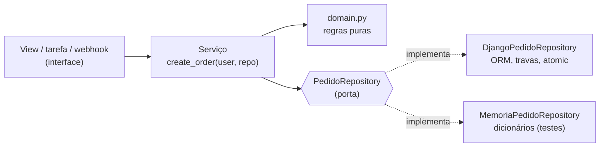

# 2. Services e repositories no MiniShop

> ⏱️ ~1h30 · Módulo 8 · Pré-requisitos: [8.01](01-responsabilidades-camadas.md), [5.17 (pedido transacional)](../05-django/17-pedidos-estoque-transacao.md), [6.12 (testes de API)](../06-apis-rest/12-testes-de-api.md), [7.09 (webhook)](../07-sincrono-assincrono/09-webhooks.md)

> ✅ **Verificação.** Esta aula é uma **refatoração real** do laboratório do MiniShop (Django 5.2.19, Python 3.13), executada em 2026-11-08. A rede de segurança foi a suíte existente: **97 testes passaram antes e depois** de cada passo; foram acrescentados **10 testes novos**, e o laboratório terminou com **107 testes passando**. As medições (`import-linter`, `radon`, tempos) e todas as saídas são reais.

## 🎯 Objetivos
Ao final desta aula você consegue:
- Separar um caso de uso em **regras de negócio puras**, **orquestração (serviço)** e **persistência (repositório)**
- Escrever um **repositório como porta** (`Protocol`) com um adaptador real (ORM) e um **em memória** para testes
- Usar **injeção de dependência** simples (parâmetro com padrão) e uma **unidade de trabalho** (`transacao()`)
- Distinguir **services** (escrita), **selectors** (leitura) e quando o repositório **vale a pena** em Django
- **Refatorar com segurança** (testes verdes a cada passo), provar que o **contrato da API não mudou** e **quitar** as violações apontadas na aula 01

## 🤔 Por que isso importa
Na aula 01 o `import-linter` acusou duas violações (um serviço dependendo de `channels` e um ciclo `orders ⇄ payments`) e o `radon` acusou o `create_order` (complexidade 13). Esta aula mostra **como arrumar sem quebrar nada**, e o ganho concreto: as regras do pedido passam a ser testáveis **sem banco**, em microssegundos. “Qual a diferença entre service e repository?” e “vale a pena criar um repositório em cima do ORM do Django?” são perguntas frequentes (e controversas); a resposta honesta é “depende”, e aqui você verá **quando**.

## 💡 Intuição (explicação simples)
Na cozinha do restaurante, o **chef** (serviço) não vai ao estoque nem anota números na planilha: **pede ao almoxarife** (repositório) “separe estes ingredientes, baixe do estoque, anote a venda”. Quem decide **se o prato pode ser feito** é uma **regra da casa** (“só com ingredientes frescos”; a regra de domínio), que não depende de quem guarda os ingredientes. Para **treinar** o chef, monta-se um **almoxarifado de brinquedo** (repositório em memória): treina-se rápido, sem sujar a cozinha de verdade. Mas, para testar se a **câmara fria** funciona de fato (travas, transações), é preciso usar a câmara real: os dois tipos de teste são necessários.

## 🔬 Como funciona por dentro

- **Três partes de um caso de uso**:
  | Parte | Contém | Conhece Django? | Teste |
  |---|---|---|---|
  | **Domínio** (`domain.py`) | regras e cálculos: “há estoque?”, “total”, mensagens | **não** | puro, µs |
  | **Serviço** (`services.py`) | a **sequência** do caso de uso; abre a unidade de trabalho; levanta exceções do domínio | **não diretamente** (só pela porta) | com *fake*, µs |
  | **Repositório** (`repositories.py`) | **como** ler e gravar: ORM, `select_for_update`, `UPDATE ... WHERE` | **sim** | com banco (integração) |
- **Repositório** = uma **coleção** de objetos de domínio com uma interface “de coleção” (`buscar`, `salvar`, `travar_produtos`), escondendo **como** são armazenados. **Porta** é a interface (um `typing.Protocol`); **adaptadores** são as implementações (ORM, memória, API externa).
- **Unidade de trabalho (*Unit of Work*)**: o limite de uma operação atômica. No MiniShop, `repo.transacao()` devolve `transaction.atomic()` (ORM) ou, no *fake*, uma “foto” do estado restaurada em caso de erro. O serviço faz `with repo.transacao():` e não sabe qual.
- **Injeção de dependência** em Python é só **passar o colaborador como argumento**: `create_order(user, repo=None)` usa o repositório real por padrão e aceita um *fake* em testes. Sem *containers* nem frameworks.
- **Service × selector × repository:**
  | | Faz | Exemplo |
  |---|---|---|
  | **Serviço** | **escreve**: caso de uso com efeitos, regras, transação | `create_order`, `cancel_order`, `processar_evento` |
  | ***Selector*** | **lê**: consulta com regras de visibilidade, sem efeitos | `pedidos_visiveis(user)` |
  | **Repositório** | abstrai o **armazenamento** atrás de uma porta substituível | `PedidoRepository` |
- **O ORM do Django já é um “repositório”** (e o `QuerySet`, uma consulta). Em casos simples (CRUD sem regra), **não** crie repositório: seria cerimônia (YAGNI, aula 03). Ele **compensa** quando: (1) o caso de uso tem **regras ricas** que você quer testar **rápido e sem banco**; (2) a persistência pode **mudar** (outro banco, uma API); (3) precisa isolar **travas e transações** complexas. Para leituras, prefira *selectors*.
- **O que o *fake* não prova:** travas, *constraints*, isolamento de transações e SQL real. Por isso a **pirâmide** continua: **muitos** testes rápidos de regra (domínio + *fake*), **alguns** de integração com o banco (repositório real) e **poucos** de ponta a ponta (API). O experimento da aula mostra, aliás, que um *fake* ingênuo **mente** sobre atomicidade.
- **Desacoplar por eventos internos:** em vez de o serviço de pagamentos importar o Channels, ele **emite um sinal** (`pedido_pago`) **depois do commit**; o adaptador de tempo real (em `realtime`) **se conecta** ao sinal. O serviço não sabe quem escuta (inversão de dependência).
- **Refatorar com segurança (aula 07 em detalhe):** nunca refatorar **sem testes**; uma mudança estrutural por vez; rodar a suíte a cada passo; e, quando possível, **provar** que o comportamento externo não mudou (aqui, comparando o **contrato OpenAPI**).

## 🛠️ Exemplo prático
**1. O ponto de partida** (o `create_order` da aula 5.17: **complexidade C, 13 caminhos**, tudo na mesma função)
```python
@transaction.atomic
def create_order(user):
    try:
        cart = Cart.objects.select_for_update().get(user=user)
    except Cart.DoesNotExist:
        raise EmptyCartError("Seu carrinho está vazio.") from None
    itens = list(cart.items.all())
    if not itens:
        raise EmptyCartError("Seu carrinho está vazio.")
    ids = sorted(i.product_id for i in itens)
    produtos = {p.pk: p for p in Product.objects.select_for_update().filter(pk__in=ids).order_by("pk")}
    problemas = []
    for item in itens:
        p = produtos.get(item.product_id)
        if p is None or not p.is_active:
            problemas.append(f"{p.name if p else 'Um produto'} não está mais disponível.")
        elif item.quantity > p.stock:
            problemas.append(f"{p.name}: restam {p.stock}, você pediu {item.quantity}.")
    if problemas:
        raise StockError(" ".join(problemas))
    total = Decimal("0")
    order = Order.objects.create(user=user, total=0)
    for item in itens:
        p = produtos[item.product_id]
        OrderItem.objects.create(order=order, product=p, quantity=item.quantity, unit_price=p.price)
        total += item.quantity * p.price
        if Product.objects.filter(pk=p.pk, stock__gte=item.quantity).update(stock=F("stock") - item.quantity) != 1:
            raise StockError(f"{p.name}: o estoque mudou, tente novamente.")
    order.total = total
    order.save(update_fields=["total"])
    cart.items.all().delete()
    return order
```
Ele **valida**, **calcula**, **grava** e **baixa o estoque**, tudo no mesmo corpo, com consultas ao ORM misturadas às regras.

**2. O domínio puro** (`apps/orders/domain.py`: sem Django, sem banco)
```python
"""Regras de negócio do pedido, em Python PURO: sem Django, sem banco, sem HTTP. Por isso testam em milissegundos."""
from dataclasses import dataclass
from decimal import Decimal


@dataclass(frozen=True)
class ProdutoInfo:
    id: int
    nome: str
    preco: Decimal
    estoque: int
    ativo: bool


@dataclass(frozen=True)
class ItemCarrinho:
    product_id: int
    quantidade: int


@dataclass(frozen=True)
class LinhaCompra:
    """Um item do carrinho já cruzado com o produto: o que o pedido vai congelar."""
    product_id: int
    nome: str
    quantidade: int
    preco: Decimal
    estoque: int
    ativo: bool

    @property
    def subtotal(self) -> Decimal:
        return self.quantidade * self.preco


def montar_linhas(itens, produtos):
    """Cruza os itens do carrinho com os produtos (o que não existir fica de fora; `problemas` acusa)."""
    linhas = []
    for i in itens:
        p = produtos.get(i.product_id)
        if p is not None:
            linhas.append(LinhaCompra(p.id, p.nome, i.quantidade, p.preco, p.estoque, p.ativo))
    return linhas


def problemas(itens, linhas):
    """Lista TODOS os motivos pelos quais o pedido não pode ser feito (mensagem completa para o usuário)."""
    achados = []
    por_id = {l.product_id: l for l in linhas}
    for item in itens:
        linha = por_id.get(item.product_id)
        if linha is None:
            achados.append("Um produto não está mais disponível.")
        elif not linha.ativo:
            achados.append(f"{linha.nome} não está mais disponível.")
        elif item.quantidade > linha.estoque:
            achados.append(f"{linha.nome}: restam {linha.estoque}, você pediu {item.quantidade}.")
    return achados


def total(linhas) -> Decimal:
    return sum((l.subtotal for l in linhas), Decimal("0"))
```
**3. O repositório: porta, adaptador do ORM e adaptador em memória** (`apps/orders/repositories.py`)
```python
"""Porta (interface) e adaptadores de persistência do pedido. O serviço conversa com a PORTA; quem implementa decide COMO gravar."""
import copy
from contextlib import AbstractContextManager, contextmanager
from decimal import Decimal
from typing import Protocol

from django.db import transaction
from django.db.models import F

from apps.cart.models import Cart
from apps.catalog.models import Product

from .domain import ItemCarrinho, LinhaCompra, ProdutoInfo
from .models import Order, OrderItem


class PedidoRepository(Protocol):
    def transacao(self) -> AbstractContextManager: ...
    def travar_carrinho(self, user): ...
    def itens_do_carrinho(self, carrinho) -> list[ItemCarrinho]: ...
    def travar_produtos(self, ids: list[int]) -> dict[int, ProdutoInfo]: ...
    def criar_pedido(self, user, linhas: list[LinhaCompra], total: Decimal): ...
    def baixar_estoque(self, product_id: int, quantidade: int) -> bool: ...
    def esvaziar_carrinho(self, carrinho) -> None: ...


class DjangoPedidoRepository:
    """Implementação real: ORM do Django, com travas (`select_for_update`) e atualização condicional do estoque."""

    def transacao(self):
        return transaction.atomic()

    def travar_carrinho(self, user):
        return Cart.objects.select_for_update().filter(user=user).first()

    def itens_do_carrinho(self, carrinho):
        return [ItemCarrinho(i.product_id, i.quantity) for i in carrinho.items.all()]

    def travar_produtos(self, ids):
        qs = Product.objects.select_for_update().filter(pk__in=ids).order_by("pk")        # SEMPRE na mesma ordem (evita deadlock)
        return {p.pk: ProdutoInfo(p.pk, p.name, p.price, p.stock, p.is_active) for p in qs}

    def criar_pedido(self, user, linhas, total):
        pedido = Order.objects.create(user=user, total=total)
        OrderItem.objects.bulk_create([OrderItem(order=pedido, product_id=l.product_id, quantity=l.quantidade, unit_price=l.preco) for l in linhas])
        return pedido

    def baixar_estoque(self, product_id, quantidade):
        return Product.objects.filter(pk=product_id, stock__gte=quantidade).update(stock=F("stock") - quantidade) == 1

    def esvaziar_carrinho(self, carrinho):
        carrinho.items.all().delete()


class MemoriaPedidoRepository:
    """Implementação em MEMÓRIA, para testar as regras do serviço sem banco (rápida e determinística)."""

    def __init__(self, carrinhos=None, produtos=None):
        self.carrinhos = carrinhos or {}              # user -> [ItemCarrinho]
        self.produtos = produtos or {}                # id -> ProdutoInfo
        self.pedidos = []                             # (user, linhas, total)

    @contextmanager
    def transacao(self):
        """Um 'fake' honesto precisa imitar a ATOMICIDADE: tira uma foto (BEGIN) e a restaura se algo falhar (ROLLBACK)."""
        foto = copy.deepcopy((self.carrinhos, self.produtos, self.pedidos))
        try:
            yield
        except Exception:
            self.carrinhos, self.produtos, self.pedidos = foto
            raise

    def travar_carrinho(self, user):
        return user if user in self.carrinhos else None

    def itens_do_carrinho(self, carrinho):
        return list(self.carrinhos[carrinho])

    def travar_produtos(self, ids):
        return {i: self.produtos[i] for i in ids if i in self.produtos}

    def criar_pedido(self, user, linhas, total):
        self.pedidos.append((user, list(linhas), total))
        return {"id": len(self.pedidos), "total": total, "linhas": list(linhas)}

    def baixar_estoque(self, product_id, quantidade):
        p = self.produtos[product_id]
        if p.estoque < quantidade:
            return False
        self.produtos[product_id] = ProdutoInfo(p.id, p.nome, p.preco, p.estoque - quantidade, p.ativo)
        return True

    def esvaziar_carrinho(self, carrinho):
        self.carrinhos[carrinho] = []
```
**4. O serviço: só orquestra** (`apps/orders/services.py`, o `create_order` novo)
```python
def create_order(user, repo=None):
    """Caso de uso: criar o pedido a partir do carrinho. Orquestra; as REGRAS estão em `domain` e a PERSISTÊNCIA no repositório."""
    repo = repo or DjangoPedidoRepository()
    with repo.transacao():
        carrinho = repo.travar_carrinho(user)                         # trava o carrinho: serializa duplo clique
        itens = repo.itens_do_carrinho(carrinho) if carrinho is not None else []
        if not itens:
            raise EmptyCartError("Seu carrinho está vazio.")
        produtos = repo.travar_produtos(sorted(i.product_id for i in itens))   # trava os produtos em ordem fixa (sem deadlock)
        linhas = domain.montar_linhas(itens, produtos)
        achados = domain.problemas(itens, linhas)                     # valida TUDO antes de gravar
        if achados:
            raise StockError(" ".join(achados))
        pedido = repo.criar_pedido(user, linhas, domain.total(linhas))
        for linha in linhas:
            if not repo.baixar_estoque(linha.product_id, linha.quantidade):   # defesa extra: nunca deveria ocorrer com a trava
                raise StockError(f"{linha.nome}: o estoque mudou, tente novamente.")
        repo.esvaziar_carrinho(carrinho)
        logger.info("order_created user=%s linhas=%s", getattr(user, "pk", user), len(linhas))
        return pedido
```
Compare com o original: o serviço agora **lê como a descrição do caso de uso** (travar carrinho → validar tudo → gravar → baixar estoque → esvaziar carrinho), e cada passo é uma chamada nomeada. Os **testes existentes** (a aula 5.17 e a API do módulo 6) não mudaram uma linha e **continuaram verdes**: é a prova do comportamento preservado.

**5. As leituras e a idempotência saem da *view*** (`selectors.py`, `idempotency.py`)
```python
"""Leituras (consultas) do app de pedidos: o 'R' do CRUD, sem efeitos colaterais."""
from .models import Order


def pedidos_visiveis(user):
    """Atendimento (permissão `view_order`) vê todos, só para leitura; o cliente vê apenas os seus (o alheio é 404)."""
    qs = Order.objects.prefetch_related("items__product")
    return qs if user.has_perm("orders.view_order") else qs.filter(user=user)
```
```python
"""Idempotência de POST (Idempotency-Key), independente de HTTP: recebe uma função que executa a operação e devolve (status, corpo)."""
from django.db import IntegrityError, transaction

from .models import IdempotencyKey


def executar_idempotente(user, chave, operacao):
    """Devolve (status, corpo, repetida). `operacao()` roda UMA vez por (usuário, chave); a repetição devolve o resultado guardado."""
    anterior = IdempotencyKey.objects.filter(user=user, key=chave).first()
    if anterior:
        return anterior.response_status, anterior.response_body, True
    try:
        with transaction.atomic():                                  # a operação e o registro da chave: tudo ou nada
            status, corpo = operacao()
            IdempotencyKey.objects.create(user=user, key=chave, response_status=status, response_body=corpo)
        return status, corpo, False
    except IntegrityError:                                          # outra requisição com a mesma chave ganhou a corrida
        anterior = IdempotencyKey.objects.get(user=user, key=chave)
        return anterior.response_status, anterior.response_body, True
```
A *view* (`OrderViewSet`) agora só **traduz**: lê o cabeçalho, chama `executar_idempotente(user, chave, lambda: self._criar(request))` e devolve a resposta. O `get_queryset()` virou `return selectors.pedidos_visiveis(self.request.user)`.

**6. Desfazendo o ciclo e o acoplamento com o Channels**
```python
"""Eventos internos do app de pagamentos. Quem quiser REAGIR (WebSocket, métricas...) se conecta aqui; o serviço não conhece ninguém."""
from django.dispatch import Signal

pedido_pago = Signal()          # kwargs: order_id, status
```
```python
"""Adaptador: converte o evento interno `pedido_pago` em mensagem WebSocket. O serviço de pagamentos não sabe que o Channels existe."""
import logging

from asgiref.sync import async_to_sync
from channels.layers import get_channel_layer
from django.dispatch import receiver

from apps.payments.signals import pedido_pago

logger = logging.getLogger(__name__)


def notificar_navegador(order_id, status):
    """Empurra a mudança para quem está com o pedido aberto. Falha aqui NÃO pode desfazer o pagamento."""
    try:
        async_to_sync(get_channel_layer().group_send)(f"pedido_{order_id}", {"type": "pedido.atualizado", "status": status})
    except Exception:
        logger.exception("ws_notificacao_falhou order=%s", order_id)


@receiver(pedido_pago, dispatch_uid="realtime.notificar_navegador")
def ao_pagar(sender, order_id, status, **kwargs):
    notificar_navegador(order_id, status)
```
```python
# apps/payments/services.py (trecho): o serviço EMITE o fato; não sabe quem escuta
transaction.on_commit(lambda: pedido_pago.send(sender=Payment, order_id=pagamento.order_id, status="paid"))   # só DEPOIS do commit
```
E o *endpoint* `POST /orders/{id}/pay/` **mudou de app**: saiu do `OrderViewSet` (em `orders`) para uma `APIView` em `apps/payments/api.py`, registrada em `config/api_urls.py`. Quem **depende** de `orders` é `payments`, **nunca o contrário**. A URL pública é a **mesma**.

**7. Os resultados, medidos**
```bash
uv run lint-imports
```
```text
Analyzed 106 files, 186 dependencies.
-------------------------------------

Dentro de cada app: interface → serviços → dados (nunca no sentido contrário) KEPT
Serviços e modelos não dependem de DRF nem de Channels KEPT
Apps em camadas, sem dependência circular (quem está em cima pode usar quem está
embaixo) KEPT

Contracts: 3 kept, 0 broken.
```
```bash
LAB=$PWD uv run python grafo.py | tail -10
```
```text
dependências entre camadas (origem → destino): número de imports
  dados      → dados        3
  interface  → dados       10
  interface  → interface    9
  interface  → outro        2
  interface  → serviços     5
  outro      → dados        9
  outro      → interface    1
  outro      → outro        3
  outro      → serviços     1
  serviços   → dados        8
  serviços   → outro        3
  serviços   → serviços     2

regras que a arquitetura em camadas quer garantir:
  (nenhuma violação)

dependências entre APPS (quem usa quem):
  cart      → catalog
  orders    → cart, catalog
  payments  → orders
  realtime  → orders, payments
```
```bash
uv run radon cc apps/orders/services.py apps/orders/domain.py apps/payments/services.py apps/cart/services.py -s -n B
```
```text
apps/orders/services.py
    F 27:0 create_order - B (8)
apps/orders/domain.py
    F 46:0 problemas - B (6)
apps/payments/services.py
    F 21:0 processar_evento - B (10)
apps/cart/services.py
    F 21:0 add_item - B (7)
    F 44:0 set_quantity - B (6)
```
- **Contratos:** de **1 cumprido e 2 quebrados** para **3 cumpridos**: o serviço de pagamentos não importa mais o `channels`, e não há ciclo entre apps. O novo mapa mostra `realtime → orders, payments` e `payments → orders`: tudo apontando **para baixo**.
- **Complexidade:** o `create_order` foi de **C (13)** para **B (8)**, e a parte que sobrou de decisão (`problemas`, B 6) está no **domínio puro**. O `processar_evento` (B 10) e o `add_item` (B 7) continuam candidatos para quando doerem (não refatore por refatorar).
- **O contrato da API não mudou.** Regenerei o OpenAPI e comparei com o anterior: as **únicas diferenças** foram a descrição da nova classe do *endpoint* e a **remoção de uma resposta `422` documentada por engano** (o `pay` sempre devolveu `400` nesse caso). Documentação e código passaram a coincidir: um efeito colateral bom da refatoração.

**8. Testes rápidos das regras, sem banco** (`tests/test_pedido_dominio.py`)
```python
# regras puras, sem banco
def test_total_e_exato_em_decimal():
    itens = [ItemCarrinho(1, 3), ItemCarrinho(2, 1)]
    produtos = {1: produto(1, preco="59.90"), 2: produto(2, "Teclado", "120.50")}
    assert domain.total(domain.montar_linhas(itens, produtos)) == Decimal("300.20")


# o serviço inteiro, com o repositório em memória
def test_sem_estoque_nao_grava_nada():
    r = repo(); r.produtos[1] = produto(estoque=1)
    with pytest.raises(StockError, match="restam 1, você pediu 2"):
        create_order("ana", r)
    assert r.pedidos == [] and r.produtos[1].estoque == 1 and len(r.carrinhos["ana"]) == 1
```
```bash
uv run pytest -q tests/test_pedido_dominio.py
uv run pytest -q
```
```text
10 passed in 0.02s
107 passed
```
**Dez** testes em **0,02 s** cobrem total exato, as três causas de recusa (estoque, inativo, inexistente), a lista completa de problemas, o caminho feliz, o carrinho vazio/inexistente, a “baixa que falha no meio” e o *rollback*. E quanto custa uma chamada, medida?
```bash
uv run python manage.py shell < rapido_vs_banco.py
```
```text

create_order com repositório EM MEMÓRIA:        4 µs por chamada (500 chamadas)
create_order com o ORM (SQLite)        :     1346 µs por chamada (100 chamadas, sem contar a preparação)
→ a versão em memória é ≈ 309× mais rápida (e não precisa de banco, migrações nem fixtures)
```
A **mesma** função `create_order` roda em **~4 µs** com o repositório em memória e em **~1,3 ms** com o ORM (SQLite, o mais rápido dos bancos; num PostgreSQL de verdade é mais lento ainda): cerca de **300×**. Em uma suíte com milhares de casos, isso separa “roda a cada *save*” de “roda só na CI”.

**9. O *fake* que mentia** (e por que `transacao()` importa)
A primeira versão do repositório em memória tinha `transacao()` **sem fazer nada**. O teste “o segundo produto falha na baixa” mostrou o problema:
```python
"""O 'fake' mentiroso: sem transação de verdade, uma falha no meio deixa o mundo pela metade. Corrigindo com snapshot/rollback."""
from contextlib import nullcontext
from decimal import Decimal

from apps.orders.domain import ItemCarrinho, ProdutoInfo
from apps.orders.repositories import MemoriaPedidoRepository
from apps.orders.services import StockError, create_order


class ConcorrenteNoSegundo(MemoriaPedidoRepository):
    """Simula outro comprador levando o 2º produto DEPOIS da validação (a baixa do 2º falha)."""

    def baixar_estoque(self, product_id, quantidade):
        if product_id == 2:
            return False
        return super().baixar_estoque(product_id, quantidade)


class SemTransacao(ConcorrenteNoSegundo):
    """O fake 'de antes': transacao() não faz nada."""

    def transacao(self):
        return nullcontext()


# (ConcorrenteNoSegundo herda de MemoriaPedidoRepository a transacao() REAL: foto do estado + restauração em caso de erro)


def cenario(classe):
    r = classe(carrinhos={"ana": [ItemCarrinho(1, 2), ItemCarrinho(2, 1)]},
               produtos={1: ProdutoInfo(1, "Mouse", Decimal("59.90"), 5, True), 2: ProdutoInfo(2, "Teclado", Decimal("120.50"), 3, True)})
    try:
        create_order("ana", r)
    except StockError as e:
        print(f"  erro esperado: {e}")
    return r


for nome, classe in (("transacao() = nullcontext (o fake ingênuo)", SemTransacao), ("transacao() com foto do estado e restauração (o fake atual)", ConcorrenteNoSegundo)):
    print(nome)
    r = cenario(classe)
    print(f"  estoque do Mouse: {r.produtos[1].estoque} (era 5) | pedidos gravados: {len(r.pedidos)} | itens no carrinho: {len(r.carrinhos['ana'])}")
    print("  →", "INCONSISTENTE: o Mouse foi baixado e o pedido ficou criado, mas a operação falhou" if r.produtos[1].estoque != 5 else "CONSISTENTE: nada mudou")
```
```text

transacao() = nullcontext (o fake ingênuo)
  erro esperado: Teclado: o estoque mudou, tente novamente.
  estoque do Mouse: 3 (era 5) | pedidos gravados: 1 | itens no carrinho: 2
  → INCONSISTENTE: o Mouse foi baixado e o pedido ficou criado, mas a operação falhou
transacao() com foto do estado e restauração (o fake atual)
  erro esperado: Teclado: o estoque mudou, tente novamente.
  estoque do Mouse: 5 (era 5) | pedidos gravados: 0 | itens no carrinho: 2
  → CONSISTENTE: nada mudou
```
Com o *fake* ingênuo, o Mouse foi **baixado**, o pedido ficou **gravado** e **mesmo assim** a operação “falhou”: um estado que o banco real **jamais** deixaria (o `atomic` desfaria tudo). Um *fake* que não imita a **atomicidade** dá **falsa segurança**: por isso `MemoriaPedidoRepository.transacao()` agora tira uma **foto** do estado e a **restaura** em caso de exceção. Regra: um *fake* deve ser **honesto** nas garantias de que o serviço depende, e os testes de integração com o banco real continuam existindo para o que o *fake* não cobre (travas, restrições, SQL).

## 🧠 Pausa para lógica
**Problema (o *fake* honesto).** Dado o `MemoriaPedidoRepository` com `transacao()` que não faz nada, escreva o teste que **expõe** o problema (a falha na baixa do 2º produto deixa o 1º baixado) e depois implemente `transacao()` como um *context manager* que **restaura o estado** se houver exceção. O teste deve passar depois da correção.

<details><summary>Dica</summary>
Use <code>copy.deepcopy</code> para tirar a “foto” do estado antes do <code>yield</code>; no <code>except Exception</code>, restaure os atributos e relance (<code>raise</code>). Com <code>@contextmanager</code> o código fica curto.
</details>

<details><summary>Solução comentada</summary>

É o `uow_demo.py` do exemplo 9 (executado) e o `transacao()` de `MemoriaPedidoRepository`. Um ponto sutil: `deepcopy` é aceitável aqui porque o estado do *fake* é pequeno; num *fake* grande, use estruturas imutáveis (copiar só o que muda). E lembre que o *rollback* do *fake* **não** simula isolamento entre transações concorrentes: para isso, só o banco real (os testes de concorrência da aula 5.17, em PostgreSQL).
</details>

## ⚠️ Erros comuns e boas práticas
| Mensagem / sintoma | Causa | Solução |
|---|---|---|
| `ImportError: cannot import name ... (most likely due to a circular import)` ao mover código | Dependência circular entre módulos | Mover para o app “de baixo” ou usar o sinal/evento para inverter a dependência |
| Refatorei e o teste quebrou em lugar inesperado | Passo grande demais | Um passo por vez, suíte verde entre eles; `git` em commits pequenos |
| O *fake* passa, o banco real falha (ou vice-versa) | *Fake* e adaptador real com **semânticas diferentes** | Um **teste de contrato** que roda **os dois** adaptadores (aula 03, LSP) |
| Repositório com um método para cada consulta do projeto | Repositório como “saco de consultas” | Repositório pequeno por caso de uso; leituras em *selectors* |
| Repositório devolvendo `QuerySet` | Vazamento do ORM pela porta | Devolver objetos de domínio/DTOs simples (como `ProdutoInfo`) |
| `transaction.atomic()` no serviço **e** na view | Transação duplicada/aninhada sem querer | Um dono da transação (o serviço, via unidade de trabalho) |
| Serviço “anêmico” só repassando para o ORM | Camada sem regra (cerimônia) | Se não há regra, deixe a view usar o ORM; ou o serviço passa a conter a regra |
| Exceção do DRF (`ValidationError`) lançada no serviço | Domínio acoplado ao HTTP | Exceções do domínio; a borda converte (aula 6.05) |
| Sinal que “não dispara” | Receptor nunca importado | Conectar em `AppConfig.ready()` (como `realtime/apps.py`) |
| Sinal dispara dentro da transação e o receptor vê dados antigos | Enviado antes do commit | `transaction.on_commit(lambda: sinal.send(...))` |

- **Refatorar = mudar a estrutura sem mudar o comportamento.** Se o comportamento muda, é outra tarefa (e outro *commit*).
- **Não crie camadas por reflexo:** cada abstração precisa **pagar aluguel** (testabilidade, troca de implementação, clareza).
- **Nomes do negócio** (`travar_produtos`, `baixar_estoque`) em vez de nomes do ORM (`select_for_update`, `update`) nas portas.
- **Meça** (contratos, complexidade, tempo dos testes) para saber se a refatoração ajudou.
- Mantenha **um teste de integração** por adaptador real para as garantias que só o banco dá.

## 🧩 Exercícios
**1. Fixação**
(a) Que partes compõem o caso de uso “criar pedido” depois da refatoração? (b) O que é uma porta e o que é um adaptador? (c) Por que o repositório em memória precisa de uma `transacao()` honesta? (d) Quando **não** vale a pena criar um repositório em Django?

<details><summary>Solução</summary>

(a) Domínio (regras puras), serviço (orquestração) e repositório (persistência), mais a interface que chama o serviço. (b) Porta: interface (`Protocol`) que o serviço usa; adaptador: implementação concreta (ORM, memória, API externa). (c) Sem ela o *fake* não desfaz mudanças parciais, e os testes passam com um comportamento que o banco real nunca teria. (d) Em CRUD simples, sem regras a testar isoladamente e sem previsão de trocar a persistência: o ORM já cumpre o papel (YAGNI).
</details>

**2. Aplicação no projeto MiniShop**
Leve o **carrinho** para a mesma estrutura.

Critérios de pronto:
- [ ] `apps/cart/domain.py` com as regras de `add_item`/`set_quantity` (limite de 20, estoque, produto ativo, quantidade ≥ 1) em Python puro
- [ ] `CartRepository` (porta) com `DjangoCartRepository` e `MemoriaCartRepository`; `services.add_item(user, product_id, quantity, repo=None)` orquestrando
- [ ] Testes **sem banco** para todas as regras do carrinho (use `parametrize`), com tempo total < 0,1 s
- [ ] Os testes **antigos** do carrinho (API e serviço) **passam sem alteração**
- [ ] `lint-imports` com 3 contratos cumpridos; `radon`: nenhuma função do carrinho acima de B
- [ ] OpenAPI regenerado, **sem diferenças** no contrato (comente qualquer mudança)
- [ ] Commit `refactor(cart): domain rules, repository port and in-memory fake`

<details><summary>Solução de referência (esqueleto do domínio do carrinho)</summary>

```python
# apps/cart/domain.py
QUANTIDADE_MAXIMA = 20


def validar_adicao(quantidade, ja_no_carrinho, produto):
    """Devolve a mensagem de erro (ou None). `produto` tem .ativo e .estoque."""
    if quantidade < 1:
        return "A quantidade deve ser pelo menos 1."
    if produto is None or not produto.ativo:
        return "Produto indisponível."
    novo = ja_no_carrinho + quantidade
    if novo > produto.estoque:
        return f"Estoque insuficiente: restam {produto.estoque} unidade(s) de {produto.nome}."
    if novo > QUANTIDADE_MAXIMA:
        return f"Máximo de {QUANTIDADE_MAXIMA} unidades por produto."
    return None
```
O serviço chama `validar_adicao(...)` e, se houver mensagem, levanta `CartError(mensagem)`; o repositório só trata de ler a quantidade atual e gravar com `F()`.
</details>

**3. Desafio (opcional)**
Escreva um **teste de contrato** parametrizado (`@pytest.mark.parametrize("repo_cls", [MemoriaPedidoRepository, DjangoPedidoRepository])`) que execute **as mesmas asserções** nos dois repositórios (travar produtos, baixar estoque, criar pedido) e veja se o *fake* e o adaptador real **se comportam igual**. Qualquer divergência é um bug do *fake* (ou do adaptador).

## 🎤 Na entrevista
- **Qual a diferença entre *service* e *repository*?** O serviço implementa um caso de uso (a sequência de regras e a transação); o repositório abstrai o armazenamento atrás de uma interface, para que o serviço não dependa do ORM/SQL e possa ser testado com um *fake*.
- **Vale a pena um repositório em cima do ORM do Django?** Depende: em CRUD simples não (o ORM já é um repositório; seria cerimônia); em casos com regras ricas, necessidade de testes rápidos sem banco ou possibilidade de trocar a persistência, sim.
- **Como você testa regras de negócio sem banco?** Isolando-as em funções/objetos puros e, para o caso de uso inteiro, injetando um repositório em memória; os adaptadores reais ficam cobertos por testes de integração.
- **Como refatorar sem quebrar nada?** Com testes que cobrem o comportamento atual, passos pequenos com a suíte verde, e verificando contratos externos (OpenAPI, esquemas) e métricas (complexidade, imports) antes e depois.
- **O que é injeção de dependência e precisa de framework em Python?** Passar as dependências de fora (parâmetros/construtor) em vez de criá-las dentro; em Python basta um argumento com valor padrão.

## 📚 Para ir além
- 📄 Guia: [HackSoft — Django Styleguide](https://github.com/HackSoftware/Django-Styleguide). *Services* e *selectors* (em inglês).
- 📘 Livro gratuito: [Cosmic Python — Repository Pattern](https://www.cosmicpython.com/book/chapter_02_repository.html). O padrão com *fakes* e portas (em inglês).
- 📘 Livro gratuito: [Cosmic Python — Unit of Work](https://www.cosmicpython.com/book/chapter_06_uow.html). A unidade de trabalho (em inglês).
- 📄 Artigo: [Martin Fowler — Repository](https://martinfowler.com/eaaCatalog/repository.html). A definição clássica (em inglês).
- 📄 Documentação oficial: [`typing.Protocol`](https://docs.python.org/3/library/typing.html#typing.Protocol). Interfaces estruturais (tipagem “de pato”).
- 📄 Documentação oficial: [Sinais do Django](https://docs.djangoproject.com/en/5.2/topics/signals/). `Signal`, `receiver`, `dispatch_uid`.
- 📄 Documentação: [import-linter](https://import-linter.readthedocs.io/). Contratos para impedir a regressão da arquitetura.
- 📑 Livro: *Refactoring* (Martin Fowler), catálogo de passos pequenos: [refactoring.com/catalog](https://refactoring.com/catalog/).
- 🏋️ Prática extra: rode `lint-imports` no `pre-commit` (módulo 10) para que o ciclo nunca volte.

> Links verificados em 2026-11-08 (HTTP 200).

## ✅ Checklist da aula
- [ ] Separei domínio puro, serviço e repositório (porta + adaptador real + *fake*)
- [ ] Os testes antigos passaram sem alteração e o contrato da API não mudou
- [ ] `lint-imports` com os 3 contratos cumpridos e sem ciclo entre apps
- [ ] Tenho testes de regra sem banco (µs) e testes de integração do adaptador real
- [ ] Sei dizer quando um repositório vale a pena em Django e quando é cerimônia
