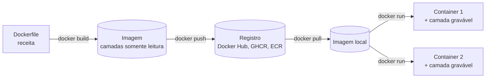

# 1. O problema que o Docker resolve

> ⏱️ ~1h30 · Módulo 11 · Pré-requisitos: [Módulo 10 (checkpoint aprovado)](../10-qualidade-testes/checkpoint.md), [3.03 (PostgreSQL com Docker)](../03-banco-de-dados/03-postgres-docker-ddl-dml.md)

> ✅ **Verificação.** Tudo executado em 2026-11-08 (Docker Engine 29.9.2, Compose v5.6.1, Linux). **As saídas são reais.** Esta aula só usa imagens públicas pequenas (`alpine`, `python:3.13-slim`); o MiniShop entra a partir da aula 02.

## 🎯 Objetivos
- Explicar o problema do **"na minha máquina funciona"** e como um container o resolve
- Diferenciar **imagem**, **container**, **camada** e **registro** (e dizer onde fica cada coisa)
- Explicar, com um experimento, por que um container **não é uma máquina virtual** (kernel compartilhado, `namespaces`, `cgroups`)
- Usar os comandos básicos: `run`, `ps`, `exec`, `logs`, `stop`, `rm`, `images`, `inspect`
- Prever o que **some** quando um container é apagado (e por isso por que existem volumes)

## 🤔 Por que isso importa
Até aqui o MiniShop rodava "no seu computador": Python 3.13 instalado pelo `uv`, PostgreSQL e Redis em containers soltos, variáveis exportadas no terminal. Um colega novo leva **horas** para reproduzir isso; o servidor de produção, **dias**, e ainda fica diferente. Em vaga de júnior, "subir o projeto com um comando" é rotina: quase todo time usa containers em desenvolvimento, em CI e em produção. Em entrevista, "o que é Docker e qual a diferença para uma máquina virtual?" é pergunta clássica.

## 💡 Intuição (explicação simples)
Pense no **contêiner de transporte** de um navio. Antes dele, cada carga (sacas, máquinas, bananas) exigia um jeito de carregar, e o porto precisava de guindastes diferentes. Com o contêiner padronizado, o porto não precisa saber o que há dentro: só sabe movê-lo. O Docker faz o mesmo com software: você empacota **o programa e tudo de que ele depende** (versão do Python, bibliotecas, arquivos) numa **imagem**; qualquer máquina com Docker sabe rodá-la, sem saber o que há dentro.

Uma **imagem** é a receita pronta e congelada (como uma fôrma de bolo já assada e embalada). Um **container** é uma execução dessa imagem (cada fatia servida). Dá para servir cem fatias da mesma fôrma, e o que uma pessoa faz com a sua fatia não muda as outras.

## 🔬 Como funciona por dentro

- **Container não é máquina virtual.** Uma VM emula um computador inteiro e roda **o próprio sistema operacional** (kernel) em cima de um *hipervisor*: gigabytes e minutos para iniciar. Um container é **um processo comum do Linux**, apenas com uma visão **restrita** do sistema, graças a dois recursos do kernel:
  | Recurso | O que faz | Efeito |
  |---|---|---|
  | **Namespaces** | Dão ao processo sua própria visão de processos (PID), rede, nomes de máquina, pontos de montagem… | Dentro do container o processo se vê como PID 1 e não enxerga os do host |
  | **cgroups** | Limitam e contabilizam CPU, memória e I/O | `--memory=64m` faz o kernel matar o processo que passar disso |
  Como o kernel é **o mesmo do host**, o container inicia em milissegundos e pesa megabytes. A contrapartida é um **isolamento mais fraco que o de uma VM**: um container não é uma barreira de segurança absoluta (aula 11.02 usa usuário não root por isso). No Windows e no macOS o Docker Desktop roda um Linux numa VM leve, e é nela que os containers vivem.
- **Imagem = camadas empilhadas, somente leitura.** Cada instrução do Dockerfile (aula 02) gera uma camada, identificada por um *hash*. Camadas iguais são **compartilhadas** entre imagens e **armazenadas uma só vez** (por isso duas imagens baseadas em `python:3.13-slim` não ocupam 2×178 MB).
- **Container = imagem + uma camada fina gravável.** O que o processo escreve vai para essa camada; ao `docker rm`, ela é **descartada**. Dados que precisam sobreviver ficam em **volumes** (aula 04).
- **Registro** é o servidor de imagens. O padrão é o **Docker Hub**; imagens têm nome `repositório:tag` (`python:3.13-slim`). A **tag é mutável** (`3.13-slim` hoje é uma coisa, em três meses outra); o **digest** (`sha256:…`) identifica o conteúdo exato.
- **Portas.** O container tem a própria rede. Para acessá-lo do host é preciso **publicar** a porta (`-p 127.0.0.1:8000:8000` = porta do host : porta do container). Publicar só em `127.0.0.1` evita expor o serviço à rede inteira.

## 🛠️ Exemplo prático
Antes de criar qualquer coisa, **olhe o que já existe** (hábito que a aula 04 mostrará ser importante):
```bash
docker ps -a
docker volume ls
```
**1. Rodar um programa sem instalá-lo.** O Python 3.13 vive só dentro da imagem:
```bash
docker run --rm python:3.13-slim python -V
```
```text
Python 3.13.18
```
`--rm` apaga o container ao terminar. Na primeira vez o Docker baixa a imagem (`pull`); nas seguintes é imediato.

**2. Container é um processo isolado, não uma máquina.** Dentro do container o processo é o PID 1 e só vê a si mesmo:
```bash
docker run --rm alpine:3.17 sh -c 'echo PID=$$; ps; hostname'
```
```text
PID=1
PID   USER     TIME  COMMAND
    1 root      0:00 sh -c echo PID=$$; ps; hostname
    7 root      0:00 ps
dfebf1cbfaa1
```
O `hostname` é o ID do container. Agora a prova de que o **kernel é o mesmo** do host, e de que o container é **um processo comum**, visto de fora:
```bash
uname -r;  docker run --rm alpine:3.17 uname -r        # kernel do host e do container
docker run -d --name dorminhoco alpine:3.17 sleep 300
docker top dorminhoco                                  # o processo, como o host o enxerga
```
```text
7.0.0-42-generic
7.0.0-42-generic
UID    PID      PPID     C   STIME   TTY   TIME       CMD
root   1183096  1183072  14  21:12   ?     00:00:00   sleep 300
```
Mesmo kernel; o `sleep` que era "PID 1" lá dentro é o **PID 1183096** aqui fora. Os *namespaces* mudam a visão, não a realidade. Eles são diferentes para o host e para o container:
```bash
readlink /proc/self/ns/pid /proc/self/ns/net                                          # host
docker run --rm alpine:3.17 sh -c 'readlink /proc/self/ns/pid /proc/self/ns/net'      # container
```
```text
host:      pid:[4026531836] net:[4026531833]
container: pid:[4026533317] net:[4026533341]
```
Números diferentes = espaços de nomes diferentes. Limpe: `docker rm -f dorminhoco`.

**3. Limites (cgroups).** Pedimos 64 MB e o kernel registra o limite:
```bash
docker run --rm --memory=64m alpine:3.17 cat /sys/fs/cgroup/memory.max
```
```text
67108864
```
(64 × 1024 × 1024 bytes. Na aula 05 veremos o que acontece quando o processo ultrapassa.)

**4. A camada gravável é descartável.**
```bash
docker run --name efemero alpine:3.17 sh -c 'echo ola > /tmp/arquivo.txt; ls /tmp'
docker diff efemero          # o que mudou em relação à imagem
docker rm efemero
docker run --rm alpine:3.17 ls /tmp      # um container novo da mesma imagem
```
```text
arquivo.txt
C /tmp
A /tmp/arquivo.txt
```
(`A` = adicionado, `C` = alterado.) A última linha não imprime nada: o arquivo morreu com o container.

**5. Uma imagem, vários containers independentes.**
```bash
docker run -d --name caixa1 alpine:3.17 sleep 60 ; docker run -d --name caixa2 alpine:3.17 sleep 60
docker exec caixa1 sh -c 'echo "só do 1" > /tmp/x'
echo "caixa1:"; docker exec caixa1 ls /tmp
echo "caixa2:"; docker exec caixa2 ls /tmp
```
```text
caixa1:
x
caixa2:
```
Um nome precisa ter **pelo menos 2 caracteres**: com `--name a`, o Docker recusa (`invalid container name (a): name must be at least 2 characters`). Limpe com `docker rm -f caixa1 caixa2`.

**6. Isolamento de versões: o mesmo código, dois Pythons, sem conflito.** O arquivo `versao.py` usa `match`, que só existe a partir do Python 3.10:
```bash
cat > versao.py <<'EOF'
import sys
match sys.version_info[:2]:
    case (3, 13): print("rodando no Python 3.13: ok")
    case _: print("outra versão")
EOF
docker run --rm -v "$PWD":/app:ro -w /app python:3.13-slim python versao.py
docker run --rm -v "$PWD":/app:ro -w /app python:3.8-slim  python versao.py
```
```text
rodando no Python 3.13: ok
    match sys.version_info[:2]:
          ^
SyntaxError: invalid syntax
```
Duas versões convivendo, sem instalar nenhuma. Este é o "na minha máquina funciona" **reproduzido de propósito**: o ambiente faz parte do que precisa ser versionado. (`-v "$PWD":/app:ro` monta a pasta atual, somente leitura; volumes são a aula 04.)

**7. Tamanho e velocidade.**
```bash
time docker run --rm alpine:3.17 true       # ~0,2 s para criar, iniciar e apagar um container
docker images --format 'table {{.Repository}}:{{.Tag}}\t{{.Size}}'
```
```text
real	0m0.198s
python:3.13-slim        178MB
nginx:1.29-alpine       93.5MB
alpine:3.17             11.2MB
redis:8                 213MB
postgres:18             650MB
```
Um container nasce em ~0,2 s (uma VM levaria dezenas de segundos) e a imagem do `python:3.13-slim` tem 178 MB, contra a distribuição "cheia" que veremos na aula 02.

**8. Camadas.** `docker history` mostra a pilha de camadas de uma imagem e o tamanho de cada uma:
```bash
docker history python:3.13-slim --format 'table {{.Size}}\t{{.CreatedBy}}' | cut -c1-90
```
```text
SIZE      CREATED BY
0B        CMD ["python3"]
16.4kB    RUN /bin/sh -c set -eux;  for src in idle3 p…
40.5MB    RUN /bin/sh -c set -eux;   savedAptMark="$(a…
0B        ENV PYTHON_VERSION=3.13.18
4.93MB    RUN /bin/sh -c set -eux;  apt-get update;  a…
87.7MB    # debian.sh --arch 'amd64' out/ 'trixie' '@1…
```
Embaixo, o sistema base (Debian, 87,7 MB); acima, o Python compilado (40,5 MB). Instruções `ENV`/`CMD` não ocupam espaço (0 B): são só metadados.

**9. Os comandos do dia a dia** (guarde esta lista; há uma folha de consulta em [`recursos/cheatsheets/docker.md`](../recursos/cheatsheets/docker.md)):
| Comando | Para quê |
|---|---|
| `docker run [-d] [--rm] [-p H:C] [--name N] IMAGEM [CMD]` | cria **e** inicia um container (`-d` = em segundo plano) |
| `docker ps [-a]` | lista containers (`-a` inclui os parados) |
| `docker logs [-f] N` | mostra a saída do processo (`-f` acompanha) |
| `docker exec -it N sh` | roda um comando **dentro** de um container que já está de pé |
| `docker stop N` / `start N` / `rm [-f] N` | parar, iniciar, apagar (`-f` apaga mesmo rodando) |
| `docker images` / `rmi` / `pull` | imagens locais, apagar, baixar |
| `docker inspect N` | JSON completo (rede, montagens, variáveis, estado) |

## 🧠 Pausa para lógica
**Problema.** Duas imagens partem de `python:3.13-slim` (178 MB). A imagem **A** adiciona 200 MB de dependências; a **B** adiciona 50 MB. (a) Quanto espaço as duas ocupam **no disco** do host? (b) Quanto ocuparia se cada imagem fosse uma cópia independente? (c) Você sobe 30 containers da imagem A: o disco cresce ~30 × 378 MB?

<details><summary>Dica</summary>As camadas iguais são armazenadas uma só vez. Um container acrescenta só a sua camada gravável.</details>

<details><summary>Solução comentada</summary>

(a) 178 (base, **uma vez**) + 200 + 50 = **428 MB**. (b) 378 + 228 = **606 MB**; o compartilhamento economiza 178 MB. (c) **Não.** A imagem A (378 MB) existe uma vez; cada container só acrescenta a sua camada gravável, vazia no início e do tamanho do que o processo escrever. Por isso subir dezenas de containers é barato, e por isso também **nada do que o processo grava sobrevive** ao `docker rm`.
</details>

## ⚠️ Erros comuns e boas práticas
| Sintoma / mensagem | Causa | Solução |
|---|---|---|
| `permission denied while trying to connect to the docker API at unix:///var/run/docker.sock` | Seu usuário não está no grupo `docker` | `sudo usermod -aG docker $USER` e abrir uma sessão nova (ou usar `sudo`) |
| `Cannot connect to the Docker daemon` | O serviço não está rodando | `sudo systemctl start docker` (Linux); abrir o Docker Desktop (Windows/macOS) |
| `Bind for 127.0.0.1:5432 failed: port is already allocated` | Outra coisa já usa a porta (outro container, ou o PostgreSQL local) | `docker ps` para achar quem usa; trocar a porta do host (`-p 127.0.0.1:5433:5432`) |
| `Conflict. The container name "/x" is already in use` | Já existe um container (parado) com esse nome | `docker rm x` (ou `--rm` desde o início) |
| `invalid container name (a): name must be at least 2 characters` | Nome com 1 caractere | Nomes de 2+ caracteres |
| Container "sumiu" depois de `run` sem `-d` e `Ctrl+C` | Rodava em primeiro plano | `-d` para segundo plano; `docker ps -a` mostra os parados |
| "Salvei um arquivo no container e perdi" | A camada gravável morre com o container | Volume (aula 04) ou o dado fora do container (banco, S3) |
| Imagem `latest` mudou e o projeto quebrou | A tag é mutável | Fixar versão (`python:3.13-slim`, `postgres:18`), nunca `latest` em projeto sério |

- **Containers são descartáveis ("gado, não animais de estimação").** Se um deles dá problema, apague e suba outro; o que importa fica em imagem (código) e volume/banco (dados).
- **Um processo principal por container.** O container vive enquanto o processo principal vive.
- **Não confunda os dois "nomes".** `postgres:18` é a **imagem**; `minishop-pg` é o **container** que você criou com ela.
- **Publique portas só em `127.0.0.1`** em desenvolvimento.
- **Olhe antes de criar:** `docker ps -a` e `docker volume ls` evitam colisões de nome (a aula 04 mostra um caso real).

## 🧩 Exercícios
**1. Fixação.** (a) Imagem × container: onde cada um aparece no `docker run`? (b) Por que um container inicia em milissegundos e uma VM não? (c) O que são *namespaces* e *cgroups*, em uma frase cada? (d) Por que não se deve confiar num container como barreira de segurança absoluta? (e) Por que `postgres:18` é melhor que `postgres:latest`?

<details><summary>Solução</summary>

(a) A imagem é o argumento (`python:3.13-slim`); o container é o que o comando cria e inicia. (b) Container é um processo no kernel do host; a VM precisa iniciar um sistema operacional completo. (c) Namespaces limitam o que o processo **enxerga** (processos, rede, montagens); cgroups limitam o que ele **consome** (CPU, memória). (d) O kernel é compartilhado: uma falha no kernel ou uma configuração frouxa (por exemplo, rodar como root) pode permitir sair do container. (e) Porque `latest` muda sem aviso e quebra a reprodutibilidade; fixar a versão torna o ambiente previsível.
</details>

**2. Aplicação no projeto MiniShop.** (Preparação para as próximas aulas.)
- [ ] Conferir `docker --version` e `docker compose version` e anotar as versões em `docs/ambiente.md`
- [ ] Listar o que você já tem (`docker ps -a`, `docker volume ls`, `docker images`) e **anotar o nome de cada container e volume do módulo 3** (`minishop-pg`, `minishop_pgdata`, …): você vai precisar para não colidir
- [ ] Reproduzir os experimentos 2, 4 e 6 e escrever em `docs/docker-conceitos.md` (10 linhas) o que cada um prova
- [ ] Executar `docker run --rm python:3.13-slim python -c "import sys; print(sys.version)"` e explicar por que isso não instala nada no seu computador
- [ ] Commit `docs: docker concepts and environment notes`

**3. Desafio (opcional).** Rode `docker run --rm --memory=20m --memory-swap=20m python:3.13-slim python -c "x = bytearray(100*1024*1024)"` e investigue com `docker inspect` (ou `docker run` sem `--rm`) o que o kernel fez e qual o *exit code* (a aula 05 retoma).

## 🎤 Na entrevista
**1. Qual a diferença entre um container e uma máquina virtual?** A VM emula um computador e roda o próprio sistema operacional em cima de um hipervisor: pesada e lenta para iniciar, isolamento forte. O container é um processo do host com visão restrita (namespaces) e limites (cgroups), compartilhando o kernel: leve, inicia em milissegundos, isolamento mais fraco.

**2. Qual a diferença entre imagem e container?** A imagem é o pacote imutável, em camadas, que descreve o sistema de arquivos e como iniciar; o container é uma instância em execução dela, com uma camada gravável descartável. De uma imagem saem vários containers.

**3. O que acontece com os dados de um container quando ele é removido?** O que foi escrito na camada gravável se perde. Dados persistentes devem ficar em volumes (ou em serviços externos, como um banco gerenciado).

## 📚 Para ir além
- 📄 Documentação oficial: [Docker overview](https://docs.docker.com/get-started/docker-overview/). Imagens, containers, registro e a arquitetura cliente-servidor do Docker.
- 📄 Documentação oficial: [Running containers](https://docs.docker.com/engine/containers/run/). Todas as opções do `docker run` (rede, memória, usuário, reinício).
- 📄 Documentação oficial: [Resource constraints](https://docs.docker.com/engine/containers/resource_constraints/). Como `--memory` e `--cpus` viram cgroups.
- 📄 Documentação: [Docker Hub — imagem oficial `python`](https://hub.docker.com/_/python). Variantes (`slim`, `alpine`, `bookworm`) e suas diferenças.
- 🎥 Vídeo: curso "Docker Tutorial for Beginners" (canal *TechWorld with Nana*, ~3 h) e o *Docker Crash Course* (canal *freeCodeCamp.org*): ⚠️ links de vídeo não verificados; procure pelo título no canal.
- 🏋️ Prática extra: rode `docker run --rm -it alpine:3.17 sh`, explore (`ps`, `ls /`, `cat /etc/os-release`), saia com `exit`, e descreva o que mudou no host (nada).

## ✅ Checklist da aula
- [ ] Sei dizer, em uma frase, o que é imagem, container, camada e registro
- [ ] Vi, com `docker top`, que o container é um processo comum do host
- [ ] Sei por que o kernel compartilhado torna o container leve e o isolamento mais fraco
- [ ] Comprovei que a camada gravável some com o `docker rm`
- [ ] Sei usar `run`, `ps`, `exec`, `logs`, `stop`, `rm`, `images`, `inspect`
- [ ] Anotei os nomes dos containers e volumes que já existem na minha máquina
