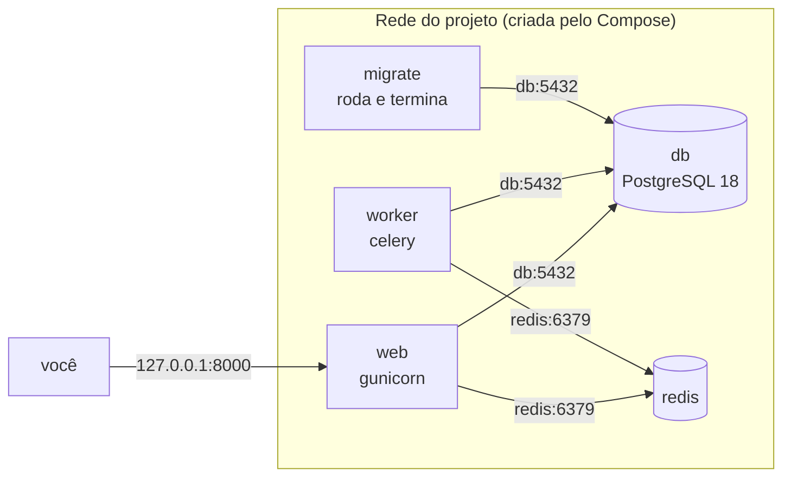

# 3. Docker Compose: app + PostgreSQL + Redis + worker

> ⏱️ ~1h30 · Módulo 11 · Pré-requisitos: [11.02](02-dockerfile-django.md), [7.06 (filas e Celery)](../07-sincrono-assincrono/06-filas-celery.md), [3.03 (PostgreSQL com Docker)](../03-banco-de-dados/03-postgres-docker-ddl-dml.md)

> ✅ **Verificação.** Tudo executado em 2026-11-08 (Docker 29.9.2, Compose v5.6.1, `postgres:18` = PostgreSQL 18.6, `redis:8`) sobre o MiniShop do módulo 10. **As saídas são reais.** Código em [`projeto/referencia-api-m11/`](../projeto/referencia-api-m11/README.md) (`compose.yaml`, `.env.docker.example`).

## 🎯 Objetivos
- Descrever o MiniShop inteiro (web, banco, cache, worker) num único `compose.yaml`
- Explicar como os serviços **se encontram pelo nome** e por que `localhost` não funciona entre containers
- Controlar a **ordem de inicialização** com `healthcheck` e `depends_on`, e demonstrar o problema que isso resolve
- Rodar tarefas únicas (migração, seed) sem deixar um container "pendurado"
- Usar `up`, `down`, `ps`, `logs`, `run`, `exec` e `--scale`

## 🤔 Por que isso importa
O MiniShop já tem **quatro processos**: o servidor web, o PostgreSQL, o Redis e o worker do Celery. Subir isso à mão (como no módulo 3 e no 7) são quatro terminais, quatro comandos `docker run` com portas e senhas, e uma ordem que ninguém lembra. O objetivo do marco `v3.0-docker` é **um comando** que sobe tudo. Em qualquer time, o `docker compose up` é a primeira coisa que se pede a um dev novo.

## 💡 Intuição (explicação simples)
O Compose é a **planta da casa**, em vez de montar cômodo por cômodo de memória. Você descreve em um arquivo quais cômodos (serviços) existem, o que cada um precisa, e quem só pode abrir depois de quem (o web só abre depois que o banco está de pé). Para ir de um cômodo a outro você usa o **nome do cômodo** ("sala", "cozinha"), não o endereço da casa inteira: dentro de um container, `localhost` é **ele mesmo**, não o computador onde tudo roda.

## 🔬 Como funciona por dentro

- **`compose.yaml`** descreve **serviços**, **redes** e **volumes**. O Compose cria uma rede para o projeto e põe todos os containers nela; **cada serviço é alcançável pelo seu nome** (DNS interno): a `DATABASE_URL` usa `@db:5432`, não `@127.0.0.1`.
- **Nome do projeto** (`name:`). Prefixa tudo o que o Compose cria (`minishop-docker-web-1`, rede `minishop-docker_default`, volumes `minishop-docker_…`). Dois projetos com o mesmo nome **compartilham volumes e redes**: escolha um nome que não colida com nada do que você já tem (a aula 04 mostra por quê, com um caso real).
- **Ordem de inicialização.** `depends_on` simples só espera o container *iniciar*, **não** o programa estar *pronto* (o PostgreSQL leva segundos para aceitar conexões). Para isso existem:
  - **`healthcheck`**: um comando que o Docker roda de tempos em tempos dentro do container; o estado vira `healthy` ou `unhealthy`;
  - **`depends_on` com `condition`**: `service_started` (padrão), `service_healthy` (espera o healthcheck passar), `service_completed_successfully` (espera um serviço de **tarefa única** terminar com código 0).
- **Tarefas únicas.** A migração do banco não é um servidor: é um comando que roda e termina. Em vez de embuti-la na inicialização do web (e todo `scale` rodar a migração N vezes ao mesmo tempo), vira um **serviço `migrate`** de que `web` e `worker` dependem.
- **Configuração por ambiente.** `env_file: .env` injeta as variáveis no container (o projeto já lê tudo do ambiente desde o módulo 8, Fator III). O `.env` **não vai para o Git**; o que se versiona é o `.env.docker.example`, só com nomes e valores fictícios. Na própria `compose.yaml`, `${VAR:?mensagem}` **interpola** uma variável do `.env` e **falha com a mensagem** se ela estiver vazia.
- **Imagem única.** `web`, `worker` e `migrate` rodam **a mesma imagem** (`minishop:dev`, construída pelo `build: .` do `web`); só o comando muda. Código igual, papéis diferentes.

## 🛠️ Exemplo prático
**1. O arquivo** (`compose.yaml`; as aulas 04 e 06 o evoluem):
```yaml
name: minishop-docker

services:
  db:
    image: postgres:18
    environment:
      POSTGRES_USER: minishop
      POSTGRES_PASSWORD: ${POSTGRES_PASSWORD:?defina POSTGRES_PASSWORD no .env}
      POSTGRES_DB: minishop
    healthcheck:
      test: ["CMD-SHELL", "pg_isready -U minishop -d minishop"]
      interval: 5s
      timeout: 3s
      retries: 10

  redis:
    image: redis:8
    healthcheck:
      test: ["CMD", "redis-cli", "ping"]
      interval: 5s
      timeout: 3s
      retries: 10

  migrate:                         # tarefa única: aplica as migrações e termina
    image: minishop:dev
    command: ["python", "manage.py", "migrate", "--noinput"]
    env_file: .env
    depends_on:
      db:
        condition: service_healthy
    restart: "no"

  web:
    build: .                       # constrói o Dockerfile da aula 02 e dá o nome minishop:dev
    image: minishop:dev
    env_file: .env
    ports:
      - "127.0.0.1:8000:8000"      # só o host local acessa
    depends_on:
      migrate:
        condition: service_completed_successfully
      redis:
        condition: service_healthy

  worker:
    image: minishop:dev
    command: ["celery", "-A", "config", "worker", "--loglevel=INFO", "--concurrency=2"]
    env_file: .env
    depends_on:
      migrate:
        condition: service_completed_successfully
      redis:
        condition: service_healthy
```
E o `.env` (copiado de `.env.docker.example`; **nunca** commitado):
```bash
DEBUG=0
SECRET_KEY=dev-compose-nao-use-em-producao-0123456789abcdef
ALLOWED_HOSTS=localhost,127.0.0.1
SECURE_SSL_REDIRECT=0                 # sem HTTPS por enquanto (o Nginx da aula 06 o traz de volta)
POSTGRES_PASSWORD=dev-somente-local
DATABASE_URL=postgres://minishop:dev-somente-local@db:5432/minishop   # "db" é o NOME do serviço
CELERY_BROKER_URL=redis://redis:6379/0
REDIS_HOST=redis
REDIS_PORT=6379
REDIS_CACHE_URL=redis://redis:6379/1
EMAIL_OUTBOX_FILE=/tmp/outbox.jsonl   # onde o "SMTP" de laboratório grava (a aula 04 troca por um volume)
```
(Repare como o **mesmo código** do módulo 10 lê `CELERY_BROKER_URL`, `REDIS_HOST` e `DATABASE_URL`: configurá-lo para os containers não exigiu mudar uma linha da aplicação, só o ambiente.)

**2. Subir tudo.**
```bash
docker compose config --quiet && echo "compose válido"
time docker compose up -d --build
docker compose ps -a --format 'table {{.Service}}\t{{.Status}}\t{{.Ports}}'
```
```text
compose válido
real	0m18.162s
SERVICE   STATUS                     PORTS
db        Up 12 seconds (healthy)    5432/tcp
migrate   Exited (0) 5 seconds ago
redis     Up 12 seconds (healthy)    6379/tcp
web       Up 5 seconds               127.0.0.1:8000->8000/tcp
worker    Up 5 seconds               8000/tcp
```
O Compose construiu a imagem, criou a rede, subiu `db` e `redis`, **esperou ficarem saudáveis**, rodou `migrate` até o fim (`Exited (0)` é o esperado) e só então iniciou `web` e `worker`. Observe que `5432/tcp` aparece **sem** `->`: o banco **não** está publicado no host, só visível para os outros containers. Aliás, nesta máquina a porta 5432 do host já pertencia ao container do módulo 3: o PostgreSQL do Compose não disputa com ele justamente porque não publica porta.
```bash
docker compose logs migrate | tail -3
```
```text
migrate-1  |   Applying token_blacklist.0011_linearizes_history... OK
migrate-1  |   Applying token_blacklist.0012_alter_outstandingtoken_user... OK
migrate-1  |   Applying token_blacklist.0013_alter_blacklistedtoken_options_and_more... OK
```

**3. Dados de exemplo com `run`.** O comando `seed` só funciona com `DEBUG=1` (criaria usuários com senha conhecida: proteção do módulo 9). Em vez de ligar o `DEBUG` do serviço inteiro, rodamos **um container descartável** com a variável sobrescrita:
```bash
docker compose run --rm -e DEBUG=1 web python manage.py seed
```
```text
Seed ok: 64 produtos
```
`run` cria um container novo do serviço `web` (com a mesma configuração), executa o comando e, com `--rm`, o apaga.

**4. O sistema inteiro, de ponta a ponta.** Login, produto, carrinho, pedido, e o e-mail de confirmação saindo **pelo worker**:
```bash
B=http://127.0.0.1:8000/api/v1
TOKEN=$(curl -s -X POST $B/auth/token/ -H 'Content-Type: application/json' \
        -d '{"username":"cliente","password":"dev-somente-local-123"}' | python3 -c 'import sys,json;print(json.load(sys.stdin)["access"])')
H="Authorization: Bearer $TOKEN"
curl -s -X POST $B/cart/items/ -H "$H" -H 'Content-Type: application/json' -d '{"product":49,"quantity":2}' -w "\ncarrinho -> %{http_code}\n" | tail -1
curl -s -X POST $B/orders/ -H "$H" -H 'Idempotency-Key: lab-1' -H 'Content-Type: application/json' -d '{}' -w "\npedido -> %{http_code}\n" | tail -1
docker compose logs worker --since 30s | grep -E "received|succeeded"
docker compose exec worker cat /tmp/outbox.jsonl
```
```text
carrinho -> 201
pedido -> 201
worker-1  | Task orders.send_order_confirmation_email[78fde1de-...] received
worker-1  | Task orders.send_order_confirmation_email[78fde1de-...] succeeded in 0.8358406820043456s: 'enviado'
{"to": ["cliente@minishop.local"], "subject": "MiniShop: pedido #1 recebido", "body": "Olá, cliente!\n\nRecebemos o seu pedido #1:\n- 2 × Cadeira Básico: R$ 1402.40\n\nTotal: R$ 1402.40\n"}
```
O **web** gravou o pedido no PostgreSQL de outro container, enfileirou a tarefa no Redis de outro container, e o **worker**, em um terceiro, a consumiu e "enviou" o e-mail. Tudo isto sem instalar nada no host além do Docker.

**5. Por que `depends_on` simples não basta (a corrida).** Um arquivo mínimo (`docker-lab/compose.sem-espera.yaml`) sem `healthcheck`: o `db` e uma tarefa que tenta conectar assim que inicia.
```yaml
name: minishop-corrida
services:
  db:
    image: postgres:18
    environment: {POSTGRES_USER: minishop, POSTGRES_PASSWORD: dev-somente-local, POSTGRES_DB: minishop}
  migrate:
    image: minishop:dev
    command: ["python", "-c", "import psycopg; psycopg.connect('postgres://minishop:dev-somente-local@db:5432/minishop'); print('conectou')"]
    depends_on: [db]          # só espera o container INICIAR, não o Postgres ficar pronto
```
```bash
for i in 1 2 3; do docker compose -f docker-lab/compose.sem-espera.yaml up migrate; docker compose -f docker-lab/compose.sem-espera.yaml down -v; done
```
```text
psycopg.OperationalError: connection failed: connection to server at "172.20.0.2", port 5432 failed: Connection refused
migrate-1 exited with code 1          (tentativas 1, 2 e 3: falhou nas três)
```
O container do banco *iniciou*, mas o PostgreSQL ainda estava inicializando o cluster. **Nota honesta:** na minha primeira tentativa, com o `migrate` real (que carrega o Django antes de conectar, ~1 s), a corrida **não** se manifestou e tudo funcionou: é isto que torna o problema traiçoeiro. "Funciona na minha máquina" (e quebra no CI, onde o disco é mais lento). Com o `healthcheck` + `condition: service_healthy` a ordem deixa de depender de sorte.

**6. Escalar o worker.**
```bash
docker compose up -d --scale worker=3
docker compose ps worker --format 'table {{.Name}}\t{{.Status}}'
```
```text
NAME                STATUS
minishop-docker-worker-1   Up 31 seconds
minishop-docker-worker-2   Up Less than a second
minishop-docker-worker-3   Up Less than a second
```
Três workers consumindo a mesma fila. (O `web` **não** se escala assim enquanto publicar a porta 8000: dois containers não podem usar a mesma porta do host; a solução é um proxy na frente, aula 06.) Volte com `--scale worker=1`.

**7. Ciclo de vida.**
| Comando | O que faz |
|---|---|
| `docker compose up -d [--build] [--wait]` | cria/atualiza e inicia (`--wait` espera ficarem saudáveis) |
| `docker compose ps [-a]` | estado dos serviços do projeto |
| `docker compose logs [-f] [serviço]` | logs |
| `docker compose exec serviço cmd` | comando num container **em execução** |
| `docker compose run --rm serviço cmd` | comando num container **novo e descartável** |
| `docker compose stop` / `start` | para / inicia sem apagar |
| `docker compose down` | apaga containers e redes (**mantém** volumes) |
| `docker compose down -v` | também apaga **os volumes do projeto** (os dados!) |
| `docker compose config` | mostra o arquivo final, com variáveis interpoladas |

## 🧠 Pausa para lógica
**Problema.** O `web` tem `depends_on: migrate (service_completed_successfully)`. A migração leva 20 s. O banco leva 4 s para ficar saudável. O Redis, 2 s. O `web` leva 3 s para iniciar e o `worker`, 2 s. (a) Em quanto tempo, no mínimo, o `web` está de pé? (b) Se o `migrate` falhar com código 1, o que acontece com `web` e `worker`? (c) Por que isso é melhor do que o `web` rodar `migrate && gunicorn …` no próprio comando?

<details><summary>Dica</summary>O tempo é o do caminho mais longo; um serviço dependente nunca inicia se a condição não for atendida.</details>

<details><summary>Solução comentada</summary>

(a) `db` saudável (4 s) → `migrate` (20 s) → `web` inicia (3 s) = **27 s**; o Redis (2 s) corre em paralelo e não está no caminho crítico. (b) `web` e `worker` **nunca iniciam**: o `docker compose up` termina com erro (`service "migrate" didn't complete successfully: exit 1`), e o log do `migrate` mostra a causa. Melhor falhar alto do que subir uma aplicação com o banco desatualizado. (c) Com `scale`, vários `web` rodariam a migração **ao mesmo tempo** (corrida entre migrações); com um serviço dedicado, ela roda **uma vez**, e é visível, testável e reexecutável sozinha (`docker compose run --rm migrate`).
</details>

## ⚠️ Erros comuns e boas práticas
| Sintoma / mensagem | Causa | Solução |
|---|---|---|
| `connection to server at "127.0.0.1", port 5432 failed: Connection refused` (dentro do container) | `DATABASE_URL` com `localhost`/`127.0.0.1`: dentro do container é **ele mesmo** | Usar o nome do serviço (`@db:5432`) |
| `required variable POSTGRES_PASSWORD is missing a value: defina POSTGRES_PASSWORD no .env` | `.env` ausente ou sem a variável | `cp .env.docker.example .env` e preencher |
| `service "migrate" didn't complete successfully: exit 1` | Migração falhou | `docker compose logs migrate` |
| `connection refused` no começo, depois funciona | Sem `healthcheck` / `service_healthy` | Esperar o serviço **pronto**, não só iniciado |
| `Bind for 127.0.0.1:8000 failed: port is already allocated` | Outro processo usa a porta | `docker ps`/`ss -ltnp`; trocar a porta do host |
| `yaml: line 12: mapping values are not allowed here` | Indentação ou `:` mal posto | Compose usa **espaços**, nunca tabulação; `docker compose config` valida |
| Mudei o código e nada mudou | A imagem não foi reconstruída | `docker compose up -d --build` |
| Mudei o `.env` e nada mudou | As variáveis são lidas **ao criar** o container | `docker compose up -d` (recria os que mudaram) |
| Publiquei o banco `5432:5432` e conflitou/ficou exposto | Costume de dev | **Não publique** o banco; use `exec` ou o `psql` pelo Compose |

- **Não publique portas de banco e cache** que só os outros containers usam.
- **Nada de segredos reais no `compose.yaml`** (ele é versionado): `${VAR}` lendo do `.env`.
- **`restart: unless-stopped`** para servidores de longa duração (veremos no 05); **`restart: "no"`** para tarefas únicas.
- **Fixe versões** (`postgres:18`, `redis:8`) para todos terem o mesmo ambiente.
- **Um arquivo, uma fonte da verdade**: o que o README manda rodar deve ser exatamente `docker compose up`.

## 🧩 Exercícios
**1. Fixação.** (a) Por que `localhost` não funciona entre containers? (b) Diferencie `service_started`, `service_healthy` e `service_completed_successfully`. (c) `run` × `exec`. (d) `down` × `down -v`. (e) Por que `migrate` é um serviço separado?

<details><summary>Solução</summary>

(a) Cada container tem sua rede; `localhost` é o próprio container. (b) Iniciou; healthcheck passou; terminou com código 0. (c) `exec` roda num container que já existe; `run` cria um novo, descartável. (d) `down` mantém os volumes (dados); `down -v` os apaga. (e) Para rodar uma vez, antes de todos, sem corrida entre réplicas.
</details>

**2. Aplicação no projeto MiniShop.**
- [ ] `compose.yaml` com `db` (PostgreSQL 18), `redis`, `migrate`, `web` e `worker`, com `healthcheck` e `depends_on` por condição
- [ ] `.env.docker.example` versionado e `.env` no `.gitignore` (confirme com `git check-ignore -v .env`)
- [ ] Banco e Redis **sem portas publicadas**
- [ ] `docker compose up -d --build` do zero em um clone novo funciona; `seed` via `run --rm -e DEBUG=1`
- [ ] Fluxo completo conferido: login, carrinho, pedido, e-mail no worker (cole a saída em `docs/docker.md`)
- [ ] Demonstração da corrida: o `docker-lab/compose.sem-espera.yaml` falhando **três vezes**
- [ ] `docker compose up -d --scale worker=3` funcionando
- [ ] Commit `build: add docker compose with web, db, redis and celery worker`

**3. Desafio (opcional).** Adicione o `celery beat` (módulo 7.08) como sexto serviço, **com uma só réplica** (por quê?), e comprove nos logs que as tarefas agendadas disparam. Depois use `profiles:` para que `beat` só suba com `--profile agendador`.

## 🎤 Na entrevista
**1. O que é Docker Compose e quando usar?** Uma ferramenta para definir e rodar aplicações com vários containers a partir de um arquivo YAML (serviços, redes, volumes). Ótima para desenvolvimento, testes e CI; em produção em larga escala se usa um orquestrador (Kubernetes, ECS), mas o Compose pode servir pequenos deploys.

**2. Como o container da aplicação acha o banco?** Pelo nome do serviço, via DNS da rede que o Compose cria (`db:5432`). `localhost` não serve, pois dentro de cada container é ele mesmo.

**3. `depends_on` garante que o banco está pronto?** Não, só a ordem de início. Para "pronto" combina-se `healthcheck` no banco com `depends_on: condition: service_healthy`; para tarefas únicas, `service_completed_successfully`.

## 📚 Para ir além
- 📄 Documentação oficial: [Docker Compose — visão geral](https://docs.docker.com/compose/). O que é e como começar.
- 📄 Documentação oficial: [Control startup and shutdown order](https://docs.docker.com/compose/how-tos/startup-order/). `healthcheck`, `condition` e por que `depends_on` sozinho não basta.
- 📄 Documentação oficial: [Compose file — services](https://docs.docker.com/reference/compose-file/services/). Todas as chaves (`restart`, `healthcheck`, `profiles`, `depends_on`).
- 📄 Documentação oficial: [Compose — Networking](https://docs.docker.com/compose/how-tos/networking/). DNS por nome de serviço e redes do projeto.
- 📄 Documentação oficial: [Compose — Profiles](https://docs.docker.com/compose/how-tos/profiles/). Serviços opcionais (`beat`, ferramentas de depuração).
- 📄 Documentação: [Imagem oficial `postgres`](https://hub.docker.com/_/postgres). Variáveis (`POSTGRES_*`), inicialização e onde ficam os dados.
- 📄 Documentação: [12 fatores — Config](https://12factor.net/pt_br/). Por que a configuração vem do ambiente.
- 🏋️ Prática extra: derrube só o `db` com `docker compose stop db` enquanto o sistema roda, faça uma requisição e leia o erro; suba de novo e veja o `web` voltar sozinho.

## ✅ Checklist da aula
- [ ] Descrevi web, db, redis, migrate e worker em um `compose.yaml`
- [ ] Entendo por que o banco é `@db` e não `@localhost`
- [ ] Usei `healthcheck` + `depends_on` por condição e reproduzi a corrida sem eles
- [ ] Rodei migração e seed como tarefas únicas
- [ ] Fiz um pedido e vi o e-mail sair pelo worker
- [ ] Banco e Redis não estão publicados no host
