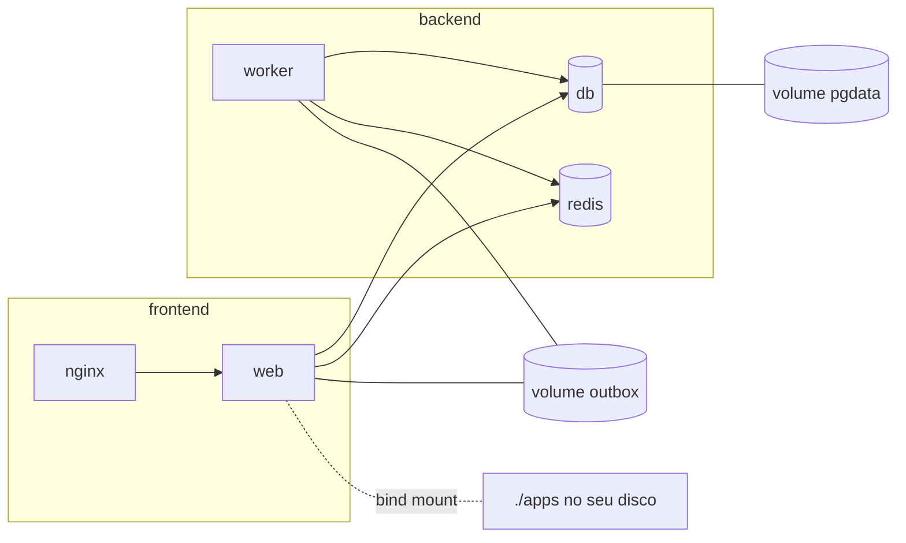

# 4. Volumes, redes e variáveis de ambiente

> ⏱️ ~1h30 · Módulo 11 · Pré-requisitos: [11.03](03-docker-compose.md), [9.06 (segredos)](../09-seguranca/06-segredos-dependencias-headers-rate-limit.md)

> ✅ **Verificação.** Tudo executado em 2026-11-08 (Docker 29.9.2, Compose v5.6.1, `postgres:18`), sobre o MiniShop do módulo 10. **As saídas são reais**, e esta aula registra, no quadro "Um caso real", **um erro que cometi no laboratório** e o que ele ensina. Código em [`projeto/referencia-api-m11/`](../projeto/referencia-api-m11/README.md) (`compose.yaml`, `compose.dev.yaml`, `config/envconf.py`, `docker-lab/compose.segredos.yaml`).

## 🎯 Objetivos
- Escolher entre **volume nomeado**, **bind mount** e **camada gravável**, e dizer o que sobrevive a `down`
- Explicar e **resolver o problema de permissão** em volumes (UID do usuário do container)
- Usar **redes** do Compose para isolar serviços (`frontend` e `backend`) e entender o DNS interno
- Passar configuração por **variáveis de ambiente** e **segredos por arquivo**, sabendo o que vaza e onde
- Montar um **override de desenvolvimento** (`compose.dev.yaml`) com recarga automática de código

## 🤔 Por que isso importa
Três dos problemas mais comuns de quem começa com Docker são: "**perdi o banco** quando recriei o container", "o container **não consegue escrever** no volume" e "**vazei a senha** na imagem/no log". Os três são tratados nesta aula. E um quarto, mais sutil, quase custou um banco de dados real no laboratório do próprio curso: **nomes que colidem**.

## 💡 Intuição (explicação simples)
O container é um **quarto de hotel**: você usa, vai embora, a camareira limpa tudo. O **volume** é o **cofre do hotel** (seus pertences continuam lá no próximo quarto). O **bind mount** é uma **janela** que dá para a sua casa: o que muda lá aparece aqui na hora. A **rede** é o conjunto de **corredores**: só quem está no mesmo corredor consegue bater na porta do outro. E as **variáveis de ambiente** são o **bilhete deixado na recepção**: qualquer um que olhar o registro do quarto vê o que está escrito, então bilhete não é lugar para a chave do cofre.

## 🔬 Como funciona por dentro

| Mecanismo | Onde os dados vivem | Sobrevive a `rm`/`down`? | Uso típico |
|---|---|---|---|
| Camada gravável | dentro do container | **Não** | arquivos temporários |
| **Volume anônimo** | gerenciado pelo Docker, **sem nome** | só enquanto alguém o referenciar; **perde-se a pista** | acidental (a imagem do `postgres` declara `VOLUME`) |
| **Volume nomeado** | gerenciado pelo Docker, **com nome** (`pgdata`) | **Sim** (só `down -v` ou `docker volume rm` apagam) | banco de dados, uploads, filas em disco |
| **Bind mount** | uma **pasta sua** montada no container | Sim (é o seu disco) | **código em desenvolvimento**, arquivos de configuração |
| `tmpfs` | memória | Não | segredos temporários, cache |

- **Volume ≠ imagem.** O volume vive fora da imagem e do container. Na **primeira** vez que um volume **vazio** é montado num caminho que existe na imagem, o Docker **copia** o conteúdo e as permissões desse caminho para dentro dele. Esse detalhe explica o problema de permissão abaixo.
- **Permissões em volumes** são por **número** (UID/GID), não por nome. O usuário `app` da imagem tem UID 10001; se a pasta do volume pertence ao `root` (UID 0), `app` não escreve nela.
- **Redes.** O Compose cria uma rede `default` se você não declarar nenhuma. Declarando redes, **só serviços na mesma rede se enxergam**; o DNS interno resolve o *nome do serviço* apenas dentro da rede. `ports:` publica no **host**; `expose:` só documenta/abre para a rede interna.
- **Variáveis de ambiente.** Podem vir de `environment:` (no YAML), `env_file:` (arquivo) ou do shell. Para a **interpolação** do próprio YAML (`${VAR}`), a ordem de precedência é: **variável do shell > arquivo `.env` > valor padrão** (`${VAR:-padrão}`). **Atenção:** `env_file:` é lido **como está** e entregue ao container; o shell **não** o sobrescreve (só a interpolação é afetada).
- **Onde as variáveis vazam.** Quem consegue rodar `docker inspect` (ou ler o `/proc/<pid>/environ`) as vê. Variáveis de **build** (`ARG`/`ENV` no Dockerfile) ficam na **história da imagem**. Segredos mais sérios devem ir como **arquivo** (`secrets:` do Compose, montado em `/run/secrets/…`) e a aplicação lê o arquivo; o padrão `NOME_FILE` (que a imagem oficial do PostgreSQL já usa, `POSTGRES_PASSWORD_FILE`) é a convenção.

## 🛠️ Exemplo prático
> 📌 **Um caso real (leia antes de seguir).** Meu primeiro `compose.yaml` se chamava `name: minishop` e declarava um volume `pgdata`. O Compose cria os volumes como `<projeto>_<volume>`: **`minishop_pgdata`**, exatamente o nome do volume do PostgreSQL do **módulo 3** (`docker run … -v minishop_pgdata:/var/lib/postgresql …`, ainda de pé na minha máquina). O Docker **não avisa** quando um volume com aquele nome já existe: simplesmente o reaproveita. Resultado: um **segundo** PostgreSQL subiu sobre os **mesmos arquivos** do primeiro; a senha não bateu (outro banco, outro usuário), e **a migração falhou com `password authentication failed`**, o primeiro sinal. Pior: quando parei o projeto, o `postmaster.pid` do diretório compartilhado desapareceu (o segundo servidor o remove ao encerrar; o log do original diz `could not open file "postmaster.pid"` e `performing immediate shutdown because data directory lock file is invalid`) e o PostgreSQL original **encerrou-se à força**; ao religá-lo, ele recusou-se a subir (`PANIC: could not locate a valid checkpoint record`). Para recuperar, copiei o volume para um arquivo `.tgz`, restaurei **numa cópia**, e só nela usei `pg_resetwal` e `pg_dumpall` para extrair os dados. O original ficou intacto até haver decisão consciente.
> **O que aprender:** (1) **antes** de nomear projeto/volume, rode `docker volume ls` e `docker ps -a`; (2) dê ao projeto do Compose um `name:` **único** (aqui, `minishop-docker`); (3) **dois servidores de banco nunca podem usar o mesmo diretório de dados**; (4) em caso de dano, **faça uma cópia antes de qualquer tentativa de reparo**, e repare na cópia.

**1. O dado que some: volume anônimo × volume nomeado.** O `compose.yaml` da aula 03 **não** declarava volume para o banco. A imagem `postgres` declara um `VOLUME` por conta própria, e o Docker cria um **anônimo**:
```bash
docker inspect -f '{{range .Mounts}}{{.Type}} {{.Name}} -> {{.Destination}}{{"\n"}}{{end}}' minishop-docker-db-1
docker compose exec -T db psql -U minishop -d minishop -tAc "select count(*) from catalog_product"   # 64 produtos
docker compose down && docker compose up -d
docker compose exec -T db psql -U minishop -d minishop -tAc "select count(*) from catalog_product"
```
```text
volume f77992546e176d0a0993ce8e5e7ffc717907bafb589accec5e391e5f2f101ea3 -> /var/lib/postgresql
64
0
```
**64 produtos antes, 0 depois**: o `down` apagou o container; o novo criou **outro** volume anônimo vazio (o antigo continua no disco, órfão, sem nome para achá-lo: o lixo que `docker volume ls` mostra aos montes). A correção é **dar nome** ao volume (`compose.yaml`):
```yaml
  db:
    volumes:
      - pgdata:/var/lib/postgresql     # PostgreSQL 18+: os dados ficam em /var/lib/postgresql/18/docker
volumes:
  pgdata:
```
```text
antes:            64
depois de down + up: 64
```
Persistiu. `docker compose down -v` apagaria; **nunca** o use sem ler antes quais volumes o projeto tem (`docker compose config --volumes`). Na versão 18 da imagem, o caminho mudou: `/var/lib/postgresql` (e não `/var/lib/postgresql/data`, como nas versões antigas e em muitos tutoriais).

**2. A armadilha da permissão.** O "SMTP" de laboratório grava os e-mails em um arquivo (`EMAIL_OUTBOX_FILE`). Queremos que `web` e `worker` o compartilhem, então um volume `outbox` montado em `/data`:
```yaml
  web:    { volumes: ["outbox:/data"] }
  worker: { volumes: ["outbox:/data"] }
volumes:
  outbox:
```
com `EMAIL_OUTBOX_FILE=/data/outbox.jsonl` no `.env`. Faço um pedido e olho o worker:
```text
worker-1  | email_retry order=1 tentativa=1 erro=[Errno 13] Permission denied: '/data/outbox.jsonl'
worker-1  | Task orders.send_order_confirmation_email[5be5d20e-...] retry: Retry in 1s: ErroTransitorio("[Errno 13] Permission denied: '/data/outbox.jsonl'")
```
```bash
docker compose exec -T worker ls -ld /data
```
```text
drwxr-xr-x 2 root root 4096 Nov  9 00:19 /data
```
**O e-mail falha, e o Celery retenta** (o comportamento de retentativa do módulo 7, funcionando). A causa: `/data` **não existia na imagem**; o Docker o criou, vazio e **de `root`**, e o usuário `app` (10001) não escreve nele. A correção é criar a pasta **na imagem**, com o dono certo, **antes** do `USER app` (no `Dockerfile`, estágio `runtime`):
```dockerfile
RUN groupadd --system --gid 10001 app \
 && useradd --system --uid 10001 --gid app --no-create-home --shell /usr/sbin/nologin app \
 && mkdir /data && chown app:app /data
```
Como o volume é novo e vazio, ele herda dono e permissões de `/data` da imagem:
```bash
docker compose down -v && docker compose up -d --build        # recria o volume do projeto
docker compose exec -T worker ls -ld /data
docker compose exec -T web cat /data/outbox.jsonl | cut -c1-100
```
```text
drwxr-xr-x 2 app app 4096 Nov  9 00:20 /data
{"to": ["cliente@minishop.local"], "subject": "MiniShop: pedido #1 recebido", "body": "Olá, cl
```
(Se o volume **já existe** com dono errado, mudar a imagem não conserta: o volume só herda na primeira vez. Apague-o ou ajuste o dono com um `docker run --rm -u 0 -v … chown`.)

**3. Redes: quem enxerga quem.** No `compose.yaml` há duas redes. O `web` está nas duas; `db`, `redis` e `worker`, só na `backend`:
```yaml
  db:     { networks: [backend] }
  web:    { networks: [frontend, backend] }
networks:
  frontend:
  backend:
```
```bash
docker compose exec -T web python -c "import socket;print('db ->',socket.gethostbyname('db'),'| redis ->',socket.gethostbyname('redis'))"
docker inspect -f '{{.Name}}: {{range $k,$v := .NetworkSettings.Networks}}{{$k}} {{end}}' minishop-docker-web-1 minishop-docker-db-1 minishop-docker-worker-1
docker run --rm alpine:3.17 getent hosts db || echo "sem resposta"
docker run --rm --network minishop-docker_frontend alpine:3.17 getent hosts db || echo "sem resposta"
docker run --rm --network minishop-docker_backend  alpine:3.17 getent hosts db
```
```text
db -> 172.20.0.3 | redis -> 172.20.0.2
/minishop-docker-web-1:    minishop-docker_backend minishop-docker_frontend
/minishop-docker-db-1:     minishop-docker_backend
/minishop-docker-worker-1: minishop-docker_backend
(sem resposta: nome 'db' não existe fora da rede)
(sem resposta: rede frontend também não)
172.20.0.3        db  db
```
O nome `db` só existe na rede `backend`. Quando o Nginx entrar (aula 06), ele ficará **apenas na `frontend`**: mesmo que fosse comprometido, **não alcança o banco**. E `docker compose ps` confirma: `db` e `redis` aparecem como `5432/tcp` e `6379/tcp`, **sem `->`** (nada publicado no host).

**4. Código em desenvolvimento: bind mount e recarga.** Em vez de reconstruir a imagem a cada linha, montamos o código do host. O `compose.dev.yaml` **complementa** o `compose.yaml` (a ordem dos `-f` importa: o último vence nas chaves repetidas):
```yaml
# Uso: docker compose -f compose.yaml -f compose.dev.yaml up
services:
  web:
    command: ["python", "manage.py", "runserver", "0.0.0.0:8000"]
    environment:
      DEBUG: "1"             # sobrescreve o valor do .env
    user: "${HOST_UID:-1000}:${HOST_GID:-1000}"   # o mesmo usuário do host
    volumes:
      - ./apps:/app/apps     # bind mount: o que você edita no host aparece no container na hora
      - ./config:/app/config
```
```bash
docker compose -f compose.yaml -f compose.dev.yaml up -d web
echo "# toque" >> apps/catalog/models.py       # (desfaça depois)
docker compose logs web --since 5s | grep changed
```
```text
web-1  | Starting development server at http://0.0.0.0:8000/
web-1  | /app/apps/catalog/models.py changed, reloading.
```
Editou no host, o servidor recarregou dentro do container. E o **problema de permissão** do bind mount, que é o inverso do anterior:
```bash
docker run --rm -v "$PWD/apps":/app/apps minishop:dev sh -c 'id -u; touch /app/apps/x'              # usuário 10001
docker run --rm -u 0 -v "$PWD/apps":/app/apps minishop:dev touch /app/apps/de-root ; ls -ln apps/de-root
```
```text
10001
touch: cannot touch '/app/apps/x': Permission denied
-rw-r--r-- 1 0 0 0 Nov  8 21:23 apps/de-root
```
O usuário 10001 do container **não escreve** na sua pasta (que é do UID 1000 do host), e se for `root`, escreve, mas o arquivo fica **do root no seu disco** (você precisará de `sudo` para apagá-lo). A solução em desenvolvimento é rodar o container **com o seu UID** (`user: "1000:1000"`), de modo que arquivos criados dentro (migrações geradas por `makemigrations`, por exemplo) pertençam a você:
```text
uid=1000 gid=1000 groups=1000
-rw-r--r-- 1 1000 1000 0 Nov  9 00:22 /app/apps/criado-no-container
-rw-r--r-- 1 1000 1000 0 Nov  8 21:22 apps/criado-no-container            ← visto do host: é seu
```
Detalhe que me custou um minuto: `UID` no bash é uma variável **somente leitura que não é exportada**, então o Compose não a vê (`/bin/bash: UID: readonly variable` ao tentar `UID=… docker compose`). Por isso a variável do arquivo se chama **`HOST_UID`**, que você põe no `.env` (`HOST_UID=1000`; confira com `id -u`).

**5. Variáveis de ambiente: o que vaza e onde.**
```bash
docker inspect -f '{{range .Config.Env}}{{println .}}{{end}}' minishop-docker-web-1 | grep -E "SECRET_KEY|DATABASE_URL|POSTGRES"
docker compose config | grep -E "POSTGRES_PASSWORD|SECRET_KEY" | head -3
```
```text
SECRET_KEY=dev-compose-nao-use-em-producao-0123456789abcdef
POSTGRES_PASSWORD=dev-somente-local
DATABASE_URL=postgres://minishop:dev-somente-local@db:5432/minishop
      POSTGRES_PASSWORD: dev-somente-local
      SECRET_KEY: dev-compose-nao-use-em-producao-0123456789abcdef
```
Quem tem acesso ao Docker lê **todos** os segredos, e `docker compose config` os imprime já interpolados (cuidado ao colar essa saída num chat ou num ticket). Precedência e obrigatoriedade:
```bash
POSTGRES_PASSWORD=do-shell docker compose config | grep POSTGRES_PASSWORD
mv .env .env.bak; docker compose config 2>&1 | head -1; mv .env.bak .env
```
```text
      POSTGRES_PASSWORD: do-shell
      POSTGRES_PASSWORD: dev-somente-local
      POSTGRES_PASSWORD: dev-somente-local
      POSTGRES_PASSWORD: dev-somente-local
error while interpolating services.db.environment.POSTGRES_PASSWORD: required variable POSTGRES_PASSWORD is missing a value: defina POSTGRES_PASSWORD no .env
```
O valor do shell venceu **só no `db`** (que usa `${POSTGRES_PASSWORD}` no YAML); nos outros serviços ele vem do `env_file`, que o shell não altera: os dois ficaram **diferentes**, o tipo de inconsistência que gera "senha incorreta" sem explicação. E a falta da variável obrigatória deu uma mensagem clara, o que é o objetivo do `${VAR:?mensagem}`.

**6. Segredos em arquivo.** A imagem do PostgreSQL lê `POSTGRES_PASSWORD_FILE`; o Compose monta o arquivo em `/run/secrets/` (`docker-lab/compose.segredos.yaml`):
```yaml
services:
  db:
    image: postgres:18
    environment:
      POSTGRES_USER: minishop
      POSTGRES_PASSWORD_FILE: /run/secrets/db_password   # a senha NÃO aparece no ambiente
      POSTGRES_DB: minishop
    secrets: [db_password]
secrets:
  db_password:
    file: ./secrets/db_password.txt
```
```bash
docker inspect -f '{{range .Config.Env}}{{println .}}{{end}}' minishop-segredos-db-1 | grep -i POSTGRES
docker compose -f compose.segredos.yaml exec -T -e PGPASSWORD=senha-do-arquivo-9 db psql -h 127.0.0.1 -U minishop -d minishop -tAc "select 'login com a senha do arquivo: ok'"
```
```text
POSTGRES_PASSWORD_FILE=/run/secrets/db_password
POSTGRES_DB=minishop
POSTGRES_USER=minishop
login com a senha do arquivo: ok
```
O `inspect` mostra **o caminho**, não a senha. Falta a aplicação aprender a mesma convenção. Em `config/envconf.py`:
```python
def env_or_file(nome: str, padrao: str = "") -> str:
    """Valor de NOME; se não houver, lê o arquivo apontado por NOME_FILE (padrão dos segredos do Docker/Kubernetes)."""
    valor = os.environ.get(nome)
    if valor:
        return valor
    caminho = os.environ.get(f"{nome}_FILE")
    return Path(caminho).read_text().strip() if caminho else padrao
```
e `settings.py` passa a usar `SECRET_KEY = env_or_file("SECRET_KEY")`. Verificação:
```bash
echo "chave-vinda-de-arquivo-123" > sk.txt
docker run --rm -v "$PWD/sk.txt":/run/secrets/sk:ro -e SECRET_KEY_FILE=/run/secrets/sk minishop:dev python -c \
  "import os;os.environ['DJANGO_SETTINGS_MODULE']='config.settings';from django.conf import settings;print(settings.SECRET_KEY)"
```
```text
chave-vinda-de-arquivo-123
```
A suíte do projeto continuou com **302 testes passando**. (A `DATABASE_URL` embute a senha; para segredos de verdade, componha-a a partir de um arquivo de senha, ou use as variáveis de partes. Em produção na AWS, a aula 13.08 usa Parameter Store/Secrets Manager.)

**7. O segredo que vaza na *construção*.** `ARG` e `ENV` do Dockerfile ficam registrados:
```bash
printf 'FROM alpine:3.17\nARG TOKEN\nRUN echo "usando $TOKEN" > /dev/null\n' | docker build -q -t teste-arg --build-arg TOKEN=abc123-secreto -f - .
docker history --no-trunc teste-arg --format '{{.CreatedBy}}' | grep -i token
```
```text
RUN |1 TOKEN=abc123-secreto /bin/sh -c echo "usando $TOKEN" > /dev/null # buildkit
ARG TOKEN=abc123-secreto
```
A imagem entregou o segredo a qualquer um que a baixe. Para um segredo necessário **só no build** (um token de repositório privado), use `RUN --mount=type=secret,id=token …`, que não deixa rastro na imagem.

## 🧠 Pausa para lógica
**Problema.** Um projeto Compose chamado `loja` declara os volumes `dados` e `uploads`. Você já tem, de outro estudo, o volume `loja_dados` com 2 GB de um banco. (a) Quais nomes de volume o Compose usará? (b) O que acontece ao subir o projeto? (c) Como evitar, e como descobrir **antes** de subir? (d) Se isso já aconteceu e o outro container ainda roda, qual o primeiro passo, e qual **não** dar?

<details><summary>Dica</summary>O Compose nomeia volumes como <code>projeto_volume</code>.</details>

<details><summary>Solução comentada</summary>

(a) `loja_dados` e `loja_uploads`. (b) O Docker **reaproveita** `loja_dados` sem avisar: o seu projeto passa a ler/escrever os dados do outro estudo (e, se for um banco, dois servidores sobre o mesmo diretório). (c) Dar ao projeto um `name:` único e listar antes: `docker volume ls`, `docker compose config --volumes` (e `docker compose config` mostra o nome final; `external: true` no volume faz o Compose **recusar** criar um volume que não exista). (d) **Parar o seu projeto sem `-v`**, e **copiar o volume** (`tar` num container com `:ro`) antes de qualquer reparo. **Não** rodar `down -v`, `docker volume rm` nem ferramentas "de conserto" (como `pg_resetwal`) no volume original.
</details>

## ⚠️ Erros comuns e boas práticas
| Sintoma / mensagem | Causa | Solução |
|---|---|---|
| Os dados sumiram depois de `down` e `up` | Volume anônimo ou sem volume | Volume **nomeado** no caminho certo |
| `Permission denied: '/data/…'` | Volume herdou dono `root` | Criar a pasta na imagem com `chown` antes de `USER` |
| Arquivos do projeto ficaram de `root` | Container como root com bind mount | `user: "${HOST_UID}:${HOST_GID}"` em desenvolvimento |
| `password authentication failed for user …` logo ao subir | Volume antigo/de outro projeto com outra senha (`POSTGRES_PASSWORD` só vale no **primeiro** início do volume) | `docker volume ls`; apagar **o volume certo** do **seu** projeto |
| PostgreSQL 18 não acha os dados / começa vazio | Montou em `/var/lib/postgresql/data` (caminho antigo) | Montar em `/var/lib/postgresql` |
| Mudei o `.env` e o container não percebeu | Variáveis são lidas ao criar | `docker compose up -d` recria |
| Shell e `.env` com valores diferentes | Precedência da interpolação × `env_file` | Uma só fonte; `docker compose config` para conferir |
| Segredo em `docker inspect` / `history` | `environment`, `ARG`, `ENV` | `secrets:` + `NOME_FILE`; `--mount=type=secret` no build |
| `UID: readonly variable` | `UID` do bash não é exportável | `HOST_UID` no `.env` |
| Outro projeto "estranho" mexendo nos meus dados | **Nome de projeto/volume igual** | `name:` único; `docker volume ls` antes |

- **Backup antes de qualquer ação irreversível** em volume: `docker run --rm -v VOL:/v:ro -v "$PWD":/b alpine tar czf /b/VOL.tgz -C /v .`
- **Volumes de banco**: um por banco, nomeados, e um **único** servidor por volume.
- **Bind mount só em desenvolvimento.** Em produção o código vai **dentro da imagem** (imutável), e o que muda vai em volume.
- **Nada de segredos no Git**: `.env` ignorado, `.env.docker.example` com valores fictícios.
- **Princípio do menor alcance (aula 9.07):** o banco só na rede `backend`, sem porta no host.

## 🧩 Exercícios
**1. Fixação.** (a) Volume nomeado × bind mount: qual para o banco, qual para o código em dev? (b) Por que o `/data` ficou de `root` e como se corrige? (c) O que `expose` faz e o que `ports` faz? (d) Onde o valor de `${VAR}` é procurado, em ordem? (e) Por que `ARG` não serve para segredos?

<details><summary>Solução</summary>

(a) Volume nomeado para o banco; bind mount para o código em dev. (b) A pasta não existia na imagem, então o Docker a criou como `root`; criar e dar `chown` na imagem. (c) `expose` só abre/documenta para a rede interna; `ports` publica no host. (d) Shell, depois `.env`, depois o padrão (`${VAR:-padrão}`). (e) Ele fica registrado em `docker history`.
</details>

**2. Aplicação no projeto MiniShop.**
- [ ] Volume **nomeado** `pgdata` no `db` (caminho do PostgreSQL 18) e a prova **antes/depois** do `down` + `up`
- [ ] `name:` do projeto **único**, e uma nota em `docs/docker.md` com a saída de `docker volume ls` **antes** de subir
- [ ] Volume `outbox` com o `chown` na imagem; reprodução do `Permission denied` e da correção
- [ ] Redes `frontend` e `backend`; prova (com `getent hosts db`) de que fora da `backend` o nome `db` não resolve
- [ ] `compose.dev.yaml` com bind mount, `runserver` e `user:` do host, com `HOST_UID` no `.env.docker.example`
- [ ] `env_or_file` + teste (arquivo `tests/test_envconf.py`) para `SECRET_KEY_FILE`
- [ ] `docs/docker.md` listando **o que vaza onde** (inspect, history, config) e como cada coisa é evitada
- [ ] Commit `build: named volumes, networks, dev override and file-based secrets`

**3. Desafio (opcional).** Faça um *backup e restore* do banco do Compose: `pg_dump` para um arquivo no host, `down -v`, `up`, restaurar com `psql`, e confira a contagem de produtos. Registre o tempo.

## 🎤 Na entrevista
**1. Como persistir os dados de um container?** Com volumes (preferencialmente nomeados, gerenciados pelo Docker) ou bind mounts; a camada gravável do container é descartada junto com ele. Banco em container pede volume nomeado e backup.

**2. Como passar configuração e segredos para um container?** Configuração por variáveis de ambiente (`environment`/`env_file`), nunca dentro da imagem. Segredos de verdade, como arquivos montados (`secrets`) ou por um gerenciador (Secrets Manager, Vault), porque variáveis aparecem em `docker inspect` e vazam em logs de falha.

**3. Por que um container não consegue escrever num volume?** Permissões são por UID/GID: se a pasta pertence ao root e o processo roda como usuário comum, falha. Cria-se a pasta na imagem com o dono certo (volume novo herda) ou ajusta-se o dono do volume.

## 📚 Para ir além
- 📄 Documentação oficial: [Volumes](https://docs.docker.com/engine/storage/volumes/) e [Bind mounts](https://docs.docker.com/engine/storage/bind-mounts/). Diferenças, cópia inicial e backup/restauração.
- 📄 Documentação oficial: [Networking in Compose](https://docs.docker.com/compose/how-tos/networking/) e [Networking overview](https://docs.docker.com/engine/network/). Redes, DNS e isolamento.
- 📄 Documentação oficial: [Environment variables precedence](https://docs.docker.com/compose/how-tos/environment-variables/envvars-precedence/) e [Set variables](https://docs.docker.com/compose/how-tos/environment-variables/set-environment-variables/).
- 📄 Documentação oficial: [Use secrets in Compose](https://docs.docker.com/compose/how-tos/use-secrets/). `secrets:` e o caminho `/run/secrets`.
- 📄 Documentação oficial: [Merge Compose files](https://docs.docker.com/compose/how-tos/multiple-compose-files/merge/). Como `-f a -f b` combina as chaves (base + override).
- 📄 Documentação: [Imagem oficial `postgres` — Secrets e `PGDATA`](https://hub.docker.com/_/postgres). `*_FILE` e o caminho dos dados na versão 18.
- 📄 Documentação oficial: [PostgreSQL — `pg_resetwal`](https://www.postgresql.org/docs/18/app-pgresetwal.html). Último recurso, e só numa **cópia** (leia o aviso da página).
- 🏋️ Prática extra: ative `read_only: true` no `web` e use `tmpfs` para `/tmp`; descubra o que quebra e por quê.

## ✅ Checklist da aula
- [ ] Sei a diferença entre volume nomeado, anônimo, bind mount e camada gravável
- [ ] Reproduzi a perda de dados (volume anônimo) e a persistência (nomeado)
- [ ] Resolvi o `Permission denied` criando a pasta na imagem com `chown`
- [ ] Isolei o banco numa rede `backend` e provei com `getent hosts`
- [ ] Rodei o `compose.dev.yaml` com recarga e o `user:` do host
- [ ] Usei segredos por arquivo (`*_FILE`) e sei o que ainda vaza
- [ ] Dei um `name:` único ao projeto e conferi `docker volume ls` antes de subir
