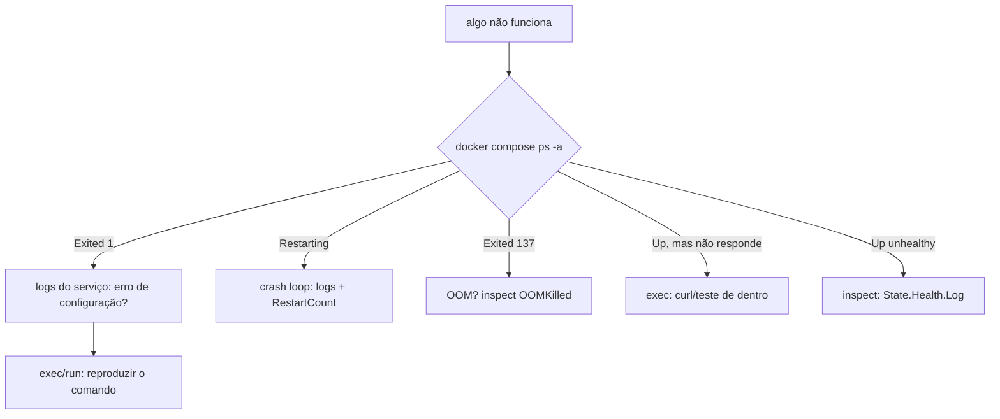

# 5. Logs, depuração dentro do container e `.dockerignore`

> ⏱️ ~1h30 · Módulo 11 · Pré-requisitos: [11.03](03-docker-compose.md), [11.04](04-volumes-redes-env.md), [0.05 (depurar e ler erros)](../00-ambiente-ferramentas/05-editor-debugger-erros.md)

> ✅ **Verificação.** Tudo executado em 2026-11-08 (Docker 29.9.2, Compose v5.6.1). **As saídas são reais**; cada falha desta aula foi **provocada de propósito** no MiniShop do laboratório para vermos a mensagem verdadeira. Código em [`projeto/referencia-api-m11/`](../projeto/referencia-api-m11/README.md) (`.dockerignore`, `config/healthcheck.py`). **Não executado:** rotação de logs com o driver `json-file` (descrita, mas não medida).

## 🎯 Objetivos
- Ler e filtrar logs do Compose e entender por que o Python precisa de `PYTHONUNBUFFERED`
- **Diagnosticar** os cinco defeitos mais comuns ao subir uma stack: configuração ausente, senha errada, host errado, broker errado e *crash loop*
- Usar `exec`, `run`, `inspect`, `stats`, `top` e `cp` para investigar um container vivo ou morto
- Interpretar **códigos de saída** (0, 1, 137) e reconhecer um **OOM kill**
- Escrever um `.dockerignore` e medir o que ele muda no **contexto de build**, no tamanho da imagem e na **segurança**

## 🤔 Por que isso importa
No dia a dia com containers, 80% do trabalho é **descobrir por que algo não subiu**. A diferença entre o júnior que fica parado e o que resolve em 5 minutos é o roteiro: *estado → logs → ambiente → rede → entrar e olhar*. Já o `.dockerignore` parece detalhe, mas é a barreira entre o seu `.env` e a imagem que vai para um registro público, e entre um build de 2 s e um de 2 min.

## 💡 Intuição (explicação simples)
Depurar um container é como investigar um **quarto de hotel trancado**: primeiro você olha pela **recepção** (`ps`: o quarto está ocupado? saiu? quantas vezes tentou entrar?), depois lê o **livro de ocorrências** (`logs`), confere o **que foi deixado de recado** (`inspect`: variáveis, redes, volumes), e, só então, **entra com a chave-mestra** (`exec`/`run`) para mexer. O `.dockerignore` é a **lista de itens proibidos na mala**: o que não deve viajar com você, para o servidor de ninguém.

## 🔬 Como funciona por dentro

- **Logs.** O Docker captura o que o processo principal escreve em **stdout e stderr** (módulo 8, Fator XI: a aplicação não gerencia arquivos de log, só escreve no fluxo). O comando é `docker logs` (um container) ou `docker compose logs` (vários, com prefixo de serviço). Por padrão, o driver `json-file` guarda tudo em disco **sem limite**; em produção configure `max-size` e `max-file` (ou envie para um coletor, módulo 14).
- **Buffer do Python.** Quando `stdout` não é um terminal, o Python **acumula** a saída em um buffer; as linhas só aparecem quando ele enche ou o processo termina. `PYTHONUNBUFFERED=1` (no Dockerfile da aula 02) desliga isso.
- **Códigos de saída.** `0` = terminou bem; `1` (ou outro pequeno) = erro do programa; `137` = `128 + 9` = morto por **SIGKILL** (pelo `docker kill`, por um *stop* que estourou o prazo ou pelo **OOM killer** do kernel); `139` = falha de segmentação; `143` = `128 + 15` = SIGTERM.
- **OOM (*out of memory*).** Se o container tem limite de memória (cgroup, aula 01) e o processo ultrapassa, o kernel o mata. `docker inspect` mostra `OOMKilled=true`.
- **Política de reinício (`restart`).** `no` (padrão), `on-failure`, `always`, `unless-stopped`. Com ela, um processo que cai é recriado; se cai **sempre**, vira um **crash loop** (o Docker espera intervalos crescentes entre as tentativas).
- **`HEALTHCHECK`.** Um comando que o Docker executa dentro do container periodicamente; o resultado fica em `State.Health` e aparece como `(healthy)`/`(unhealthy)` no `ps`. Não reinicia sozinho no Compose (um orquestrador pode usar), mas serve de condição para `depends_on` (aula 03).
- **`.dockerignore`.** Arquivo na raiz do contexto, com a sintaxe do `.gitignore`, que lista o que **não** é enviado ao Docker no `docker build`. Três efeitos: **velocidade** (menos dados a enviar), **cache** (arquivos irrelevantes não invalidam camadas) e **segurança** (`.env`, chaves e `.git` não entram numa `COPY . .`).

## 🛠️ Exemplo prático
**1. Logs: o essencial.**
```bash
docker compose logs --tail 3 -t worker          # últimas 3 linhas, com data/hora
docker compose logs -f web                      # acompanha (Ctrl+C para sair)
docker compose logs --since 30s db web          # só os últimos 30 s, de dois serviços
```
```text
worker-1  | 2026-11-09T00:24:45.469804179Z [2026-11-09 00:24:45,469: INFO/MainProcess] mingle: searching for neighbors
worker-1  | 2026-11-09T00:24:46.477723641Z [2026-11-09 00:24:46,477: INFO/MainProcess] mingle: all alone
worker-1  | 2026-11-09T00:24:46.488940393Z [2026-11-09 00:24:46,488: INFO/MainProcess] celery@006b6aa85886 ready.
```
`docker logs` funciona também em container **parado** (essencial: o erro mora no log de quem morreu).

**2. O buffer do Python, medido.** Um script imprime 1 linha por segundo, 5 vezes. Depois de 3 s, quantas linhas o `docker logs` mostra?
```bash
docker run -d --name tick1 -v $PWD/tick.py:/tick.py:ro python:3.13-slim python /tick.py ; sleep 3; docker logs tick1 | wc -l
docker run -d --name tick2 -e PYTHONUNBUFFERED=1 -v $PWD/tick.py:/tick.py:ro python:3.13-slim python /tick.py ; sleep 3; docker logs tick2 | wc -l
```
```text
0 linha(s)        (sem PYTHONUNBUFFERED; as 5 só aparecem no final, quando o processo termina)
4 linha(s)        (com PYTHONUNBUFFERED=1)
```
Sem a variável, um serviço que roda "para sempre" pode parecer mudo por minutos.

**3. Defeito 1: configuração obrigatória ausente.** O container morre ao iniciar (o módulo 8 projetou isso: *falhar cedo*):
```bash
docker run --rm -e DEBUG=0 minishop:dev python manage.py check ; echo "exit code: $?"
```
```text
django.core.exceptions.ImproperlyConfigured: SECRET_KEY é obrigatória quando DEBUG=False (defina a variável de ambiente).
exit code: 1
```
(Pegadinha: `docker compose run --rm -e SECRET_KEY= web echo oi` imprimiu `oi` e saiu 0. O Django só lê as configurações quando algo o carrega; o `echo` não carrega. Teste sempre com o **comando real**.)

**4. Defeito 2: senha do banco errada.**
```bash
docker run --rm --network minishop-docker_backend -e SECRET_KEY=x \
  -e DATABASE_URL=postgres://minishop:errada@db:5432/minishop minishop:dev python manage.py migrate 2>&1 | tail -1
```
```text
django.db.utils.OperationalError: connection failed: connection to server at "172.19.0.3", port 5432 failed: FATAL:  password authentication failed for user "minishop"
```
Repare: o servidor foi **encontrado** (apareceu o IP), a rede está certa, a **credencial** é que não bateu. Lembre-se da aula 04: `POSTGRES_PASSWORD` só vale no **primeiro** início de um volume; se mudou a senha depois, o banco antigo continua com a velha.

**5. Defeito 3: host do banco errado.**
```bash
... -e DATABASE_URL=postgres://minishop:x@banco:5432/minishop ...
```
```text
django.db.utils.OperationalError: failed to resolve host 'banco': [Errno -3] Temporary failure in name resolution
```
Dois erros, duas mensagens: **"password authentication failed"** = achou o servidor, senha errada; **"failed to resolve host"** = nem achou o nome (serviço com outro nome, ou container fora da rede). E `Connection refused` em `127.0.0.1` é o erro da aula 03 (usou `localhost` dentro do container).

**6. Defeito 4: o worker sem o endereço do broker.** Subimos um worker **sem** passar `CELERY_BROKER_URL`: o projeto usa o valor padrão do `settings.py` (`127.0.0.1:6390`, do laboratório do módulo 7).
```bash
docker run -d --name w-sem-broker -e SECRET_KEY=x minishop:dev celery -A config worker -l INFO ; sleep 6
docker logs w-sem-broker 2>&1 | grep -i connect | head -2
```
```text
[2026-11-09 00:26:32,387: ERROR/MainProcess] consumer: Cannot connect to redis://:**@127.0.0.1:6390/0: Error 111 connecting to 127.0.0.1:6390. Connection refused..
[2026-11-09 00:26:34,389: ERROR/MainProcess] consumer: Cannot connect to redis://:**@127.0.0.1:6390/0: Error 111 connecting to 127.0.0.1:6390. Connection refused..
```
**O processo continua "Up", tentando reconectar para sempre.** O `docker compose ps` não mostra nada de errado; só o log mostra. Lição: **"Up" não significa "funcionando"**. Por isso existem healthchecks e, no módulo 14, monitoramento. (Note também que o Celery esconde a senha: `:**@`.)

**7. Defeito 5: *crash loop*.** Um servidor que falha ao iniciar, com `restart: unless-stopped`:
```bash
docker run -d --name loop --restart unless-stopped -e DEBUG=0 minishop:dev ; sleep 12
docker ps -a --filter name=loop --format '{{.Names}}: {{.Status}}'
docker inspect -f 'RestartCount={{.RestartCount}}' loop
docker logs loop 2>&1 | tail -1
```
```text
loop: Up Less than a second
RestartCount=6
gunicorn.errors.HaltServer: <HaltServer 'Worker failed to boot.' 3>
```
Seis reinícios em 12 s. A pista que engana: o `Status` diz **"Up"** (naquele instante estava de pé); o que denuncia é o `RestartCount` crescendo e o log. O erro real (a falta do `SECRET_KEY`) está **acima** no log: `docker logs loop | head`. Apague: `docker rm -f loop`.

**8. Morto por falta de memória (OOM).**
```bash
docker run --name oom --memory=48m --memory-swap=48m minishop:dev python -c "x=bytearray(200*1024*1024); print('alocou')" ; echo "exit=$?"
docker inspect -f 'OOMKilled={{.State.OOMKilled}} exit={{.State.ExitCode}}' oom
```
```text
exit=137
OOMKilled=true exit=137
```
Nenhuma mensagem do Python: o kernel o matou antes de ele dizer qualquer coisa. Se o seu container "some" com 137 e `OOMKilled=true`, aumente o limite ou ache o vazamento; se for `137` com `OOMKilled=false`, alguém mandou `kill`/`stop` com prazo estourado (aula 02, forma shell).

**9. Entrar e investigar.**
```bash
docker compose exec web python manage.py shell -c "from apps.catalog.models import Product; print('produtos:', Product.objects.count())"
docker compose exec db psql -U minishop -d minishop -tAc "select status, count(*) from orders_order group by 1"
docker stats --no-stream --format 'table {{.Name}}\t{{.CPUPerc}}\t{{.MemUsage}}'
docker compose top web
docker compose cp web:/data/outbox.jsonl ./outbox-copia.jsonl
```
```text
produtos: 64
pending|1
NAME                       CPU %     MEM USAGE / LIMIT
minishop-docker-web-1      0.01%     191.6MiB / 18.74GiB
minishop-docker-worker-1   0.05%     145.6MiB / 18.74GiB
minishop-docker-db-1       0.05%     33.62MiB / 18.74GiB
minishop-docker-redis-1    2.50%     9.48MiB / 18.74GiB
SERVICE  #   UID    PID      PPID     C   STIME  TTY  TIME      CMD
web      1   10001  1212370  1212345  1   21:25  ?    00:00:00  /app/.venv/bin/python /app/.venv/bin/gunicorn ...
```
Três ferramentas: `exec` (olhar de dentro, no processo vivo), `stats` (consumo: o `web` com 3 workers usa ~190 MB), `cp` (tirar um arquivo do container). Para um container **que morre ao iniciar**, não há onde dar `exec`: reproduza com `docker run --rm -it --entrypoint sh minishop:dev` (entra na imagem sem executar o `CMD`) ou `docker compose run --rm --entrypoint sh web`. A imagem não tem `curl`: ferramentas de depuração não são instaladas na imagem de produção; usam-se `python -c`, um container descartável na mesma rede (`docker run --rm --network … alpine`) ou, em ambientes maiores, containers efêmeros de depuração.

**10. Saúde: o `HEALTHCHECK` do `web`.** Como a imagem não tem `curl`, a sonda usa o próprio Python (`config/healthcheck.py`, só biblioteca padrão):
```python
host = os.environ.get("HEALTHCHECK_HOST") or os.environ.get("ALLOWED_HOSTS", "localhost").split(",")[0]
requisicao = urllib.request.Request(
    "http://127.0.0.1:8000/admin/login/",
    headers={"Host": host, "X-Forwarded-Proto": "https"},   # com este cabeçalho o SSL_REDIRECT não redireciona
)
try:
    sys.exit(0 if urllib.request.urlopen(requisicao, timeout=3).status == 200 else 1)
except Exception as erro:  # qualquer falha = não saudável
    print(f"healthcheck falhou: {erro}", file=sys.stderr)
    sys.exit(1)
```
```yaml
  web:
    healthcheck:
      test: ["CMD", "python", "-m", "config.healthcheck"]
      interval: 10s
      timeout: 5s
      start_period: 15s      # falhas nesse período inicial não contam
      retries: 3
```
```bash
docker compose ps --format '{{.Service}}: {{.Status}}'
docker compose exec -T -e HEALTHCHECK_HOST=invalido.com web python -m config.healthcheck ; echo "exit=$?"
```
```text
web: Up 20 seconds (healthy)
healthcheck falhou: HTTP Error 400: Bad Request
exit=1
```
Para o healthcheck passar, ele precisa mandar o `Host` permitido (senão o `ALLOWED_HOSTS` devolve 400, como vimos na aula 02) e o `X-Forwarded-Proto: https` (senão o `SECURE_SSL_REDIRECT` devolve 301). O `/health/` de verdade, que verifica banco e cache, é do módulo 14; usar a página de login do Admin é um **meio-termo honesto**: prova que o Django responde, **não** que o banco está de pé.

**11. O `.dockerignore`: medindo.** Reproduzo o erro mais comum (`COPY . .`) com um Dockerfile mínimo (`docker-lab/Dockerfile.copia-tudo`: `FROM python:3.13-slim`, `WORKDIR /app`, `COPY . .`) numa pasta de projeto "suja": com `.venv` (312 MB), um `.git`, um `db.sqlite3` de 40 MB e o `.env` de desenvolvimento.
```bash
docker build --progress=plain -f docker-lab/Dockerfile.copia-tudo -t teste-ctx . 2>&1 | grep "transferring context"
docker run --rm teste-ctx sh -c 'ls -a /app | tr "\n" " "; echo; cat /app/.env | head -3'
docker image ls teste-ctx --format 'imagem: {{.Size}}'
```
```text
#6 transferring context: 338.67MB 1.7s done
. .. .env .env.example .git .git-blame-ignore-revs .github .gitignore ... .venv CONTRIBUTING.md Dockerfile ... db.sqlite3 docker-lab docs frontend ... tests uv.lock
--- /app/.env DENTRO da imagem: ---
# Variáveis do ambiente de DESENVOLVIMENTO com Docker. Este arquivo NÃO vai para o Git.
DEBUG=0
SECRET_KEY=dev-compose-nao-use-em-producao-0123456789abcdef
imagem: 656MB
```
**338 MB enviados, o `.env` com a `SECRET_KEY` dentro da imagem, e o histórico do Git inteiro.** Agora o `.dockerignore`:
```text
# Controle de versão e ambientes locais
.git
.gitignore
.venv
.env
.env.*
!.env.example

# Lixo gerado
__pycache__/
*.pyc
.pytest_cache/
.ruff_cache/
.mypy_cache/
.coverage
*.sqlite3
outbox.jsonl
staticfiles/

# Não pertencem à imagem de execução
tests/
docs/
frontend/
seclab/
grpc_demo/
docker-lab/
compose*.yaml
Dockerfile
.dockerignore
*.md
```
```text
#5 transferring context: 8.59kB 0.1s done
. .. .env.example .git-blame-ignore-revs .github .importlinter .pre-commit-config.yaml .secrets.baseline apps config conftest.py legado manage.py pyproject.toml pytest.ini schema.yml scripts uv.lock
ls: cannot access '/app/.env': No such file or directory
imagem: 178MB
```
| | Sem `.dockerignore` | Com `.dockerignore` |
|---|---|---|
| Contexto enviado | **338,67 MB** (1,7 s) | **8,59 kB** (0,1 s) |
| Imagem do teste | 656 MB | 178 MB (só a base) |
| `.env` na imagem | **sim** | não |
| `.git` na imagem | **sim** | não |
Repare que o Dockerfile real da aula 02 já copia **pastas específicas** (`COPY apps apps`), o que evita parte do problema; o `.dockerignore` é a segunda trava (e protege a próxima pessoa que escrever `COPY . .`). E note a exceção `!.env.example`: o arquivo-modelo pode viajar, o `.env` real, nunca.

## 🧠 Pausa para lógica
**Problema.** Um serviço mostra, em `docker compose ps`, `Up 4 seconds`. Você roda de novo 30 s depois e vê `Up 6 seconds`. E mais 30 s: `Up 3 seconds`. (a) O que está acontecendo, apesar do "Up"? (b) Qual comando prova isso e qual a conclusão do que ele mostra? (c) O container está fazendo OOM ou crashando por erro do programa, e como distinguir?

<details><summary>Dica</summary>O tempo de "Up" deveria crescer. Pense em política de reinício.</details>

<details><summary>Solução comentada</summary>

(a) O tempo de "Up" **não cresce**: o processo cai e o Docker o recria (`restart` ativo), um **crash loop**. (b) `docker inspect -f '{{.RestartCount}} {{.State.ExitCode}} {{.State.OOMKilled}}' <container>`: `RestartCount` crescente prova o ciclo; o log (`docker logs`) mostra o erro. (c) Se `OOMKilled=true` e código 137, foi memória; se `OOMKilled=false` e código 1 (com um *traceback* no log), é erro do programa; 137 com `false` indica `kill`/`stop` forçado.
</details>

## ⚠️ Erros comuns e boas práticas
| Sintoma / mensagem | Causa | Solução |
|---|---|---|
| Container "Up", mas nada funciona | O processo está em *retry* (broker, banco) | Ler o log; adicionar healthcheck que teste a dependência |
| Sem logs, ou logs que chegam em rajada | Buffer do Python | `PYTHONUNBUFFERED=1` |
| `exited with code 137` | SIGKILL: OOM ou `stop` que estourou o prazo | `inspect` (`OOMKilled`); `CMD` em forma exec; aumentar a memória |
| `docker compose exec` → `service "x" is not running` | O container morreu | `docker compose logs x`; `run --rm --entrypoint sh` para reproduzir |
| `OCI runtime exec failed: exec: "bash": executable file not found` | Imagem `slim` sem `bash` | Usar `sh` |
| `curl: not found` dentro do container | Imagem enxuta | `python -c`, ou container descartável com `curl` na mesma rede |
| `COPY . .` leva `.env`/`.git`/`.venv` | Sem `.dockerignore` | Criar o `.dockerignore` e **conferir com `ls` na imagem** |
| Build lento e cache sempre invalidado | Arquivos que mudam entram no contexto (`.git`, logs, bancos) | `.dockerignore` |
| `unhealthy` sem motivo aparente | Sonda falha (`ALLOWED_HOSTS`, redirect HTTPS) | `docker inspect -f '{{json .State.Health.Log}}'`; rodar a sonda à mão |
| Disco cheio de logs | `json-file` sem limite | `logging: options: {max-size: "10m", max-file: "3"}` |

- **Roteiro de depuração:** `ps -a` → `logs` → `inspect` → `exec`/`run`. Não pule direto para o `exec`.
- **Reproduza o comando real** (não um `echo`): o erro mora no que roda de verdade.
- **Não instale ferramentas de depuração na imagem de produção**; prefira containers descartáveis na mesma rede.
- **`.dockerignore` é parte do projeto:** versione-o, revise-o quando criar pastas novas e **verifique o conteúdo da imagem** (`docker run --rm IMAGEM ls -a /app`).
- **Logs não são lugar de segredos** (módulo 9): o Celery mascara a senha do broker (`:**@`); confira se a sua aplicação também o faz.

## 🧩 Exercícios
**1. Fixação.** (a) Diferencie `logs`, `exec`, `run` e `inspect`. (b) O que significam os códigos 1, 137 e 143? (c) Por que um serviço "Up" pode estar quebrado? (d) Três ganhos do `.dockerignore`. (e) Por que `!.env.example` está no arquivo?

<details><summary>Solução</summary>

(a) `logs` lê a saída; `exec` roda comando num container vivo; `run` cria um novo; `inspect` mostra a configuração e o estado em JSON. (b) 1 = erro do programa; 137 = SIGKILL (OOM, kill ou stop estourado); 143 = SIGTERM. (c) O processo está vivo, mas tentando reconectar a uma dependência; "Up" só diz que o processo existe. (d) Velocidade, cache, segurança (e tamanho). (e) Para o arquivo-modelo, sem segredos, viajar mesmo com `.env.*` ignorado.
</details>

**2. Aplicação no projeto MiniShop.**
- [ ] `.dockerignore` na raiz, com a tabela **antes/depois** de contexto e tamanho (**medida por você**) e a prova de que `.env` e `.git` não entram (`ls -a`)
- [ ] `HEALTHCHECK` do `web` por `python -m config.healthcheck` e a prova de que fica `healthy`; e a sonda falhando com `HEALTHCHECK_HOST` inválido
- [ ] **Quadro de falhas** em `docs/docker-depuracao.md`: para cada um dos cinco defeitos desta aula, **a mensagem exata**, a causa e o comando que a revelou (reproduza-os, não copie)
- [ ] Prova de `PYTHONUNBUFFERED` (0 × N linhas) com o seu `tick.py`
- [ ] Um OOM provocado, com `OOMKilled=true` registrado
- [ ] Opcional: `logging.options.max-size` no `compose.yaml`
- [ ] Commit `build: add .dockerignore, healthcheck and debugging notes`

**3. Desafio (opcional).** Quebre a stack de um jeito novo (por exemplo, `ALLOWED_HOSTS` sem `localhost`, ou o Redis parado) e **entregue o diagnóstico a um colega só com os comandos e saídas**, sem comentar. Se ele chegar à causa seguindo o seu roteiro, o roteiro é bom.

## 🎤 Na entrevista
**1. Um container sobe e cai logo. Como você investiga?** Vejo o estado e o código de saída (`docker ps -a`, `inspect`), leio os logs do container que morreu (`docker logs`), confiro variáveis e rede, e reproduzo o comando com `docker run --rm -it --entrypoint sh` para olhar por dentro. Código 137 com `OOMKilled=true` aponta memória; 1 com traceback aponta erro do programa.

**2. Para que serve o `.dockerignore`?** Para não enviar ao build arquivos desnecessários ou sensíveis (`.git`, `.env`, `.venv`, caches), o que acelera o build, preserva o cache de camadas e evita vazar segredos na imagem.

**3. O que é um healthcheck e por que "Up" não basta?** É um comando que o Docker executa periodicamente para saber se o serviço está *funcionando*, não só vivo. Um processo pode estar de pé e incapaz de atender (sem banco, sem broker); o healthcheck expõe isso e permite ordenar dependências (`service_healthy`).

## 📚 Para ir além
- 📄 Documentação oficial: [`docker container logs`](https://docs.docker.com/reference/cli/docker/container/logs/) e [`docker compose` (referência)](https://docs.docker.com/reference/cli/docker/compose/). `--since`, `--tail`, `-t`, `-f`.
- 📄 Documentação oficial: [Build context e `.dockerignore`](https://docs.docker.com/build/concepts/context/). Sintaxe, exceções com `!` e arquivos `Dockerfile.dockerignore`.
- 📄 Documentação oficial: [`HEALTHCHECK`](https://docs.docker.com/reference/dockerfile/#healthcheck) e [Start containers automatically](https://docs.docker.com/engine/containers/start-containers-automatically/). Política de reinício e seus efeitos.
- 📄 Documentação oficial: [Resource constraints](https://docs.docker.com/engine/containers/resource_constraints/). Limites de memória/CPU e o OOM killer.
- 📄 Documentação oficial: [`docker system prune`](https://docs.docker.com/reference/cli/docker/system/prune/). Limpeza **com cuidado**: leia o que cada opção apaga (a aula 04 mostra por quê).
- 📄 Documentação oficial: [Django — Logging](https://docs.djangoproject.com/en/5.2/topics/logging/). Configurar o fluxo para `stdout`.
- 🏋️ Prática extra: provoque um `Connection refused` mudando só uma letra do nome do serviço do Redis no `.env` e veja o que o worker diz; depois corrija e confira que o `docker compose up -d` recria o container.

## ✅ Checklist da aula
- [ ] Sigo o roteiro: `ps -a` → `logs` → `inspect` → `exec`/`run`
- [ ] Reproduzi os cinco defeitos e sei a mensagem de cada um
- [ ] Sei interpretar 0, 1, 137 e `OOMKilled`
- [ ] Meu `web` tem `HEALTHCHECK` e fica `healthy`
- [ ] Escrevi o `.dockerignore` e provei que o `.env` não entra na imagem
- [ ] Medi o contexto de build antes e depois
