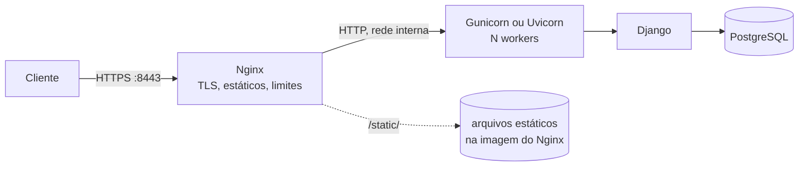

# 6. Gunicorn/Uvicorn atrás de Nginx

> ⏱️ ~1h30 · Módulo 11 · Pré-requisitos: [11.02](02-dockerfile-django.md), [11.03](03-docker-compose.md), [11.04](04-volumes-redes-env.md), [7.05 (WSGI × ASGI)](../07-sincrono-assincrono/05-wsgi-asgi.md), [9.06 (cabeçalhos e limite de taxa)](../09-seguranca/06-segredos-dependencias-headers-rate-limit.md)

> ✅ **Verificação.** Tudo executado em 2026-11-08 (Gunicorn 26.2.0, Uvicorn 0.54.0, `nginx:1.29-alpine`, Docker 29.9.2, certificado **autoassinado** só para desenvolvimento). **As saídas e os tempos são reais.** Código em [`projeto/referencia-api-m11/`](../projeto/referencia-api-m11/README.md) (`nginx/`, `compose.yaml`, `compose.asgi.yaml`, `scripts/smoke_docker.sh`). **Não executado:** `gunicorn -k uvicorn_worker.UvicornWorker` (pacote `uvicorn-worker`), certificados reais (Let's Encrypt), balanceamento entre várias réplicas do `web`, HTTP/2 e `nginx` com `limit_req`.

## 🎯 Objetivos
- Explicar por que **não** se usa o `runserver` em produção e **medir** a diferença entre os servidores
- Escolher entre **Gunicorn (WSGI)** e **Uvicorn (ASGI)** e configurar workers, *timeouts* e recarga suave
- Colocar um **Nginx** como proxy reverso: HTTPS, arquivos estáticos, limites e WebSocket
- Explicar os cabeçalhos `X-Forwarded-*` e **provar** o que acontece quando faltam
- Fechar o marco `v3.0-docker`: `docker compose up` sobe o MiniShop **completo**

## 🤔 Por que isso importa
O `python manage.py runserver` foi feito para **desenvolvimento**: ele recarrega o código, mostra páginas de erro detalhadas e **não** é endurecido para a internet (o próprio Django imprime `This is a development server. Do not use it in a production setting`). Em produção, a pilha padrão tem três andares: **Nginx** (borda: HTTPS, estáticos, limites) → **Gunicorn/Uvicorn** (servidor de aplicação) → **Django**. Quase toda vaga web Python pergunta sobre isso, e é o desenho que a aula 13 levará para a AWS.

## 💡 Intuição (explicação simples)
Um restaurante. O **Nginx** é o **maître** na porta: recebe todo mundo, confere a reserva (HTTPS), entrega o couvert que está pronto na hora (arquivos estáticos) e só chama a cozinha para o que precisa dela. O **Gunicorn** é o **chefe de cozinha** que distribui os pedidos entre vários **cozinheiros** (workers); se um cozinheiro trava com um prato, o chefe o substitui. O **Django** é a receita. O `runserver` é você cozinhando e servindo ao mesmo tempo, em casa: ótimo para testar um prato, ruim para cem clientes.

## 🔬 Como funciona por dentro

- **WSGI × ASGI** (aula 7.05). O **Gunicorn** é um servidor **WSGI**: cada *worker* atende **uma requisição por vez** (modelo `sync`), então a concorrência é `workers` (ou `workers × threads` no modelo `gthread`). O **Uvicorn** é **ASGI**: um laço de eventos (`asyncio`) por processo, capaz de milhares de conexões ociosas, necessário para **WebSocket** e para as views `async`. O projeto tem WebSocket (módulo 7.10), então a pilha ASGI é a que serve **tudo**.
- **Workers.** Cada worker é um processo com a aplicação inteira carregada. Receita clássica do Gunicorn: `2 × núcleos + 1`. Cuidado: dentro de um container, `os.cpu_count()` vê **os núcleos do host**, não o limite do container; comece com um número fixo (2 a 4) e meça.
- **Timeout.** `--timeout` (padrão 30 s): se um worker fica esse tempo sem responder ao *master*, ele é **morto e substituído** (`WORKER TIMEOUT`). Protege contra travamentos, mas mata requisições legítimas lentas.
- **Sinais.** `SIGTERM` = parada suave (termina as requisições em curso, até `--graceful-timeout`); `SIGHUP` = **recarrega** a configuração e troca os workers **sem derrubar** o servidor; `SIGKILL` = morte imediata. Por isso o `CMD` em forma exec da aula 02 importa.
- **Proxy reverso.** O Nginx fica na frente e **repassa** (`proxy_pass`) ao Django. Ganhos: termina o **TLS**; serve **estáticos** direto do disco (sem acordar o Python); impõe **limites** (tamanho de corpo, *timeouts*); absorve clientes lentos; e isola o Django da internet. O Django vê **o Nginx** como cliente, então o Nginx precisa contar o que sabe:
  | Cabeçalho | Quem põe | Para quê |
  |---|---|---|
  | `Host` | Nginx (`$http_host`) | O domínio original (o Django valida contra `ALLOWED_HOSTS`) |
  | `X-Forwarded-For` | Nginx (`$proxy_add_x_forwarded_for`) | IP real do cliente (o limite de taxa depende dele) |
  | `X-Forwarded-Proto` | Nginx (`$scheme`) | Se o cliente falou `https` (o Django decide redirecionar/segurar cookies) |
  O Django só **confia** nesses cabeçalhos quando configurado: `SECURE_PROXY_SSL_HEADER = ("HTTP_X_FORWARDED_PROTO", "https")` (já no projeto, módulo 8) e `NUM_PROXIES` no DRF (módulo 9). Confiar sem haver um proxy na frente permite que **o cliente forje** esses cabeçalhos: a regra é só aceitar de uma rede que você controla.
- **Arquivos estáticos.** O `collectstatic` (aula 02) gerou `/app/staticfiles` na imagem do Django. Em vez de um volume compartilhado (que **não se atualiza** sozinho a cada nova imagem: armadilha clássica), o `nginx/Dockerfile` **copia esses arquivos para a imagem do Nginx** com `COPY --from=app`; o Compose passa a imagem do `web` como contexto adicional (`additional_contexts: app: service:web`).

## 🛠️ Exemplo prático
**1. O servidor de desenvolvimento × os de produção: medindo.** (Scripts auxiliares em `scripts/m11/`: `carga.py`, `slow.py`, `login.py`, `ws.py`.) Uma view que espera 0,5 s (`/demo/sync/`, como uma chamada a API externa) e outra `async` (`/demo/async/`), do módulo 7. 20 requisições **simultâneas** a cada servidor (`carga.py`: threads + `urllib`, total de tempo):
```python
# carga.py: uso carga.py URL [N]
import sys, time, urllib.request
from concurrent.futures import ThreadPoolExecutor
url, n = sys.argv[1], int(sys.argv[2]) if len(sys.argv) > 2 else 20
def um(_):
    t = time.perf_counter()
    with urllib.request.urlopen(url, timeout=60) as r:
        r.read()
    return time.perf_counter() - t
ini = time.perf_counter()
with ThreadPoolExecutor(n) as ex:
    tempos = sorted(ex.map(um, range(n)))
print(f"{n} requisições simultâneas em {time.perf_counter()-ini:5.2f} s  (mais rápida {tempos[0]:.2f} s, mais lenta {tempos[-1]:.2f} s)")
```
```bash
docker run -d --name exp -p 127.0.0.1:8021:8000 -e DEBUG=1 minishop:dev  <COMANDO DO SERVIDOR>
python3 carga.py http://127.0.0.1:8021/demo/sync/ 20
```
| Servidor | Comando | view síncrona | view assíncrona |
|---|---|---|---|
| `runserver` | `python manage.py runserver` (com `DATABASE_URL=sqlite:////tmp/x.sqlite3`) | 1,52 s | 1,55 s |
| Gunicorn `sync`, 1 worker | `gunicorn config.wsgi:application --workers 1` | **10,04 s** | 10,06 s |
| Gunicorn `sync`, 4 workers | `… --workers 4` | 2,66 s | 2,54 s |
| Gunicorn `gthread`, 1 × 8 threads | `… --workers 1 --worker-class gthread --threads 8` | 1,52 s | 1,53 s |
| Uvicorn, 1 processo | `uvicorn config.asgi:application` | **0,54 s** | 0,54 s |
| Uvicorn, 4 processos | `… --workers 4` | 0,65 s | 0,52 s |
**Como ler.** (1) O Gunicorn `sync` com 1 worker é **estritamente sequencial**: 20 × 0,5 s = 10 s; com 4 workers, ⌈20/4⌉ × 0,5 = 2,5 s (medido: 2,66). Cada worker `sync` é uma "mesa" de um cliente só. (2) `gthread` com 8 threads: ⌈20/8⌉ × 0,5 = 1,5 s (medido 1,52): threads ajudam em **espera de I/O**. (3) O Uvicorn atendeu as 20 em **0,54 s**: o laço de eventos espera todas ao mesmo tempo. **Nota honesta:** a view *síncrona* também foi paralela no Uvicorn; no Django ASGI, cada requisição ganha sua própria *thread* para executar views síncronas (por isso o 0,54 s), ao contrário do que eu esperava antes de medir. (4) O `runserver` (com *threads*) ficou perto do `gthread`: mas é o único dos seis que **não** foi feito para produção (sem endurecimento, sem gestão de workers, recarregador de código ativo). **Uma limitação do teste:** isto mede **espera**, não CPU; para views que *calculam*, mais processos (e não threads ou `async`) é o que escala (GIL, aula 7.02).

**2. Timeout e recarga suave do Gunicorn.** Um app WSGI mínimo que dorme o tempo pedido na URL (`slow.py`):
```python
import time
def app(environ, start_response):
    time.sleep(float(environ["PATH_INFO"].strip("/") or 0.1))
    start_response("200 OK", [("Content-Type", "text/plain")]); return [b"ok\n"]
```
```bash
docker run -d --name g1 -p 127.0.0.1:8031:8000 -v $PWD/slow.py:/app/slow.py:ro minishop:dev gunicorn slow:app -b 0.0.0.0:8000 --workers 1 --timeout 2
curl -s -o /dev/null -w "curl: %{http_code}\n" http://127.0.0.1:8031/5      # requisição de 5 s com timeout de 2 s
docker logs g1 2>&1 | grep -iE "timeout|Booting" | tail -3
curl -s -o /dev/null -w "depois, uma curta: %{http_code}\n" http://127.0.0.1:8031/0.1
```
```text
curl: 500
[2026-11-09 00:35:05 +0000] [7] [INFO] Booting worker with pid: 7
[2026-11-09 00:35:09 +0000] [1] [CRITICAL] WORKER TIMEOUT (pid:7)
depois, uma curta: 200
```
O *master* matou o worker travado e criou outro; o cliente da requisição lenta recebeu um erro, o seguinte funcionou. Agora a **recarga sem queda**: 40 requisições de 0,3 s em paralelo com `kill -HUP`:
```bash
docker run -d --name g2 -p 127.0.0.1:8032:8000 -v $PWD/slow.py:/app/slow.py:ro minishop:dev gunicorn slow:app -b 0.0.0.0:8000 --workers 3 --graceful-timeout 10
( for i in $(seq 1 40); do curl -s -o /dev/null -w "%{http_code}\n" http://127.0.0.1:8032/0.3; done | sort | uniq -c ) &
sleep 3; docker kill -s HUP g2 ; wait
docker logs g2 2>&1 | grep -iE "Handling signal|Booting" | cut -c1-90
```
```text
       40 200
[...] [1] [INFO] Handling signal: hup
[...] [11] [INFO] Booting worker with pid: 11
[...] [13] [INFO] Booting worker with pid: 13
[...] [15] [INFO] Booting worker with pid: 15
```
**40 de 40 com `200`** durante a troca dos três workers (pids 7, 8, 9 → 11, 13, 15). É assim que se aplica uma mudança de configuração sem derrubar o site. (`docker rm -f g1 g2`.)

**3. O Nginx.** `nginx/nginx.conf`, comentado:
```nginx
# Não registrar a query string: no WebSocket o token JWT vai nela (?token=...) e vazaria para os logs.
log_format sem_query '$remote_addr [$time_local] "$request_method $uri" $status $body_bytes_sent rt=$request_time "$http_user_agent"';

upstream django {
    server web:8000;          # "web" é o nome do serviço no Compose (DNS interno)
}

server {
    listen 80;
    server_name _;
    access_log /var/log/nginx/access.log sem_query;
    return 301 https://$host:8443$request_uri;     # em produção: https://$host$request_uri
}

server {
    listen 443 ssl;
    server_name _;
    access_log /var/log/nginx/access.log sem_query;   # no nível do server: SUBSTITUI o log padrão herdado
    ssl_certificate     /etc/nginx/certs/dev.crt;
    ssl_certificate_key /etc/nginx/certs/dev.key;

    client_max_body_size 5m;                       # corpo maior que isso: 413, sem incomodar o Django

    # Estáticos: o Nginx responde sozinho, sem acordar o Python.
    location /static/ {
        root /usr/share/nginx/html;
        expires 7d;
    }

    # WebSocket (ASGI): precisa dos cabeçalhos de upgrade.
    location /ws/ {
        proxy_pass http://django;
        proxy_http_version 1.1;
        proxy_set_header Upgrade $http_upgrade;
        proxy_set_header Connection "upgrade";
        proxy_set_header X-Forwarded-Proto $scheme;
        proxy_set_header Host $http_host;
        proxy_read_timeout 60s;
    }

    # Todo o resto vai para o Django.
    location / {
        proxy_pass http://django;
        proxy_set_header Host $http_host;   # preserva a porta (útil em desenvolvimento)
        proxy_set_header X-Real-IP $remote_addr;
        proxy_set_header X-Forwarded-For $proxy_add_x_forwarded_for;
        proxy_set_header X-Forwarded-Proto $scheme;   # sem isto o Django acha que é HTTP e redireciona em laço
        proxy_connect_timeout 5s;
        proxy_read_timeout 30s;
    }
}
```
`nginx/Dockerfile` (estáticos "assados" na imagem):
```dockerfile
FROM nginx:1.29-alpine
COPY --from=app /app/staticfiles /usr/share/nginx/html/static
COPY nginx.conf /etc/nginx/conf.d/default.conf
```
No `compose.yaml`, o `web` **deixa de publicar** a porta (`expose: ["8000"]`) e passa a ter o Nginx à frente, que fica **só na rede `frontend`**:
```yaml
  web:
    environment:
      NUM_PROXIES: "1"            # um proxy confiável (o Nginx) na frente
      SECURE_SSL_REDIRECT: "1"     # produção: o Django exige HTTPS (quem termina o TLS é o Nginx)
    expose: ["8000"]               # visível só para os outros containers
    networks: [frontend, backend]
  nginx:
    build:
      context: ./nginx
      additional_contexts:
        app: service:web           # usa a imagem construída para o serviço "web"
    ports:
      - "127.0.0.1:8080:80"
      - "127.0.0.1:8443:443"
    volumes:
      - ./nginx/certs:/etc/nginx/certs:ro
    networks: [frontend]
    depends_on:
      web:
        condition: service_healthy
```
E o servidor do `web` troca para ASGI, necessário para o WebSocket (`compose.asgi.yaml`, aplicado com um segundo `-f`):
```yaml
services:
  web:
    command: ["uvicorn", "config.asgi:application", "--host", "0.0.0.0", "--port", "8000", "--workers", "2",
              "--proxy-headers", "--forwarded-allow-ips", "*", "--no-server-header"]
```
(`--forwarded-allow-ips "*"` aceita os cabeçalhos `X-Forwarded-*` de **qualquer** origem: aceitável aqui **só porque** o `web` não está publicado e só o Nginx o alcança. Se o Uvicorn estivesse exposto, o certo seria o IP do Nginx.) O certificado de desenvolvimento, **autoassinado** (o navegador e o `curl` reclamam; por isso o `-k`):
```bash
openssl req -x509 -newkey rsa:2048 -nodes -days 30 -subj "/CN=localhost" -keyout nginx/certs/dev.key -out nginx/certs/dev.crt
```
**Nunca** versione a chave (`nginx/certs/` está no `.gitignore`). Em produção real o TLS vem de uma autoridade (Let's Encrypt) ou do balanceador da nuvem (aula 13).

**4. Subir e testar cada decisão do Nginx.**
```bash
docker compose -f compose.yaml -f compose.asgi.yaml up -d --build --wait
curl -s -o /dev/null -w "%{http_code} -> %{redirect_url}\n" http://127.0.0.1:8080/api/v1/products/
curl -sk -D - -o /dev/null https://127.0.0.1:8443/static/admin/css/base.css | grep -iE "^HTTP|server|cache-control|expires"
docker compose logs web 2>&1 | grep -c '/static/'
curl -sk -D - -o /dev/null https://127.0.0.1:8443/api/v1/products/ | grep -iE "^HTTP|strict-transport|x-frame|content-security"
head -c 6000000 /dev/zero | curl -sk -o /dev/null -w "%{http_code}\n" -X POST https://127.0.0.1:8443/api/v1/auth/token/ -H 'Content-Type: application/json' --data-binary @-
```
```text
301 -> https://127.0.0.1:8443/api/v1/products/
HTTP/1.1 200 OK
Server: nginx/1.29.8
Expires: Mon, 16 Nov 2026 00:30:09 GMT
Cache-Control: max-age=604800
0                                                   ← o Django não viu o pedido do estático
HTTP/1.1 200 OK
Content-Security-Policy: default-src 'none'; frame-ancestors 'none'; base-uri 'none'; form-action 'none'
X-Frame-Options: DENY
Strict-Transport-Security: max-age=3600
413                                                 ← corpo de 6 MB barrado no Nginx
```
O HTTP é redirecionado para HTTPS; o estático sai do Nginx (cabeçalho `Server: nginx`, com cache de 7 dias, e **zero** linhas no log do Django); os **cabeçalhos de segurança do módulo 9** continuam chegando; e o corpo grande é rejeitado na borda (`413`) sem tocar no Python.

**5. O que acontece quando falta `X-Forwarded-Proto`.** Tiro essa linha do `nginx.conf` de propósito e recarrego:
```bash
curl -skL --max-redirs 5 -o /dev/null -w "%{http_code} após %{num_redirects} redirecionamentos\n" https://127.0.0.1:8443/api/v1/products/ ; echo "curl exit=$?"
```
```text
301 após 5 redirecionamentos
curl exit=47        (47 = excesso de redirecionamentos)
```
O cliente fala HTTPS com o Nginx; o Nginx fala HTTP com o Django; **sem o cabeçalho**, o Django acha que a conexão é insegura (`SECURE_SSL_REDIRECT=1`) e manda o cliente para `https://…`, que volta ao mesmo lugar: **laço infinito** (no navegador: `ERR_TOO_MANY_REDIRECTS`). Esta é uma das mensagens mais comuns de quem coloca um proxy na frente do Django. (Restaurei a linha; o `curl` voltou a `200`.)

**6. O IP real e o limite de taxa.** O login tem limite de 5 tentativas/minuto por IP (módulo 9). Atrás do Nginx, o IP que o Django vê é o **do Nginx**, a não ser que `NUM_PROXIES` diga ao DRF para ler o `X-Forwarded-For`. Teste (`scripts/m11/login.py`, que envia `Host: localhost` e ignora o certificado de desenvolvimento): o cliente A (meu host) erra o login 6 vezes; o cliente B (**outro container** na rede `frontend`: `docker run --rm --network minishop-docker_frontend -v "$PWD/scripts/m11/login.py":/login.py:ro minishop:dev python /login.py https://nginx/api/v1/auth/token/ 1`) tenta uma vez:
```text
NUM_PROXIES=0 (padrão):  A: [401, 401, 401, 401, 401, 429]   B: [429]   ← B bloqueado pelos erros de A
NUM_PROXIES=1:           A: [401, 401, 401, 401, 401, 429]   B: [401]   ← B tem o seu próprio contador
```
Com `NUM_PROXIES=0`, todos os clientes aparecem como "o Nginx" e **dividem o mesmo balde**: um atacante bloqueia todo mundo (negação de serviço). Com `1`, cada IP real tem o seu. (O contador vive no Redis, `REDIS_CACHE_URL`, justamente para ser compartilhado entre os workers: aula 9.06.)

**7. WebSocket: ASGI e os cabeçalhos de upgrade.** O pedido #1 do cliente existe; um cliente WebSocket (`scripts/m11/ws.py`: faz o login e usa o pacote `websockets`) abre `wss://…/ws/pedidos/1/?token=<JWT>` pelo Nginx:
```text
com gunicorn (WSGI):                 falhou: InvalidStatus server rejected WebSocket connection: HTTP 400
com uvicorn (ASGI), via Nginx:       WebSocket ABERTO; primeira mensagem: {"tipo": "estado_atual", "status": "pending"}
com uvicorn, SEM o bloco /ws/:       falhou: InvalidStatus server rejected WebSocket connection: HTTP 404
```
Três lições: WSGI **não** fala WebSocket; o proxy precisa de `Upgrade`/`Connection` e `proxy_http_version 1.1` (sem o bloco `/ws/`, o pedido segue pelo `location /` como HTTP comum e o Django responde 404); e, ao conferir o log do Nginx, apareceu um **vazamento**: o formato de log padrão registrava a URL **com o token JWT**:
```text
"GET /ws/pedidos/1/?token=eyJhbGciOiJIUzI1NiIsInR5cCI6IkpXVCJ9.eyJ0b2tlbl90eXBlIjoiYWNjZXNzIi...   ← padrão: token no log!
172.20.0.1 [09/Nov/2026:00:39:30 +0000] "GET /ws/pedidos/1/" 101 50 rt=0.065 "Python/3.13 websockets/17.4"  ← log_format sem_query
```
É o aviso que a aula 7.10 deixou ("nunca registre a URL completa em logs"), agora na borda. A correção está no `nginx.conf` (`log_format sem_query` com `$uri` em vez de `$request`). **Detalhe de configuração:** a diretiva `access_log` do nível `http` continua valendo, e o novo log **somou-se a ela**; só ao declará-la **no bloco `server`** o log antigo foi substituído.

**8. Quando o Django cai: o que o Nginx responde.**
```bash
docker compose stop web
curl -sk -o /dev/null -w "nginx responde: %{http_code}\n" https://127.0.0.1:8443/api/v1/products/
```
```text
nginx responde: 504
[error] upstream timed out (110: Operation timed out) while connecting to upstream, client: 172.20.0.1, request: "GET /api/v1/products/ HTTP/1.1"
```
Um **504** (o Nginx esperou `proxy_connect_timeout 5s` e desistiu). Já um **502 Bad Gateway** acontece quando o Django responde com lixo ou recusa a conexão na hora. Saber a diferença acelera o diagnóstico: 502/504 vêm do **proxy**, não da aplicação. (`docker compose up -d` traz o `web` de volta.)

**9. O marco: um comando.** O `scripts/smoke_docker.sh` gera o certificado (se faltar), sobe tudo, semeia, faz login, carrinho e pedido **pelo Nginx**, confere o e-mail no worker, o usuário `app` e o estático, e (por padrão) derruba **só este projeto**:
```bash
bash scripts/smoke_docker.sh
```
```text
== 1/6 subir tudo (build + espera ficar saudável)
== 2/6 dados de exemplo (seed) — só em desenvolvimento
Seed ok: 64 produtos
== 3/6 login
== 4/6 carrinho e pedido (chave de idempotência nova a cada execução)
carrinho -> 201
pedido -> 201
== 5/6 e-mail de confirmação enviado pelo worker
{"to": ["cliente@minishop.local"], "subject": "MiniShop: pedido #1 recebido", "body": "Olá, cliente!\n\nRecebemos o seu 
== 6/6 usuário do processo e arquivos estáticos
ok: web roda como 'app'; estático servido pelo Nginx
== limpeza (somente o projeto minishop-docker)
SMOKE OK                                      (≈ 23 a 28 s, com as imagens já em cache)
```
Do zero (um clone novo): copiar `.env.docker.example` para `.env`, ajustar as senhas e rodar o script. Com isto, o marco **`v3.0-docker`** está cumprido.

## 🧠 Pausa para lógica
**Problema.** Um endpoint chama uma API externa que demora 400 ms (I/O), e você espera 30 requisições por segundo no pico. (a) Quantos workers Gunicorn `sync` precisa para sustentar isso? (b) Com `gthread`, quantas threads por worker, se tiver 2 workers? (c) Qual o risco de dar a cada worker 8 threads se o código **não é seguro para threads**? (d) Qual a parte desse cálculo que o Nginx **não** muda?

<details><summary>Dica</summary>Lei de Little: concorrência = taxa × tempo de atendimento.</details>

<details><summary>Solução comentada</summary>

(a) Concorrência = 30 req/s × 0,4 s = **12** requisições em andamento: **12 workers `sync`** (cada um atende uma por vez). (b) 12 / 2 = **6 threads por worker**. Na prática, some uma folga (20 a 30%). (c) Estado compartilhado mal protegido (variáveis globais, objetos mutáveis, conexões de banco não *thread-safe*) gera *race conditions* difíceis de reproduzir; o Django em si é seguro para threads, o seu código e as bibliotecas escolhidas é que precisam ser conferidos. (d) O **tempo da chamada externa** (400 ms) continua o mesmo; o Nginx protege contra clientes lentos e serve estáticos, mas não acelera o que o Django espera. Para reduzir a concorrência necessária, é preciso tornar a chamada mais rápida (cache, fila: módulos 7 e 14) ou assíncrona.
</details>

## ⚠️ Erros comuns e boas práticas
| Sintoma / mensagem | Causa | Solução |
|---|---|---|
| `ERR_TOO_MANY_REDIRECTS` / `curl: (47)` | Sem `X-Forwarded-Proto` com `SECURE_SSL_REDIRECT=1` | `proxy_set_header X-Forwarded-Proto $scheme;` |
| `400 Bad Request` pelo proxy | `Host` não está em `ALLOWED_HOSTS` | Repassar `Host $http_host` e listar o domínio |
| `502 Bad Gateway` | Django recusou/derrubou a conexão | `docker compose logs web`; o healthcheck |
| `504 Gateway Time-out` | Upstream parado, inexistente ou lento demais | `proxy_connect_timeout`/`proxy_read_timeout`; o que o Django está fazendo? |
| `413 Request Entity Too Large` | Corpo maior que `client_max_body_size` | Ajustar o limite **de propósito** (uploads) |
| `WORKER TIMEOUT` no log | Requisição mais lenta que `--timeout` | Achar a lentidão; só aumentar o timeout como último recurso |
| WebSocket com 400/404 | WSGI, ou o proxy sem `Upgrade` | Uvicorn/ASGI + bloco `/ws/` com `proxy_http_version 1.1` |
| Todos os clientes aparecem com o mesmo IP | `NUM_PROXIES=0` atrás de proxy | `NUM_PROXIES=1` (e o proxy limpando/anexando `X-Forwarded-For`) |
| Estáticos antigos depois de um deploy | Volume compartilhado que não se atualiza | Estáticos dentro da imagem do Nginx (como feito aqui) |
| Token ou dado pessoal nos logs de acesso | Formato de log padrão guarda a query string | `log_format` com `$uri` |
| `docker compose up` do Nginx falha: `host not found in upstream "web"` | O Nginx iniciou antes do `web` existir na rede | `depends_on` (`service_healthy`), como feito |
| Depois de um deploy o site dá 502/504 e só volta reiniciando o Nginx | O Nginx resolve `web` **uma vez** ao iniciar; o contêiner recriado ganhou outro IP | `resolver 127.0.0.11 valid=10s` + `set $django_upstream http://web:8000; proxy_pass $django_upstream;` (medido no módulo 14.01: 502/504 antes, 200 depois) |
| Todo o site cai ao trocar de versão | Reinício brusco | `SIGHUP`/*rolling*, `--graceful-timeout`, health checks |

- **Nunca o `runserver` em produção.** Nem `DEBUG=1`.
- **Confie nos cabeçalhos `X-Forwarded-*` só se o servidor de aplicação não estiver exposto** diretamente.
- **O Django nunca é a borda:** o Nginx (ou o balanceador da nuvem) termina o TLS, impõe limites e serve estáticos.
- **Comece simples e meça:** número fixo de workers, depois ajuste olhando CPU, memória e latência (módulo 14).
- **Certificado e chave fora do Git.** Em produção, renovação automática.
- **Sempre `nginx -t` antes de recarregar** (`docker compose exec nginx nginx -t` → `syntax is ok` / `test is successful`).

## 🧩 Exercícios
**1. Fixação.** (a) Por que o `runserver` não é para produção? (b) Gunicorn × Uvicorn: o que muda e quando cada um? (c) Para que serve o `X-Forwarded-Proto`? (d) O que é `NUM_PROXIES`? (e) 502 × 504.

<details><summary>Solução</summary>

(a) Sem endurecimento, sem gestão de workers, com recarregador e páginas de depuração. (b) Gunicorn é WSGI (um pedido por worker, ou por thread), Uvicorn é ASGI (laço de eventos, WebSocket, `async`). (c) Informar ao Django que o cliente usou HTTPS, para ele não redirecionar em laço nem emitir links `http`. (d) A quantidade de proxies confiáveis na frente, para o DRF ler o IP real do `X-Forwarded-For`. (e) 502: resposta inválida ou conexão recusada pelo upstream; 504: o upstream não respondeu a tempo.
</details>

**2. Aplicação no projeto MiniShop (fecha o marco `v3.0-docker`).**
- [ ] A tabela de concorrência (seis servidores) **medida por você**, e uma frase sobre o que ela mostra
- [ ] `nginx/nginx.conf` + `nginx/Dockerfile` (estáticos na imagem) + certificado de desenvolvimento fora do Git
- [ ] `web` sem porta publicada; Nginx na rede `frontend`; Uvicorn via `compose.asgi.yaml`
- [ ] Provas: redirecionamento 80→443, estático servido pelo Nginx (0 linhas no log do Django), `413`, cabeçalhos de segurança presentes
- [ ] Provas: o laço de redirecionamento sem `X-Forwarded-Proto` e o limite de taxa com `NUM_PROXIES` 0 × 1
- [ ] Prova do WebSocket via Nginx e do log **sem** o token
- [ ] `bash scripts/smoke_docker.sh` verde em um **clone novo** (`SMOKE OK`)
- [ ] `README.md` com a seção "Rodando com Docker" **executada do zero**
- [ ] `git tag v3.0-docker` (veja o [checkpoint](checkpoint.md))
- [ ] Commit `build: add nginx reverse proxy, uvicorn asgi server and smoke test`

**3. Desafio (opcional).** Rode **duas** réplicas do `web` (`--scale web=2`, sem publicar porta) e faça o Nginx balanceá-las (o `upstream` resolve o nome `web` para os dois IPs; atenção: o Nginx resolve o DNS **na inicialização**). Prove que as duas recebem requisições (cabeçalho com o hostname do container ou o log) e descreva o que acontece com o limite de taxa entre as duas (e por que o cache no Redis resolve).

## 🎤 Na entrevista
**1. Por que usar Gunicorn e Nginx em vez de `runserver`?** O `runserver` é só para desenvolvimento. O Gunicorn (ou Uvicorn) gerencia processos *worker*, reinicia os que travam e é testado para produção; o Nginx fica na borda: termina o TLS, serve estáticos com eficiência, limita corpo e *timeouts*, e protege o servidor de aplicação de clientes lentos.

**2. Qual a diferença entre WSGI e ASGI?** WSGI é a interface síncrona (uma requisição por vez por worker/thread); ASGI estende a ideia para código assíncrono e protocolos de longa duração, como WebSocket. Gunicorn é WSGI; Uvicorn (e Daphne) são ASGI.

**3. Seu Django atrás de um proxy redireciona em laço ou mostra o IP errado. Por quê?** O Django só vê o proxy. O proxy precisa enviar `X-Forwarded-Proto` e `X-Forwarded-For`, e o Django precisa confiar neles (`SECURE_PROXY_SSL_HEADER`, `NUM_PROXIES`), apenas porque o servidor de aplicação só é alcançável pelo proxy.

## 📚 Para ir além
- 📄 Documentação oficial: [Gunicorn — Design](https://gunicorn.org/design/) e [Settings](https://gunicorn.org/reference/settings/). Tipos de worker, `workers`, `timeout`, `graceful-timeout`.
- 📄 Documentação oficial: [Gunicorn — Deploy](https://gunicorn.org/deploy/) e [Signals](https://gunicorn.org/signals/). Proxy com Nginx, `HUP`, `TERM`, `USR2`.
- 📄 Documentação oficial: [Uvicorn — Deployment](https://uvicorn.dev/deployment/). Workers, `--proxy-headers`, `--forwarded-allow-ips` e uso com Gunicorn.
- 📄 Documentação oficial: [Nginx — Beginner's guide](https://nginx.org/en/docs/beginners_guide.html), [proxy_module](https://nginx.org/en/docs/http/ngx_http_proxy_module.html), [WebSocket proxying](https://nginx.org/en/docs/http/websocket.html) e [log_module](https://nginx.org/en/docs/http/ngx_http_log_module.html).
- 📄 Documentação oficial: [Django — Deploying](https://docs.djangoproject.com/en/5.2/howto/deployment/), [`SECURE_PROXY_SSL_HEADER`](https://docs.djangoproject.com/en/5.2/ref/settings/#secure-proxy-ssl-header) e [Deployment checklist](https://docs.djangoproject.com/en/5.2/howto/deployment/checklist/).
- 📄 Documentação oficial: [DRF — Throttling (`NUM_PROXIES`)](https://www.django-rest-framework.org/api-guide/throttling/) e [Channels — Deploying](https://channels.readthedocs.io/en/stable/deploying.html).
- 📄 Documentação: [Imagem oficial `nginx`](https://hub.docker.com/_/nginx). Onde ficam os arquivos de configuração e como o `conf.d` é incluído.
- 🏋️ Prática extra: ative `limit_req_zone`/`limit_req` no Nginx para a rota de login e compare com o limite do DRF (quem barra primeiro, e por quê usar os dois).

## ✅ Checklist da aula
- [ ] Medi os seis servidores e sei explicar cada número
- [ ] Provoquei um `WORKER TIMEOUT` e fiz uma recarga `HUP` sem erros
- [ ] O Nginx termina o TLS, serve os estáticos, limita o corpo e repassa os cabeçalhos corretos
- [ ] Reproduzi o laço de redirecionamento e o efeito de `NUM_PROXIES`
- [ ] O WebSocket funciona via Nginx e o token não aparece nos logs
- [ ] `bash scripts/smoke_docker.sh` termina em `SMOKE OK` num clone novo
