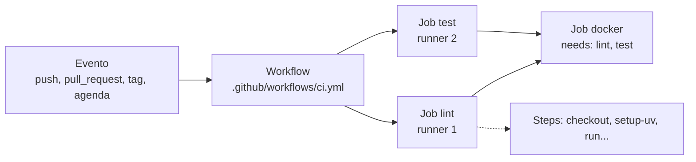

# 1. CI/CD e GitHub Actions

> ⏱️ ~1h30 · Módulo 12 · Pré-requisitos: [Módulo 11 (checkpoint aprovado)](../11-docker/checkpoint.md), [0.04 (GitHub, branches e PR)](../00-ambiente-ferramentas/04-github-branch-pr.md), [10.05 (ruff, mypy e pre-commit)](../10-qualidade-testes/05-ruff-mypy-precommit.md)

> ✅ **Verificação.** Os workflows foram validados com o **actionlint**, os comandos de cada job foram reproduzidos num **checkout limpo em containers** (Debian, não o Ubuntu do runner) **e depois executados de verdade no GitHub**, num repositório privado criado para isto. Os tempos de cada job no GitHub estão na aula 02. O primeiro push **falhou em dois jobs por defeitos que o laboratório não tinha pegado** (relatados na aula 02): é a melhor demonstração de que reproduzir localmente **não substitui** rodar no ambiente real. Código em [`projeto/referencia-api-m12/`](../projeto/referencia-api-m12/README.md). Versões das *actions* conferidas na API do GitHub em 2026-11-08.

## 🎯 Objetivos
- Explicar **integração contínua**, **entrega contínua** e **implantação contínua**, e a diferença entre as duas últimas
- Ler e escrever um **workflow** do GitHub Actions (evento, job, step, runner, action)
- Rodar **lint e testes** a cada PR, com cache e sem repetição
- Aplicar o **menor privilégio** (`permissions`) e **fixar actions por SHA**
- Validar um workflow **antes** de enviar (actionlint) e reproduzir um job localmente

## 🤔 Por que isso importa
Até aqui, a qualidade do MiniShop dependia de **cada pessoa lembrar** de rodar `ruff`, `mypy` e os 302 testes (o `pre-commit` ajuda, mas pode ser pulado com `--no-verify`). Em time, ninguém quer descobrir na segunda-feira que o PR de sexta quebrou a `main`. A integração contínua é a **máquina neutra** que roda tudo, em ambiente limpo, a cada mudança, e **bloqueia o merge** se falhar. Todo repositório profissional tem uma; o "badge verde" no README é o primeiro sinal que um recrutador procura.

## 💡 Intuição (explicação simples)
Uma **linha de montagem com inspetor**. Cada peça nova (um commit) passa por estações automáticas: confere medidas (lint), testa encaixes (testes), embala (build). Se alguma estação reprova, a peça volta com um bilhete dizendo o motivo, **antes** de chegar ao cliente. A *entrega contínua* é manter a caixa sempre pronta para sair no caminhão; a *implantação contínua* é o caminhão sair sozinho a cada caixa aprovada.

## 🔬 Como funciona por dentro
**Os três conceitos**
| Sigla | Significa | O que automatiza | Quem decide a publicação |
|---|---|---|---|
| **CI** (*Continuous Integration*) | integrar o código de todos na linha principal **várias vezes ao dia**, validando cada integração | lint, testes, build | não publica nada |
| **CD** (*Continuous Delivery*) | manter o software **sempre pronto** para publicar | CI + empacotar e preparar o artefato (imagem) | **uma pessoa** aperta o botão (ou aprova) |
| **CD** (*Continuous Deployment*) | publicar **sozinho** tudo o que passar | CI + entrega + implantação | **ninguém**; passou, foi |
"CD" é ambíguo: confirme qual dos dois a vaga quer dizer. No MiniShop faremos *entrega* contínua com aprovação manual para produção. A prática central da CI (Martin Fowler) é: **todo mundo integra na linha principal com frequência, e um build automatizado e rápido verifica cada integração**. Se o build quebra, consertar é prioridade zero.

**Anatomia do GitHub Actions**

| Termo | O que é |
|---|---|
| **Workflow** | um arquivo YAML em `.github/workflows/`; define *quando* e *o que* rodar |
| **Evento** (`on:`) | o gatilho: `pull_request`, `push`, tag, `schedule`, `workflow_dispatch` (manual) |
| **Job** | um conjunto de passos num **runner novo e limpo**; jobs rodam **em paralelo**, a menos que haja `needs:` |
| **Step** | um passo: `run:` (comando de shell) ou `uses:` (uma *action* pronta) |
| **Runner** | a máquina (VM) que executa o job; `ubuntu-24.04` é hospedada pelo GitHub |
| **Action** | um passo reutilizável (`actions/checkout`, `astral-sh/setup-uv`), versionado por tag ou SHA |
| **Matriz** | repete um job variando parâmetros (`db: [sqlite, postgres]`) |
| **Contextos/expressões** | `${{ github.ref }}`, `${{ matrix.db }}`, `${{ secrets.X }}`, `${{ needs.job.outputs.y }}` |
| **`GITHUB_TOKEN`** | token temporário criado a cada execução, com as permissões que o workflow declarar |
Como cada job começa **do zero** (sem seus arquivos, sem dependências), todo job de código começa com `actions/checkout` e instala o que precisa. O que se quer reaproveitar entre execuções (pacotes baixados) vai para o **cache**; o que um job entrega ao outro vai como **saída** (`outputs`) ou **artefato**.

**Segurança de pipeline (parte do trabalho de quem escreve o YAML)**
- **Menor privilégio:** `permissions: contents: read` no topo; um job que precisa de mais (publicar pacote) declara só isso, **no próprio job**.
- **Fixar *actions* por SHA de commit** (com o número da versão num comentário). Uma *tag* (`@v7`) pode ser movida por quem controla a action; o SHA não. É um vetor real de ataque à cadeia de suprimentos (aula 9.06).
- **PR vindo de *fork* não recebe segredos**, de propósito: o código do PR é de um estranho e rodaria com as suas chaves. Cuidado extremo com o evento `pull_request_target` (roda o código-base **com** segredos): evite-o.
- **Nunca imprima segredos** (o GitHub mascara os conhecidos, mas `echo ${{ secrets.X }}` modificado por `base64` escapa da máscara).
- **Dados na expressão viram código.** `run: echo "${{ github.event.pull_request.title }}"` permite que um título de PR com aspas execute comandos (injeção de script). Passe o valor por `env:` e use `"$VAR"`.

## 🛠️ Exemplo prático
**1. O workflow mínimo (só lint).** `.github/workflows/ci.yml` (a versão completa está na aula 02):
```yaml
name: CI

on:
  pull_request:
  push:
    branches: [main]

permissions:
  contents: read

concurrency:
  group: ci-${{ github.workflow }}-${{ github.ref }}
  cancel-in-progress: true        # um push novo no mesmo PR cancela a execução anterior

env:
  DEBUG: "1"                      # configuração de teste do projeto
  UV_FROZEN: "1"                  # nunca resolver dependências no CI: usar exatamente o uv.lock

jobs:
  lint:
    name: Lint, tipos e arquitetura
    runs-on: ubuntu-24.04
    timeout-minutes: 10
    steps:
      - uses: actions/checkout@3d3c42e5aac5ba805825da76410c181273ba90b1  # v7.0.1
      - uses: astral-sh/setup-uv@68559e99cc807c1eb7e9238fd43a15bba460eec2  # v10.3.3
        with:
          python-version: "3.13"
          enable-cache: true
      - run: uv sync
      - run: uv run ruff format --check
      - run: uv run ruff check
      - run: uv run mypy
      - run: uv run lint-imports
```
Pontos de atenção: `on: pull_request` valida **o resultado do merge** do PR com a `main`; `push` na `main` valida o que de fato entrou; `timeout-minutes` evita um job travado gastando minutos; `UV_FROZEN=1` faz o `uv` **falhar** se o `uv.lock` não bater com o `pyproject.toml`, em vez de "consertar" em silêncio. Os SHAs vieram da API do GitHub (`gh api repos/actions/checkout/releases/latest` e `…/commits/<tag>`): **nunca copie SHA de blog**, confira você.

**2. Validar sem enviar: actionlint.** Enviar o YAML ao GitHub para descobrir erro de digitação custa minutos e commits "fix ci" a cada tentativa. O **actionlint** (analisa sintaxe, tipos de expressão e roda o `shellcheck` nos `run:`) faz isso local:
```bash
docker run --rm -v "$PWD":/repo -w /repo rhysd/actionlint:latest -color=false ; echo "exit=$?"
```
```text
exit=0
```
(Precisa estar dentro de um repositório Git: sem `.git`, ele responde `no project was found in any parent directories`.) Agora três erros de propósito (`ubuntu-lastest`, uma expressão não fechada e `matrix.dbb`):
```text
ruim.yml:24:14: label "ubuntu-lastest" is unknown. available labels are "windows-latest", ..., "ubuntu-24.04", ... [runner-label]
ruim.yml:35:9: shellcheck reported issue in this script: SC1072:error:2:1:  Fix any mentioned problems and try again [shellcheck]
```
Na aula 02 ele vai pegar um **erro meu de verdade** (`needs` incompleto). Complemento: o editor com a extensão de YAML/GitHub Actions também destaca erros.

**3. Reproduzir o job num ambiente limpo.** O runner do GitHub começa sem nada. Para saber se o job passará, simulamos: um **`git clone`** (só o que está no Git, o que revela `.gitignore` mal feito) e um container sem o seu `.venv` nem cache:
```bash
git clone -q . ../clone && cd ../clone
docker run --rm -v "$PWD":/w -w /w -e DEBUG=1 -e UV_FROZEN=1 ghcr.io/astral-sh/uv:0.9-python3.13-bookworm-slim bash /lint.sh      # /lint.sh = os comandos do job, um por linha, cada um cronometrado
```
```text
ok       2.9s  uv sync
ok       0.1s  uv run ruff format --check
ok       0.0s  uv run ruff check
ok       4.6s  uv run mypy
ok       0.2s  uv run lint-imports
```
Cada comando que o CI rodará passa num ambiente que não é o seu. **Quando o CI quebra, o primeiro movimento é rodar o mesmo comando local**, com `UV_FROZEN=1`. Agora, o CI **pegando** um erro: acrescento `import os` sem uso e rodo o passo `ruff check`:
```text
help: Remove definition: `os`
Found 2 errors.
[*] 1 fixable with `--fix`.
exit=1
```
`exit=1` faz o step falhar, o job fica vermelho, o PR mostra um ✗ ao lado do commit e (com a proteção de branch, aula 02) o botão de merge é bloqueado. Este é todo o valor da CI.

**4. No GitHub.** Com um repositório remoto (foi o que fiz, num repositório privado):
```bash
gh repo create minishop --private --source=. --push        # cria o repositório e envia o código
git switch -c feat/ci && git push -u origin feat/ci
gh pr create --fill                                         # abre o PR: o workflow dispara sozinho
gh run list --limit 3 ; gh run watch                        # acompanha as execuções
gh run view --log-failed                                    # só o log do que falhou
```
Na página do PR aparece a lista de *checks*; clicar em um mostra o log de cada step. Você pode também rodar o workflow à mão se declarar `workflow_dispatch:` em `on:`.

**5. Cache.** O `setup-uv` com `enable-cache: true` guarda o cache de pacotes do `uv` entre execuções, com chave derivada do `uv.lock`: mudou o lock, cache novo. No lab, o `uv sync` limpo levou 2,9 s (rede rápida); no runner a economia é maior, porque cada job é uma máquina nova. Regra: **cacheie o que é caro de obter e barato de verificar**; um cache que nunca é invalidado vira um bug misterioso.

## 🧠 Pausa para lógica
**Problema.** Seu pipeline tem 3 jobs em paralelo (lint 1 min, testes 4 min, build 3 min), e os testes rodam em uma matriz de 2 bancos × 3 versões do Python. (a) Quanto tempo leva uma execução se houver runners livres? (b) Quantos minutos de runner são consumidos (o que a conta do GitHub cobra)? (c) Se o build passar a depender (`needs`) de lint e testes, qual o novo tempo e o que se ganha, em minutos de runner, quando o lint falha?

<details><summary>Dica</summary>Paralelo: vale o mais lento. Cobrança: soma de todos os jobs. Com <code>needs</code>, um job que falha impede os seguintes.</details>

<details><summary>Solução comentada</summary>

(a) Tudo em paralelo: o mais lento, **4 min** (as 6 combinações da matriz rodam juntas). (b) lint 1 + testes 6 × 4 = 24 + build 3 = **28 min de runner**. (c) Com `needs`, o build espera: 4 + 3 = **7 min** de relógio (mais lento, porém mais barato quando falha). Se o **lint** falhar em 1 min, o build nunca começa (−3 min) — e, com `fail-fast` ligado na matriz, as demais combinações são canceladas quando uma falha. Trocar tempo de relógio por minutos de runner é uma decisão: fazer o barato (lint) rodar primeiro dá feedback rápido.
</details>

## ⚠️ Erros comuns e boas práticas
| Sintoma / mensagem | Causa | Solução |
|---|---|---|
| O workflow não aparece / não dispara | Arquivo fora de `.github/workflows/`, extensão errada, ou branch não listada em `on:` | Caminho exato; conferir `on:` |
| `Invalid workflow file … You have an error in your yaml syntax` | Indentação (tabulação não vale) | actionlint antes de enviar |
| `Resource not accessible by integration` | `GITHUB_TOKEN` sem a permissão pedida | Declarar `permissions:` do job (ex.: `packages: write`) |
| Segredo vazio num PR de fork | Por segurança, forks não recebem segredos | Não depender de segredo em testes de PR |
| Roda duas vezes (PR e push) | `on: [push, pull_request]` sem filtro | `push` só em `main`, `pull_request` para o resto |
| Passa no seu computador, falha no CI | Ambiente diferente (lock desatualizado, arquivo ignorado, variável) | `git clone` + container limpo; `UV_FROZEN=1`; conferir `.gitignore` |
| `uv.lock needs to be updated` | `pyproject.toml` mudou sem regerar o lock | `uv lock` e commit |
| Job eterno | Teste que espera para sempre | `timeout-minutes` no job (e por teste, se preciso) |
| Action "sumiu" ou foi comprometida | Tag móvel | SHA fixo + Dependabot para atualizar |
| Minutos de runner estourando | Matriz grande, sem cache nem `concurrency` | Cache, `cancel-in-progress`, `needs` e matrizes enxutas |
| Injeção via `${{ github.event... }}` num `run:` | Dado de terceiros virando código de shell | Passar por `env:` e usar `"$VAR"` |

- **Todo job é descartável:** nada de depender do que "sobrou" de outro.
- **Rápido é um requisito:** CI de 30 min não é rodado; mire em minutos (aula 10.01 mostrou como medir).
- **O CI usa os mesmos comandos do dev** (`uv run …`): o que roda no pipeline deve rodar na sua máquina com o mesmo comando.
- **Não use `--no-verify` como hábito**: o CI é a rede de proteção quando o hook local é pulado.
- **Falhou? Leia o log do primeiro step vermelho**, não do último.

## 🧩 Exercícios
**1. Fixação.** (a) CI × entrega contínua × implantação contínua. (b) Por que cada job começa com `checkout`? (c) O que `needs:` faz? (d) Por que fixar a action por SHA? (e) Por que `pull_request` de fork não vê segredos?

<details><summary>Solução</summary>

(a) CI valida cada integração; entrega mantém o artefato sempre pronto, com aprovação humana para publicar; implantação publica sozinha. (b) Cada job roda num runner limpo, sem o código. (c) Cria dependência: o job só começa quando os listados terminam com sucesso. (d) Uma tag pode ser reapontada para código malicioso; o SHA é imutável. (e) O código do PR é de terceiros e rodaria com as suas chaves.
</details>

**2. Aplicação no projeto MiniShop.**
- [ ] `.github/workflows/ci.yml` com o job `lint` (ruff format, ruff check, mypy, import-linter), `permissions: contents: read`, `concurrency`, `timeout-minutes` e `UV_FROZEN`
- [ ] Todas as *actions* fixadas por **SHA** (conferido por você com `gh api`), com o número da versão em comentário
- [ ] `actionlint` sem erros; e um arquivo `ruim.yml` (fora de `.github/`) com 3 erros de propósito e as mensagens coladas em `docs/ci.md`
- [ ] Reprodução do job num `git clone` + container limpo, com a tabela de tempos de cada passo
- [ ] Um erro proposital (import sem uso) mostrando o `exit=1`
- [ ] No GitHub: repositório (privado serve), PR aberto e **print do check verde**
- [ ] Commit `ci: add lint workflow with pinned actions`

**3. Desafio (opcional).** Escreva um workflow `titulo-do-pr.yml` que **falha** se o título do PR não seguir Conventional Commits (módulo 10.06). Faça a leitura do título por `env:` (e explique por que não direto na expressão) e valide com o actionlint.

## 🎤 Na entrevista
**1. O que é CI/CD?** CI é integrar o código com frequência e validar cada integração com um build automatizado (lint, testes). CD é manter o software sempre pronto para publicar (entrega) ou publicá-lo automaticamente (implantação), com o pipeline cuidando de empacotar e implantar.

**2. Como funciona um workflow do GitHub Actions?** Um YAML em `.github/workflows/` define eventos que o disparam e *jobs* compostos de *steps*. Cada job roda em um runner limpo, em paralelo por padrão (ou em ordem com `needs`); os steps executam comandos ou *actions* reutilizáveis. O resultado (verde/vermelho) aparece no commit e no PR.

**3. Como proteger um pipeline?** Permissões mínimas para o `GITHUB_TOKEN`, actions fixadas por SHA, segredos só em ambientes que precisam, nenhum segredo em PRs de fork, cuidado com dados externos em expressões e revisão obrigatória de mudanças em `.github/workflows/`.

## 📚 Para ir além
- 📄 Documentação oficial: [GitHub Actions (pt-BR)](https://docs.github.com/pt/actions). Porta de entrada: conceitos, guias e referência.
- 📄 Documentação oficial: [Sintaxe de workflows](https://docs.github.com/en/actions/reference/workflows-and-actions/workflow-syntax). Cada chave: `on`, `jobs`, `needs`, `strategy`, `concurrency` (em inglês).
- 📄 Documentação oficial: [Contextos e expressões](https://docs.github.com/en/actions/reference/workflows-and-actions/contexts). O que há em `github`, `matrix`, `needs`, `secrets` (em inglês).
- 📄 Documentação oficial: [Endurecimento de segurança para Actions](https://docs.github.com/en/actions/security-for-github-actions/security-guides/security-hardening-for-github-actions). SHA, injeção de script, `pull_request_target` (em inglês).
- 📄 Documentação oficial: [`GITHUB_TOKEN`](https://docs.github.com/en/actions/concepts/security/github_token). Permissões e ciclo de vida (em inglês).
- 📄 Documentação: [uv — Using uv in GitHub Actions](https://docs.astral.sh/uv/guides/integration/github/). `setup-uv`, cache e `UV_FROZEN`.
- 📄 Artigo: [Martin Fowler — Continuous Integration](https://martinfowler.com/articles/continuousIntegration.html). As práticas centrais, sem ferramenta (em inglês).
- 📄 Artigo: [Atlassian — CI × entrega × implantação](https://www.atlassian.com/br/continuous-delivery/principles/continuous-integration-vs-delivery-vs-deployment). A diferença em português.
- 🧰 Ferramenta: [actionlint](https://github.com/rhysd/actionlint). O validador usado nesta aula.
- 🏋️ Prática extra: leia o `ci.yml` de um projeto de código aberto que você usa (por exemplo, o do Django ou do `uv`) e anote três práticas que ele usa e o seu não.

## ✅ Checklist da aula
- [ ] Sei explicar CI, entrega e implantação contínuas
- [ ] Sei apontar evento, job, step, runner e action em um workflow
- [ ] Meu `ci.yml` tem `permissions` mínimas, `concurrency`, `timeout-minutes` e actions por SHA
- [ ] Validei o YAML com o actionlint e provoquei erros de propósito
- [ ] Reproduzi o job num clone + container limpos
- [ ] Vi o CI falhar de propósito e sei ler o resultado
