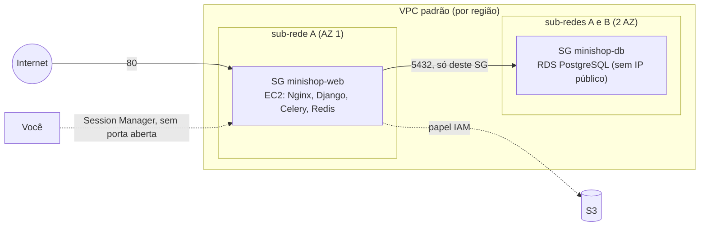

# 4. EC2, Security Groups e noção de VPC

> ⏱️ ~1h30 · Módulo 13 · Pré-requisitos: [13.03](03-iam.md), [11.06 (Nginx e Compose)](../11-docker/06-gunicorn-nginx.md)

> ✅ **Verificação.** Executado: os passos 5 e 8 do `provision.sh` **contra o `moto`** (security groups, instância com IMDSv2 e disco criptografado), a geração do **user-data** (6 219 bytes, `bash -n` e `shellcheck` sem avisos) e o **pacote de deploy num Compose local** (a mesma `compose.prod.yaml`). **Não executado (sem conta AWS):** uma EC2 de verdade, o `cloud-init`/user-data em ação, o Session Manager, tempos de boot, e o comportamento real de rede (o `moto` guarda as regras mas não as aplica). 💸 O que cria EC2/IP público na AWS real gera cobrança. Código em [`projeto/referencia-api-m13/`](../projeto/referencia-api-m13/README.md).

## 🎯 Objetivos
- Descrever uma **EC2** (AMI, tipo, disco EBS, rede, papel, *user data*) e lançar uma com a CLI
- Configurar **Security Groups** com o menor alcance (porta 80 aberta, banco só para o grupo web, **sem SSH**)
- Explicar **VPC, sub-rede, IP público e IP elástico** em linguagem simples
- Explicar por que usar **IMDSv2** e **Session Manager**
- Montar o **user-data** que prepara o servidor no primeiro boot

## 🤔 Por que isso importa
A EC2 é o "servidor" mais clássico da nuvem e a base da maioria dos deploys simples. Quase todo incidente de rede vem de um Security Group aberto demais (porta 22 ou 5432 para o mundo) e quase toda conta surpresa vem de uma instância ou IP esquecido. Júniores são cobrados em entrevista por "como você protege uma EC2?" e "por que o banco não fica numa sub-rede pública?".

## 💡 Intuição (explicação simples)
A **VPC** é o seu **condomínio** dentro da nuvem: um terreno privado com ruas (sub-redes) e uma portaria. A **EC2** é um **apartamento** onde roda o seu servidor. O **Security Group** é o **porteiro daquele apartamento**: uma lista de quem pode tocar a campainha em qual porta. Regra de ouro do porteiro: **nada entra, a menos que esteja na lista**. O banco de dados é o **cofre**, no apartamento dos fundos: o porteiro dele só deixa entrar o porteiro do apartamento da frente.

## 🔬 Como funciona por dentro

**EC2**
- **AMI:** a "imagem" do disco da máquina (sistema operacional pronto). Usamos **Amazon Linux 2023**, cuja AMI mais recente a AWS publica num *parâmetro público* do Systems Manager (`/aws/service/ami-amazon-linux-latest/al2023-ami-kernel-default-x86_64`): o script a busca em vez de ter um ID fixo (que muda por região e envelhece).
- **Tipo de instância:** `família + tamanho` (`t3.micro` = uso geral, "burstable", 2 vCPU, 1 GiB). Famílias com `g` no nome (`t4g`) são **Graviton (ARM)**: mais baratas, mas a **imagem Docker precisa ser `arm64`**. Nosso `deploy.sh` constrói para `linux/amd64`, coerente com `t3`. **Confirme na sua conta quais tipos o seu plano aceita** (aula 01).
- **EBS:** o disco, um volume de rede cobrado por GB-mês **mesmo com a instância parada**. Com `DeleteOnTermination=true` (padrão do disco raiz) ele some quando a instância é terminada; discos extras não têm o mesmo padrão.
- **Estados:** `running` (cobra instância + disco), `stopped` (cobra só o disco e IPs), `terminated` (acabou, continua listada por cerca de uma hora e não cobra).
- **User data:** um script que roda **uma vez**, no primeiro boot, como root (limite de 16 KB). Usamos para instalar o Docker e subir o Compose.
- **Metadados (IMDS)** em `169.254.169.254`: a máquina descobre seu IP, região e credenciais do papel. **IMDSv2** exige um *token* obtido por um `PUT` antes de ler, o que bloqueia uma classe de ataques (SSRF: enganar o app para ele fazer uma requisição e vazar credenciais). Configure `HttpTokens=required`.
- **Sem SSH:** em vez de abrir a porta 22 (alvo de varreduras o tempo todo) e gerenciar chaves `.pem`, usamos o **Session Manager** do Systems Manager: a instância tem o papel `AmazonSSMManagedInstanceCore`, e você abre um shell (`aws ssm start-session --target i-...`) ou envia comandos (`send-command`) autenticado pelo **IAM** e com **log de auditoria**, sem porta de entrada.

**Security Groups**
- Funcionam como **firewall virtual por interface**, **permitem apenas** (não há "negar"), são **com estado** (a resposta de uma conexão permitida volta sem regra extra) e podem referenciar **outro Security Group como origem**: a regra do banco diz "aceito 5432 de quem está no SG `minishop-web`", sem listar IPs.
- Entrada: `80/tcp` de `0.0.0.0/0` (web); nada de `22`. O banco: `5432/tcp` **só** da origem SG `minishop-web`. Saída: por padrão, tudo liberado (a instância precisa baixar imagens e falar com a AWS).

**VPC, em linguagem simples**
- **VPC (Virtual Private Cloud):** a rede isolada da sua conta numa região, com uma faixa de IPs privados (ex.: `172.31.0.0/16`). **Sub-rede:** uma fatia da VPC dentro de **uma** AZ. Contas novas têm uma **VPC padrão** já pronta, com uma sub-rede pública por AZ e saída para a internet; é o que o curso usa (aprender a desenhar VPCs próprias, com sub-redes privadas, NAT e rotas, fica para depois: um NAT Gateway, por exemplo, é um serviço **caro** por hora).
- **Sub-rede pública** = tem rota para um *Internet Gateway* (permite IP público). **Privada** = sem essa rota. No curso, o banco fica em sub-redes da VPC padrão mas **sem IP público e com SG restrito**, o que o torna inalcançável de fora (em produção séria: sub-redes privadas de verdade).
- **IP público × IP elástico:** o IP público automático some quando a instância é parada/terminada; o **IP elástico** é fixo, e **cobrado enquanto não estiver em uso**. IPv4 público em geral é **cobrado por hora** (veja a página de preços da VPC).

## 🛠️ Exemplo prático
**1. Redes e grupos** (passo 5 do `provision.sh`; executado no `moto`):
```bash
VPC_ID=$(aws ec2 describe-vpcs --filters Name=isDefault,Values=true --query 'Vpcs[0].VpcId' --output text)
SG_WEB=$(aws ec2 create-security-group --group-name minishop-web --description "MiniShop web" --vpc-id "$VPC_ID" \
  --tag-specifications '[{"ResourceType":"security-group","Tags":[{"Key":"Project","Value":"minishop-curso"}]}]' --query GroupId --output text)
SG_DB=$(aws ec2 create-security-group --group-name minishop-db --description "MiniShop banco" --vpc-id "$VPC_ID" \
  --tag-specifications '[{"ResourceType":"security-group","Tags":[{"Key":"Project","Value":"minishop-curso"}]}]' --query GroupId --output text)
aws ec2 authorize-security-group-ingress --group-id "$SG_WEB" --protocol tcp --port 80 --cidr 0.0.0.0/0
aws ec2 authorize-security-group-ingress --group-id "$SG_DB"  --protocol tcp --port 5432 --source-group "$SG_WEB"
```
Conferência (a saída é a do simulador):
```bash
aws ec2 describe-security-groups --filters Name=tag:Project,Values=minishop-curso \
  --query 'SecurityGroups[].[GroupName,IpPermissions[0].FromPort,IpPermissions[0].IpRanges[0].CidrIp,IpPermissions[0].UserIdGroupPairs[0].GroupId]' --output text
```
```text
minishop-web	80	0.0.0.0/0	None
minishop-db	5432	None	sg-efe2469f8e0303f99        ← a origem é o ID do SG web, não um IP
```
Detalhe de sintaxe que custou uma execução: `--tag-specifications "ResourceType=security-group,Tags=[{"Key":...}]"` (mistura de atalho e JSON) é rejeitado (`Expected: '=', received: '"'`). Com JSON dentro, o parâmetro inteiro tem de ser JSON, como acima.

**2. O user-data.** `deploy/user-data.sh.tpl` instala o Docker e o plugin do Compose (versão **fixa** e **checksum conferido**, a mesma v5.6.1 do módulo 11), grava a `compose.prod.yaml` e o `nginx.conf`, busca a configuração no Parameter Store, e cria um `update.sh`. Os pontos principais:
```bash
dnf install -y docker && systemctl enable --now docker
curl -fsSL -o /usr/local/lib/docker/cli-plugins/docker-compose \
  https://github.com/docker/compose/releases/download/v5.6.1/docker-compose-linux-x86_64
echo "47737f4236e6d3ccea7291995203f8f018058783b4c3a9469119811a0b5db8c0  /usr/local/lib/docker/cli-plugins/docker-compose" | sha256sum -c -
# ...
TOKEN=$(curl -sX PUT http://169.254.169.254/latest/api/token -H "X-aws-ec2-metadata-token-ttl-seconds: 300")   # IMDSv2
REGION=$(curl -s -H "X-aws-ec2-metadata-token: $TOKEN" http://169.254.169.254/latest/meta-data/placement/region)
aws ssm get-parameters-by-path --path /minishop --with-decryption --region "$REGION" ...   > .env     # umask 077
```
O checksum não foi inventado: veio do arquivo `.sha256` publicado na própria página de releases do Compose (`docker-compose-linux-x86_64.sha256`). O `provision.sh` junta o template, o Compose e o Nginx num arquivo só:
```bash
python3 scripts/aws/render_user_data.py > /tmp/minishop-user-data.sh
wc -c /tmp/minishop-user-data.sh ; bash -n /tmp/minishop-user-data.sh && echo "sintaxe bash ok"
```
```text
6219 /tmp/minishop-user-data.sh        ← limite da AWS: 16384
sintaxe bash ok
```
e o `shellcheck` (rodado em contêiner) não apontou nada. **Não executei esse script numa EC2**: o que valida é a leitura cuidadosa, o `shellcheck` e a execução do **mesmo Compose** localmente (aula 07). Ele também deixa um arquivo de log (`/var/log/minishop-user-data.log`): é onde você olha quando o primeiro boot não deu certo (outra fonte: `/var/log/cloud-init-output.log`).

**3. Lançar a instância** (passo 8; no `moto`):
```bash
AMI=$(aws ssm get-parameter --name /aws/service/ami-amazon-linux-latest/al2023-ami-kernel-default-x86_64 --query Parameter.Value --output text)
INSTANCE_ID=$(aws ec2 run-instances --image-id "$AMI" --instance-type t3.micro --subnet-id "$SUBNET_1" \
  --security-group-ids "$SG_WEB" --iam-instance-profile Name=minishop-ec2 --associate-public-ip-address \
  --metadata-options HttpTokens=required,HttpEndpoint=enabled \
  --block-device-mappings 'DeviceName=/dev/xvda,Ebs={VolumeSize=12,VolumeType=gp3,Encrypted=true,DeleteOnTermination=true}' \
  --user-data file:///tmp/minishop-user-data.sh \
  --tag-specifications '[{"ResourceType":"instance","Tags":[{"Key":"Project","Value":"minishop-curso"},{"Key":"Name","Value":"minishop"}]},{"ResourceType":"volume","Tags":[{"Key":"Project","Value":"minishop-curso"}]}]' \
  --query 'Instances[0].InstanceId' --output text)
aws ec2 wait instance-running --instance-ids "$INSTANCE_ID"
aws ec2 describe-instances --filters Name=tag:Project,Values=minishop-curso \
  --query 'Reservations[0].Instances[0].[InstanceType,MetadataOptions.HttpTokens,IamInstanceProfile.Arn]' --output text
```
```text
t3.micro	required	arn:aws:iam::123456789012:instance-profile/minishop-ec2
```
Repare em cada escolha: **sem `--key-name`** (sem chave SSH), IMDSv2 obrigatório, disco **criptografado** e com tag (as tags da instância **não** vão sozinhas para o volume: por isso a segunda especificação), perfil de instância, e IP público só porque o Nginx precisa receber visitas. 💸 Na AWS real, esse comando começa a cobrar instância, disco e IPv4.

**4. Entrar sem SSH (não executado).**
```bash
aws ssm start-session --target "$INSTANCE_ID"                    # shell; exige o plugin Session Manager da CLI
aws ssm send-command --instance-ids "$INSTANCE_ID" --document-name AWS-RunShellScript \
  --parameters 'commands=["docker ps","tail -n 30 /var/log/minishop-user-data.log"]' --query Command.CommandId --output text
```
O `deploy.sh` (aula 07) usa o `send-command` para mandar a instância atualizar a aplicação.

**5. Por que a aplicação precisa do IP público na lista de hosts.** O Django em produção só atende `Host`s listados em `ALLOWED_HOSTS` (aula 11.02: sem isso, **400 Bad Request**). O IP público da instância só é conhecido **depois** do boot; o user-data o lê dos metadados e grava `ALLOWED_HOSTS=$PUBLIC_IP,localhost` no `.env`. (Com um domínio, você listaria o domínio.)

## 🧠 Pausa para lógica
**Problema.** Um colega abre o Security Group do banco com `5432` para `0.0.0.0/0` "só para testar da minha casa". (a) O que um invasor precisa para entrar? (b) Dê **duas** alternativas melhores para acessar o banco de casa. (c) O SG do banco diz "5432 de `sg-web`". Se uma segunda instância, de outro projeto, entrar no `sg-web`, o que acontece? (d) Por que as regras de SG são "só permitir"?

<details><summary>Dica</summary>Pense em quem tem a senha, em túnel por uma máquina que já tem acesso, e no que a origem "grupo" realmente significa.</details>

<details><summary>Solução comentada</summary>

(a) Só a **senha** (e o usuário): varreduras da internet encontram portas 5432 abertas em minutos; senha fraca ou vazada = banco exposto. (b) **Túnel** pela instância web (SSM *port forwarding* ou um túnel SSH reverso) para `localhost:5432`, ou um IP **fixo seu** (`/32`) temporário, removido ao fim; melhor ainda: não acessar de casa, rodar `psql` na própria instância via Session Manager. (c) A segunda instância **ganha acesso ao banco**: a origem "SG" vale para todo membro; por isso SG é uma fronteira de **confiança**, e cada projeto deve ter os seus. (d) Para simplificar o raciocínio: o que não está na lista não passa; sem "negar" não há conflito de ordem entre regras (diferente das ACLs de rede, que têm ordem).
</details>

## ⚠️ Erros comuns e boas práticas
| Sintoma / mensagem | Causa | Solução |
|---|---|---|
| Não consigo acessar o site (timeout) | SG sem a porta 80, ou o serviço não subiu | Regra de entrada; `docker ps` via Session Manager |
| `400 Bad Request` no navegador | IP/domínio fora de `ALLOWED_HOSTS` | Incluir o host (o user-data lê o IP público) |
| `Expected: '=', received: '"'` na CLI | Atalho misturado com JSON | JSON completo no parâmetro |
| `InvalidParameterValue … Unsupported instance type` / não elegível ao plano | Tipo de instância fora do que a conta aceita | Conferir os tipos permitidos do plano (aula 01) |
| `exec format error` ao subir o contêiner | Imagem `amd64` em Graviton (`t4g`) ou o inverso | `docker build --platform` coerente com o tipo |
| Instância "parada" e ainda cobrando | Disco e IPv4 continuam | Terminar e destruir tudo (aula 08) |
| `InvalidGroup.InUse` ao apagar o SG | A instância ou o RDS ainda o usam | Apagar a instância/banco primeiro |
| `AccessDeniedException … ssm:SendCommand` ou instância não aparece no Session Manager | Falta o papel `AmazonSSMManagedInstanceCore` ou o agente sem rede | Anexar o papel; conferir saída para a internet |
| Chave `.pem` perdida | SSH com chave por instância | Session Manager (não depende de chave) |
| user-data não rodou | Erro no script ou a instância não achou rede | `/var/log/minishop-user-data.log` e `/var/log/cloud-init-output.log` |
- **IMDSv2 obrigatório, disco criptografado, SG mínimo, sem SSH.**
- **Imagens (AMI/Docker) com versão fixa**; atualizações do SO são sua responsabilidade (`dnf upgrade`), conforme o modelo de responsabilidade compartilhada.
- **Tag em tudo** (instância, volume, SG): é a base da destruição.
- **Uma EC2 não é alta disponibilidade**: se ela cair, o site cai. Para estudo é aceitável.

## 🧩 Exercícios
**1. Fixação.** (a) AMI × tipo × EBS. (b) O que o Security Group faz e por que "só permite"? (c) IP público × elástico. (d) Por que IMDSv2? (e) Por que Session Manager em vez de SSH?

<details><summary>Solução</summary>

(a) AMI é a imagem do sistema; tipo é CPU/memória; EBS é o disco. (b) Firewall por interface, com estado; só lista o que pode entrar. (c) Público é automático e some com a instância; elástico é fixo e cobrado se solto. (d) Exige token, bloqueando o roubo de credenciais por SSRF. (e) Sem porta aberta, sem chaves, com autenticação IAM e auditoria.
</details>

**2. Aplicação no projeto MiniShop.**
- [ ] Executar os passos 5 e 8 do `provision.sh` **no `moto`** e mostrar, com `describe-*`, o SG do banco aceitando 5432 apenas do SG web, a instância com `HttpTokens=required` e o disco `Encrypted=true`
- [ ] `render_user_data.py` gerando o user-data, com o tamanho, `bash -n` e `shellcheck` limpos
- [ ] Alterar o `INSTANCE_TYPE` para um tipo Graviton (`t4g.micro`) e **registrar** o que mudaria no `deploy.sh` (plataforma da imagem)
- [ ] `docs/rede.md`: diagrama (Mermaid) da VPC, SGs e fluxos; justificativa de **não** abrir a 22
- [ ] Provocar de propósito o erro de `--tag-specifications` mal formatado e colar a mensagem
- [ ] Uma lista das 5 maneiras pelas quais essa instância poderia gerar custo inesperado
- [ ] Commit `feat(aws): security groups, ec2 launch and user-data`

**3. Desafio (opcional).** Estenda o `provision.sh` para aceitar `MEU_IP=a.b.c.d/32` e abrir temporariamente a porta 22 **só** para esse IP, com `destroy.sh` removendo a regra. Depois escreva por que, mesmo assim, o Session Manager é preferível.

## 🎤 Na entrevista
**1. Como você protege uma instância EC2?** Security Group com o mínimo de portas e de origens, nada de SSH aberto (Session Manager), IMDSv2 obrigatório, papel IAM de menor privilégio em vez de chaves, disco criptografado, patches em dia, logs e tags.

**2. O que é um Security Group e como difere de uma ACL de rede?** Firewall com estado associado a interfaces, que só permite tráfego e aceita referenciar outros SGs; a ACL de rede é por sub-rede, sem estado, com regras ordenadas de permitir/negar.

**3. Por que o banco não deve ter IP público?** Para não ficar exposto à internet; ele deve aceitar conexões só dos componentes da aplicação (por SG), e o acesso administrativo deve passar por túnel autenticado.

## 📚 Para ir além
- 📄 Documentação oficial: [Security groups](https://docs.aws.amazon.com/vpc/latest/userguide/vpc-security-groups.html) e [VPC padrão](https://docs.aws.amazon.com/vpc/latest/userguide/default-vpc.html). Regras, referência entre SGs e sub-redes da VPC padrão.
- 📄 Documentação oficial: [User data](https://docs.aws.amazon.com/AWSEC2/latest/UserGuide/user-data.html) e [Metadados e IMDSv2](https://docs.aws.amazon.com/AWSEC2/latest/UserGuide/configuring-instance-metadata-service.html).
- 📄 Documentação oficial: [Session Manager](https://docs.aws.amazon.com/systems-manager/latest/userguide/session-manager.html). Shell sem SSH e com auditoria.
- 📄 Documentação oficial: [IP elástico](https://docs.aws.amazon.com/AWSEC2/latest/UserGuide/elastic-ip-addresses-eip.html) e [Preços da VPC](https://aws.amazon.com/vpc/pricing/). Quando o IP é cobrado.
- 📄 Documentação oficial: [Preços sob demanda da EC2](https://aws.amazon.com/ec2/pricing/on-demand/) e [Calculadora](https://calculator.aws/). Use sempre, não confie em números de blog.
- 📄 Documentação: [Amazon Linux 2023](https://docs.aws.amazon.com/linux/al2023/ug/what-is-amazon-linux.html). O sistema da AMI usada.
- 🏋️ Prática extra: leia o `user-data.sh.tpl` linha por linha e escreva, para cada bloco, **o que acontece se ele falhar** (o `set -e` interrompe tudo?) e como você perceberia.

## ✅ Checklist da aula
- [ ] Sei o que são AMI, tipo, EBS, user data e metadados
- [ ] Sei por que a porta 22 fica fechada e como o Session Manager a substitui
- [ ] Os Security Groups seguem o menor alcance (web:80; banco só do SG web)
- [ ] Entendo VPC, sub-rede, IP público e elástico (e o que cobra)
- [ ] Conferi o user-data (sintaxe, `shellcheck`, tamanho) e sei onde olhar seus logs
