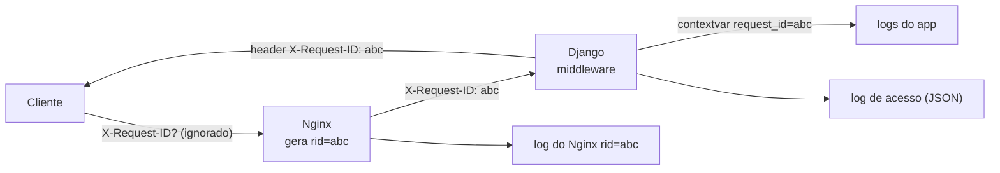

# 1. Logs estruturados e health checks

> ⏱️ ~1h30 · Módulo 14 · Pré-requisitos: [Módulo 13 (checkpoint aprovado)](../13-aws/checkpoint.md), [11.05 (logs e `healthcheck`)](../11-docker/05-logs-debug-dockerignore.md), [8.07 (12 fatores: logs)](../08-arquitetura/README.md)

> ✅ **Verificação.** Executado em 2026-11-09 sobre o MiniShop do módulo 13 (Docker 29.9.2, PostgreSQL 18.6 e Redis 8 em contêineres, `uvicorn` local e o Compose de produção da aula 13.07): os **12 testes novos** desta aula (`tests/test_observabilidade.py`), a suíte inteira (**341 testes** em SQLite; 338 + 4 pulados em PostgreSQL, com o mesmo aviso de teardown da aula 12.02), `ruff`, `mypy`, `lint-imports`, o contrato OpenAPI, e o **pacote de produção rodando localmente** (readiness, logs JSON, correlação Nginx × Django). **As saídas são reais.** Não executado: coletor de logs de verdade (CloudWatch Logs Insights, Loki). Código em [`projeto/referencia-api-m14/`](../projeto/referencia-api-m14/README.md).

## 🎯 Objetivos
- Explicar por que **logs estruturados (JSON)** valem mais que texto livre, e emitir um evento por linha com campos fixos
- Correlacionar tudo o que acontece numa requisição com um **ID de requisição** (Nginx → Django → logs)
- **Nunca** registrar segredos: redação de campos e *query strings*
- Diferenciar **liveness** e **readiness**, e escrever `/health/` e `/health/ready/` sem vazar detalhes
- Ligar os health checks ao **Docker** e ao balanceador, e evitar os erros clássicos (reinício em cascata)

## 🤔 Por que isso importa
Quando algo quebra às 3h da manhã, a única testemunha é o log. Texto livre (`"pedido 7 falhou para o usuário 12"`) obriga a *adivinhar* com `grep`; um evento JSON com `{"event":"order_failed","order_id":7,"user_id":12,"request_id":"..."}` pode ser **filtrado, contado e correlacionado** por qualquer ferramenta. E sem health checks, quem decide "este contêiner está bom?" é a sorte. Em entrevista: "diferença entre liveness e readiness" e "como você rastreia uma requisição entre serviços" são perguntas de quem já operou algo.

## 💡 Intuição (explicação simples)
O log é o **diário de bordo** do navio. Em texto livre, cada marinheiro escreve do seu jeito; em formato estruturado, todos preenchem **o mesmo formulário** (data, gravidade, o quê, quem, em qual viagem) e o capitão consegue fazer perguntas ("quantas avarias na viagem 4?"). O **ID da requisição** é o número da viagem, carimbado em tudo que aconteceu nela. Os health checks são os **sinais vitais**: *liveness* é "tem pulso?"; *readiness* é "está em condições de trabalhar agora?". Um médico que reanima quem só está com sede (reinicia um serviço saudável porque o banco demorou) faz mais mal que bem.

## 🔬 Como funciona por dentro
**Logs como fluxo de eventos (12 fatores, Fator XI).** A aplicação escreve **em `stdout`, uma linha por evento**, sem se preocupar com arquivos, rotação ou envio. Quem coleta é a plataforma (Docker → CloudWatch, Loki…). O que o módulo 14 acrescenta é o **formato**:

- **JSON em uma linha** (`ts`, `level`, `logger`, `message`, `request_id`, mais campos do evento). Máquinas indexam por campo; humanos leem com `jq`. **Mensagem curta e estável + dados em campos** (`"message":"order_created","order_id":7`), não dados espremidos numa frase.
- **Nível certo.** `DEBUG` (diagnóstico), `INFO` (fatos normais, como o acesso), `WARNING` (algo estranho que se recuperou), `ERROR` (a operação falhou), `CRITICAL` (o serviço está em risco). Sondas a cada 5 s vão para `DEBUG`, senão afogam o log.
- **`request_id` por `contextvars`.** Uma `ContextVar` guarda "o ID da requisição que esta tarefa está atendendo"; um *filtro* de logging o copia para **todo** registro, de qualquer biblioteca, sem passar o ID de mão em mão. No ASGI cada requisição tem o seu contexto; num servidor com *threads* o contexto da thread é reaproveitado, então o middleware **restaura o valor** ao terminar (senão o ID de uma requisição vazaria para a seguinte).
- **O ID vem do Nginx.** O Nginx tem a variável `$request_id` (16 bytes aleatórios) e a repassa em `X-Request-ID`; ela aparece no log do Nginx (`rid=`) **e** no do Django. O Django só aceita um ID recebido se ele parecer inofensivo (`^[A-Za-z0-9._-]{8,64}$`); do contrário gera um UUID: sem isso, um cliente mandaria `x\nFAKE {"level":"CRITICAL"}` e **forjaria uma linha de log** (injeção de log).
- **Nunca logar segredos nem dados pessoais** (módulo 9 e LGPD): nada de `Authorization`, senhas, tokens, CPF. Duas travas: (1) o log de acesso grava o **caminho, nunca a query string** (no WebSocket o token JWT vai nela, aula 11.06); (2) o formatter **redige** campos com nomes sensíveis (`password`, `token`, `authorization`, `cookie`, `api_key`…) mesmo que alguém os passe em `extra=` por descuido.
- **Exceções:** `logger.exception(...)` grava o *traceback* inteiro no campo `exc` (uma linha JSON, com `\n` escapados), sem quebrar o formato.

**Liveness × readiness** (conceitos de contêineres e de orquestradores como o Kubernetes; no Docker e nos balanceadores da AWS a ideia é a mesma)
| | **Liveness** (`/health/`) | **Readiness** (`/health/ready/`) |
|---|---|---|
| Pergunta | "O processo está vivo (não travou)?" | "Consegue atender requisições agora?" |
| O que checa | **nada externo** | banco, cache (dependências obrigatórias) |
| Se falha | **reiniciar** o processo | **tirar do balanceador** (parar de mandar tráfego), sem reiniciar |
| Erro típico | checar o banco aqui: o banco cai e **todos** os contêineres são reiniciados em cascata, piorando a crise | checar demais (serviços opcionais) e ficar fora do ar sem necessidade |
- **Não vaze detalhes.** O corpo da readiness diz só `ok`/`error` por componente (e a latência quando ok). A mensagem do erro (IP interno, usuário do banco, trecho de senha numa URL) vai para **o log**, nunca para quem perguntou: o endpoint é público.
- **Sem autenticação e sem limite de taxa** (quem sonda é o orquestrador), mas **só `GET`**, sem cache (`never_cache`), e **isento do redirecionamento HTTPS** (`SECURE_REDIRECT_EXEMPT`): a sonda fala HTTP simples.
- **Timeouts importam.** Se o banco estiver preso, o `SELECT 1` pode demorar; um `connect_timeout` curto na `DATABASE_URL` (a aula 13.05 permite `?connect_timeout=5`) evita sondas penduradas. A sonda do Docker tem o seu próprio `timeout`.

## 🛠️ Exemplo prático
**1. O formatter** (`config/logging_json.py`, sem dependências):
```python
request_id_var: contextvars.ContextVar[str] = contextvars.ContextVar("request_id", default="-")
SENSIVEIS = re.compile(r"(passw|senha|secret|token|authorization|cookie|api[-_]?key|dsn)", re.I)

class RequestContextFilter(logging.Filter):
    def filter(self, record):
        record.request_id = request_id_var.get()      # TODO registro, de qualquer logger, ganha o ID da requisição
        return True

class JsonFormatter(logging.Formatter):
    def format(self, record):
        registro = {"ts": datetime.fromtimestamp(record.created, UTC).isoformat(timespec="milliseconds"),
                    "level": record.levelname, "logger": record.name, "message": record.getMessage(),
                    "request_id": getattr(record, "request_id", "-")}
        extras = {k: v for k, v in record.__dict__.items() if k not in PADRAO_LOGRECORD and not k.startswith("_")}
        registro.update(redigir(extras))               # campos do evento (extra=...) já sem segredos
        if record.exc_info:
            registro["exc"] = self.formatException(record.exc_info)
        return json.dumps(registro, ensure_ascii=False, default=str)
```
E no `settings.py` (o formato JSON é o padrão **fora** do `DEBUG`; em desenvolvimento, texto legível com o ID):
```python
LOG_FORMAT = os.environ.get("LOG_FORMAT", "text" if DEBUG else "json")
LOGGING = {
    "version": 1, "disable_existing_loggers": False,
    "filters": {"contexto": {"()": "config.logging_json.RequestContextFilter"}},
    "formatters": {"text": {"format": "%(asctime)s %(levelname)s %(name)s [%(request_id)s] %(message)s"},
                   "json": {"()": "config.logging_json.JsonFormatter"}},
    "handlers": {"stdout": {"class": "logging.StreamHandler", "stream": "ext://sys.stdout", "formatter": LOG_FORMAT, "filters": ["contexto"]}},
    "root": {"handlers": ["stdout"], "level": os.environ.get("LOG_LEVEL", "INFO")},
}
```
Um evento do app com dados em campos (a linha JSON abaixo é **ilustrativa** do formato; os testes e a saída real do acesso estão mais adiante):
```python
logger.info("order_created", extra={"order_id": 7, "total": "1402.40"})
```
```json
{"ts": "2026-11-09T02:34:39.181+00:00", "level": "INFO", "logger": "apps.orders.services", "message": "order_created", "request_id": "dd58c311...", "order_id": 7, "total": "1402.40"}
```

**2. O middleware do contexto da requisição** (`config/middleware.py`, o primeiro da lista, para medir o tempo de **tudo**):
```python
ID_VALIDO = re.compile(r"^[A-Za-z0-9._-]{8,64}$")
SILENCIOSAS = ("/health/", "/metrics/")

class RequestContextMiddleware(MiddlewareMixin):
    def process_request(self, request):
        recebido = request.headers.get("X-Request-ID", "")
        request.request_id = recebido if ID_VALIDO.match(recebido) else uuid.uuid4().hex
        request._token_rid = request_id_var.set(request.request_id)
        request._inicio = time.perf_counter()

    def process_response(self, request, response):
        duracao = time.perf_counter() - request._inicio
        nivel = logging.DEBUG if request.path.startswith(SILENCIOSAS) else logging.INFO
        acesso.log(nivel, "%s %s %s", request.method, request.path, response.status_code,   # NUNCA a query string
                   extra={"method": request.method, "path": request.path, "status": response.status_code,
                          "duration_ms": round(duracao * 1000, 1), "user_id": uid})
        response["X-Request-ID"] = request.request_id
        request_id_var.reset(request._token_rid)       # a thread será reutilizada: não deixar o ID vazar
        return response
```
**3. Provando com testes** (`tests/test_observabilidade.py`, 12 testes verdes). Os mais instrutivos:
```python
def test_access_log_tem_request_id_status_duracao_e_nunca_a_query_string(client, saida_json):
    r = client.get("/api/v1/products/?search=cadeira&token=SEGREDO", headers={"X-Request-ID": "req-abc-12345"})
    (linha,) = [x for x in linhas(saida_json) if x["path"].startswith("/api/v1/products")]
    assert linha["request_id"] == "req-abc-12345" and "SEGREDO" not in json.dumps(linha) and "?" not in linha["path"]

def test_request_id_malicioso_e_substituido(client, saida_json):
    r = client.get("/health/", headers={"X-Request-ID": "x\nFAKE {\"level\":\"CRITICAL\"}"})
    assert "\n" not in r["X-Request-ID"] and len(r["X-Request-ID"]) == 32      # gerou um UUID novo

def test_campos_sensiveis_sao_redigidos():
    assert redigir({"user": "ana", "password": "x", "Authorization": "Bearer abc"}) == {"user": "ana", "password": "[REDACTED]", "Authorization": "[REDACTED]"}
```
**4. Health checks** (`config/health.py`):
```python
@never_cache
@require_GET
def liveness(request):
    return JsonResponse({"status": "ok"})                # NÃO toca em nada externo (um teste prova: 0 consultas)

@never_cache
@require_GET
def readiness(request):
    resultado, ok = {}, True
    for nome, teste in (("database", _banco), ("cache", _cache)):
        inicio = time.perf_counter()
        try:
            teste()
            resultado[nome] = {"status": "ok", "ms": round((time.perf_counter() - inicio) * 1000, 1)}
        except Exception:
            ok = False
            logger.exception("readiness_failed check=%s", nome)      # o traceback vai para o LOG…
            resultado[nome] = {"status": "error"}                    # …e a resposta só diz "error"
    return JsonResponse({"status": "ok" if ok else "error", "checks": resultado}, status=200 if ok else 503)
```
O teste que prova o que **não** vaza: o banco "cai" com a mensagem `connection to server at 10.0.3.7 refused (senha=xyz)`; a resposta é `503` com `{"database": {"status": "error"}}` e o IP aparece **só** no log capturado. Rotas em `config/urls.py` (`health/`, `health/ready/`), e a sonda do Docker (`config/healthcheck.py`) agora consulta a **readiness**:
```python
requisicao = urllib.request.Request("http://127.0.0.1:8000/health/ready/", headers={"Host": host})
```
(a versão da aula 11.05 usava a página de login do Admin e precisava mandar `X-Forwarded-Proto`; as sondas agora estão em `SECURE_REDIRECT_EXEMPT = [r"^health/", r"^metrics/"]`.)

**5. Ao vivo, no pacote de produção** (Compose da aula 13.07, local; o Nginx na frente):
```bash
curl -s -w "  -> %{http_code}\n" http://127.0.0.1:8091/health/ready/
```
```text
{"status": "ok", "checks": {"database": {"status": "ok", "ms": 13.4}, "cache": {"status": "ok", "ms": 31.9}}}  -> 200
```
Com `SECURE_SSL_REDIRECT=1` ligado, essa sonda responde `200` por HTTP simples (isenta), enquanto a API devolveria `301`. **A correlação**, com uma requisição qualquer:
```bash
R=$(curl -s -o /dev/null -D - http://127.0.0.1:8091/api/v1/products/ | grep -i x-request-id | awk '{print $2}')
docker compose logs nginx | grep "rid=$R" ; docker compose logs web | grep "\"request_id\": \"$R\""
```
```text
172.20.0.1 [09/Nov/2026:02:34:39 +0000] rid=dd58c31143ae45b019c7bf8385338a9f "GET /api/v1/products/" 200 52 rt=0.123
{"ts": "2026-11-09T02:34:39.181+00:00", "level": "INFO", "logger": "minishop.access", "message": "GET /api/v1/products/ 200", "request_id": "dd58c31143ae45b019c7bf8385338a9f", "method": "GET", "path": "/api/v1/products/", "status": 200, "duration_ms": 120.3, "user_id": "-"}
```
**O mesmo ID nos dois logs** (e na resposta ao cliente: ele pode citá-lo no suporte). E um detalhe medido: se o cliente envia `X-Request-ID: meu-id-cliente-123`, a resposta traz **outro** ID (`0e12adaf...`): o Nginx **substitui** o cabeçalho pelo seu `$request_id` (`proxy_set_header X-Request-ID $request_id;`). Se você quiser honrar o ID do cliente, é preciso um `map` no Nginx; aqui a escolha é **confiar só no ID gerado na borda**.

**6. Ler JSON na prática** (`jq` filtra por campo; é o equivalente local do CloudWatch Logs Insights):
```bash
docker compose logs --no-log-prefix web | jq -c 'select(.status >= 500) | {ts, path, request_id, duration_ms}'
docker compose logs --no-log-prefix web | jq -s 'map(select(.logger=="minishop.access")) | group_by(.status) | map({status: .[0].status, n: length})'
```
(Exemplo de uso; no CloudWatch a consulta equivalente é `filter status >= 500 | fields @timestamp, path, request_id`.)

## 🧠 Pausa para lógica
**Problema.** Um serviço tem 6 contêineres atrás de um balanceador. O `/health/` (liveness) **também** consulta o banco, e a política é "reiniciar o contêiner se o liveness falhar 3 vezes seguidas, com sondas a cada 10 s". O banco entra em manutenção por 2 minutos. (a) O que acontece com os 6 contêineres? (b) E se o `/health/` fosse só "o processo responde" e o banco estivesse fora? (c) Onde a checagem do banco deveria estar, e o que o balanceador faria? (d) Cite um motivo para a **readiness** devolver 503 sem vazar o texto do erro.

<details><summary>Dica</summary>Reiniciar o contêiner resolve falta de banco? E quanto custa um reinício (conexões, caches, aquecimento)?</details>

<details><summary>Solução comentada</summary>

(a) Depois de ~30 s (3 sondas), **todos** os 6 são reiniciados quase ao mesmo tempo, e continuam reiniciando a cada 30 s durante os 2 minutos: o site fica fora do ar *e* sem aquecimento quando o banco volta (uma "tempestade de reconexões" ainda pode derrubar o banco que acabou de voltar). (b) Nada é reiniciado; as requisições que precisam do banco falham com erro, mas o processo está vivo, e quando o banco volta tudo segue. (c) Na **readiness**: ela falha, o balanceador **tira** os contêineres da rotação (e pode servir uma página de manutenção), e quando o banco volta eles voltam sozinhos, sem reinício. (d) O texto do erro pode conter hostnames/IPs internos, nomes de usuário e até pedaços de URL de conexão; o endpoint é alcançável por qualquer um, e isso seria reconhecimento gratuito para um atacante. O detalhe fica no log.
</details>

## ⚠️ Erros comuns e boas práticas
| Sintoma / mensagem | Causa | Solução |
|---|---|---|
| Logs em texto, impossíveis de filtrar | `print` ou formato livre | `logging` + JSON + campos |
| Linha de log "falsa" aparece no seu sistema | `X-Request-ID` do cliente copiado sem validação | Regex de ID; gerar UUID se for estranho |
| Token JWT/senha apareceu no log | Query string ou `extra=` com segredo | Logar só o caminho; redação no formatter; `detect-secrets` |
| Todos os logs com `request_id: "-"` | Filtro não instalado no handler ou middleware fora da ordem | `filters: ["contexto"]` no handler; middleware **primeiro** |
| O ID de uma requisição aparece em outra | `ContextVar` não restaurada em servidor com threads | `reset(token)` ao terminar |
| Log de acesso duplicado no `runserver` | O servidor de desenvolvimento tem o próprio log | Silenciar `django.server` (feito no `LOGGING`) |
| Contêineres reiniciando em ondas | Liveness depende do banco | Liveness só do processo; dependências na readiness |
| `/health/` responde `301` | `SECURE_SSL_REDIRECT` sem isenção | `SECURE_REDIRECT_EXEMPT = [r"^health/"]` |
| `400 Bad Request` na sonda | `Host` fora de `ALLOWED_HOSTS` | A sonda manda `Host` válido (`config/healthcheck.py`) |
| Sonda lenta trava a fila | Sem timeout no banco | `connect_timeout` curto; `timeout` na sonda |
| Detalhes de infraestrutura na resposta de `/health/ready/` | `str(erro)` no JSON | Só `error`; detalhe no log |
- **Uma linha, um evento, um formato.** Mensagem estável + campos.
- **Sondas e métricas em `DEBUG`** no log de acesso; erros em `ERROR` com `exc`.
- **Logs não são auditoria nem armazenamento de dados pessoais**; defina retenção (aula 13.08).
- **Correlacione:** o mesmo ID no proxy, na aplicação, na tarefa em segundo plano (propagar para o Celery é a evolução natural; **não** implementei aqui) e no Sentry (aula 02).

## 🧩 Exercícios
**1. Fixação.** (a) Por que JSON e não texto? (b) Para que serve o `request_id` e quem o gera? (c) Liveness × readiness: o que cada uma checa e o que o orquestrador faz se falha? (d) Por que nunca logar a query string? (e) Por que a resposta da readiness não traz o texto do erro?

<details><summary>Solução</summary>

(a) Campos fixos podem ser filtrados, contados e correlacionados por máquinas. (b) Liga tudo o que aconteceu numa requisição (Nginx, app, tarefas); o Nginx o gera e o Django o valida. (c) Liveness: só o processo (falha → reiniciar); readiness: dependências (falha → tirar do tráfego). (d) Ela carrega tokens e dados pessoais (WebSocket, links). (e) O endpoint é público; o erro pode revelar infraestrutura e segredos.
</details>

**2. Aplicação no projeto MiniShop.**
- [ ] `config/logging_json.py` (formatter, filtro e redação) e `LOGGING` com `LOG_FORMAT`; `config/middleware.py` com o ID validado e o log de acesso sem query string
- [ ] `config/health.py` + rotas `/health/` e `/health/ready/`; `SECURE_REDIRECT_EXEMPT`; `config/healthcheck.py` consultando a readiness
- [ ] Os **12 testes** (formatter e exceção, redação, log de acesso, ID malicioso, ID gerado, nível das sondas, liveness sem consultas, readiness ok/503 sem vazamento, só `GET`) e a suíte inteira verde
- [ ] `proxy_set_header X-Request-ID $request_id` e `rid=$request_id` no `log_format` do Nginx; a prova de **um ID nos dois logs**
- [ ] Uma consulta `jq` (ou Logs Insights) que lista as requisições com `status >= 500` e outra que conta por status
- [ ] `docs/producao.md` com a tabela "pergunta → onde olhar" e a decisão liveness × readiness
- [ ] Commit `feat(observability): json logs, request id and health checks`

**3. Desafio (opcional).** Propague o `request_id` para as tarefas do Celery (cabeçalho da tarefa → `task_prerun` → `ContextVar`), de modo que o e-mail enviado pelo worker apareça com o **mesmo ID** da requisição que criou o pedido. Escreva o teste.

## 🎤 Na entrevista
**1. O que são logs estruturados e por que usá-los?** Eventos em formato fixo (JSON) com campos consultáveis, em vez de texto livre. Permitem filtrar, agregar e correlacionar (por exemplo por `request_id`) em ferramentas como CloudWatch Insights ou Loki, e reduzem o tempo de diagnóstico.

**2. Qual a diferença entre liveness e readiness?** Liveness diz se o processo está vivo (se falha, reinicia); readiness diz se ele consegue atender agora, checando dependências (se falha, sai da rotação sem reiniciar). Misturá-las provoca reinícios em cascata quando uma dependência cai.

**3. Como você rastreia uma requisição que passa por vários componentes?** Um ID de correlação gerado na borda (proxy) e repassado por cabeçalho; cada componente o registra em todos os logs e o devolve na resposta, e o mesmo ID vai para o monitoramento de erros.

## 📚 Para ir além
- 📄 Documentação oficial: [Python — Logging HOWTO](https://docs.python.org/3/howto/logging.html) e [`contextvars`](https://docs.python.org/3/library/contextvars.html). Filtros, formatters e variáveis de contexto.
- 📄 Documentação oficial: [Django — Logging](https://docs.djangoproject.com/en/5.2/topics/logging/) e [`SECURE_REDIRECT_EXEMPT`](https://docs.djangoproject.com/en/5.2/ref/settings/#secure-redirect-exempt).
- 📄 Referência: [12 fatores — Logs](https://12factor.net/pt_br/logs). Logs como fluxo de eventos.
- 📄 Documentação oficial: [Nginx — variáveis do módulo core (`$request_id`)](https://nginx.org/en/docs/http/ngx_http_core_module.html). Ids de requisição na borda.
- 📄 Documentação oficial: [Kubernetes — probes de liveness, readiness e startup](https://kubernetes.io/docs/tasks/configure-pod-container/configure-liveness-readiness-startup-probes/). A definição de referência dos conceitos (em inglês).
- 📄 Documentação oficial: [Dockerfile `HEALTHCHECK`](https://docs.docker.com/reference/dockerfile/) e [CloudWatch Logs](https://docs.aws.amazon.com/AmazonCloudWatch/latest/logs/WhatIsCloudWatchLogs.html).
- 📄 Livro online: [Google SRE — Monitoring Distributed Systems](https://sre.google/sre-book/monitoring-distributed-systems/). Os "quatro sinais de ouro" (em inglês).
- 🏋️ Prática extra: instale o `jq` e escreva três consultas sobre os logs do Compose: a rota mais lenta (p95 de `duration_ms`), o ID de uma requisição que deu 500 e o número de requisições por usuário.

## ✅ Checklist da aula
- [ ] Sei por que JSON, e emito mensagem estável + campos
- [ ] O `request_id` nasce no Nginx, é validado no Django e aparece nos dois logs e na resposta
- [ ] Nenhum segredo nem query string chega ao log (testes provam)
- [ ] Sei a diferença entre liveness e readiness e onde cada uma é usada
- [ ] A readiness devolve 503 sem vazar detalhes; o detalhe vai para o log
- [ ] A sonda do Docker consulta a readiness e as sondas estão isentas do redirecionamento HTTPS
