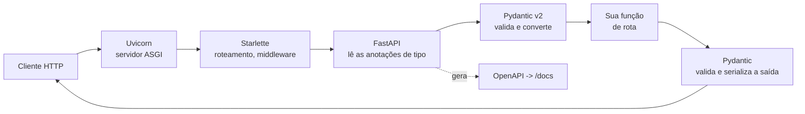

# 1. FastAPI e Pydantic

> ⏱️ ~1h30 · Módulo 15 · Pré-requisitos: [6.03 (serializers do DRF)](../06-apis-rest/03-drf-serializers.md), [6.05 (validação e erros)](../06-apis-rest/05-validacao-erros.md), [7.03 (asyncio)](../07-sincrono-assincrono/03-asyncio.md), [7.05 (WSGI e ASGI)](../07-sincrono-assincrono/05-wsgi-asgi.md)

> ✅ **Verificação.** Executado em 2026-11-09 com **Python 3.13.18, FastAPI 0.162.2, Starlette 1.10.0, Pydantic 2.14.3, Uvicorn 0.54.0**. Os exemplos desta aula estão em [`projeto/referencia-api-m15/catalog-fastapi/`](../projeto/referencia-api-m15/catalog-fastapi/README.md) (`scripts/hello.py`, `app/schemas.py`); as saídas abaixo são as reais. **Não medido aqui:** nada de desempenho (isso fica para a aula 03 e a 06). Versões mudam rápido neste ecossistema: confira `00-guia/versoes.md`.

## 🎯 Objetivos
- Subir uma API FastAPI mínima e explicar o que o **tipo** de cada parâmetro faz (conversão, validação, documentação)
- Modelar entrada e saída com **Pydantic v2** (`BaseModel`, `Field`, validadores de campo e de modelo)
- Ler uma resposta **422** e localizar o erro (`loc`, `type`, `msg`)
- Mapear o que você já sabe de **serializers do DRF** para o equivalente em Pydantic, e dizer o que muda

## 🤔 Por que isso importa
FastAPI aparece em muitas vagas de Python para APIs, microsserviços e serviços de dados/IA, quase sempre ao lado de Django. Quem só conhece um framework tende a achar que "a maneira dele" é *a* maneira. Aqui você reimplementa uma fatia **que já conhece** (o catálogo do MiniShop) e, por contraste, entende melhor o que o Django/DRF faz por você e o que ele esconde. Em entrevista: "qual a diferença entre Pydantic e um serializer do DRF?" é pergunta recorrente.

## 💡 Intuição (explicação simples)
No DRF você escreve **uma classe de regras** (o serializer) e *depois* a view a usa. No FastAPI as regras estão **na assinatura da função**: "este parâmetro é um inteiro", "este corpo é um `Item`". É como a diferença entre um formulário em papel com um balconista que confere campo a campo (DRF) e uma **máquina de autoatendimento** que só deixa digitar números onde se pede número. O balconista é flexível; a máquina é rígida e rápida em recusar. Nos dois casos, **quem valida é o servidor**: nunca confie em quem chama.

## 🔬 Como funciona por dentro
**Peças e quem faz o quê**

- **Uvicorn**: servidor **ASGI** (aula 7.05). O Django também roda nele, via `config.asgi`.
- **Starlette**: o *toolkit* ASGI de baixo (rotas, requisição/resposta, WebSocket). FastAPI **é** um Starlette com mais coisas por cima.
- **FastAPI**: lê as **anotações de tipo** da função e decide de onde vem cada parâmetro: nome que está no caminho (`/itens/{item_id}`) é parâmetro de **caminho**; tipo simples fora do caminho é **query string**; tipo `BaseModel` é o **corpo JSON**. Também gera o **OpenAPI**.
- **Pydantic v2**: o núcleo de validação (escrito em Rust, `pydantic-core`). Recebe dados "sujos" (texto de JSON, query string) e devolve objetos tipados ou uma lista de erros.

**Validar × converter (modo padrão "lax").** O Pydantic *converte* o que é seguro: `"3"` vira `3`, `"true"`/`"1"`/`"yes"` viram `True`. Não converte o que é ambíguo: `"sim"` e `"talvez"` **não** são booleanos (veremos na saída). Existe o modo `strict` (sem conversões) para quando isso importa.

**Pydantic × serializer do DRF**
| Conceito | DRF | Pydantic v2 |
|---|---|---|
| Declarar campos | `serializers.CharField(...)` | anotação: `nome: str` |
| Restrições | `max_length=`, `min_value=` | `Field(max_length=, ge=, gt=)` ou `Annotated[...]` |
| Regra de um campo | `validate_<campo>` | `@field_validator("campo")` |
| Regra entre campos | `validate(self, attrs)` | `@model_validator(mode="after")` |
| Campo calculado (leitura) | `SerializerMethodField` | `@computed_field` |
| Ler de objeto ORM | `ModelSerializer` (automático) | `ConfigDict(from_attributes=True)` |
| Campo desconhecido no corpo | **ignorado** em silêncio | ignorado por padrão; `extra="forbid"` recusa |
| Erro devolvido | `400` + `{campo: [mensagens]}` | `422` + lista de `{type, loc, msg, input}` |
| Idioma das mensagens | traduzido (`LANGUAGE_CODE = "pt-br"`) | **inglês** (você traduz/mapeia se quiser) |
| Mesma classe para ler e gravar | sim (com `read_only`/`write_only`) | **normalmente duas** classes: `ProductIn` e `ProductOut` |

Esse último ponto é uma decisão de design: separar entrada e saída evita expor campo interno por acidente (um `is_admin` que entrou no corpo) e deixa o contrato do OpenAPI mais preciso.

**`Decimal` e dinheiro.** Pydantic aceita `Decimal` e o serializa como **texto** no JSON (`"701.20"`), exatamente como o DRF faz. Isso evita o erro de ponto flutuante (`0.1 + 0.2`) que a aula 1 do curso mostrou. `max_digits` e `decimal_places` recusam `10.999` para um campo de 2 casas.

## 🛠️ Exemplo prático
**1. A menor API útil** (`scripts/hello.py`):
```python
from decimal import Decimal
from fastapi import FastAPI
from pydantic import BaseModel, Field

app = FastAPI(title="Hello MiniShop")

class Item(BaseModel):
    nome: str = Field(min_length=2)
    preco: Decimal = Field(gt=0, max_digits=10, decimal_places=2)
    tags: list[str] = []

@app.get("/itens/{item_id}")
async def ler(item_id: int, detalhe: bool = False) -> dict[str, object]:
    return {"id": item_id, "detalhe": detalhe, "tipo_do_id": type(item_id).__name__}

@app.post("/itens", status_code=201)
async def criar(item: Item) -> Item:
    return item
```
Instalar e rodar (`uv` já conhecido da aula 0): na pasta do serviço,
```bash
cd projeto/referencia-api-m15/catalog-fastapi
uv sync
uv run uvicorn scripts.hello:app --port 8830     # depois abra http://localhost:8830/docs
```

**2. O que cada tipo faz.** Chamadas reais (via `httpx` contra o próprio app, sem rede; a aula 04 explica como):
```text
GET  /itens/3?detalhe=sim        -> 422  {"detail":[{"type":"bool_parsing","loc":["query","detalhe"],
                                          "msg":"Input should be a valid boolean, unable to interpret input","input":"sim"}]}
GET  /itens/abc                  -> 422  {"detail":[{"type":"int_parsing","loc":["path","item_id"],
                                          "msg":"Input should be a valid integer, unable to parse string as an integer","input":"abc"}]}
POST /itens {"nome":"Mouse","preco":"29.9"}  -> 201  {"nome":"Mouse","preco":"29.9","tags":[]}
POST /itens {"nome":"M","preco":0}           -> 422  (dois erros, um por campo)
   [{"type":"string_too_short","loc":["body","nome"],"msg":"String should have at least 2 characters",...},
    {"type":"greater_than","loc":["body","preco"],"msg":"Input should be greater than 0",...}]
POST /itens {"nome":"Mouse","preco":"10.999","tags":[1,"a"]} -> 422
   [{"type":"decimal_max_places","loc":["body","preco"],...},
    {"type":"string_type","loc":["body","tags",0],"msg":"Input should be a valid string","input":1}]
```
Observe: (a) `loc` diz **onde** (`path`, `query`, `body`) e **qual campo** (até o índice da lista: `["body","tags",0]`); (b) **todos** os erros vêm de uma vez, não só o primeiro; (c) `"sim"` **não** é aceito como booleano (use `true`/`false`/`1`/`0`); (d) o `Decimal` volta com o texto que você enviou (`"29.9"`), sem o zero final: se quiser sempre duas casas, formate na saída.

**3. Entrada × saída do catálogo** (`app/schemas.py`, trecho). As regras são as **mesmas** do `ProductSerializer` do Django (aula 6.05):
```python
class ProductIn(BaseModel):
    model_config = ConfigDict(extra="forbid")   # campo desconhecido = erro
    sku: str
    name: Annotated[str, Field(min_length=1, max_length=120)]
    price: Annotated[Decimal, Field(max_digits=10, decimal_places=2)]
    stock: Annotated[int, Field(ge=0)] = 0
    is_active: bool = True
    category_slug: str

    @field_validator("sku")
    @classmethod
    def sku_formato(cls, v: str) -> str:
        v = v.strip().upper()
        if not SKU_RE.match(v):
            raise ValueError("Use o formato AAA-123 (3 letras, hífen, 3 números).")
        return v

    @model_validator(mode="after")
    def regra_entre_campos(self) -> Self:
        if self.is_active is False and self.stock > 0:
            raise ValueError("Não desative um produto que ainda tem estoque.")
        return self
```
Um corpo inválido com vários problemas produz (resumido; resposta real):
```json
{"detail": [
  {"type": "value_error", "loc": ["body","sku"],   "msg": "Value error, Use o formato AAA-123 (3 letras, hífen, 3 números).", "input": "abc"},
  {"type": "string_too_short", "loc": ["body","name"],  "msg": "String should have at least 1 character", "input": ""},
  {"type": "value_error", "loc": ["body","price"], "msg": "Value error, O preço deve ser maior que zero.", "input": "-1"},
  {"type": "int_parsing", "loc": ["body","stock"], "msg": "Input should be a valid integer, unable to parse string as an integer", "input": "muitos"},
  {"type": "extra_forbidden", "loc": ["body","intruso"], "msg": "Extra inputs are not permitted", "input": 1}
]}
```
O **mesmo corpo** no `ProductSerializer` do DRF (rodado no projeto do módulo 14) dá:
```json
{"sku": ["Use o formato AAA-123 (3 letras, hífen, 3 números)."],
 "name": ["Este campo pode não estar em branco."],
 "price": ["Certifique-se de que este valor seja maior ou igual a 0."],
 "stock": ["Um número inteiro válido é exigido."]}
```
Diferenças reais: o DRF devolve **em português**, **agrupado por campo** e **ignorou** o campo `intruso`; o preço `-1` caiu no validador de modelo (`>= 0`) em vez do nosso "maior que zero" porque o `MinValueValidator` do campo roda antes. O FastAPI devolve **inglês**, uma **lista plana** com `loc`, e recusou `intruso`.

**4. Cuidado: o 422 devolve o `input`.** Cada erro ecoa o valor recebido. Se o campo era uma **senha** ou um token, ele volta na resposta (e vai para logs de quem registra respostas). Em endpoints sensíveis, personalize o tratador de `RequestValidationError` para remover `input` e `ctx` (assunto de segurança da aula 9).

## 🧠 Pausa para lógica
**Problema.** Um cliente envia `POST /itens` com `{"nome": "Mouse", "preco": "29.90", "tags": "audio"}`. (a) O que o Pydantic faz com `tags`? (b) Se o tipo fosse `tags: list[str] | str`, o que mudaria? (c) Por que `preco` não deve ser `float`?

<details><summary>Dica</summary>O Pydantic não transforma texto em lista "por gentileza". E lembre da soma `0.1 + 0.2`.</details>

<details><summary>Solução comentada</summary>

(a) **Recusa** (`list_type`, "Input should be a valid list"): uma string não vira lista no modo lax. (b) Aceitaria os dois formatos, mas o código passaria a tratar dois tipos (pior para quem consome e para o OpenAPI); prefira **um** formato e recuse o resto. (c) `float` tem erro de representação binária (`0.1 + 0.2 = 0.30000000000000004`); para dinheiro use `Decimal` (ou inteiros em centavos), no banco e na API.
</details>

## ⚠️ Erros comuns e boas práticas
| Sintoma / erro | Causa | Correção |
|---|---|---|
| `422` `model_attributes_type` ("Input should be a valid dictionary or object") com `curl -d '{...}'` | faltou `-H 'content-type: application/json'`: o `curl -d` envia como formulário e o corpo chega como **texto** | enviar o cabeçalho; no `curl` moderno (8.x), use `--json '{...}'` |
| `422` `missing` com `loc: ["body"]` | corpo ausente | enviar o JSON |
| `value_error` com `ctx: {"error": {}}` | exceção do seu validador serializada de forma pobre | use `msg` como fonte; o `ctx` desse tipo é vazio |
| `500` com `ResponseValidationError` | a função devolveu algo que não bate com o tipo de saída | corrigir o retorno; o 500 protege o contrato |
| Campo extra aceito em silêncio | padrão do Pydantic é **ignorar** | `ConfigDict(extra="forbid")` onde a precisão importa |
| `float` para preço | erro de arredondamento | `Decimal` com `max_digits`/`decimal_places` |
| Mesmo modelo para entrada e saída | expõe campos internos / confunde o contrato | `XIn` e `XOut` separados |
| Esperar `400` como no DRF | FastAPI usa **422** para erro de validação | documentar para o front; ou mapear no tratador |
| `class Config:` do Pydantic v1 | removido/obsoleto na v2 | `model_config = ConfigDict(...)`; `@validator` virou `@field_validator` |

**Boas práticas.** Tipos explícitos em tudo; um modelo por intenção (criar, atualizar, ler); mensagens de erro de **negócio** em português nos seus validadores; nunca confie em validação do cliente.

## 🧩 Exercícios
**1. Fixação.** (a) De onde o FastAPI tira cada parâmetro (caminho, query, corpo)? (b) Qual a diferença entre `@field_validator` e `@model_validator`? (c) Por que dois modelos (`In` e `Out`)? (d) O que significa `from_attributes=True`?

<details><summary>Solução</summary>

(a) Nome na URL → caminho; tipo simples → query; `BaseModel` → corpo. (b) O primeiro valida **um** campo; o segundo, regras **entre** campos (depois que todos passaram). (c) Segurança do contrato e do OpenAPI: a saída não precisa nem deve ter os mesmos campos da entrada. (d) Permite criar o modelo a partir de **atributos** de um objeto (ORM), não só de um `dict`.
</details>

**2. Aplicação no projeto MiniShop.**
- [ ] `uv sync` no `catalog-fastapi/` e `scripts/hello.py` rodando em `/docs`
- [ ] Reproduza as 6 chamadas da seção "O que cada tipo faz" e **explique** cada `loc`
- [ ] Leia `app/schemas.py` e aponte, para cada validador, o método equivalente no `apps/catalog/serializers.py`
- [ ] Faça `ProductIn` aceitar `price` com **vírgula decimal** (`"29,90"`) usando um `field_validator(mode="before")`, com teste
- [ ] Commit `docs(m15): pydantic models for the catalog`

**3. Desafio (opcional).** Troque o tratador de `RequestValidationError` para devolver `400` no formato do DRF (`{campo: [mensagens]}`), **sem** o `input`. Quando isso é uma boa ideia e quando só esconde o contrato do FastAPI?

## 🎤 Na entrevista
- **"O que é Pydantic e como o FastAPI o usa?"** — Biblioteca de validação e serialização baseada em anotações de tipo. O FastAPI lê as anotações das rotas e delega a ela a conversão e a validação de caminho, query e corpo, e usa os mesmos modelos para gerar o OpenAPI.
- **"Por que 422 e não 400?"** — O corpo estava bem formado, mas **semanticamente inválido** (entidade que não pôde ser processada). É a escolha do FastAPI; o DRF usa 400. Importa documentar e ser consistente.
- **"Pydantic ou serializer do DRF?"** — O serializer está acoplado ao Django (ORM, `ModelSerializer`, mensagens traduzidas); o Pydantic é independente de framework, mais rígido com tipos e mais rápido. O serializer economiza código quando o modelo é Django.

## 📚 Para ir além
- 📄 Documentação oficial: [FastAPI — Tutorial](https://fastapi.tiangolo.com/tutorial/). Caminho, query e corpo, passo a passo.
- 📄 Documentação oficial: [FastAPI — Corpo da requisição](https://fastapi.tiangolo.com/tutorial/body/). `BaseModel` na rota.
- 📄 Documentação oficial: [FastAPI — Tratando erros](https://fastapi.tiangolo.com/tutorial/handling-errors/). Como personalizar o 422.
- 📄 Documentação oficial: [Pydantic — Modelos](https://docs.pydantic.dev/latest/concepts/models/) e [Validadores](https://docs.pydantic.dev/latest/concepts/validators/) (em inglês).
- 📄 Documentação oficial: [DRF — Serializers](https://www.django-rest-framework.org/api-guide/serializers/). Para comparar lado a lado.
- 🏋️ Prática extra: ligue `strict=True` num campo inteiro e veja o que passa a ser recusado (`"3"`).

## ✅ Checklist da aula
- [ ] Sei de onde vem cada parâmetro (caminho, query, corpo) e como o tipo vira validação
- [ ] Leio um 422 (`loc`, `type`, `msg`) e sei que ele ecoa o `input`
- [ ] Escrevo `ProductIn`/`ProductOut` com validadores de campo e de modelo
- [ ] Sei a tabela Pydantic × serializer do DRF e as diferenças de comportamento (idioma, extras, formato do erro)
- [ ] Uso `Decimal` para dinheiro
