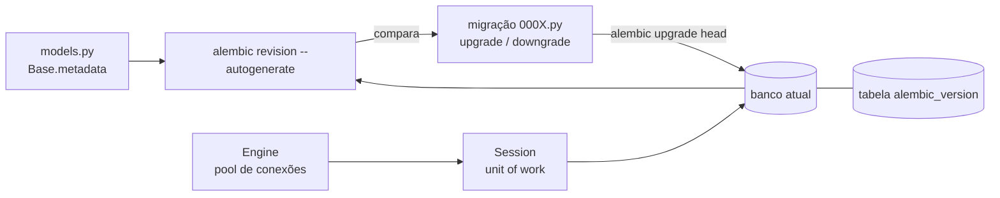

# 2. SQLAlchemy 2 e Alembic

> ⏱️ ~1h30 · Módulo 15 · Pré-requisitos: [15.01](01-fastapi-pydantic.md), [3.11 (ORM e migrações)](../03-banco-de-dados/11-orm-migracoes-nosql.md), [3.08 (constraints e índices)](../03-banco-de-dados/08-constraints-indices-explain.md)

> ✅ **Verificação.** Executado em 2026-11-09 com **SQLAlchemy 2.1.8, Alembic 1.20.1, aiosqlite 0.22.1, asyncpg 0.32.0**, em **SQLite** e **PostgreSQL 18.6** (contêiner descartável `m15-lab-pg`, porta 55415, apagado ao final). Migração `0001` aplicada nos dois bancos; migração de exemplo `0002` (coluna `weight_g`) gerada, aplicada, desfeita e emitida como SQL em PostgreSQL. **Não executado:** migrações com dados em produção, `alembic merge` de ramos, e *async* com `psycopg` (usamos `asyncpg`). Código: [`catalog-fastapi/`](../projeto/referencia-api-m15/catalog-fastapi/README.md).

## 🎯 Objetivos
- Mapear tabelas com o estilo **declarativo tipado** do SQLAlchemy 2 (`Mapped[...]`, `mapped_column`)
- Escrever consultas com `select()` e carregar relacionamentos **sem N+1** (`contains_eager`, `joinedload`)
- Entender **Engine**, **Session** e o padrão *unit of work* (`add`, `flush`, `commit`)
- Criar, revisar, aplicar e desfazer migrações com **Alembic**, e saber por que o *autogenerate* precisa de revisão
- Comparar com o ORM e as migrações do Django

## 🤔 Por que isso importa
O Django traz ORM, migrações e admin juntos. No FastAPI **nada disso vem pronto**: você escolhe (quase sempre) SQLAlchemy + Alembic. É mais peça para montar e mais decisão, em troca de controle. SQLAlchemy também é o ORM de muitos projetos Flask, de ferramentas de dados e de código legado: conhecer o básico abre portas. E o tema "migração gerada automaticamente quebrou em produção" é daqueles que você prefere aprender num laboratório.

## 💡 Intuição (explicação simples)
O ORM do Django é um **carro automático**: você diz `Product.objects.filter(...)` e ele resolve. O SQLAlchemy é um **carro com câmbio manual**: você escreve a consulta explicitamente (`select(Product).where(...)`), decide quando "enviar" as mudanças (`commit`) e como carregar os relacionados. Dá mais trabalho no começo; evita surpresas depois (por exemplo, um acesso a atributo que dispara uma consulta escondida). A **migração** é o diário de obras do banco: cada arquivo é "uma reforma" com `upgrade` (fazer) e `downgrade` (desfazer); o Alembic anota em qual reforma o banco está.

## 🔬 Como funciona por dentro

**Engine** = a fábrica de conexões (com *pool*); você cria **uma** por aplicação. **Session** = a "conversa" com o banco: acumula objetos novos/alterados e os envia no `commit()`; cada requisição web usa **sua própria** sessão. **`AsyncSession`** é a versão com `await` (aula 03).

**Mapeamento declarativo tipado (SQLAlchemy 2).** O tipo Python vira o tipo da coluna e `Optional` vira `NULL`:
```python
class Product(Base):
    __tablename__ = "products"
    id: Mapped[int] = mapped_column(primary_key=True)
    name: Mapped[str] = mapped_column(String(120))
    weight_g: Mapped[int | None] = mapped_column(default=None)   # int | None = coluna que aceita NULL
```
O estilo antigo (`Column(Integer)` sem `Mapped`) ainda funciona, mas o `mypy` não o entende tão bem: use o novo.

**Carregamento de relacionados** (o centro do N+1):
| Estratégia | Como | Quando |
|---|---|---|
| *lazy* (padrão) | consulta ao **acessar** `produto.category` | **não funciona em async**: erro `MissingGreenlet` |
| `lazy="raise"` | erro claro ao acessar sem carregar | proteção: força carregar de propósito |
| `joinedload` | `LEFT JOIN` no mesmo `SELECT` | um-para-um/muitos-para-um |
| `contains_eager` | usa um `JOIN` **que você já escreveu** | quando o JOIN também filtra |
| `selectinload` | 2º `SELECT ... WHERE id IN (...)` | coleções (um-para-muitos) |

**Alembic.** `alembic init -t async migrations` gera `env.py` assíncrono. As revisões são encadeadas (`down_revision`); a tabela `alembic_version` guarda a atual. `--autogenerate` **compara** `Base.metadata` com o banco e propõe a migração. **Detecta** tabelas, colunas, índices e *constraints* novos/removidos; **não** detecta bem renomeações (vira "apagar + criar" = **perda de dados**), mudanças de *server_default*, nem lógica de dados. **Sempre leia o arquivo gerado.**

**Django × SQLAlchemy/Alembic**
| Tarefa | Django | SQLAlchemy + Alembic |
|---|---|---|
| Definir tabela | `models.Model` | `DeclarativeBase` + `Mapped` |
| Consultar | `Product.objects.filter(price__gte=5)` | `select(Product).where(Product.price >= 5)` |
| JOIN/N+1 | `select_related` / `prefetch_related` | `joinedload`/`contains_eager` / `selectinload` |
| Salvar | `obj.save()` | `session.add(obj)` + `await session.commit()` |
| Gerar migração | `makemigrations` | `alembic revision --autogenerate` |
| Aplicar | `migrate` | `alembic upgrade head` |
| Detectar defasagem | `makemigrations --check` | `alembic check` |
| Ver o SQL | `sqlmigrate` | `alembic upgrade head --sql` |
| Estado do banco | tabela `django_migrations` | tabela `alembic_version` |
| Transação por requisição | `ATOMIC_REQUESTS` (opcional) | você controla na dependência/rota |

## 🛠️ Exemplo prático
**1. Modelos** (`app/models.py`, trecho). Compare com `apps/catalog/models.py`: mesmas colunas, mesma `CHECK (price >= 0)`, mesmo índice `(is_active, name)`:
```python
class Product(Base):
    __tablename__ = "products"
    __table_args__ = (
        CheckConstraint("price >= 0", name="product_price_gte_0"),
        Index("product_active_name_idx", "is_active", "name"),
    )
    id: Mapped[int] = mapped_column(primary_key=True)
    category_id: Mapped[int] = mapped_column(ForeignKey("categories.id", ondelete="RESTRICT"))
    sku: Mapped[str] = mapped_column(String(20), unique=True)
    price: Mapped[Decimal] = mapped_column(Numeric(10, 2))
    is_active: Mapped[bool] = mapped_column(default=True, server_default=true())
    category: Mapped[Category] = relationship(lazy="raise")    # nunca carrega "por baixo dos panos"
```

**2. O SQL que a listagem emite** (ligando `echo`/log `sqlalchemy.engine`). Veja o que **eu** errei na primeira versão: a rota fazia `JOIN categories` (para filtrar) **e** `joinedload(Product.category)`, e o SQL saiu com **dois** JOINs na mesma tabela:
```sql
-- ANTES (defeito meu, só percebido lendo o SQL)
FROM products JOIN categories ON categories.id = products.category_id
              JOIN categories AS categories_1 ON categories_1.id = products.category_id
-- DEPOIS: contains_eager reaproveita o JOIN do filtro
FROM products JOIN categories ON categories.id = products.category_id
WHERE products.is_active IS 1 AND categories.slug = ? ORDER BY products.name ASC, products.id LIMIT ? OFFSET ?
```
```python
select(Product).join(Product.category)
    .options(contains_eager(Product.category))   # as colunas do JOIN já preenchem produto.category
    .where(*where)
```
Lição: **leia o SQL** que o ORM gera (no Django, `str(qs.query)`; no SQLAlchemy, `echo=True`). Os testes passavam nas duas versões; só o SQL mostrava o desperdício.

**3. O erro clássico do async: `MissingGreenlet`** (`scripts/lazy_load_demo.py`):
```text
StatementError: (sqlalchemy.exc.MissingGreenlet) greenlet_spawn has not been called; can't call await_() here.
                Was IO attempted in an unexpected place?
com joinedload: Áudio
```
`print(produto.category.name)` num mapeamento *lazy* tenta fazer E/S **dentro de um atributo**, o que o `await` não permite. No Django síncrono isso funciona (e vira N+1 sem aviso); aqui **estoura** — um bug a menos escondido, mas você precisa carregar explicitamente. Por isso o nosso modelo usa `lazy="raise"`: o erro aparece no teste, não em produção. Também usamos `expire_on_commit=False`: depois do `commit`, os atributos do objeto seguem legíveis (senão, ler um atributo "expirado" também tentaria E/S).

**4. Alembic na prática.** Configuração em `migrations/env.py` (a URL vem do ambiente via `app/config.py`, nunca do `alembic.ini`):
```bash
cd projeto/referencia-api-m15/catalog-fastapi
uv run alembic upgrade head                      # aplica 0001 (cria categories, products, índice)
uv run alembic check                             # compara modelos x banco
```
Saída real, **sem** diferença: `No new upgrade operations detected.` Agora adicione `weight_g: Mapped[int | None] = mapped_column(default=None)` ao modelo (numa **cópia**) e:
```text
$ uv run alembic check
FAILED: New upgrade operations detected: [('add_column', None, 'products', Column('weight_g', Integer(), table=<products>))]
$ uv run alembic revision --autogenerate -m "peso do produto" --rev-id 0002
INFO  [alembic.autogenerate.compare.tables] Detected added column 'products.weight_g'
```
```python
def upgrade() -> None:
    op.add_column('products', sa.Column('weight_g', sa.Integer(), nullable=True))
def downgrade() -> None:
    op.drop_column('products', 'weight_g')
```
```text
$ uv run alembic upgrade head           ->  Running upgrade 0001 -> 0002, peso do produto
  (psql \d products)  weight_g | integer |  | (nulável)
$ uv run alembic history                ->  0001 -> 0002 (head), peso do produto
                                            <base> -> 0001, tabelas iniciais
$ uv run alembic downgrade -1           ->  Running downgrade 0002 -> 0001  (coluna some: 0 ocorrências em \d)
$ uv run alembic upgrade head --sql     ->  ALTER TABLE products ADD COLUMN weight_g INTEGER;
                                            UPDATE alembic_version SET version_num='0002' WHERE ... = '0001';
```
`alembic check` em CI (aula 12) é o equivalente do `makemigrations --check`: falha se alguém alterou o modelo e esqueceu a migração.

**5. O *autogenerate* quebrou no PostgreSQL (erro real).** Eu gerei a `0001` contra **SQLite** e ela gravou:
```python
sa.Column('is_active', sa.Boolean(), server_default=sa.text('1'), nullable=False)
```
No PostgreSQL, `alembic upgrade head` falhou:
```text
asyncpg.exceptions.DatatypeMismatchError: column "is_active" is of type boolean but default expression is of type integer
HINT:  You will need to rewrite or cast the expression.
```
O Alembic renderizou o *default* **para o dialeto do banco em que gerei** (SQLite não tem booleano: `1`). Correção: usar `sa.true()` na migração, que cada dialeto renderiza do seu jeito (`true` no PostgreSQL). Depois disso, migrações idênticas funcionaram nos dois bancos (`\d products` mostra `is_active | boolean | not null | true`). **Moral:** gere migrações **no mesmo SGBD de produção**; leia o arquivo; teste `upgrade` e `downgrade` num banco descartável.

**6. Dois bancos, uma suíte.** Os 30 testes rodam em SQLite (memória) por padrão e em PostgreSQL com `CATALOG_TEST_DATABASE_URL=postgresql+asyncpg://...` (aula 04). Ambos: **30 passaram**. Diferença real encontrada: a **ordenação de "Áudio"** depende da *collation* (medido: `ORDER BY name` devolveu `Casa, Informática, Áudio` no SQLite, que compara bytes, e `Áudio, Casa, Informática` no PostgreSQL 18 do contêiner `postgres:18`, que usa a localidade do servidor). O teste compara conjuntos, não ordem. Também: `created_at` em SQLite perde o fuso (volta sem `Z`), no PostgreSQL volta `timestamp with time zone`.

## 🧠 Pausa para lógica
**Problema.** Uma migração renomeia a coluna `name` para `title`. O *autogenerate* propôs: `op.drop_column('products', 'name')` e `op.add_column('products', sa.Column('title', ...))`. (a) O que acontece com os dados? (b) Como corrigir? (c) Em produção com 10 milhões de linhas, qual o cuidado extra?

<details><summary>Dica</summary>O Alembic compara estruturas; ele não sabe a sua **intenção**. Existe uma operação específica para renomear.</details>

<details><summary>Solução comentada</summary>

(a) Todos os valores de `name` são **perdidos** (a coluna nova nasce vazia, e ainda pode falhar por `NOT NULL`). (b) Edite a migração para `op.alter_column('products', 'name', new_column_name='title')` (que no PostgreSQL é um `RENAME COLUMN`, instantâneo) e teste `downgrade`. (c) Código antigo e novo convivem durante o *deploy*: o padrão seguro é **expandir e contrair** (criar `title`, copiar em lotes, trocar o código, só depois apagar `name`), em migrações separadas, para não travar a tabela nem quebrar a versão anterior.
</details>

## ⚠️ Erros comuns e boas práticas
| Sintoma / erro | Causa | Correção |
|---|---|---|
| `MissingGreenlet: greenlet_spawn has not been called` | acesso *lazy* a relacionamento em `AsyncSession` | `contains_eager`/`joinedload`/`selectinload`; `lazy="raise"` para pegar cedo |
| `DetachedInstanceError` / atributo "expirado" | objeto lido depois do `commit` com `expire_on_commit=True` | `expire_on_commit=False` ou recarregar explicitamente |
| `column "x" is of type boolean but default expression is of type integer` | migração gerada em SQLite, aplicada em PostgreSQL | `sa.true()`/`sa.false()`; gerar no SGBD de produção |
| Coluna renomeada virou `drop` + `add` | o *autogenerate* não detecta renomeação | `op.alter_column(..., new_column_name=...)` |
| `Target database is not up to date` | há migrações pendentes | `alembic upgrade head` |
| `Can't locate revision identified by '...'` | arquivo da revisão ausente (branch/merge) | recuperar o arquivo; `alembic heads`, `alembic merge` |
| `alembic check` falha na CI | alguém mudou o modelo sem migração | gerar e **revisar** a migração |
| Sessão compartilhada entre tarefas concorrentes | `AsyncSession` **não é** segura para concorrência | **uma sessão por requisição/tarefa** |
| `alembic.ini` com senha | URL fixa no arquivo versionado | ler do ambiente (`env.py`), como aqui |
| SQLite em memória "some" entre conexões | cada conexão vê outro banco vazio | `StaticPool` (testes) ou arquivo |

**Boas práticas.** Uma migração por mudança lógica; mensagem descritiva; `downgrade` testado quando possível; nunca editar migração **já aplicada** em outro ambiente (crie nova); `compare_type=True` no `env.py` (já ligado) para notar mudança de tipo; migração de dados separada da de esquema.

## 🧩 Exercícios
**1. Fixação.** (a) Engine × Session. (b) Quando usar `contains_eager` em vez de `joinedload`? (c) Por que `lazy="raise"`? (d) O que o `alembic check` faz? (e) Por que não editar uma migração já aplicada?

<details><summary>Solução</summary>

(a) Engine: pool de conexões, uma por app; Session: unidade de trabalho, uma por requisição. (b) Quando você **já escreveu** o `JOIN` (por exemplo, para filtrar), para não repeti-lo. (c) Falha alto e cedo quando alguém esquece de carregar o relacionamento. (d) Compara modelos × banco e sai com erro se faltar migração. (e) Outros ambientes já a aplicaram: a mudança não seria reexecutada e os bancos divergiriam.
</details>

**2. Aplicação no projeto MiniShop.**
- [ ] `uv run alembic upgrade head` em SQLite **e** em PostgreSQL (contêiner descartável de nome **seu**, nunca o `minishop-pg`)
- [ ] Reproduza o erro do `server_default` (troque por `sa.text('1')` na `0001`, aplique no PostgreSQL, leia o erro, corrija)
- [ ] Adicione `weight_g` numa **cópia**, gere a `0002`, faça `upgrade`, `downgrade -1` e `upgrade --sql`
- [ ] Ative o log do SQL e conte as consultas de `GET /api/v1/products/?category=audio`: devem ser **2** (contagem + página), sem JOIN duplicado
- [ ] Rode `scripts/lazy_load_demo.py` e explique cada linha da saída
- [ ] Commit `feat(catalog-fastapi): sqlalchemy models and initial alembic migration`

**3. Desafio (opcional).** Faça `weight_g` passar a ser `NOT NULL DEFAULT 0` em **duas** migrações seguras (adiciona nulável → preenche em lotes → torna `NOT NULL`) e explique por que numa tabela grande não se faz `ADD COLUMN ... NOT NULL` sem *default* de uma vez.

## 🎤 Na entrevista
- **"Qual a diferença entre ORM do Django e SQLAlchemy?"** — O Django é *active record* integrado (o modelo sabe se salvar, migrações e admin inclusos). O SQLAlchemy separa mapeamento, sessão e consulta (padrão *unit of work* / *data mapper*), é mais explícito e independente de framework; exige montar migrações (Alembic) e decidir o carregamento de relacionados.
- **"O que é N+1 e como evitar no SQLAlchemy?"** — Uma consulta para a lista e uma por item para o relacionado. Evita-se com `joinedload`/`contains_eager` (muitos-para-um) ou `selectinload` (coleções); em async o acesso lazy nem funciona.
- **"Por que revisar uma migração autogerada?"** — O *autogenerate* não entende intenção (renomeação vira drop+add) e renderiza defaults conforme o dialeto em que rodou; pode perder dados ou quebrar em outro banco.

## 📚 Para ir além
- 📄 Documentação oficial: [SQLAlchemy 2 — Quickstart do ORM](https://docs.sqlalchemy.org/en/21/orm/quickstart.html). Mapeamento tipado e sessões.
- 📄 Documentação oficial: [SQLAlchemy — Extensão asyncio](https://docs.sqlalchemy.org/en/21/orm/extensions/asyncio.html). `AsyncSession`, o que **não** fazer e por quê (em inglês).
- 📄 Documentação oficial: [SQLAlchemy — Carregamento de relacionamentos](https://docs.sqlalchemy.org/en/21/orm/queryguide/relationships.html). Todas as estratégias.
- 📄 Documentação oficial: [Alembic — Tutorial](https://alembic.sqlalchemy.org/en/latest/tutorial.html). Ambiente, revisões e `upgrade`/`downgrade`.
- 📄 Documentação oficial: [Alembic — Autogenerate](https://alembic.sqlalchemy.org/en/latest/autogenerate.html). O que ele detecta e o que não.
- 🏋️ Prática extra: gere uma migração que **renomeia** uma coluna, deixe o Alembic errar (drop+add), e corrija à mão.

## ✅ Checklist da aula
- [ ] Mapeio tabelas com `Mapped`/`mapped_column` e sei o que `int | None` significa
- [ ] Carrego relacionados sem N+1 (`contains_eager`/`joinedload`) e reconheço o `MissingGreenlet`
- [ ] Sei o papel de Engine e Session, e uso uma sessão por requisição
- [ ] Gerei, revisei, apliquei, desfiz e emiti como SQL uma migração Alembic; sei usar `alembic check`
- [ ] Sei por que o *autogenerate* exige revisão (renomeação, defaults por dialeto)
- [ ] Li o SQL gerado e achei (e corrigi) um JOIN duplicado
