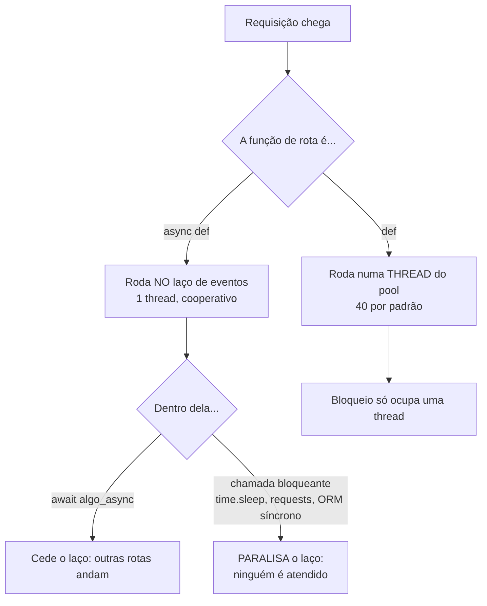

# 3. Async nativo, injeção de dependências e documentação automática

> ⏱️ ~1h30 · Módulo 15 · Pré-requisitos: [15.01](01-fastapi-pydantic.md), [15.02](02-sqlalchemy-alembic.md), [7.03 (asyncio)](../07-sincrono-assincrono/03-asyncio.md), [7.05 (WSGI e ASGI)](../07-sincrono-assincrono/05-wsgi-asgi.md), [6.10 (OpenAPI)](../06-apis-rest/10-versionamento-openapi.md)

> ✅ **Verificação.** Executado em 2026-11-09 (FastAPI 0.162.2, Uvicorn 0.54.0, 1 processo, máquina local). **Medido:** o experimento de 3 rotas (`scripts/async_demo.py` + `scripts/medir_async.py`), a inspeção do OpenAPI gerado, `/docs` e `/redoc` com HTTP 200. **Não medido:** comportamento sob carga real com banco (isso aparece na aula 06, com limitações), `Depends` com escopo de WebSocket, e a interface `/docs` num navegador (conferi o JSON `openapi.json`, não a tela).

## 🎯 Objetivos
- Explicar a diferença entre `async def` e `def` numa rota FastAPI e **medir** o que acontece com uma chamada bloqueante dentro de `async def`
- Montar **dependências** com `Depends` (parâmetros reutilizáveis, `yield` para abrir/fechar recursos, cadeias)
- **Trocar** uma dependência nos testes (`dependency_overrides`)
- Ler e melhorar o **OpenAPI/Swagger** gerado automaticamente, sabendo o que ele *não* documenta

## 🤔 Por que isso importa
"FastAPI é async, logo é mais rápido" é meia verdade perigosa: um único `time.sleep` ou uma consulta síncrona dentro de uma rota `async def` **trava o servidor inteiro**. Saber quando usar `async def` e quando `def` é o que separa quem usa o framework de quem o quebra. A injeção de dependências, por sua vez, é o que organiza autenticação, banco e configuração; em entrevista, "como funciona o `Depends`?" é pergunta certa. E a documentação automática é o que mais impressiona na primeira demonstração, mas tem limites que você precisa conhecer.

## 💡 Intuição (explicação simples)
Imagine **um garçom só** atendendo um salão (o *laço de eventos*). Se um cliente pede algo que demora e o garçom **fica parado esperando na cozinha**, ninguém mais é atendido: é a chamada bloqueante. Se ele deixa o pedido e **vai atender outra mesa enquanto a cozinha trabalha** (`await`), o salão flui. `async def` + `await` é o garçom que não fica parado. Já `def` comum é "chamar um **ajudante** (uma thread) para esperar por você": o garçom segue livre, mas há só 40 ajudantes. E as **dependências** são a bandeja pronta que a cozinha entrega junto com o pedido: "já vem com a sessão do banco aberta e o usuário identificado", sem a rota ter de montar isso.

## 🔬 Como funciona por dentro
**`async def` × `def` na rota**

Regras práticas:
1. Biblioteca **assíncrona** (`asyncpg`, `httpx.AsyncClient`, `aiosqlite`) → `async def` + `await`.
2. Biblioteca **bloqueante** (ORM síncrono, `requests`, `psycopg2`, cálculo pesado) → rota **`def`** (o FastAPI a joga num pool de threads), ou execute o trecho com `await asyncio.to_thread(...)`.
3. **Nunca** misture: bloqueante dentro de `async def` é o erro mais comum e mais caro.
4. Trabalho de **CPU** (calcular, comprimir, redimensionar imagem) não melhora com async nem com threads (GIL, aula 7.02): use processos ou uma fila (Celery, aula 7.06).

**Injeção de dependências (`Depends`).** Uma dependência é uma função (ou classe) cujos parâmetros o FastAPI resolve **antes** de chamar a rota, usando as mesmas regras de tipo (caminho, query, cabeçalho, outras dependências). Propriedades:
- **Composição**: uma dependência pode depender de outras (formando uma árvore resolvida por requisição).
- **Cache por requisição**: a mesma dependência usada duas vezes na árvore é executada **uma vez** (a menos que `use_cache=False`).
- **`yield`**: antes do `yield` = *setup*; depois = *teardown* (executado ao final da resposta, mesmo com exceção). É o `with` da requisição; perfeito para sessão de banco.
- **Substituição**: `app.dependency_overrides[original] = substituta` troca a dependência em testes, sem mexer na rota.

**Comparação com o Django.** O Django não tem DI: o equivalente está espalhado em middlewares (`request.user`), `permission_classes`/`authentication_classes` do DRF, `get_queryset`, `ATOMIC_REQUESTS`, `settings` globais. Funciona, mas a "ligação" é por **convenção e variáveis globais**; no FastAPI ela é **explícita na assinatura** (você vê o que a rota precisa). Em compensação, o Django entrega o conjunto pronto; no FastAPI você monta.

**Documentação automática.** O FastAPI monta o **OpenAPI 3.1** a partir das rotas, dos tipos e dos modelos Pydantic, e serve:
- `/docs` (Swagger UI) e `/redoc` (ReDoc), `/openapi.json` (o contrato bruto).
No Django, o equivalente é o `drf-spectacular` (aula 6.10): gera o mesmo tipo de contrato, mas é uma **extensão** que você instala e ajusta; no FastAPI vem de fábrica e é **sempre coerente com o código** porque a validação e a documentação nascem das mesmas anotações.

## 🛠️ Exemplo prático
**1. O experimento: três jeitos de "esperar 0,5 s"** (`scripts/async_demo.py`):
```python
@app.get("/async-correto")
async def async_correto():
    await asyncio.sleep(0.5)          # cede o laço
    return {"modo": "async def + await"}

@app.get("/sync-def")
def sync_def():
    time.sleep(0.5)                   # roda numa thread do pool
    return {"modo": "def (threadpool)"}

@app.get("/async-bloqueando")
async def async_bloqueando():
    time.sleep(0.5)                   # ERRO: bloqueia o laço inteiro
    return {"modo": "async def + time.sleep (bloqueia tudo)"}
```
```bash
uv run uvicorn scripts.async_demo:app --port 8820 &
uv run python scripts/medir_async.py http://localhost:8820 20
```
Saída real (20 requisições simultâneas a cada rota; depois 60):
```text
/async-correto       20 requisições concorrentes:   0.53 s
/sync-def            20 requisições concorrentes:   0.53 s
/async-bloqueando    20 requisições concorrentes:  10.02 s     <- 20 x 0,5 s: tudo em fila
(60 requisições)
/async-correto       60 requisições concorrentes:   0.59 s
/sync-def            60 requisições concorrentes:   1.11 s     <- 40 threads: 40 juntas + 20 na 2ª leva
/async-bloqueando    60 requisições concorrentes:  30.08 s
/ping sozinho:   1.3 ms
/ping durante 5 bloqueadoras:  2405 ms                          <- até a rota trivial ficou refém
```
Leitura: `async` correto e `def` empatam em 20 (a espera é a mesma, só muda o mecanismo); com 60, o `def` esbarra no **limite de 40 threads** (`anyio` confirma `40` de padrão) e o `async` não. O bloqueio dentro de `async def` multiplica o tempo por N **e** derruba as demais rotas (`/ping` de 1,3 ms para 2,4 s). Atenção: `ruff` com a regra `ASYNC` acusa isso (`ASYNC251: Async functions should not call time.sleep`); deixei um `# noqa` explícito **só** neste arquivo didático. Ligue a regra no seu projeto.

**2. Dependências do catálogo** (`app/db.py`, `app/security.py`, `app/pagination.py`):
```python
async def get_session() -> AsyncIterator[AsyncSession]:       # yield = setup/teardown
    async with SessionLocal() as session:
        yield session                                          # a rota usa; ao final, a sessão fecha

def is_staff(creds: Creds) -> bool:                            # depende de HTTPBearer
    if creds is None or not settings.api_token: return False
    return hmac.compare_digest(creds.credentials.encode(), settings.api_token.encode())

def require_staff(staff: Annotated[bool, Depends(is_staff)]) -> None:   # depende de is_staff
    if not staff: raise HTTPException(401, "Credenciais ausentes ou inválidas.", headers={"WWW-Authenticate": "Bearer"})

def page_params(page: Annotated[int, Query(ge=1)] = 1, page_size: Annotated[int, Query(ge=1)] = 20) -> PageParams: ...
```
Na rota, as dependências aparecem **na assinatura** (e a leitura da assinatura já diz o que ela exige):
```python
Session = Annotated[AsyncSession, Depends(get_session)]    # alias reutilizável
Staff   = Annotated[bool, Depends(is_staff)]

@router.get("/", response_model=Page[ProductOut])
async def list_products(request: Request, session: Session, staff: Staff, pg: Annotated[PageParams, Depends(page_params)], ...): ...

@router.post("/", status_code=201, dependencies=[Depends(require_staff)])   # exigência sem usar o valor
async def create_product(body: ProductIn, session: Session, response: Response): ...
```
Pontos de segurança que valem registrar: (a) a comparação do token usa `hmac.compare_digest` (tempo constante); (b) **token vazio no servidor = escrita fechada** (nunca "se não configurou, libera"); (c) um token errado **não** vira equipe nem produz erro, apenas o acesso público (testado). Este é um token de **serviço** simples, didático; autenticação de usuários de verdade (JWT/OAuth2) seria outro tópico (aula 6.06 para a ideia).

**3. Trocar a dependência nos testes** (`tests/conftest.py`):
```python
app.dependency_overrides[get_session] = _session      # a rota nem sabe que mudou o banco
...
app.dependency_overrides.clear()
```
O mesmo recurso substitui o usuário autenticado, o relógio, um cliente HTTP externo etc. Equivale ao `override_settings`/`APIClient.force_authenticate` do Django, mas por **injeção**, não por configuração global (aula 04).

**4. O que o OpenAPI gerou** (inspecionando `app.openapi()`):
```text
GET    /api/v1/products/                 security=[{'HTTPBearer': []}]  responses=['200','422']
POST   /api/v1/products/                 security=[{'HTTPBearer': []}]  responses=['201','422']
GET    /api/v1/products/{product_id}/    security=[{'HTTPBearer': []}]  responses=['200','422']
DELETE /api/v1/products/{product_id}/    security=[{'HTTPBearer': []}]  responses=['204','422']
GET    /api/v1/categories/               security=None                  responses=['200']
schemas: CategoryOut, HTTPValidationError, Page_ProductOut_, ProductIn, ProductOut, ValidationError
securitySchemes: HTTPBearer {type: http, scheme: bearer}
```
Três **imprecisões** que a geração automática deixou (e que você deve corrigir, ou ao menos conhecer):
1. Os `GET` aparecem como protegidos, mas a leitura é **pública** (o token é opcional e só amplia a visão): o OpenAPI não tem uma forma natural de dizer "opcional".
2. Os `401`, `404`, `409` e `400` **não** aparecem (só `200/201/204` e `422`): o FastAPI não conhece as exceções que você levanta. Declare com `responses={404: {"description": "..."}}`.
3. O `price` na **saída** é documentado como `string` (coerente com o JSON), e na **entrada** o schema aceita `number` **ou** `string` (`anyOf`). Testei o que acontece com número JSON: `10.1` vira `Decimal('10.1')` exato (o Pydantic lê o texto do JSON, sem passar por `float`) e `12345678.99` também; um número com 17 casas (`0.30000000000000004`) é recusado pelo `decimal_places`. Portanto o risco que eu esperava **não existe** neste caminho; ainda assim, o contrato mais claro é enviar o preço como texto.
No Django com `drf-spectacular` você tem o mesmo tipo de lacuna (e usa `@extend_schema` para preenchê-la). A documentação automática é um **ponto de partida**, não uma garantia.

**5. `/docs` e `/redoc`.** Ambos respondem **200**; o Swagger UI permite "Authorize" com o token e executar chamadas. Em produção, é comum **desligar** (`FastAPI(docs_url=None, redoc_url=None, openapi_url=None)`) ou proteger, para não expor o mapa da API; decida conforme a API seja pública ou interna.

## 🧠 Pausa para lógica
**Problema.** Uma rota `async def` precisa (1) consultar o PostgreSQL com `asyncpg` (30 ms), (2) chamar um serviço externo com `httpx.AsyncClient` (200 ms) e (3) calcular um relatório pesado de CPU (400 ms). (a) Quanto leva se feito em sequência? (b) E se (1) e (2) forem independentes e rodarem juntos? (c) O que acontece com **outras** requisições durante o passo (3), e o que fazer?

<details><summary>Dica</summary>Tempo com `asyncio.gather` = o da mais lenta. O cálculo de CPU não "espera": ele **ocupa** o processador.</details>

<details><summary>Solução comentada</summary>

(a) 30 + 200 + 400 = **630 ms**. (b) `gather` nos dois primeiros: max(30, 200) + 400 = **600 ms**. (c) O passo (3) roda no laço de eventos e **o bloqueia por 400 ms**: todas as outras requisições do processo param. Soluções: mover o cálculo para uma thread/processo (`await asyncio.to_thread(...)` ajuda para E/S bloqueante, mas para CPU pura o GIL limita; melhor um `ProcessPoolExecutor` ou, melhor ainda, uma **fila** (Celery) com o resultado entregue depois).
</details>

## ⚠️ Erros comuns e boas práticas
| Sintoma / erro | Causa | Correção |
|---|---|---|
| API "congela" sob carga leve; `/ping` demora segundos | chamada bloqueante dentro de `async def` | trocar por equivalente async ou mover a rota para `def`; ativar a regra `ASYNC` do `ruff` |
| `RuntimeWarning: coroutine '...' was never awaited` | faltou o `await` | `await` (ou `asyncio.create_task` conscientemente) |
| `MissingGreenlet` | lazy load do SQLAlchemy em async (aula 02) | carregar explicitamente |
| Sessão fechada antes da resposta serializar | objetos usados depois do `yield` terminar | serializar dentro da rota, ou `expire_on_commit=False` e retornar antes de fechar |
| `AsyncSession` usada em `asyncio.gather` | sessão **não** é segura para concorrência | uma sessão por tarefa concorrente |
| Dependência executa várias vezes | `use_cache=False` ou instâncias distintas | deixar o cache por requisição (padrão) |
| Pool de threads esgotado (40) | muitas rotas `def` lentas | aumentar o limite de threads ou migrar para async; escalar processos |
| `/docs` exposto em produção | padrão ligado | `docs_url=None`, ou proteger por rede/autenticação |
| `401` ausente no Swagger | exceção não declarada | `responses={401: {...}}` |
| Esperar que `async` acelere uma consulta lenta | async só ajuda a **esperar sem travar**, não faz a consulta mais rápida | índice, `EXPLAIN` (aula 14.04) |

**Boas práticas.** Decida por rota: biblioteca async → `async def`; bloqueante → `def`. Uma sessão por requisição via dependência com `yield`. Dependências pequenas e nomeadas (`Session`, `Staff`) como aliases `Annotated`. Documente respostas de erro. Teste `dependency_overrides` sempre limpando no fim.

## 🧩 Exercícios
**1. Fixação.** (a) O que faz uma rota `def` no FastAPI? (b) Por que bloqueio em `async def` é pior do que em `def`? (c) O que o `yield` numa dependência faz? (d) Como substituir o banco nos testes? (e) Cite uma lacuna do OpenAPI gerado.

<details><summary>Solução</summary>

(a) Roda numa thread do pool (40 por padrão), sem bloquear o laço. (b) Em `async def` o bloqueio ocupa o **único** laço (todas as requisições esperam); em `def` ocupa só uma thread. (c) Separa *setup* e *teardown* da requisição (abre/fecha a sessão). (d) `app.dependency_overrides[get_session] = outra`. (e) Respostas de erro (401/404/409) e o caráter opcional da autenticação não aparecem.
</details>

**2. Aplicação no projeto MiniShop.**
- [ ] Rode `async_demo` e `medir_async` e **reproduza** os três tempos (os seus serão parecidos, não idênticos)
- [ ] Faça `/async-bloqueando` virar correto de duas formas: `await asyncio.sleep` e `def` (comparando)
- [ ] Declare `responses={401: ..., 404: ...}` nas rotas de escrita e confira em `/openapi.json`
- [ ] Desligue `/docs` quando `CATALOG_ENV=production` (configuração em `app/config.py`), com teste
- [ ] Escreva uma dependência `request_id` que lê/gera `X-Request-ID` e a devolve no cabeçalho de resposta (compare com o middleware da aula 14.01)
- [ ] Commit `feat(catalog-fastapi): dependencies, documented responses and docs toggle`

**3. Desafio (opcional).** Faça `list_products` rodar a contagem e a página **em paralelo** com `asyncio.gather` (duas sessões). Funciona? Mede mais rápido? Explique por que numa mesma conexão não adiantaria e o que muda no pool.

## 🎤 Na entrevista
- **"Qual a diferença entre `async def` e `def` no FastAPI?"** — `async def` roda no laço de eventos e deve usar `await` com bibliotecas assíncronas; `def` roda numa thread do pool, adequado para código bloqueante. Misturar (bloqueante em `async def`) trava todas as requisições do processo.
- **"Como funciona a injeção de dependências?"** — Funções declaradas em `Depends(...)` têm seus parâmetros resolvidos pelo framework por requisição, em árvore, com cache por requisição; com `yield` fazem *setup/teardown*; em testes, `dependency_overrides` troca qualquer uma sem alterar a rota.
- **"FastAPI é mais rápido que Django?"** — Em tarefas de **E/S concorrente** (muitas esperas simultâneas) o modelo async brilha; numa API comum com banco, o ganho costuma ser pequeno e depende do restante (aula 06 mostra uma medição em que ficaram empatados). Velocidade bruta raramente é o critério de escolha.

## 📚 Para ir além
- 📄 Documentação oficial: [FastAPI — Concorrência e async/await](https://fastapi.tiangolo.com/async/). A explicação "hambúrguer" e quando usar cada um.
- 📄 Documentação oficial: [FastAPI — Dependências](https://fastapi.tiangolo.com/tutorial/dependencies/) e [dependências com `yield`](https://fastapi.tiangolo.com/tutorial/dependencies/dependencies-with-yield/).
- 📄 Documentação oficial: [Python — `asyncio` tarefas e `gather`](https://docs.python.org/3/library/asyncio-task.html) (em inglês).
- 📄 Documentação oficial: [Django — Suporte a async](https://docs.djangoproject.com/en/5.2/topics/async/). O que o Django faz (e o que ainda é síncrono por baixo).
- 📄 Documentação oficial: [FastAPI — Implantação](https://fastapi.tiangolo.com/deployment/). Workers, contêiner, proxy.
- 🏋️ Prática extra: repita o experimento com `uvicorn --workers 2` e explique por que o `/ping` melhora, mas o bloqueio continua um erro.

## ✅ Checklist da aula
- [ ] Sei escolher entre `async def` e `def` e **medi** o custo do bloqueio no laço
- [ ] Escrevo dependências com `Depends`, `yield` e aliases `Annotated`
- [ ] Troco dependências nos testes com `dependency_overrides`
- [ ] Leio o OpenAPI gerado e sei três coisas que ele não diz
- [ ] Sei que token vazio fecha a escrita e que a comparação é em tempo constante
- [ ] Sei que `async` não acelera uma consulta lenta
