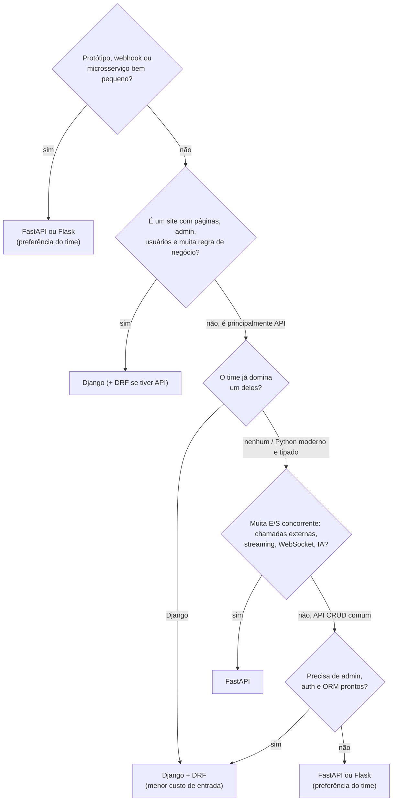

# 6. Comparativo e "quando escolher cada um"

> ⏱️ ~1h30 · Módulo 15 · Pré-requisitos: [15.01](01-fastapi-pydantic.md) a [15.05](05-fastapi-endpoints-catalogo.md), [8.05 (monolito × microsserviços)](../08-arquitetura/05-monolito-vs-microsservicos.md)

> ✅ **Verificação.** Executado em 2026-11-09 (Python 3.13.18, Django 5.2 do módulo 14, FastAPI 0.162.2, Flask 3.1.3, PostgreSQL 18.6 em contêiner, uvicorn de **1 processo** para cada API, cliente de carga na **mesma máquina**). **Medido:** latência e vazão da listagem do catálogo nas duas APIs (5 rodadas × 600 requisições, concorrência 1 e 20); contagem de linhas; um Flask mínimo (`POST` com validação manual, rodado com o cliente de testes). **Não medido, e não afirmo:** carga em produção, múltiplos processos, o catálogo com 200 mil linhas, ASGI síncrono vs. assíncrono no Django, consumo de memória, e qualquer coisa sobre Flask além do exemplo mínimo. A tabela "quando escolher" é **julgamento de engenharia**, não resultado de experimento.

## 🎯 Objetivos
- Comparar Django/DRF, FastAPI e Flask em **tipagem, validação, async, injeção de dependências, ORM, migrações, admin, autenticação, documentação e testes**
- Interpretar uma **medição de desempenho** sem tirar conclusões que ela não sustenta
- Decidir, com critérios explícitos, **qual framework escolher** para um cenário e justificar o *trade-off*
- Reconhecer a "armadilha do framework da moda" e o custo de **dois** frameworks no mesmo produto

## 🤔 Por que isso importa
A escolha de framework raramente é técnica pura: envolve **time, prazo, ecossistema, contratação e manutenção**. Júnior costuma ouvir "FastAPI é mais rápido" ou "Django é lento" como verdade; em entrevista, quem responde "depende de X, Y, Z" com **critérios** (e sabe quando os números não dizem nada) se destaca. Também protege você de reescrever um sistema inteiro por modismo.

## 💡 Intuição (explicação simples)
Escolher framework é escolher **ferramenta de cozinha**. O Django é uma **cozinha industrial montada**: fogão, bancada, geladeira e até o balcão de atendimento (admin, auth, ORM, migrações) já instalados; ótimo para abrir o restaurante rápido, mas você cozinha do jeito da cozinha. O FastAPI é uma **bancada com bons facões e uma chapa muito boa**: você monta o resto, mas fica leve e rápido de adaptar. O Flask é uma **faca e uma tábua**: máxima liberdade, e você traz tudo que não for faca. Ninguém pergunta "qual é a melhor ferramenta?", e sim "**o que vou cozinhar, para quantas pessoas e quem vai cozinhar**?".

## 🔬 Como funciona por dentro
**Comparativo por dimensão** (Django/DRF e FastAPI foram **implementados** aqui; sobre Flask há só um exemplo mínimo rodado)
| Dimensão | Django + DRF | FastAPI | Flask |
|---|---|---|---|
| Filosofia | "baterias incluídas" | focado em APIs, você escolhe o resto | micro: só o núcleo |
| Tipagem | opcional; DRF usa classes de campo | **central**: anotações guiam tudo | opcional, sem integração nativa |
| Validação | serializers (`validate_*`) | Pydantic (tipos + validadores) | manual ou extensões (marshmallow, pydantic) |
| Erro de validação | `400`, `{campo: [msgs]}`, em pt-br | `422`, lista com `loc/type/msg`, em inglês | o que você definir |
| Async | suporte parcial (views e ORM async; muita coisa ainda síncrona por baixo) | **nativo** (ASGI/Starlette) | suporte limitado a `async def` nas rotas |
| Injeção de dependências | não há (middlewares, `request.user`, mixins) | **`Depends`**, explícita e testável | não há (extensões, globais, `g`) |
| ORM | **Django ORM** integrado | **você escolhe** (SQLAlchemy típico) | você escolhe |
| Migrações | integradas (`makemigrations`/`migrate`) | Alembic (à parte; revisar o autogenerate) | Alembic/Flask-Migrate |
| Admin pronto | **sim** | não (há projetos de terceiros) | extensões |
| Autenticação | sessão, permissões e grupos prontos; JWT via pacote | blocos (`HTTPBearer`, OAuth2); lógica **sua** | extensões (Flask-Login, JWT) |
| Documentação da API | `drf-spectacular` (extensão) | **de fábrica** (`/docs`, `/redoc`) | extensões (flask-smorest etc.) |
| Testes | `APIClient`, `TestCase`, banco de teste automático | `httpx` + `dependency_overrides`; banco: você monta | `test_client()` |
| Segurança de fábrica | CSRF, XSS no template, headers, sessões, senhas | poucas; **você** configura CORS, headers, hashing | poucas; você configura |
| Servir HTML/templates | **sim** (maduro) | possível (Jinja2), não é o foco | sim |
| Curva de aprendizado | média/alta (muita coisa), mas guiada | baixa p/ começar; **async + DI exigem estudo** | baixa, e cresce com as extensões |
| Maturidade/ecossistema | muito grande, estável, longevo | jovem, crescendo rápido, muito ativo | grande e antigo |
| Convenções | fortes (todo projeto Django é parecido) | fracas (cada projeto organiza do seu jeito) | quase nenhuma |

**Linhas de código: uma comparação injusta que vale ler.** Os arquivos do catálogo no Django (`models`, `serializers`, `api`, `filters`, `estilos`, `pagination`) somam **263 linhas**; no serviço FastAPI, `app/` soma **463** (inclui `seed.py` 53, `frete.py` 26, `security.py`, `db.py`, `config.py`, `main.py`). **Não** conclua "Django escreve menos": o Django ali também faz imagem em S3, cache e permissões por grupo que o FastAPI **não** faz, e o admin e as migrações (autogeradas) estão fora da conta. O que a medida mostra é que o FastAPI pede mais **infraestrutura explícita** (sessão, segurança, paginação, seed) porque não vem pronta.

**Desempenho: o que medi e o que NÃO posso concluir.** `GET /api/v1/products/` (61 itens ativos, 20 por página, PostgreSQL 18.6 local, 1 processo `uvicorn` cada, Django em ASGI com `CONN_MAX_AGE=60`, **sem** limite de taxa no Django para a medição; `--log-level warning` no uvicorn, mas o Django ainda gravou o seu log JSON de acesso do módulo 14, o que **favorece** o FastAPI e mesmo assim deu empate), 600 requisições por rodada, 5 rodadas:
| Concorrência | Django (mediana das 5 rodadas) | FastAPI (mediana) | Faixa observada |
|---|---|---|---|
| 1 requisição por vez | **330 req/s**, p50 2,9 ms | **312 req/s**, p50 3,1 ms | Django 299–361; FastAPI 286–326 |
| 20 em voo | **469 req/s**, p50 ≈ 40 ms | **470 req/s**, p50 ≈ 41 ms | Django 447–530; FastAPI 402–501 |

Interpretação honesta: **empate prático**, com oscilação de ±10% entre rodadas. Isto não quer dizer "são iguais em tudo". Por quê o empate: (1) o tempo está em **uma consulta ao banco + serialização** de 20 objetos, coisas parecidas nos dois; (2) o cliente de carga roda na mesma máquina e disputa CPU; (3) 1 processo cada. O que **não** se testou: milhares de conexões ociosas (WebSocket, SSE), chamadas externas lentas (onde o async aparece, veja o experimento da aula 03: 20 requisições de 0,5 s em 0,53 s com `await` e 10,02 s com bloqueio), nem o Django em modo síncrono/WSGI com Gunicorn. **Lição:** o framework raramente é o gargalo de uma API com banco; o gargalo é a consulta, o índice, o cache, a rede.

**Flask: o que eu rodei.** Um `POST /itens` com validação feita à mão (mesmo contrato do `hello.py` da aula 01) e o cliente de testes do Flask 3.1.3:
```text
201 {'nome': 'Mouse', 'preco': '29.9'}
422 {'erros': {'nome': 'mínimo 2 caracteres', 'preco': 'número inválido'}}
404       <- GET /itens/abc: o conversor <int:item_id> não casa, e a rota nem existe para "abc"
```
Funciona e é curto, mas **a validação foi toda manual** (nenhum tipo a faz por você). Só isso foi executado; o restante da tabela sobre Flask vem da documentação e da experiência geral.

**Quando escolher cada um** (critérios, em ordem de importância)

| Cenário | Escolha provável | Por quê |
|---|---|---|
| Loja virtual completa (catálogo, carrinho, pedidos, painel) | **Django** | admin, auth, ORM, migrações e segurança prontos; o MiniShop é isso |
| API pública de um produto de dados/IA, com muitas chamadas externas ou *streaming* | **FastAPI** | async nativo, tipos, OpenAPI automático |
| Microsserviço pequeno e focado (um recurso, poucas rotas) | **FastAPI** ou **Flask** | pouca cerimônia |
| Sistema interno com formulários, relatórios e permissões por grupo | **Django** | admin e permissões já resolvem 70% |
| Protótipo de uma tarde, ou webhook simples | **Flask** ou **FastAPI** | começa rápido |
| Time sênior em Django, API CRUD para o app móvel | **Django + DRF** | custo de aprendizado zero |
| Time novo, sem legado, quer contrato tipado ponta a ponta | **FastAPI** | validação e documentação nascem do código |
| Migrar um Django maduro "porque FastAPI é mais rápido" | **Não migrar** (a menos que haja gargalo **medido**) | custo alto, ganho incerto (veja a medição) |

**Convivência.** É comum usar **os dois**: Django como núcleo (admin, regras, banco) e FastAPI para um serviço específico (ex.: ingestão em alta concorrência, API de leitura). O custo: dois conjuntos de dependências, deploys, logs, métricas, autenticação **compartilhada** e convenções; só vale se o ganho for claro. Antes, considere trazer o async para dentro do Django (views async, `httpx`, Celery para o pesado).

## 🛠️ Exemplo prático
**1. Reproduzir a medição.** Com PostgreSQL de laboratório (nome seu) e as duas APIs rodando (aula 05):
```bash
cd projeto/referencia-api-m15/catalog-fastapi
for r in 1 2 3 4 5; do
  uv run python scripts/carga.py http://localhost:8816/api/v1/products/ 600 20   # Django
  uv run python scripts/carga.py http://localhost:8815/api/v1/products/ 600 20   # FastAPI
done
# cada linha: "  469 req/s  p50=  40.2 ms  p95=  53.9 ms  falhas=0"
```
**Armadilha que invalidou minha primeira medição (guarde a lição).** O Django devolvia `429 Too Many Requests` em mais de 80% das requisições e o script mostrava `falhas=531..630`: o *throttling* do projeto (`100/hour` anônimo **e** `1000/hour` do `UserRateThrottle`, que também vale para anônimos por IP) estava ativo. Subir só `THROTTLE_ANON` **não** bastou: o limite `user` continuou. Para medir, usei um arquivo de configuração **temporário**, fora do projeto, que remove as classes de throttle (`DEFAULT_THROTTLE_CLASSES: []`). Sempre confira `falhas=0` e o código HTTP antes de confiar em qualquer número de latência: um `429` é muito mais rápido que um `200`, o que "melhorava" a latência do lado errado.

**2. Escrever a sua tabela de decisão.** Pegue três cenários da sua vida (projeto da faculdade, uma ideia sua, um sistema da empresa) e aplique o fluxograma, anotando o critério que decidiu. Salve em `15-fastapi-comparativo/comparativo.md` (já há uma versão resumida para consulta rápida).

**3. Conferir se vale migrar.** Pergunte, nesta ordem: Qual é o **problema medido**? (latência, custo, concorrência) → O gargalo é o framework ou o banco/rede? → Existe solução mais barata dentro do framework atual (índice, cache, Celery, view async)? → Quanto custa reescrever e re-testar? → Quem mantém? Só depois decida.

## 🧠 Pausa para lógica
**Problema.** Uma equipe diz: "FastAPI atende 10× mais requisições que Django; vamos migrar". Seus dados: `GET /products` leva 3 ms no app e 25 ms na consulta ao banco (total ≈ 28 ms por requisição, 1 processo). (a) Se o app ficasse 10× mais rápido (0,3 ms), qual seria o novo tempo total e o ganho? (b) E se o índice reduzisse a consulta de 25 ms para 0,5 ms? (c) Qual mudança gera mais ganho e qual custa menos? (d) Que dado faltou para decidir?

<details><summary>Dica</summary>Soma de tempos: a parte lenta domina o total (Lei de Amdahl).</details>

<details><summary>Solução comentada</summary>

(a) 0,3 + 25 = **25,3 ms**: ganho de ~10% (2,7 ms de 28). (b) 3 + 0,5 = **3,5 ms**: ganho de **~87%** (de 28 para 3,5). (c) O índice: muito mais ganho e custa uma linha de migração; a reescrita do framework custaria semanas. (d) O gargalo **medido** em produção (percentis, não médias), a concorrência real e o custo de infraestrutura; sem isso, é opinião. Reproduz a lição da aula 14.04: o `EXPLAIN` e o índice (20 ms → 0,044 ms) valeram mais que qualquer troca de servidor.
</details>

## ⚠️ Erros comuns e boas práticas
| Sintoma / erro | Causa | Correção |
|---|---|---|
| "Migramos por desempenho e nada melhorou" | gargalo era banco/rede, não o framework | medir antes (percentis, `EXPLAIN`, traços) |
| Benchmark com `falhas>0` ou 429 | limite de taxa/`ALLOWED_HOSTS` barrando | conferir status; desligar o limite **só** na medição |
| Comparar Django em modo `runserver` com FastAPI em `uvicorn` | servidores diferentes | comparar em condições equivalentes (ASGI/Gunicorn, mesmos workers) |
| Concluir de um teste de 600 requisições | amostra pequena, ruído de ±10% | várias rodadas, mediana, faixa; dizer o que não foi medido |
| Reescrever o que já funciona | modismo ("hype") | critério explícito + custo da migração |
| Dois frameworks sem dono | duplicação de auth, logs, deploy | documentar fronteiras e dono de cada serviço |
| FastAPI "sem admin": equipe reclama | expectativa de Django | planejar painel (ex.: ferramenta interna) ou manter o Django para isso |
| Segurança "de fábrica" presumida no FastAPI | o Django traz CSRF, headers, sessões; o FastAPI não | checklist de segurança (aula 9) aplicado ao novo serviço |
| `async def` com ORM síncrono | bloqueia o laço (aula 03) | driver async ou rota `def` |
| Falar "o melhor framework" em entrevista | não há | dizer "depende de..." e citar critérios |

**Boas práticas.** Decisão registrada (ADR, aula 8): contexto, opções, escolha, consequências. Experimento pequeno antes de decidir. Uma fatia migrada por vez, com teste de contrato. Não trocar de ferramenta por currículo.

## 🧩 Exercícios
**1. Fixação.** (a) Cite 3 coisas que o Django entrega e o FastAPI não. (b) E 3 que o FastAPI entrega "de fábrica" e o Django exige extensão. (c) Em que cenário o async nativo faz diferença real? (d) Por que um benchmark com 429 é inválido?

<details><summary>Solução</summary>

(a) Admin, ORM + migrações integrados, autenticação/permissões, proteções de segurança (CSRF etc.). (b) Documentação OpenAPI automática, validação por tipos (Pydantic) integrada à rota, injeção de dependências. (c) Muita espera de E/S concorrente (chamadas externas, WebSocket/streaming, serviços de IA). (d) Respostas de erro são rápidas e baratas, distorcendo a latência e a vazão; é preciso `falhas=0`.
</details>

**2. Aplicação no projeto MiniShop.**
- [ ] Reproduza a medição (5 rodadas, c=1 e c=20) com `falhas=0` e preencha **a sua** tabela (mediana e faixa)
- [ ] Reproduza a armadilha do `429` (deixe o throttle ligado) e registre o que o script mostra
- [ ] Complete `15-fastapi-comparativo/comparativo.md` com **três cenários seus** e o critério decisivo de cada
- [ ] Escreva um ADR de 10 linhas: "Adotar FastAPI para o serviço de X?" com contexto, opções, decisão e consequências
- [ ] Compare **linhas de código** do seu `PATCH` em cada framework e explique por que o número, sozinho, engana
- [ ] Commit `docs(m15): framework comparison and decision record`

**3. Desafio (opcional).** Acrescente uma rota `/frete-lento` que chama (via `httpx.AsyncClient`) um serviço falso de 200 ms, tanto no FastAPI quanto numa view **async** do Django, e meça 50 requisições concorrentes em cada. Repita com a view do Django **síncrona**. O que muda? (Eu **não** executei este experimento.)

## 🎤 Na entrevista
- **"Quando você escolheria FastAPI em vez de Django?"** — Para uma API focada, com muita E/S concorrente ou necessidade de contrato tipado e documentação automática, quando não preciso de admin/ORM/auth prontos ou o time já domina o ecossistema; para um sistema completo com admin, usuários e regras, Django.
- **"FastAPI é mais rápido que Django?"** — Em E/S concorrente pode ser, porque o modelo é async nativo; numa API comum dominada pelo banco, na minha medição ficou empatado (cerca de 330 vs 312 req/s sequenciais e 469 vs 470 com 20 em voo). O gargalo costuma ser consulta/índice/cache.
- **"Você migraria um sistema Django para FastAPI?"** — Só com gargalo medido que não se resolva dentro do Django (índice, cache, fila, view async) e com plano de migração por fatias e testes de contrato; por modismo, não.

## 📚 Para ir além
- 📄 Documentação oficial: [FastAPI — Alternativas, inspirações e comparações](https://fastapi.tiangolo.com/alternatives/). O que o autor aprendeu com Django, Flask e outros.
- 📄 Documentação oficial: [FastAPI — Concorrência e async/await](https://fastapi.tiangolo.com/async/).
- 📄 Documentação oficial: [Flask — Início rápido](https://flask.palletsprojects.com/en/stable/). Para ver a "faca e a tábua".
- 📄 Documentação oficial: [Django — Suporte a async](https://docs.djangoproject.com/en/5.2/topics/async/). O que já é async no Django.
- 📄 Documentação oficial: [DRF — Serializers](https://www.django-rest-framework.org/api-guide/serializers/) × [Pydantic — Modelos](https://docs.pydantic.dev/latest/concepts/models/).
- 🏋️ Prática extra: reescreva em FastAPI a rota `/health/ready/` do módulo 14 (incluindo a checagem do banco) e compare com a versão Django.

## ✅ Checklist da aula
- [ ] Sei comparar Django/DRF, FastAPI e Flask nas 10+ dimensões da tabela
- [ ] Meço antes de afirmar (`falhas=0`, várias rodadas, mediana e faixa) e sei dizer o que a medida **não** prova
- [ ] Aplico o fluxograma e justifico a escolha por critérios, não por modismo
- [ ] Sei o custo de manter dois frameworks e quando vale
- [ ] Entendo que o gargalo costuma ser banco/rede e que índice vale mais que trocar de servidor
