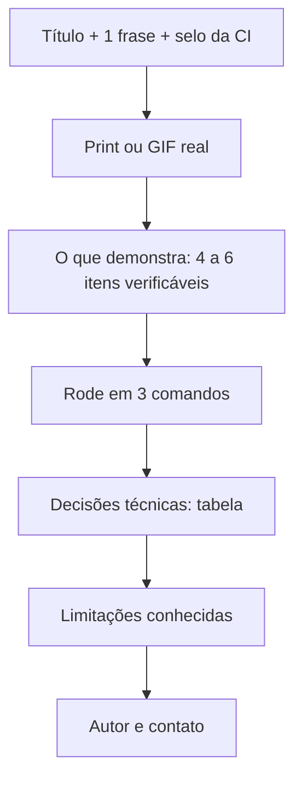

# 01. Portfólio e README (PT/EN)

> ⏱️ ~1h30 · Módulo 16 · Pré-requisitos: Módulos 12 e 14 (CI, Docker, observabilidade); `referencia-api-m14` pronta

## 🎯 Objetivos
Ao final desta aula você consegue:
- Explicar o que um(a) recrutador(a) procura em 2 minutos de GitHub
- Escrever um README em português e em inglês que permite rodar o projeto em 3 comandos
- Registrar decisões técnicas e limitações sem inflar o projeto
- Limpar o repositório (segredos, histórico, arquivos mortos) antes de torná-lo público
- Fixar até 6 repositórios no perfil com um critério claro

## 🤔 Por que isso importa
Júnior não tem experiência para mostrar; tem **evidência**. Quem avalia abre o perfil, olha o README do projeto principal por poucos minutos e decide se chama para a conversa. Um projeto bom com README ruim parece um projeto ruim.

## 💡 Intuição (explicação simples)
O README é a **vitrine** da loja: se a porta não abre (não roda), ninguém entra. Mostre o produto primeiro (o que faz), depois como experimentar (3 comandos), depois os bastidores (decisões) e, com honestidade, o que ainda não funciona.

## 🔬 Como funciona por dentro
Uma ordem que funciona, do mais para o menos lido:



Regras que valem ouro:
1. **Cada afirmação precisa de prova**: "341 testes" é verificável (`uv run pytest`); "código limpo" não é.
2. **Bilíngue sem duplicar manutenção**: `README.md` (PT) e `README.en.md`, com link cruzado no topo. Mantenha os dois curtos para que ficarem sincronizados seja viável.
3. **Limitações honestas** aumentam a confiança: quem avalia sabe que o gateway é simulado; esconder isso é o que queima.
4. **Print real**, do *seu* sistema rodando (a tela do `/api/docs/`). Nunca imagem de terceiros.
5. Segredos: `.env.example`, nunca `.env`.

## 🛠️ Exemplo prático
Os modelos estão em [`projeto/referencia-m16/portfolio/`](../projeto/referencia-m16/portfolio/README.pt-BR.modelo.md) (e [em inglês](../projeto/referencia-m16/portfolio/README.en.modelo.md)). Eles foram escritos a partir do MiniShop do módulo 14; antes de copiar, **confira cada número** contra o seu repositório. Conferi os que estão lá: `select_for_update` existe em `apps/orders/repositories.py`, a `Idempotency-Key` em `apps/orders/api.py`, e os 341 testes vêm do registro do marco do módulo 14 (não os reexecutei nesta aula: **rode você** `uv run pytest` e use o número que aparecer).

Checklist de limpeza antes de tornar público (rode no seu clone):

```bash
git log --all -p | grep -inE "password|secret|token|AKIA" | head   # algo real vazou no histórico?
git ls-files | grep -E "\.env$|\.sqlite3$|\.db$|__pycache__"        # arquivos que não deveriam estar versionados
uv run pytest -q && uv run ruff check .                              # o que o README promete, funciona?
```

Se achar um segredo **no histórico**, trocar o arquivo não basta: **revogue o segredo** (gere outro) — o antigo já foi exposto. Reescrever histórico é último recurso.

> 🔒 Neste curso o repositório `minishop` é **privado**. Tornar público é decisão sua, depois da limpeza acima. Faça isso conscientemente.

## 🧠 Pausa para lógica
Seu README diz "suporta 10 mil pedidos por minuto". Que **prova** você teria que anexar para a frase ser honesta? Como reescrevê-la se você nunca mediu?
<details><summary>Dica e solução</summary>

Dica: separe *medido* de *esperado*. Solução: anexar o script de carga, a máquina, o banco e os números (como na medição do módulo 15). Sem medição: "projetado para ser *stateless* e escalar horizontalmente; **não** foi medido sob carga".
</details>

## ⚠️ Erros comuns e boas práticas
- README com `<!-- TODO -->`, `SEU-USUARIO` esquecido, selo de CI apontando para o repositório errado (o selo fica cinza/quebrado).
- "Rode: `python manage.py runserver`" sem dizer dependências nem o `migrate`/`seed`: o clone limpo não funciona. **Teste num diretório novo.**
- Repositório com `node_modules`, `.venv` ou o banco local commitados.
- Commits "asdf", "fix", "fix2": prefira mensagens no imperativo (`Corrige baixa de estoque duplicada`).
- Copiar o README de um tutorial: o avaliador reconhece, e na entrevista perguntam sobre o que está escrito.

## 🧩 Exercícios
1. **(Fixação)** Liste 4 itens de um README que *não* são verificáveis e reescreva cada um como algo verificável.
2. **(Aplicação no MiniShop)** Escreva `README.md` e `README.en.md` do seu repositório.
   - [ ] Roda a partir de um clone novo seguindo só o README (teste de verdade)
   - [ ] Todo número do texto foi conferido por você
   - [ ] Print real do `/api/docs/`
   - [ ] Seção "Limitações conhecidas" com ≥ 3 itens
   - [ ] Sem segredos no histórico (comando acima)
3. **(Desafio)** Peça a alguém que nunca viu o projeto para rodá-lo em 10 minutos, sem ajuda. Anote onde travou e corrija o README.

<details><summary>Solução do exercício 1</summary>

"Código limpo" → "`ruff` e `mypy --strict` rodam na CI (selo verde)"; "seguro" → "senhas com Argon2, JWT de 15 min, 30 testes de permissão"; "rápido" → "listagem com 2 consultas SQL (sem N+1), verificado por teste"; "escalável" → "sem estado no processo web; sessões e cache no Redis".
</details>

## 🎤 Na entrevista
**"Me fale do seu projeto."** (Resposta de 60 s) O que é e para quem; o problema mais difícil que resolveu (estoque sem *overselling*); uma decisão e o motivo; o que faria diferente. Detalhe na aula 07.

**"O que você não terminou?"** Responda sem culpa e com plano: "o pagamento é simulado; para produção eu trocaria o adaptador e testaria o webhook em ambiente do provedor".

## 📚 Para ir além
- 📄 [GitHub Docs — Sobre READMEs](https://docs.github.com/pt/repositories/managing-your-repositorys-settings-and-features/customizing-your-repository/about-readmes) (verificado em 2026-11-09)
- 📄 [Fixar itens no seu perfil](https://docs.github.com/pt/account-and-profile/setting-up-and-managing-your-github-profile/customizing-your-profile/pinning-items-to-your-profile)
- 📑 [Conventional Commits](https://www.conventionalcommits.org/pt-br/v1.0.0/)
- 🏋️ Prática extra: abra o README de 3 projetos de que você gosta e anote o que os faz fáceis de entender.

## ✅ Checklist da aula
- [ ] README PT e EN publicados e testados em clone limpo
- [ ] Histórico sem segredos (ou segredo revogado)
- [ ] Perfil com até 6 repositórios fixados e um projeto principal claro
