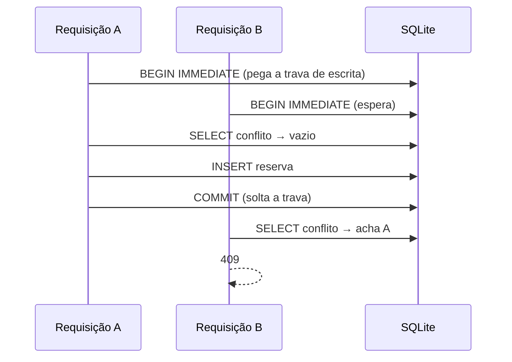

# 07. Desafio técnico simulado — parte 2 (API de reservas) e retrospectiva

> ⏱️ ~1h30 de leitura/correção + **3 h de execução do desafio** · Módulo 16 · Pré-requisitos: aula 06, Módulos 6, 10 e 15

## 🎯 Objetivos
Ao final desta aula você consegue:
- Modelar uma regra de sobreposição de intervalos e testá-la nas bordas
- Impedir condição de corrida (duas requisições disputando o mesmo horário) e **provar** com teste
- Tratar fusos horários sem ambiguidade
- Explicar uma estratégia de autenticação sem implementá-la
- Fazer uma retrospectiva e apresentar o MiniShop em 5 minutos

## 🤔 Por que isso importa
O segundo tipo clássico de desafio é uma API pequena com **uma regra de negócio traiçoeira**. Aqui são duas: a sobreposição e a concorrência. Quem corrige quer ver se você percebe que "checar e depois inserir" **não é atômico**.

## 💡 Intuição (explicação simples)
Duas pessoas olham a agenda ao mesmo tempo: "10h está livre". As duas escrevem. Resultado: reserva dupla. A solução é trancar a porta enquanto uma verifica **e** escreve, ou fazer o banco recusar a segunda.

## 🔬 Como funciona por dentro

- **Sobreposição:** dois intervalos `[a, b)` e `[c, d)` colidem se `a < d` **e** `b > c`. Com `<` e `>` estritos, "encostar" (termina às 10:00, outro começa às 10:00) é permitido.
- **Fusos:** o modelo aceita só `AwareDatetime` (com fuso), converte tudo para UTC e guarda o texto ISO; em UTC, comparar texto equivale a comparar instantes.
- **Em produção (PostgreSQL):** o banco impõe a regra com uma restrição de exclusão (`EXCLUDE USING gist (sala_id WITH =, tstzrange(inicio, fim) WITH &&)`). **Não executei isto** nesta aula; é a alternativa que eu estudaria.
- **Autenticação (explicada, não implementada):** login emite JWT curto (15 min) como no MiniShop; `responsavel` vem do token, não do corpo; só o dono (ou admin) cancela; 401 sem token e 403 sem permissão; limitar taxa em `POST /reservas`.

## 🛠️ Exemplo prático
Enunciado: [`take-home-2/ENUNCIADO.md`](../projeto/referencia-m16/take-home-2/ENUNCIADO.md). Referência: [`app/main.py`](../projeto/referencia-m16/take-home-2/app/main.py), [`app/db.py`](../projeto/referencia-m16/take-home-2/app/db.py) e [README](../projeto/referencia-m16/take-home-2/README.md) (FastAPI + SQLite, **13 testes**).

```bash
cd projeto/referencia-m16 && uv run pytest -q take-home-2
```
Os testes cobrem: sobreposição em 7 casos (incluindo encostar nos dois lados), regras de domínio (fim ≤ início, > 4 h, passado, sem fuso), fusos diferentes que colidem pelo mesmo instante (`-03:00` × UTC), cancelar (204/404) e a concorrência:

```python
def test_concorrencia_so_uma_vence(client, sala):
    # 20 threads disputam o MESMO horário
    ...
    assert sorted(codigos) == [201] + [409] * 19
```
**Experimento que mede se o teste presta** (teste de mutação manual): troquei `BEGIN IMMEDIATE` por `BEGIN` em `db.py` e rodei o teste 15 vezes. Resultado real: **falhou 12 vezes e passou 3**; com `BEGIN IMMEDIATE`, **passou 15 de 15**. Lição dupla: a trava resolve; e um teste de concorrência **pode passar por sorte**, então rode-o várias vezes antes de confiar (e corrigi o README da referência, que dizia "sempre falha"). Depois restaurei o arquivo e a suíte completa voltou a **57 passed**.

Entrada inválida vira erro de cliente, nunca 500: `GET /reservas?data=2026-13-45` → `422`.

## Retrospectiva do take-home (preencha em 20 min)
| Pergunta | Sua resposta |
|---|---|
| Quanto tempo planejei × gastei em cada parte? | |
| Que requisito entendi errado no início? | |
| Que teste pegou um bug meu? | |
| O que cortei e documentei? | |
| Se tivesse mais 1 hora, faria… | |

## Apresentação do MiniShop em 5 minutos
1. **(30 s)** O que é e o problema (loja com estoque correto sob concorrência).
2. **(1 min)** Arquitetura em um diagrama (Nginx → Django/DRF → PostgreSQL; Redis/Celery).
3. **(1 min 30 s)** Uma decisão difícil e o motivo (transação + trava no estoque; idempotência).
4. **(1 min)** Como você sabe que funciona (testes, CI, observabilidade).
5. **(30 s)** Limitações honestas (gateway simulado, AWS só em simulador).
6. **(30 s)** O que aprenderia a seguir.

Grave-se (áudio) e cronometre.

## 🧠 Pausa para lógica
A reserva A é 09:00–10:00 e B é 10:00–11:00. Seu colega usou `<=`/`>=` na comparação e B recebeu 409. Qual teste de uma linha teria pego isso?
<details><summary>Solução</summary>

Um caso de borda "encostar": reservar 09–10 e depois 10–11 na mesma sala e esperar `201`. A referência o tem na tabela dos 7 casos de sobreposição.
</details>

## ⚠️ Erros comuns e boas práticas
- "Checar e depois inserir" sem trava ou restrição no banco.
- Datas sem fuso, ou comparar `datetime` ingênuo com consciente (`TypeError: can't compare offset-naive and offset-aware datetimes`).
- Validar só no front-end; devolver 500 para entrada inválida.
- Dizer "tem autenticação" sem explicar como. Em take-home, **explique a estratégia** no README.
- Estourar o tempo com extras (paginação, Docker) antes do núcleo funcionar.

## 🧩 Exercícios
1. **(Fixação)** Desenhe a linha do tempo de 6 pares de intervalos e marque quais colidem; confira com a fórmula `a < d e b > c`.
2. **(Aplicação no MiniShop)** Refaça o desafio **sem olhar a referência**, 3 h, com FastAPI ou DRF.
   - [ ] Todas as rotas do enunciado
   - [ ] Sobreposição com borda "encostar"
   - [ ] Teste de concorrência rodado ≥ 10 vezes
   - [ ] Fusos tratados
   - [ ] README com decisões, limitações e a estratégia de autenticação
   - [ ] Retrospectiva preenchida
3. **(Desafio)** Migre a regra de sobreposição para PostgreSQL com restrição de exclusão e prove com um teste concorrente (use um contêiner **descartável com nome único**, sem tocar nos recursos do MiniShop).

<details><summary>Solução do exercício 1</summary>

Exemplos: [9,10) e [10,11) → não colidem (`b > c` é falso: 10 > 10); [9,11) e [10,12) → colidem; [9,12) contém [10,11) → colidem; [9,10) e [11,12) → não colidem.
</details>

## 🎤 Na entrevista
**"Como evita reserva dupla?"** Trava de escrita na verificação+inserção (ou restrição de exclusão no banco), e teste concorrente. **"E em vários servidores?"** A trava tem que estar **no banco**, não na memória do processo. **"Por que 409?"** O pedido é válido, mas conflita com o estado atual do recurso. **"Como testaria concorrência?"** Várias threads no mesmo horário, esperar exatamente um sucesso, e repetir várias vezes.

## 📚 Para ir além
- 📄 [SQLite — Transações (`BEGIN IMMEDIATE`)](https://www.sqlite.org/lang_transaction.html) (HTTP 200 em 2026-11-09)
- 📄 [PostgreSQL — Constraints de exclusão](https://www.postgresql.org/docs/current/ddl-constraints.html#DDL-CONSTRAINTS-EXCLUSION)
- 📄 [Pydantic — `AwareDatetime`](https://docs.pydantic.dev/latest/api/types/#pydantic.types.AwareDatetime)
- 🏋️ Prática extra: continue a trilha com um projeto seu (não do curso) em 2 semanas e publique.

## ✅ Checklist da aula
- [ ] Take-home 2 entregue (≤ 3 h) com teste de concorrência repetido
- [ ] Retrospectiva preenchida
- [ ] Apresentação de 5 minutos gravada e cronometrada
