# Treinamento: Dev Júnior Python Web

Do zero até uma vaga de **Desenvolvedor(a) Júnior Python para sistemas web**, construindo um único sistema real: o **MiniShop** (ver [projeto central](00-guia/projeto-central.md)).

- **Ritmo:** 1h30/dia, 5 dias/semana · **162 sessões · 243 h · 33 semanas**
- **Stack:** Python 3.13, Django 5.2 LTS + DRF, PostgreSQL 18, Redis, Docker, GitHub Actions, AWS; FastAPI como comparativo ([versões](00-guia/versoes.md))
- **Idioma:** explicações em PT-BR; código e commits em inglês

## Como usar
1. Leia [como estudar](00-guia/como-estudar.md) e faça o [setup](00-guia/setup-ambiente.md).
2. Siga o [cronograma](00-guia/cronograma.md), marcando as sessões.
3. Ao fim de cada módulo faça o `checkpoint.md` e crie a tag do [marco](projeto/marcos.md).

## Mapa da trilha

```mermaid
flowchart LR
    M0[0 Ambiente] --> M1[1 Python] --> M2[2 Web/HTTP] --> M3[3 Banco SQL] --> M4[4 Front]
    M4 --> M5[5 Django] --> M6[6 APIs REST] --> M7[7 Sync/Async] --> M8[8 Arquitetura]
    M8 --> M9[9 Segurança] --> M10[10 Qualidade] --> M11[11 Docker] --> M12[12 CI/CD]
    M12 --> M13[13 AWS] --> M14[14 Produção] --> M15[15 FastAPI] --> M16[16 Mercado]
```

## Módulos
| # | Módulo | Sessões | Horas |
|---|---|---|---|
| 0 | [Ambiente e ferramentas do dev](00-ambiente-ferramentas/README.md) | 6 | 9 h |
| 1 | [Python e lógica de programação](01-python-logica/README.md) | 20 | 30 h |
| 2 | [Como a web funciona](02-como-a-web-funciona/README.md) | 6 | 9 h |
| 3 | [Bancos de dados relacionais](03-banco-de-dados/README.md) | 13 | 19.5 h |
| 4 | [Front-end essencial para dev backend](04-front-end-essencial/README.md) | 9 | 13.5 h |
| 5 | [Framework web: Django](05-django/README.md) | 19 | 28.5 h |
| 6 | [APIs REST](06-apis-rest/README.md) | 15 | 22.5 h |
| 7 | [Comunicação síncrona e assíncrona](07-sincrono-assincrono/README.md) | 11 | 16.5 h |
| 8 | [Estrutura de projetos e arquitetura](08-arquitetura/README.md) | 8 | 12 h |
| 9 | [Segurança](09-seguranca/README.md) | 8 | 12 h |
| 10 | [Qualidade, testes e boas práticas](10-qualidade-testes/README.md) | 8 | 12 h |
| 11 | [Docker e containers](11-docker/README.md) | 7 | 10.5 h |
| 12 | [CI/CD](12-ci-cd/README.md) | 3 | 4.5 h |
| 13 | [Introdução à nuvem com AWS](13-aws/README.md) | 9 | 13.5 h |
| 14 | [Produção e observabilidade básica](14-producao-observabilidade/README.md) | 5 | 7.5 h |
| 15 | [FastAPI (comparativo)](15-fastapi-comparativo/README.md) | 7 | 10.5 h |
| 16 | [Pronto para o mercado](16-pronto-para-o-mercado/README.md) | 8 | 12 h |
| | **Total** | **162** | **243 h** |

## Guias
[Mercado](00-guia/o-que-o-mercado-pede.md) · [Versões](00-guia/versoes.md) · [Glossário](00-guia/glossario.md) · [Biblioteca](recursos/biblioteca.md) · [Entrevistas](recursos/perguntas-entrevista.md) · [Lógica](recursos/exercicios-logica.md) · [Competências → aulas](00-guia/competencias-aulas.md)
